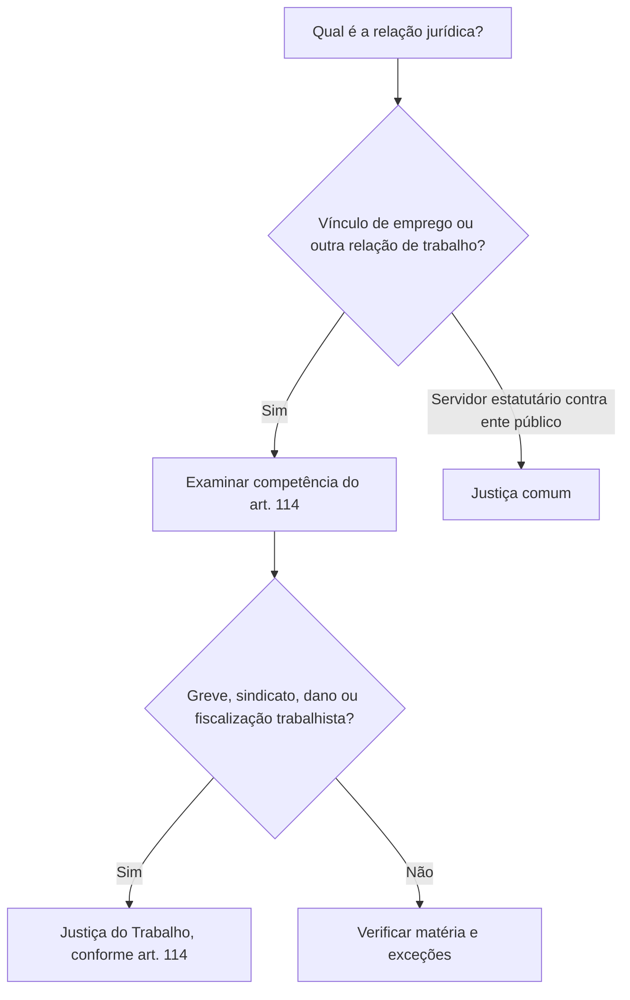

Este capítulo apresenta a estrutura da Justiça Federal e da Justiça do Trabalho e delimita as competências mais frequentes em prova. A primeira julga causas atribuídas à União e a outras entidades federais, além de matérias específicas previstas na Constituição; a segunda resolve conflitos decorrentes das relações de trabalho em sentido constitucional. O capítulo anterior tratou do STJ, que recebe recursos de ambas em situações determinadas. O ponto decisivo agora é identificar a matéria, as partes e as exceções antes de escolher o ramo judicial.

> [!objetivos]
> - Reconhecer os órgãos da Justiça Federal e sua organização territorial.
> - Identificar competências dos juízes federais e exceções relevantes.
> - Diferenciar a competência constitucional da Justiça do Trabalho.

## Estrutura da Justiça Federal

A Justiça Federal comum tem como órgãos os Tribunais Regionais Federais (TRFs) e os juízes federais. Cada Estado e o Distrito Federal constituem uma seção judiciária sediada na capital, com varas distribuídas conforme a lei. Os TRFs têm, no mínimo, sete juízes, recrutados, quando possível, na região. Um quinto dos lugares é destinado a advogados com mais de dez anos de atividade profissional e a membros do Ministério Público Federal com mais de dez anos de carreira. Os demais são preenchidos por promoção de magistrados federais após cinco anos no cargo, alternando-se os critérios de antiguidade e mérito.

A Constituição prevê justiça itinerante nos limites territoriais dos TRFs e permite que funcionem descentralizadamente, por câmaras regionais, para ampliar o acesso à justiça. Nos Territórios Federais, a jurisdição e as atribuições normalmente cometidas aos juízes federais cabem aos juízes da Justiça local, na forma da lei. A regra evita supor que todo território tenha necessariamente seção e vara federal com a mesma estrutura de um Estado.

> [!lei] CF, art. 106, e art. 105, § 1º, II
> Art. 106. São órgãos da Justiça Federal:
> I - os Tribunais Regionais Federais;
> II - os Juízes Federais.
> Art. 105. (...) § 1º Funcionarão junto ao Superior Tribunal de Justiça: (...)
> II - o **Conselho da Justiça Federal**, cabendo-lhe exercer, na forma da lei, a supervisão administrativa e orçamentária da Justiça Federal de primeiro e segundo graus, como órgão central do sistema e com poderes correicionais, cujas decisões terão caráter vinculante.

Exemplo: uma audiência federal itinerante pode ser realizada fora da sede da vara ou do tribunal dentro da jurisdição correspondente, aproximando o serviço judicial de comunidades distantes. A itinerância não cria uma jurisdição ilimitada: respeita os limites territoriais estabelecidos.

## Competência dos juízes federais

O art. 109 da Constituição reúne competências dos juízes federais. Em regra, julgam causas em que a União, autarquia federal ou empresa pública federal figure como autora, ré, assistente ou oponente, ressalvadas as exceções constitucionais. Não basta haver interesse político ou financeiro indireto da União. Sociedades de economia mista federais não estão incluídas automaticamente nessa regra: a Constituição menciona empresas públicas, e a jurisprudência diferencia as entidades.

Também cabem ao juízo federal as controvérsias entre Município ou residente no Brasil e Estado estrangeiro ou entidade internacional; igualmente, os casos baseados em ajuste internacional celebrado pela União. Na esfera penal, a Justiça Federal aprecia crimes políticos e delitos que afetem patrimônio, atividade ou interesse jurídico federal, sem incluir contravenções e respeitando os ramos especializados. A competência também abrange infrações com execução e resultado transfronteiriços, se presentes as condições previstas em tratado, além dos delitos contra a organização do trabalho nos limites constitucionais.

Outras matérias incluem disputas sobre direitos indígenas, causas relativas à nacionalidade e naturalização, e execução de carta rogatória após exequatur e de sentença estrangeira após homologação, nas condições previstas na Constituição. As causas previdenciárias podem ser processadas na Justiça estadual quando a comarca não for sede de vara federal, nos termos da lei, com recurso ao TRF. A Justiça Federal também julga mandados de segurança e habeas data contra ato de autoridade federal, excetuadas as hipóteses de competência dos tribunais federais.

| Situação | Regra geral | Atenção |
| --- | --- | --- |
| União, autarquia ou empresa pública federal como parte | Justiça Federal | Exceções constitucionais, como falência, acidente de trabalho e matérias eleitorais ou trabalhistas |
| Sociedade de economia mista federal | Em regra, Justiça estadual | Não se confunde com empresa pública federal |
| Contravenção penal | Não é julgada pelo juízo federal com base no art. 109, IV | Mesmo que haja interesse de entidade federal, observe a ressalva constitucional |
| Causa previdenciária em comarca sem vara federal | Pode tramitar na Justiça estadual, conforme a lei | Recurso dirigido ao TRF |

> [!exemplo]
> Uma ação contra empresa pública federal, em regra, tramita na Justiça Federal. Se a ré for sociedade de economia mista federal, como regra a competência não se desloca apenas por essa participação estatal; é preciso verificar outra hipótese constitucional específica.

> [!pegadinha]
> A Constituição exclui expressamente as contravenções da competência criminal federal descrita no art. 109, IV. Também ressalva causas de falência, acidentes de trabalho e matérias sujeitas às Justiças Eleitoral e do Trabalho na regra do inciso I.

## Prefeitos e a Súmula 206 do STJ

O foro para julgar prefeito por desvio ou aplicação irregular de verba depende da origem e do destino jurídico do recurso. A Súmula 208 do STJ orienta que compete à Justiça Federal processar e julgar prefeito por desvio de verba sujeita a prestação de contas perante órgão federal. Já a Súmula 209 atribui à Justiça estadual o julgamento quando a verba foi transferida e incorporada ao patrimônio municipal. A atenção pedida neste trecho é a Súmula 206: ela dispõe que a existência de vara federal na comarca não altera a competência da Justiça estadual para processar e julgar prefeito por desvio de verba transferida e incorporada ao patrimônio municipal.

O critério não é simplesmente “dinheiro originalmente federal”. Importa saber se a verba continuou sujeita à prestação de contas perante órgão federal ou se foi transferida de modo a integrar o patrimônio local. O enunciado da Súmula 206 trata da competência estadual apesar da presença de vara federal; não é regra sobre competência territorial dentro da Justiça Federal.

> [!jurisprudencia] STJ, Súmula 206
> Súmula 206/STJ: a existência de vara federal na comarca não altera a competência da Justiça estadual para processar e julgar prefeito por desvio de verba transferida e incorporada ao patrimônio municipal.

Exemplo: se um repasse federal foi incorporado ao patrimônio do município e a prestação de contas não permanece perante órgão federal, a competência tende a ser estadual conforme a súmula. Se há dever de prestar contas a órgão federal, a análise se dirige à competência federal, conforme a Súmula 208.

## Justiça do Trabalho

A Justiça do Trabalho compõe-se do Tribunal Superior do Trabalho (TST), dos Tribunais Regionais do Trabalho (TRTs) e dos juízes do Trabalho. O TST é composto por 27 ministros, escolhidos entre brasileiros com mais de 35 e menos de 70 anos, nomeados pelo Presidente da República após aprovação da maioria absoluta do Senado. Um quinto das vagas é preenchido por advogados e membros do Ministério Público do Trabalho com mais de dez anos de atividade ou carreira, respectivamente; os demais são juízes dos TRTs oriundos da carreira, indicados pelo próprio TST.

Os TRTs têm, no mínimo, sete juízes. A Constituição estabelece quinto constitucional e ascensão de magistrados trabalhistas por alternância entre tempo de serviço e mérito. A Justiça do Trabalho também deve instalar justiça itinerante e pode funcionar descentralizadamente por câmaras regionais.

O art. 114 atribui à Justiça do Trabalho ações oriundas da relação de trabalho, inclusive envolvendo entes de direito público externo e administração pública direta e indireta, nos limites constitucionais. Julga ações sobre exercício do direito de greve, representação sindical, conflitos entre sindicatos, indenização por dano moral ou patrimonial decorrente da relação de trabalho, penalidades administrativas impostas a empregadores por fiscalização trabalhista e execução de contribuições sociais decorrentes das sentenças que proferir. Ações entre servidor estatutário e Administração Pública não integram a competência trabalhista conforme a interpretação do STF para o art. 114, I.

> [!esquema]

> [!pegadinha]
> Justiça do Trabalho não é sinônimo de justiça para todo litígio que envolva trabalho. A relação jurídica e a natureza do vínculo importam; servidor estatutário e Administração Pública não são deslocados à Justiça do Trabalho apenas pela prestação de serviço.

### Matérias que não se confundem

A competência federal pode decorrer da qualidade de uma das partes ou da matéria definida pela Constituição. São fundamentos diferentes. Uma disputa sobre direito indígena é federal mesmo que a União não figure formalmente como autora ou ré. Em sentido oposto, a presença de entidade federal pode levar à Justiça Federal em causa cível, mas existem exceções expressas, e uma empresa de economia mista não se equipara automaticamente à empresa pública.

Na área criminal, o interesse federal precisa ser concreto e enquadrar-se nas hipóteses constitucionais. Crime contra bem ou serviço da União pode ser federal; crime praticado por servidor federal não se torna federal apenas pela qualidade do autor. Crimes políticos são julgados por juiz federal, mas o recurso ordinário correspondente é dirigido ao STF. A competência para contravenções não integra a regra do art. 109, IV. Essa combinação de crime político, crime federal e recurso aparece em itens que trocam órgão de primeiro grau e tribunal de recurso.

> [!bizu]
> Para o art. 109, faça duas perguntas: existe parte federal relevante ou matéria expressamente federal? Depois procure a exceção e identifique o órgão recursal indicado pela Constituição.

O inciso V trata de infrações previstas em tratado ou convenção internacional quando houver transnacionalidade nos termos constitucionais: início da execução em um país e resultado ocorrido ou pretendido no outro, ou o inverso. A referência a tratado, sozinha, não federaliza toda infração. Também há competência federal para crimes contra a organização do trabalho e para crimes cometidos a bordo de navios ou aeronaves, ressalvadas as exceções constitucionais.

### A Justiça do Trabalho em casos concretos

A expressão “relação de trabalho” é mais ampla que emprego celetista, mas não alcança toda causa em que alguém trabalhe. O art. 114 enumera matérias e o STF delimitou a interpretação para vínculos jurídico-administrativos. Ações entre sindicato e empregador sobre representação coletiva, greve e indenização por danos ligados ao trabalho podem ser trabalhistas; litígio entre servidor estatutário e ente público sobre vínculo funcional segue à Justiça comum.

A Justiça do Trabalho executa de ofício contribuições sociais decorrentes das sentenças que proferir, observada a extensão constitucional. Não executa qualquer tributo relacionado ao empregador nem toda contribuição em abstrato. Também processa ações relativas a penalidades administrativas impostas aos empregadores por órgãos de fiscalização das relações de trabalho.

| Demanda | Ramo normalmente competente | Razão |
| --- | --- | --- |
| Empregado celetista cobra verbas do empregador | Justiça do Trabalho | Relação de emprego |
| Servidor estatutário discute vantagem funcional com Estado | Justiça comum | Vínculo jurídico-administrativo |
| Ação sobre greve em atividade privada | Justiça do Trabalho | Art. 114, II |
| Mandado de segurança contra autoridade federal | Justiça Federal ou tribunal competente | Autoridade e grau definem competência |

> [!exemplo]
> Uma técnica de enfermagem contratada pela CLT por hospital municipal ajuíza ação para cobrar horas extras: a relação é trabalhista. Uma servidora efetiva que pede revisão de vantagem estatutária discute vínculo administrativo, ainda que execute atividade laboral.

A Constituição também prevê que os TRTs instalem justiça itinerante e funcionem por câmaras regionais. Essas medidas organizam o acesso e a prestação jurisdicional; não mudam, por si, a competência material. O Conselho Superior da Justiça do Trabalho exerce supervisão administrativa, orçamentária, financeira e patrimonial no âmbito da Justiça do Trabalho de primeiro e segundo graus, conforme o art. 111-A, § 2º, II.

### Recursos e órgãos de cúpula

As decisões dos juízes federais são, em regra, revistas por TRF, dentro de sua região. Os TRFs também julgam originariamente determinadas causas e recursos, conforme os arts. 108 e 109. As decisões dos TRFs podem chegar ao STJ em recurso especial ou ordinário, ou ao STF se presentes os requisitos de recurso extraordinário. Não se deve saltar automaticamente do juiz federal ao STJ.

No âmbito trabalhista, os juízes do Trabalho exercem a jurisdição de primeiro grau; os TRTs revisam sentenças e exercem competências originárias previstas; o TST exerce a uniformização nacional da legislação laboral nos limites recursais. O TST não é uma instância de reexame irrestrito de fatos. A composição do Tribunal também é matéria literal: 27 ministros, nomeados pelo Presidente após aprovação da maioria absoluta do Senado.

A Constituição dispõe que o TST funciona junto ao Conselho Superior da Justiça do Trabalho e à Escola institucional de capacitação e aperfeiçoamento da magistratura trabalhista. O Conselho Superior exerce coordenação administrativa, financeira, orçamentária e patrimonial dos órgãos trabalhistas regionais e de primeiro grau, e suas decisões têm efeito vinculante nos termos constitucionais. A Escola regulamenta cursos oficiais para ingresso e promoção na carreira. São funções administrativas e de formação, não competência para julgar recurso individual.

> [!atencao]
> Se o item afirma que o CNJ ou o Conselho Superior substitui os tribunais na função jurisdicional, a afirmação troca controle administrativo por julgamento de causas.

A Justiça Federal possui órgãos de apoio também vinculados ao STJ: o Conselho da Justiça Federal supervisiona administração e orçamento dos graus iniciais e regionais; a Escola Nacional de Formação e Aperfeiçoamento de Magistrados disciplina cursos oficiais da magistratura. O vínculo orgânico com o STJ não transforma esses conselhos em tribunais de recurso.

Uma regra útil para casos do cotidiano é identificar a relação jurídica primária. Contrato de trabalho privado aponta para Justiça do Trabalho; ato administrativo federal impugnado por particular pode apontar à Justiça Federal; litígio que envolva órgão eleitoral ou militar requer examinar a competência especializada. Nem o local de trabalho nem o vínculo indireto com o governo resolvem a competência isoladamente. O ramo judicial é escolhido pela causa e pelas regras constitucionais, não apenas pelo endereço do empregador.

O modo correto de raciocinar não é decorar apenas o nome do ramo judicial. Um acidente no trabalho pode gerar ação trabalhista, mas eventual benefício previdenciário segue a competência própria da matéria previdenciária. Um ato de agente federal pode ser impugnado perante a Justiça Federal, mas um vínculo celetista com empresa estatal leva à análise da relação trabalhista. A banca procura induzir o candidato a usar uma característica isolada e esquecer a causa de pedir.

## Mapa do capítulo

| Ramo | Órgãos | Chave de competência |
| --- | --- | --- |
| Justiça Federal | TRFs e juízes federais | Partes federais e matérias do art. 109, com ressalvas |
| Justiça do Trabalho | TST, TRTs e juízes do Trabalho | Relações e matérias do art. 114 |
| Súmula 206/STJ | Justiça estadual | Verba municipal incorporada ao patrimônio local, mesmo havendo vara federal |

| Autoridade ou vínculo | Indicador principal | Ramo a examinar|
|---|---|---|
| Órgão da União em causa cível | Parte federal e exceção aplicável | Justiça Federal|
| Trabalhador contratado pela CLT | Relação de emprego | Justiça do Trabalho|
| Servidor estatutário | Relação jurídico-administrativa | Justiça comum|
| Questão de eleição | Matéria eleitoral especializada | Justiça Eleitoral|

O cuidado prático é verificar primeiro o pedido e a relação jurídica. Só depois se examina quem são as partes e se há ressalva. Essa ordem diminui erros em casos que mencionam simultaneamente União, município, servidor e empresa estatal.

| Matéria | Pergunta | Resultado|
|---|---|---|
| Trabalho | O vínculo é estatutário? | Se sim, Justiça comum|
| Verba municipal | Foi incorporada ao patrimônio local? | Pode incidir Súmula 206|
| Crime federal | Há competência expressa? | Aplicar art. 109, sem ampliar por analogia|
| Região | Onde está a seção judiciária? | Define a organização territorial|

### Para fixar
- A Justiça Federal comum tem TRFs e juízes federais.
- O TRF tem no mínimo sete juízes.
- Empresa pública federal e sociedade de economia mista não recebem tratamento idêntico no art. 109, I.
- Contravenções estão excluídas da competência do art. 109, IV.
- A Súmula 206/STJ preserva a competência estadual para verba municipal incorporada.
- A Justiça do Trabalho é formada por TST, TRTs e juízes do Trabalho.
- O TST tem 27 ministros.
- Servidor estatutário contra Administração Pública não é caso da Justiça do Trabalho, conforme interpretação do STF.
