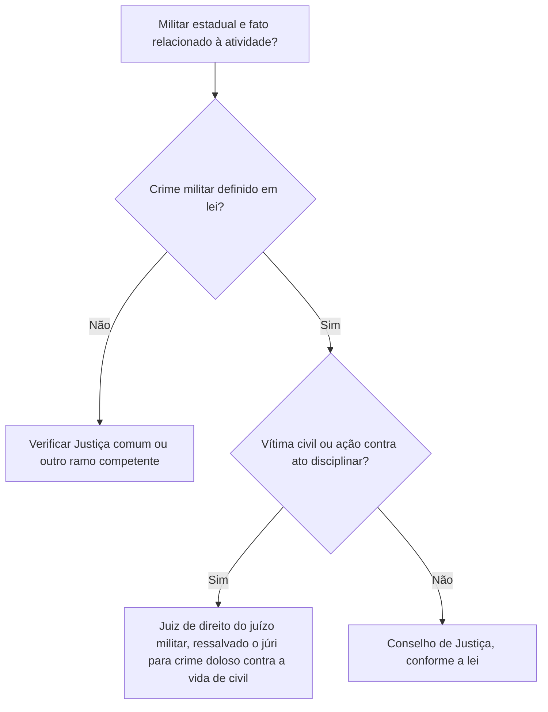
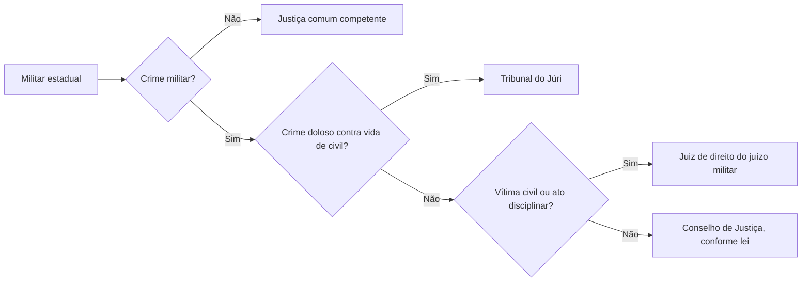

As Justiças Eleitoral e Militar são ramos especializados, cada qual com órgãos, composição e competências constitucionais próprias. Este capítulo também examina os tribunais e juízes estaduais, inclusive a Justiça Militar estadual. A comparação é especialmente útil: a Justiça Militar da União julga crimes militares definidos em lei, enquanto a Justiça Militar estadual julga militares dos Estados nos limites constitucionais. O capítulo anterior tratou da Justiça Federal e do Trabalho; agora, a pergunta central é qual ramo possui competência especializada para a causa.

> [!objetivos]
> - Reconhecer os órgãos da Justiça Eleitoral e da Justiça Militar.
> - Comparar a Justiça Militar da União e a Justiça Militar estadual.
> - Identificar a organização constitucional dos tribunais estaduais.

## Justiça Eleitoral

São órgãos da Justiça Eleitoral o Tribunal Superior Eleitoral (TSE), os Tribunais Regionais Eleitorais (TREs), os juízes eleitorais e as juntas eleitorais. A Constituição determina que a lei complementar disponha sobre a organização e competência dos tribunais, juízes e juntas. Assim, o texto constitucional indica a estrutura, enquanto a legislação eleitoral detalha atribuições e procedimentos.

O TSE compõe-se de, no mínimo, sete membros: três dentre ministros do STF, dois dentre ministros do STJ e dois advogados de reconhecida capacidade jurídica e conduta ilibada, escolhidos a partir de indicação do STF e nomeados pelo Presidente da República. A presidência e vice-presidência cabem a ministros do STF; a corregedoria, a ministro do STJ. Cada Estado e o Distrito Federal têm um TRE. A Constituição ainda prevê regras para escolha de seus membros, incluindo magistrados, advogado e juiz federal, conforme a composição constitucional.

Uma característica importante é a irrecorribilidade das decisões do TSE, ressalvadas as hipóteses constitucionais: decisões que contrariem a Constituição ou deneguem habeas corpus ou mandado de segurança podem ser recorridas ao STF. Já as decisões dos TREs só admitem recurso nas hipóteses do art. 121, § 4º (como inelegibilidade e perda de mandato federal ou estadual).

> [!lei] CF, art. 118, e art. 121, caput e § 3º
> Art. 118. São órgãos da Justiça Eleitoral:
> I - o Tribunal Superior Eleitoral;
> II - os Tribunais Regionais Eleitorais;
> III - os Juízes Eleitorais;
> IV - as Juntas Eleitorais.
> Art. 121. **Lei complementar** disporá sobre a organização e competência dos tribunais, dos juízes de direito e das juntas eleitorais. (...)
> § 3º - São irrecorríveis as decisões do Tribunal Superior Eleitoral, salvo as que contrariarem esta Constituição e as denegatórias de habeas corpus ou mandado de segurança.

> [!pegadinha]
> O TSE não é composto exclusivamente por ministros do STF. Sua composição reúne ministros do STF, do STJ e advogados, segundo a proporção constitucional.

## Justiça Militar da União

A Justiça Militar da União tem como órgãos o Superior Tribunal Militar (STM) e os tribunais e juízes militares instituídos por lei. Compete-lhe processar e julgar os crimes militares definidos em lei. A Constituição não limita essa competência a réus integrantes das Forças Armadas: a definição legal do crime militar e as regras de competência devem ser examinadas para cada caso. O STM compõe-se de 15 ministros vitalícios, nomeados pelo Presidente da República após aprovação do Senado: dez oficiais-generais das Forças Armadas, distribuídos entre Marinha, Exército e Aeronáutica, e cinco civis. Entre os civis há três advogados e dois escolhidos, de forma paritária, entre magistrados de primeiro grau e integrantes da Promotoria Militar, observados os requisitos constitucionais.

> [!lei] CF, art. 124
> Art. 124. À Justiça Militar compete processar e julgar os **crimes militares definidos em lei**.
> Parágrafo único. A lei disporá sobre a organização, o funcionamento e a competência da Justiça Militar.

Exemplo: para decidir se um fato praticado por civil contra bem ou serviço militar é da Justiça Militar, não basta perguntar se o acusado é militar. É necessário analisar o tipo legal e a hipótese de crime militar, além da competência prevista na legislação. A condição pessoal do agente, isoladamente, não resolve todos os casos.

> [!atencao]
> Justiça Militar da União não se confunde com Justiça Militar estadual. A primeira tem competência constitucional para crimes militares definidos em lei; a estadual julga militares estaduais nos limites do art. 125, §§ 4º e 5º.

## Tribunais e juízes dos Estados

Cada Estado organiza seu próprio ramo judiciário dentro dos limites fixados pela Constituição Federal. A Constituição estadual define atribuições da Corte de Justiça; ao Tribunal compete iniciar o projeto da lei de organização judiciária. A Corte também pode propor ao Legislativo medidas sobre cargos, remuneração dos serviços auxiliares, estrutura administrativa e provimento de funções na forma constitucional. Lei estadual de iniciativa do Tribunal pode instituir órgão de Justiça Militar.

O Tribunal de Justiça pode funcionar descentralizadamente por câmaras regionais e deve instalar justiça itinerante, nos limites territoriais de sua jurisdição, para ampliar o acesso à Justiça. O quinto constitucional também se aplica aos tribunais estaduais com mais de dez julgadores: um quinto dos lugares é reservado integrantes do Ministério Público com carreira superior a dez anos e profissionais da advocacia com mais de dez anos de atividade profissional, notório saber jurídico e reputação ilibada, indicados em lista sêxtupla pelas entidades de classe.

O foro por prerrogativa de função de autoridades estaduais deve respeitar a Constituição Federal e a interpretação do STF. A constituição estadual não pode ampliar livremente as hipóteses de competência originária do Tribunal de Justiça para criar foro não autorizado pelo modelo constitucional. Em mandado de segurança contra ato de autoridade, a competência também deve derivar de regra constitucional válida; não é matéria que possa ser criada livremente por regimento interno, pois envolve competência jurisdicional.

> [!jurisprudencia] STF, Súmula Vinculante 10
> A Súmula Vinculante 10 do STF protege a reserva de plenário: órgão fracionário de tribunal não pode afastar a incidência de lei ou ato normativo, no todo ou em parte, por fundamento constitucional sem observar o art. 97 da Constituição. É uma regra relevante para a organização e o funcionamento dos tribunais.

## Justiça Militar estadual

Os Estados podem criar Justiça Militar estadual, mediante lei de iniciativa do Tribunal de Justiça. Ela é constituída, na instância inicial, por magistrados togados e colegiados de Justiça; na revisão, pelo Tribunal de Justiça ou por corte militar própria nos Estados em que o efetivo militar seja superior a 20 mil integrantes. A Constituição permite, portanto, um tribunal militar próprio somente quando ultrapassado esse patamar de efetivo.

A jurisdição estadual alcança integrantes das corporações militares estaduais em ilícitos sujeitos à legislação castrense. Também examina impugnações de sanções disciplinares. Se militar estadual for acusado de crime doloso contra a vida de pessoa civil, o Tribunal do Júri julga o caso. A declaração judicial de perda de posto e patente de oficial ou de graduação de praça cabe à autoridade jurisdicional definida no modelo constitucional. O juiz togado aprecia, individualmente, demanda disciplinar e infração que envolva civil fora da alçada do júri; os órgãos colegiados militares decidem as demais infrações conforme a lei.

Há distinções essenciais: a existência de um Tribunal de Justiça Militar depende de efetivo superior a 20 mil militares; abaixo desse limiar, o segundo grau cabe ao Tribunal de Justiça. A competência penal da Justiça Militar estadual é dirigida aos militares estaduais; não se deve estender a competência do art. 125, § 4º, a civis. Em crime doloso contra a vida de civil, a Constituição ressalva expressamente a competência do Tribunal do Júri.

> [!pegadinha]
> O limite constitucional é “superior a 20 mil”, e não “igual ou superior a 20 mil”. Com efetivo exatamente igual a 20 mil, a Constituição não autoriza tribunal militar próprio por esse critério.

### Composição e funcionamento eleitoral

A composição plural dos órgãos eleitorais procura combinar experiência de magistrados de diferentes ramos e participação da advocacia. No TSE, a presidência e a vice-presidência são exercidas por ministros oriundos do STF, e a corregedoria eleitoral cabe a ministro do STJ. Nos TREs, integram o colegiado desembargadores do Tribunal de Justiça, juízes de direito, juiz federal quando houver, e dois advogados. A escolha dos advogados segue lista elaborada pelo Tribunal de Justiça e nomeação presidencial. Os mandatos têm duração definida pela Constituição, com possibilidade de recondução limitada.

O caráter especializado da Justiça Eleitoral não elimina o controle pelo STF. A irrecorribilidade das decisões do TSE é regra, mas não absoluta. Nas hipóteses do art. 121, § 3º e § 4º, cabe recurso. Para a prova, leia o tipo de decisão e a eleição envolvida: várias hipóteses de recurso ao TSE dependem de eleição federal ou estadual, e há regras específicas para decisões dos TREs.

### Justiça Militar: primeiro e segundo graus

A Constituição remete à lei a organização dos tribunais e juízes militares da União. Na Justiça Militar estadual, em primeiro grau atuam juízes de direito do juízo militar e Conselhos de Justiça. O juiz de direito julga singularmente crime militar contra civil e ação contra ato disciplinar; os Conselhos julgam os demais crimes militares, nos termos legais. No segundo grau atua o Tribunal de Justiça ou, se o efetivo militar estadual ultrapassar 20 mil integrantes, Tribunal de Justiça Militar criado por lei de iniciativa do Tribunal de Justiça.

A ressalva do júri diz respeito a crimes dolosos contra a vida de civil praticados por militar estadual. Nessa hipótese, a competência é do Tribunal do Júri. A norma não significa que toda infração com vítima civil vá ao júri: é necessário o elemento doloso contra a vida. Nos demais crimes militares contra civis, o julgamento singular cabe ao juiz de direito do juízo militar, observadas as normas legais.

| Situação | Quem julga em primeiro grau? | Nota |
| --- | --- | --- |
| Crime militar estadual contra civil, sem ser doloso contra a vida | Juiz de direito do juízo militar | Competência singular prevista no art. 125, § 5º |
| Crime doloso contra a vida de civil praticado por militar estadual | Tribunal do Júri | Exceção expressa à Justiça Militar estadual |
| Demais crimes militares estaduais | Conselho de Justiça | Conforme organização legal |
| Ação judicial contra ato disciplinar militar | Juiz de direito do juízo militar | Competência expressa do § 5º |

A decisão sobre perda do posto e da patente de oficial pertence ao tribunal competente, e a perda da graduação de praça pode ser decidida pelo tribunal competente nos termos constitucionais. Não confunda a sanção administrativa disciplinar com a perda judicial do posto, patente ou graduação. A Administração pode aplicar sanções previstas em lei, mas a consequência funcional de perda segue o procedimento e a autoridade definidos pela Constituição e pela legislação.

> [!exemplo]
> Um policial militar acusado de homicídio doloso contra civil será submetido ao Tribunal do Júri. Se acusado de delito militar contra patrimônio de civil que não envolva crime doloso contra a vida, a competência segue a regra da Justiça Militar estadual e o julgamento singular pelo juiz de direito, conforme o caso.

### Justiça comum estadual e autonomia

A Justiça estadual possui competência residual: aprecia as matérias que não foram atribuídas à Justiça Federal ou às Justiças especializadas, observadas as competências originárias constitucionais. A Constituição estadual organiza o Tribunal de Justiça dentro das balizas federais. A lei de organização judiciária detalha divisão territorial, varas e serviços, mas não pode contrariar competências fixadas no texto constitucional. Regimento interno ordena o funcionamento do tribunal, sem criar novas hipóteses de competência originária.

> [!bizu]
> Competência jurisdicional precisa de fundamento constitucional ou legal válido. “Matéria interna corporis” não autoriza regimento a retirar causa de juiz natural e criar foro novo.

## Mapa do capítulo

| Ramo | Órgãos ou estrutura | Competência-chave |
| --- | --- | --- |
| Eleitoral | TSE, TREs, juízes e juntas | Organização e competência detalhadas por lei complementar |
| Militar da União | STM e tribunais/juízes militares | Crimes militares definidos em lei |
| Justiça estadual | Tribunais e juízes estaduais | Organização estadual dentro dos princípios constitucionais |
| Militar estadual | Juiz de direito, Conselhos e, se cabível, TJM | Militares estaduais e atos disciplinares nos limites do art. 125 |

### Para fixar
- O TSE tem no mínimo sete membros.
- O TSE reúne integrantes do STF, STJ e advocacia.
- A Justiça Militar da União julga crimes militares definidos em lei.
- O STM tem 15 ministros vitalícios.
- A Justiça Militar estadual pode ser criada por lei de iniciativa do Tribunal de Justiça.
- Tribunal de Justiça Militar estadual exige efetivo superior a 20 mil militares.
- A Justiça Militar estadual julga militares dos Estados nos termos do art. 125.
- Crime doloso contra a vida de civil é ressalvado à competência do júri.
