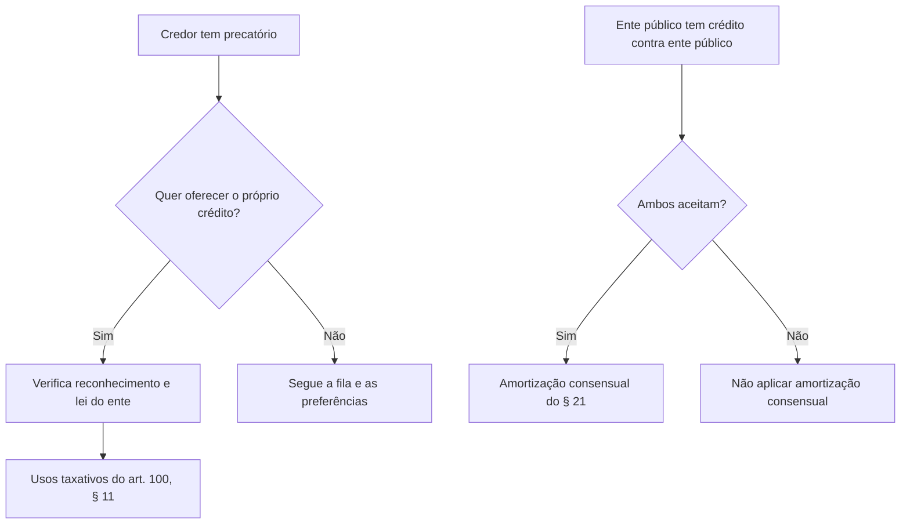

O regime de precatórios contém preferências, possibilidades de uso do crédito e regras para cessão e acordos. Essas alternativas não significam que o credor possa exigir pagamento fora da Constituição: cada uma depende de requisitos próprios. Este capítulo aprofunda a preferência dos créditos alimentares, a oferta para quitar obrigações perante o próprio ente, a compra de bens e direitos públicos, a cessão a terceiros, os acordos com deságio, o alcance do regime para empresas estatais e a desvinculação de receitas municipais. A leitura deve considerar as alterações constitucionais recentes.

> [!objetivos]
> - Ordenar as preferências dos créditos alimentares e explicar a superpreferência.
> - Distinguir compensação facultativa, depósito judicial e uso de créditos em precatório.
> - Explicar cessão, acordos com deságio e aplicação do regime a estatais.
> - Identificar os limites temporais da desvinculação municipal de receitas.

## Natureza alimentar e superpreferência

Créditos alimentares incluem, na redação vigente do art. 100, § 1º, débitos decorrentes da relação laboral ou previdenciária, ainda que sua natureza seja tributária, inclusive repetição de indébito sobre remuneração ou proventos de aposentadoria, e indenizações por morte ou invalidez fundadas em responsabilidade civil, reconhecidas por sentença transitada em julgado. Esses créditos têm preferência sobre os demais, exceto pela faixa especial disciplinada no § 2º.

A preferência especial ou superpreferência beneficia titulares originários ou sucessores hereditários que tenham 60 anos de idade, sejam portadores de doença grave ou pessoas com deficiência, na forma da lei. Ela incide sobre crédito alimentar até o triplo do limite legal de RPV. O credor pode receber a parcela prioritária antes, mas o saldo mantém sua posição na ordem cronológica pertinente. Para essa finalidade específica, a Constituição admite fracionamento do crédito.

Exemplo: suponha que o teto de RPV do ente seja 20 unidades e que uma credora de 65 anos tenha precatório alimentar de 100 unidades. A prioridade especial alcança até 60 unidades (3 × 20); as outras 40 permanecem sujeitas à ordem aplicável aos demais créditos alimentares. O exemplo ilustra a fórmula, sem presumir que todos os entes usem o mesmo limite de RPV.

> [!lei] CF, art. 100, § 2º
> Os débitos de natureza alimentícia cujos titulares, originários ou por sucessão hereditária, tenham 60 (sessenta) anos de idade, ou sejam portadores de doença grave, ou pessoas com deficiência, assim definidos na forma da lei, serão pagos com preferência sobre todos os demais débitos, até o valor equivalente ao **triplo** fixado em lei para os fins do disposto no § 3º deste artigo, admitido o fracionamento para essa finalidade, sendo que o restante será pago na ordem cronológica de apresentação do precatório.

> [!pegadinha]
> Idade, doença grave ou deficiência não tornam todo o precatório prioritário sem limite. O limite é três vezes a RPV, e a prioridade especial não elimina a ordem para o saldo.

## Oferta de créditos para débitos com o próprio ente

O art. 100, § 11, faculta ao credor, conforme estabelecido em lei do ente federativo devedor, apresentar créditos líquidos e certos que originalmente lhe pertençam ou tenham sido adquiridos de terceiros, desde que reconhecidos pelo ente ou por decisão judicial transitada em julgado. Entre as finalidades previstas estão liquidar obrigações parceladas ou inscritas como dívida ativa perante o ente, inclusive em acordo para encerrar litígio; em segundo plano, quitar débitos com autarquia ou fundação desse mesmo ente.

Essa faculdade não autoriza compensação compulsória feita unilateralmente pela Fazenda. Também não equivale à antiga redação do § 9º, que determinava abatimento automático de certos débitos no momento da expedição. O STF declarou inconstitucional a compensação forçada criada pela EC 62/2009 (ADI 4357). A EC 113/2021 passou a prever mecanismos distintos, mas os §§ 9º e 10 tiveram sua aplicação afastada conforme julgamentos das ADIs 7047 e 7064. Assim, não se deve afirmar que o valor do precatório será automaticamente retido e destinado ao juízo da cobrança como regra atual sem conferir a decisão vinculante e a redação vigente.

> [!atencao]
> O § 11 prevê uma opção do credor, dependente de lei do ente, para fins listados na Constituição. Não é autorização geral para o Poder Público impor compensação forçada de precatório contra dívida tributária.

## Compra de imóveis e outras utilizações

O mesmo § 11 permite oferta de créditos reconhecidos para comprar imóveis públicos de propriedade do ente devedor que estejam disponibilizados para venda; pagar outorga de delegações de serviços públicos e outras concessões negociais promovidas pelo mesmo ente; adquirir participação societária disponibilizada para venda, inclusive minoritária; ou comprar direitos disponibilizados para cessão pelo ente. A Constituição também contempla, no caso da União, antecipação de valores a receber como excedente em óleo em contratos de partilha de petróleo.

As hipóteses não são intercambiáveis: o crédito deve ser líquido e certo, próprio ou adquirido de terceiro, ter reconhecimento devido e ser utilizado perante o ente ao qual se vincula, observadas as condições constitucionais e legais. A regra não dá direito a escolher qualquer imóvel ou participação societária nem obriga a Administração a alienar bem que não tenha sido disponibilizado para venda.

> [!exemplo]
> Um credor de precatório estadual pode consultar se lei estadual permite ofertar crédito reconhecido para adquirir imóvel estadual que tenha sido formalmente colocado à venda. A Constituição oferece a possibilidade dentro das condições legais; não converte o Estado em vendedor obrigatório de qualquer bem.

O § 21 trata de hipótese diferente: valores devidos por sentença transitada em julgado a pessoa jurídica de direito público podem ser utilizados por ambas as partes, desde que aceito por ambas, para amortizar dívidas vencidas ou vincendas nos contratos e obrigações ali descritos. Entre eles estão contratos de refinanciamento em que o ente credor seja devedor da sentença, garantias prestadas a outro ente, parcelamentos tributários ou de contribuições sociais e obrigações por descumprimento de prestação de contas ou desvio de recursos. Nas obrigações vencidas, a amortização alcança primeiro as parcelas mais antigas; nas vincendas, reduz uniformemente cada parcela, mantida a duração original.

## Cessão do precatório

O credor pode ceder total ou parcialmente seu crédito em precatório a terceiro sem concordância do ente devedor. A cessão, entretanto, não produz efeitos perante o tribunal e o ente federativo devedor até que seja comunicada por petição protocolizada ao Tribunal de origem e ao ente devedor, como exige o art. 100, § 14. O procedimento permite atualizar o registro de quem tem direito ao pagamento e evita que a Fazenda quite o antigo titular após a transferência.

O cessionário não recebe a superpreferência do § 2º nem o tratamento da RPV do § 3º, conforme o § 13. Assim, a cessão não serve para transferir a uma pessoa terceira a condição pessoal que fundamentou preferência especial do cedente. O crédito pode ser alienado total ou parcialmente, mas a comunicação formal é indispensável à produção de efeitos perante os destinatários constitucionais.

| Aspecto | Regra |
| --- | --- |
| Anuência do devedor | Não é necessária para ceder o crédito |
| Extensão | Cessão total ou parcial permitida |
| Eficácia perante os sujeitos constitucionais | Após petição ao tribunal de origem e comunicação ao ente devedor |
| Preferências pessoais | Cessionário não recebe os benefícios dos §§ 2º e 3º |

> [!pegadinha]
> A cessão dispensa concordância da Fazenda, mas não dispensa comunicação formal ao Tribunal de origem e ao ente federativo devedor.

## Acordos com deságio

O acordo direto permite que credor e ente público componham o pagamento de determinadas categorias de precatório com redução do valor devido, segundo limites e requisitos constitucionais e regulamentares. No art. 100, § 20, para precatório superior a 15% do montante dos precatórios apresentados nos termos do § 5º, a Constituição prevê pagamento de 15% até o final do exercício seguinte e opção pelo restante em parcelas nos cinco exercícios subsequentes ou por acordo direto perante Juízo Auxiliar de Conciliação, com redução máxima de 40% do crédito atualizado, se não houver recurso ou defesa judicial pendente e forem cumpridos os requisitos do ente.

A EC 136/2025 acrescentou hipóteses nos §§ 23 e 29 relacionadas aos Estados, DF e Municípios. O § 29 faculta ao credor de precatório não pago em razão dos §§ 20 ou 23 optar por acordo direto perante Juízos Auxiliares de Conciliação contra a Fazenda estadual, municipal ou distrital, em parcela única até o final do exercício seguinte, renunciando a parcela do crédito. O dispositivo não estabelece por si só um percentual único de renúncia; não se deve importar o percentual de 40% de outra hipótese constitucional. O acordo é opção, não imposição ao credor.

> [!atencao]
> O antigo art. 107-A, § 3º, do ADCT, que previa acordo com renúncia de 40% para certos precatórios federais, foi declarado inconstitucional pelo STF na ADI 7064. A EC 136/2025 criou disciplina atual distinta para credores estaduais, distritais e municipais em hipóteses expressas.

## Administração indireta e regime de precatórios

Autarquias e fundações públicas integram a Fazenda Pública para diversos efeitos, inclusive o regime de precatórios. Empresas públicas e sociedades de economia mista exigem análise mais cuidadosa. Em regra, empresas estatais que exploram atividade econômica em regime concorrencial não se beneficiam do regime constitucional de precatórios, pois atuam em competição com particulares. O STF admite o regime para empresas estatais que prestam serviço público próprio do Estado em ambiente não concorrencial, observados os requisitos jurisprudenciais.

Não basta o capital ser público ou a entidade ser chamada de estatal. Devem ser examinadas a atividade desenvolvida, a competição no mercado, a distribuição de lucros e a prestação de serviço público típico. O fundamento é impedir que empresa que concorre no mercado obtenha privilégio incompatível com a livre concorrência, sem excluir automaticamente prestadoras de serviço público essencial não concorrencial.

> [!jurisprudencia] STF, ADPF 387
> Na ADPF 387, o STF assentou a aplicação do regime de precatórios a sociedade de economia mista prestadora de serviço público próprio do Estado e de natureza não concorrencial. A conclusão depende das características da entidade, não apenas de sua forma societária.

## Desvinculação municipal de receitas

A EC 136/2025 acrescentou ao ADCT regra de desvinculação de receitas municipais até 31 de dezembro de 2032. Para o ano de 2026, são desvinculados 50% das receitas municipais indicadas no art. 76-B; de 1º de janeiro de 2027 até 31 de dezembro de 2032, o percentual é de 30%. A regra alcança, nos termos do dispositivo, receitas de impostos, contribuições, taxas e multas, seus adicionais e acréscimos legais, e outras receitas correntes.

Há exceções expressas: dotações protegidas para ações sanitárias coletivas e para a manutenção da educação pública; receitas de contribuições previdenciárias e de assistência à saúde dos servidores; transferências obrigatórias e voluntárias entre entes com destinação especificada em lei; e fundos instituídos pelo Tribunal de Contas do Município. O próprio ADCT permite, nos exercícios considerados, uso de superávits financeiros do exercício anterior de fundos do Executivo municipal exclusivamente para políticas locais de saúde, educação e adaptação às mudanças climáticas.

> [!pegadinha]
> Não confunda a regra municipal do art. 76-B com desvinculação geral de recursos federais ou estaduais. A porcentagem muda após 2026 e há receitas expressamente excluídas.

### Ordem entre classes e titularidade

A ordem de pagamento combina a posição cronológica com preferências constitucionais. RPV tem disciplina própria. Dentro dos precatórios, créditos alimentares passam à frente dos demais; dentro deles, a superpreferência atende titulares protegidos até o limite constitucional. O saldo mantém a classificação restante. É importante não tratar “preferência” como sinônimo de prioridade absoluta para toda a soma, nem entender que a cessão transfere uma característica pessoal do credor original.

A natureza alimentar é determinada pela origem do crédito conforme o art. 100, § 1º, na redação da EC 136/2025. A alteração incluiu créditos trabalhistas e previdenciários independentemente de sua natureza tributária e repetição de indébito sobre remuneração e proventos. Questões antigas podem trazer lista anterior, mais restrita. O critério para a resposta deve ser a data e a redação constitucional exigida no enunciado.

### Oferta, compensação e execução

Na oferta prevista no § 11, a iniciativa é do credor e o aproveitamento depende dos requisitos constitucionais e da lei do ente. O crédito pode ter sido adquirido de terceiro, desde que reconhecido pelo ente ou por decisão judicial transitada em julgado. A oferta pode quitar dívida ativa do próprio ente, inclusive em transação; débitos de autarquia e fundação do mesmo ente aparecem subsidiariamente. O texto também autoriza pagamentos de outorga, aquisição de bens e direitos disponibilizados.

Já o § 9º prevê depósito relacionado a débitos inscritos em dívida ativa, mas sua aplicação foi objeto de controle concentrado. O STF invalidou previsões de compensação obrigatória e examinou as alterações posteriores nas ADIs 7047 e 7064. Para fins didáticos e de prova, diferencie: compensação compulsória, que não pode ser presumida válida; oferta facultativa do § 11, sujeita à lei; e amortização consensual do § 21 entre pessoas jurídicas de direito público. Os institutos têm sujeitos, vontade e finalidade diversos.

### Empresas estatais: análise em duas etapas

Primeiro, identifique a forma e a função da entidade. Autarquia é pessoa de direito público e submete-se ao regime. Empresa pública e sociedade de economia mista têm personalidade de direito privado, mas podem prestar serviço público não concorrencial. Segundo, verifique a jurisprudência: o STF admite precatórios para estatal que executa serviço público próprio do Estado sem concorrência, mas afasta o privilégio de entidade empresarial que compete no mercado em atividade econômica.

A razão prática é evitar que uma estatal concorrente disponha de vantagem processual sobre empresas privadas e, simultaneamente, preservar a continuidade de serviço público prestado em regime não concorrencial. Nem o controle acionário público nem o lucro são critérios isolados; a natureza do serviço e o ambiente concorrencial devem ser examinados em conjunto.

### Desvinculação municipal e exceções

O art. 76-B do ADCT autoriza, até 31 de dezembro de 2032, desvincular parte das receitas municipais abrangidas. O percentual é 50% até o fim de 2026 e cai para 30% entre 2027 e 2032. Não se aplica às verbas destinadas a ações e serviços de saúde e à manutenção e desenvolvimento do ensino; às contribuições previdenciárias e de assistência à saúde dos servidores; às transferências entre entes com destinação legal específica; nem aos fundos do Tribunal de Contas do Município.

A regra também permite utilizar superávits financeiros de fundos do Executivo municipal, apurados no exercício anterior, exclusivamente para políticas locais de saúde, educação e adaptação climática. “Desvincular” não significa extinguir a receita nem retirar o tributo da competência municipal: permite redirecionar a parcela autorizada, respeitadas as exceções.

| Período | Percentual desvinculado | Base geral |
| --- | ---: | --- |
| Até 31/12/2026 | 50% | Receitas municipais abrangidas pelo art. 76-B |
| 01/01/2027 a 31/12/2032 | 30% | Mesmas categorias, com as exceções do § 1º |
| Após 31/12/2032 | A regra transitória se encerra | Não presumir prorrogação automática |

> [!exemplo]
> Se um Município arrecadar 1 milhão de unidades em receita abrangida em 2026, a parcela potencialmente desvinculada será 500 mil, ressalvadas as fontes excluídas e a classificação jurídica de cada receita. Em 2027, aplicando o percentual de 30%, seriam 300 mil unidades sobre a mesma base hipotética.

## Mapa do capítulo

| Instituto | Regra essencial |
| --- | --- |
| Superpreferência alimentar | Até 3 vezes a RPV para idoso, pessoa com deficiência ou doença grave, nas condições constitucionais |
| Oferta pelo credor | Usos do § 11 perante o próprio ente, observada lei e reconhecimento do crédito |
| Cessão | Livre de anuência, mas exige comunicação formal; cessionário não recebe superpreferência/RPV |
| Acordo direto | Facultativo, hipóteses e deságio dependem do dispositivo constitucional aplicável |
| Estatal | Regime para prestadora de serviço público próprio e não concorrencial, segundo STF |
| Art. 76-B do ADCT | Municípios: 50% até 2026; 30% de 2027 a 2032, com exceções |

| Situação temporal | Marco constitucional | Consequência|
|---|---|---|
| Ano de 2026 | Percentual transitório de 50% | Aplicável apenas às receitas abrangidas|
| Anos de 2027 a 2032 | Percentual de 30% | Mantidas as exclusões legais|
| Data posterior a 2032 | Encerramento do prazo previsto | Exige nova base normativa para extensão|
| Receita excluída | Não é desvinculada por essa regra | Preserva destinação constitucional|

| Requisito de acordo | Verificação prática | Efeito|
|---|---|---|
| Hipótese constitucional de precatório | Conferir §§ 20, 23 ou 29 | Define se cabe acordo direto|
| Ausência de defesa ou recurso pendente | Exigência do § 20 | Permite a negociação nos termos legais|
| Manifestação do titular | Acordo é facultativo | Não cabe impor renúncia|
| Juízo auxiliar competente | Formalizar conciliação | Dá eficácia ao ajuste|

| Fase da cessão | Ação | Resultado|
|---|---|---|
| Negócio entre particulares | Credor transfere total ou parte do crédito | Fazenda não tem veto por falta de anuência|
| Formalização | Protocola comunicação no Tribunal e avisa o ente | Cessão torna-se eficaz perante ambos|
| Pagamento | Atualiza-se titularidade | Cessionário recebe crédito sem privilégios pessoais|
| Ordem | Aplica-se fila constitucional | Prioridade pessoal não se transmite|

| Questão sobre preferência | Regra a aplicar | Erro comum|
|---|---|---|
| Credor tem 60 anos? | Prioridade até triplo da RPV, se alimentar | Não antecipa todo o crédito sem limite|
| Crédito é alimentar? | Tem prioridade sobre créditos comuns | Não altera o limite da faixa especial|
| Crédito foi cedido? | Exige comunicação ao tribunal e ente | Cessionário não herda preferência pessoal|
| Ente oferece acordo? | Verificar hipótese e opção do titular | Não presumir deságio fixo para todo precatório|

### Para fixar
- Créditos alimentares têm preferência sobre os demais débitos.
- A superpreferência limita-se ao triplo do valor de RPV.
- O § 11 prevê oferta facultativa e depende de lei do ente devedor.
- Compensação forçada não se confunde com oferta voluntária pelo credor.
- A cessão não exige anuência, mas precisa ser comunicada ao tribunal e ao ente devedor.
- O cessionário não recebe as preferências dos §§ 2º e 3º.
- O acordo com deságio é opção do credor e segue condições próprias.
- O art. 76-B do ADCT estabelece 50% em 2026 e 30% de 2027 a 2032 para receitas municipais abrangidas.
