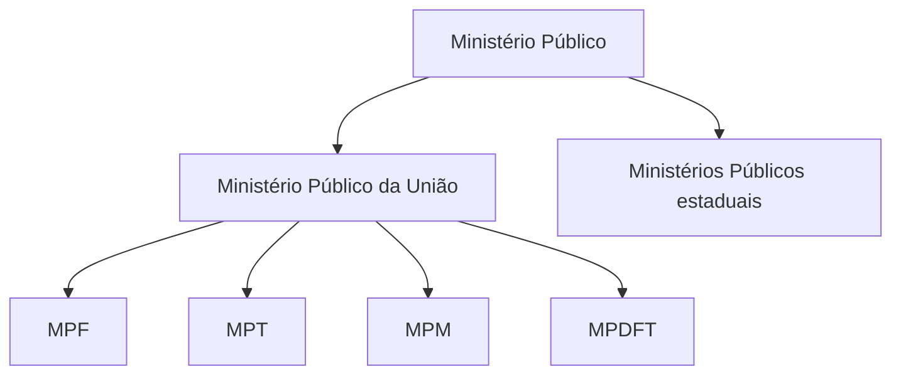

O Ministério Público (MP) é uma instituição constitucional autônoma, voltada à defesa da ordem jurídica, do regime democrático e de interesses que não podem ser livremente abandonados por seus titulares. Este capítulo apresenta sua estrutura, seus princípios, a garantia do promotor natural, as autonomias, as funções constitucionais e os requisitos de ingresso na carreira. A compreensão dessas bases prepara o estudo das garantias e da organização institucional do capítulo seguinte.

> [!objetivos]
> - Explicar a missão constitucional e a estrutura do Ministério Público.
> - Diferenciar unidade, indivisibilidade e independência funcional.
> - Relacionar autonomia institucional e limites orçamentários.
> - Identificar as funções constitucionais do art. 129.
> - Reconhecer os requisitos para ingresso na carreira.

## Natureza e organização

O art. 127 define o Ministério Público como instituição permanente e essencial à função jurisdicional do Estado. Sua missão é defender a ordem jurídica, o regime democrático e os interesses sociais e individuais indisponíveis. Interesse indisponível é aquele cuja proteção não pode ser afastada por simples renúncia do titular, como a proteção do patrimônio público ou de crianças e adolescentes em determinadas situações. O MP atua perante o Judiciário e também em procedimentos extrajudiciais, como inquérito civil.

A Constituição trata o MP em seção própria, fora dos capítulos dedicados aos Poderes. A posição predominante o reconhece como instituição autônoma, sem subordinação hierárquica ao Executivo, Legislativo ou Judiciário. Isso não o transforma em quarto Poder: exerce atribuições constitucionais delimitadas e se sujeita aos controles previstos no sistema, inclusive controle judicial e controle administrativo do Conselho Nacional do Ministério Público.

A estrutura se divide em Ministério Público da União (MPU) e Ministérios Públicos dos Estados. O MPU abrange Ministério Público Federal (MPF), Ministério Público do Trabalho (MPT), Ministério Público Militar (MPM) e Ministério Público do Distrito Federal e Territórios (MPDFT). O MPDFT pertence à União, ainda que atue no Distrito Federal e nos Territórios. O MP Eleitoral não é ramo autônomo: sua atuação combina membros do MPF e dos Ministérios Públicos estaduais, nos termos da organização eleitoral.

> [!esquema]
> - MPU: MPF + MPT + MPM + MPDFT.
> - MPE: Ministério Público de cada Estado.
> - MP Eleitoral: atuação por membros do MPF e dos MPEs, sem quadro institucional próprio.

A organização e o estatuto de cada MP são estabelecidos por lei complementar, observadas as regras constitucionais de iniciativa. Não há hierarquia geral do PGR sobre os Procuradores-Gerais de Justiça. Cada ramo possui chefia e organização próprias.

## Princípios institucionais e promotor natural

O art. 127, § 1º, enumera unidade, indivisibilidade e independência funcional. Unidade significa que cada Ministério Público atua como instituição coesa, submetida à chefia correspondente. Como há MPU e MPEs, não há uma unidade nacional que elimine a autonomia entre eles.

Indivisibilidade permite a substituição de membros da mesma instituição, respeitadas as regras de atribuição. O processo pertence ao órgão ministerial, não à pessoa física do promotor que primeiro se manifestou. A substituição não autoriza escolha casuística para manipular um caso: deve seguir critérios prévios e objetivos.

Independência funcional protege a formação jurídica da manifestação do membro. Um superior administrativo não pode impor o conteúdo de denúncia ou parecer em caso concreto. A proteção não elimina deveres funcionais, controle disciplinar ou revisão interna nos termos legais; tampouco autoriza atuação fora da Constituição.

A garantia do promotor natural decorre da vedação a designações discricionárias feitas para escolher um membro especificamente para acusar determinada pessoa. A distribuição deve obedecer a regras gerais, anteriores e impessoais. Substituição por férias, impedimento ou reforço especializado pode ser legítima se prevista em normas abstratas e controláveis. A finalidade é impedir acusação de exceção sem bloquear a organização do serviço.

> [!pegadinha]
> Independência funcional não é soberania pessoal. A indivisibilidade permite substituição regular dentro da instituição, mas não designação arbitrária para um caso concreto.

## Autonomias e orçamento

A Constituição assegura autonomia funcional e administrativa e reconhece ao MP a elaboração de proposta orçamentária dentro dos limites da lei de diretrizes orçamentárias (LDO). Autonomia funcional protege a atuação finalística. Autonomia administrativa abrange organização dos serviços e iniciativas legislativas sobre matérias constitucionalmente reservadas. Autonomia orçamentária não significa poder gastar sem autorização legal.

A proposta do MP deve respeitar os limites da LDO. Se não for encaminhada no prazo, o Executivo considera os valores do orçamento vigente, ajustados aos limites aplicáveis. Se a proposta ultrapassar esses limites, o Executivo realiza os ajustes necessários na consolidação do projeto de lei orçamentária. Durante a execução, não se podem assumir despesas acima dos limites da LDO, salvo autorização prévia por créditos suplementares ou especiais.

| Dimensão | Conteúdo | Limite |
| --- | --- | --- |
| Funcional | Atuação institucional e manifestação dos membros | Constituição, lei e controles cabíveis |
| Administrativa | Organização interna, gestão e iniciativas legais reservadas | Regras constitucionais de iniciativa |
| Orçamentária | Elaboração de proposta do MP | LDO e processo orçamentário |

Imagine que um MP pretenda criar cargos de apoio. A instituição poderá propor a medida na forma constitucional, mas a despesa precisa caber nos limites orçamentários aplicáveis. Autonomia não substitui autorização legislativa nem afasta responsabilidade fiscal.

## Funções institucionais

O art. 129 apresenta funções do MP. O rol admite outras atribuições legais compatíveis com a finalidade institucional, mas proíbe representação judicial e consultoria jurídica de entidades públicas. A função mais conhecida é promover privativamente a ação penal pública. Essa titularidade não impede ação privada subsidiária quando a lei e a inércia ministerial autorizarem.

O MP também zela pelo respeito dos Poderes e dos serviços de relevância pública aos direitos constitucionais; promove inquérito civil e ação civil pública para proteger patrimônio público e social, meio ambiente e interesses difusos e coletivos; defende judicialmente direitos e interesses das populações indígenas; e propõe ações de inconstitucionalidade ou representações interventivas nos casos constitucionais.

Pode expedir notificações, requisitar informações e documentos em procedimentos administrativos de sua competência, requisitar diligências investigatórias e a instauração de inquérito policial, com indicação dos fundamentos jurídicos, e exercer controle externo da atividade policial na forma da lei complementar. Controle externo fiscaliza a atividade policial, mas não coloca a polícia sob hierarquia ministerial.

A Constituição não reserva toda investigação criminal à polícia. O STF reconhece investigação criminal pelo Ministério Público em prazo razoável, com respeito aos direitos do investigado, reservas de jurisdição e prerrogativas da defesa. Isso não permite ao MP substituir o Judiciário em medidas que dependam de ordem judicial.

> [!exemplo]
> Diante de indícios de dano a uma área de preservação, o promotor pode instaurar inquérito civil e requisitar documentos ao órgão ambiental. Havendo indícios de crime, pode conduzir investigação nos limites constitucionais ou requisitar diligências à polícia.

> [!pegadinha]
> A ação penal pública é privativa do MP; a ação civil pública não é exclusiva dele. Outros legitimados podem ajuizá-la conforme a lei.

## Ingresso na carreira

O ingresso ocorre por concurso público de provas e títulos, com participação da Ordem dos Advogados do Brasil (OAB) em sua realização. Exige-se bacharelado em Direito e, no mínimo, três anos de atividade jurídica. As nomeações observam a ordem de classificação. O período mínimo é contado após a obtenção do grau de bacharel, não desde o início da graduação.

A exigência de experiência é uma condição constitucional de acesso, enquanto provas e títulos compõem o concurso. A participação da OAB não significa que a Ordem nomeie ou dirija os membros do MP. A atividade jurídica deve ser comprovada segundo a regulamentação do concurso, e os candidatos precisam ter concluído o bacharelado antes do período computado. A exigência se aplica ao ingresso na carreira e não pode ser substituída por experiência em área sem conteúdo jurídico.

> [!bizu]
> Associe o MP a quatro verbos: acusar (ação penal pública), proteger (direitos coletivos), fiscalizar (atividade policial) e requisitar (diligências e documentos).

## Atuação e instrumentos de proteção

A atuação ministerial varia conforme o bem jurídico protegido e o instrumento adequado. O inquérito civil é procedimento administrativo voltado à coleta de informações sobre possível lesão a direitos coletivos ou indisponíveis. Ele pode terminar com arquivamento fundamentado, ajustamento de conduta nos casos autorizados ou propositura de ação civil pública. O inquérito não é condição obrigatória para a ação: se já houver elementos suficientes, o MP pode ajuizá-la diretamente.

A ação civil pública protege interesses difusos, coletivos e individuais homogêneos em temas como meio ambiente, patrimônio público, consumidor e outros previstos em lei. Interesses difusos pertencem a pessoas indeterminadas ligadas por circunstâncias de fato; coletivos em sentido estrito pertencem a grupo ou categoria determinável ligada por relação jurídica; individuais homogêneos são direitos individuais com origem comum. O MP avalia a pertinência de sua atuação segundo a Constituição e a legislação.

A função de zelar pelo respeito aos direitos constitucionais dos cidadãos permite expedir recomendações e requisitar informações, sem que isso substitua a competência decisória de outro Poder. Se uma secretaria pública descumpre sistematicamente obrigação legal de atendimento, o MP pode apurar a situação e buscar providências extrajudiciais ou judiciais. Não pode, contudo, assumir a gestão administrativa da secretaria.

> [!exemplo]
> Uma associação informa que uma obra pública ameaça área de preservação e também pode afetar a captação de água de uma comunidade. O MP pode reunir dados em inquérito civil, ouvir órgãos técnicos e avaliar uma ação para prevenir o dano. Se a documentação já for suficiente, não precisa concluir investigação formal para ajuizar a demanda.

## Investigação e controle policial

A Constituição atribui à polícia judiciária e ao MP papéis relacionados, mas diferentes. A investigação policial é usualmente conduzida por autoridade policial; o Ministério Público pode requisitar a instauração de inquérito e diligências e, conforme a jurisprudência do STF, conduzir investigação própria. A competência investigatória ministerial é concorrente, não exclusiva. Nenhum dos caminhos elimina as garantias de defesa, o acesso aos elementos documentados e a reserva judicial para buscas, interceptações e outras medidas que dependam de ordem.

O controle externo da atividade policial acompanha a legalidade e a eficiência institucional nas condições previstas em lei complementar. Pode envolver visitas, análise de dados, recomendações e comunicação de irregularidades. Não é controle hierárquico: a polícia continua organizada conforme a estrutura do respectivo ente. O MP também não substitui corregedorias nem a autoridade judicial, embora possa provocar os órgãos competentes.

A ação penal pública é privativa do MP porque a Constituição lhe reserva o oferecimento da acusação pública. O titular não precisa oferecer denúncia sem justa causa: deve avaliar os elementos, podendo requerer arquivamento conforme o procedimento legal. O controle da decisão segue o modelo processual vigente. A ação privada subsidiária da pública é uma garantia contra inércia, acionável nos limites do prazo legal, não uma transferência geral da titularidade.

> [!pegadinha]
> Requisitar a instauração de inquérito não equivale a dirigir a polícia. A polícia mantém sua estrutura própria; o MP fiscaliza externamente e pode investigar dentro dos parâmetros reconhecidos pelo STF.

## Organização e independência na prática

A unidade institucional também permite que a chefia distribua tarefas e organize grupos especializados. Essa administração precisa respeitar o promotor natural e as regras de competência. Designações gerais para matérias especializadas podem ser válidas se previsíveis, objetivas e definidas antes dos casos. Já a escolha de um membro especificamente para produzir determinada acusação suscita risco de violação da garantia.

A independência funcional protege a convicção do membro no desempenho da atribuição, mas não afasta a prestação de contas. Um membro pode responder por falta funcional, abuso, crime ou ato ilícito nos termos aplicáveis. A chefia pode estabelecer prioridades administrativas e orientar a organização de serviços, sem impor a conclusão jurídica de um processo individual.

> [!bizu]
> Para analisar uma questão, pergunte: qual ramo do MP atua? Qual atribuição foi acionada? Há regra objetiva de distribuição? A medida exige autorização judicial? Essas perguntas evitam confundir autonomia, independência e ausência de controle.

## A estrutura federativa e os conflitos de atribuição

A divisão entre MPU e MPE acompanha a federação. A União organiza e mantém o MPDFT, mas os Ministérios Públicos estaduais têm autonomia própria. Um membro do MPF não pode avocar procedimento de um promotor estadual apenas por ocupar posição superior na carreira federal: não existe essa relação hierárquica. A competência de cada ramo depende da matéria, das pessoas e dos bens envolvidos, conforme a Constituição e as leis.

Conflito de atribuição surge quando órgãos ministeriais divergem sobre quem deve atuar. A resposta precisa observar a origem dos órgãos envolvidos e o entendimento constitucional vigente, pois nem todo conflito é resolvido pelo PGR. A organização administrativa de cada ramo é parte de sua autonomia. Nas questões de prova, desconfie da afirmação genérica de que o PGR resolve todos os conflitos nacionais ou que chefia todos os membros do país.

O MP Eleitoral ilustra a cooperação sem fusão institucional. O membro pode ser oriundo do MPF ou do MPE, mas atua em atribuição eleitoral e sob regras eleitorais. Isso não cria um Ministério Público Eleitoral independente com carreira própria. Da mesma forma, membros podem atuar em força-tarefa ou grupo especializado sem que a unidade retire a autonomia de outros ramos.

| Questão | Leitura adequada |
| --- | --- |
| MPDFT pertence a qual ramo? | Ao MPU |
| Existe hierarquia geral do PGR sobre PGJs? | Não |
| O MP Eleitoral possui carreira própria? | Não; recebe membros de ramos já existentes |
| Autonomia permite ignorar competência? | Não; atribuições seguem Constituição e lei |

> [!esquema]
> MPU e MPEs são instituições distintas na federação. Dentro de cada instituição existem unidade e indivisibilidade; entre elas há autonomia, sem chefia nacional comum.

## Princípios no cotidiano institucional

Unidade não significa que todas as manifestações sejam idênticas. Ela permite coordenação institucional, distribuição de serviços e atuação coerente em áreas especializadas. A chefia administra a instituição, mas não pode apagar a independência funcional no caso concreto. A indivisibilidade, por sua vez, explica por que a substituição não muda a titularidade institucional da atribuição.

O promotor natural tem uma dimensão de previsibilidade. A sociedade deve poder saber, segundo regras gerais, qual órgão ministerial será responsável por determinada matéria ou localidade. Esse princípio protege investigados contra escolha dirigida e membros contra designações persecutórias. Não impede que normas legais redistribuam atribuições quando há alteração administrativa geral, desde que não se escolha o destinatário em razão de um caso específico.

> [!lei] CF, art. 127, caput, e art. 129, IX
> Art. 127. O Ministério Público é instituição permanente, essencial à função jurisdicional do Estado, incumbindo-lhe a defesa da ordem jurídica, do regime democrático e dos interesses sociais e individuais indisponíveis.
> Art. 129. São funções institucionais do Ministério Público: (...)
> IX - exercer outras funções que lhe forem conferidas, desde que compatíveis com sua finalidade, sendo-lhe **vedada a representação judicial e a consultoria jurídica de entidades públicas**.

## Vocabulário constitucional e referências de prova

O termo *Parquet* é um nome tradicional do Ministério Público. A expressão *custos legis* significa guardião da lei; *custos societatis*, guardião dos interesses sociais. São rótulos doutrinários, não nomes de órgãos nem funções autônomas criadas pela Constituição. A função deve ser localizada no texto constitucional ou na lei. O MP exerce atribuições de modo institucional: seus membros atuam em nome do ramo competente, e não como particulares.

A doutrina também descreve a instituição como guardiã do regime democrático, mas a consequência de considerá-la cláusula pétrea implícita é construção doutrinária, não frase expressa do art. 60. Em prova, diferencie o que está literalmente no texto da Constituição do que é interpretação doutrinária predominante.

| Expressão | Sentido para estudo | Cuidado |
| --- | --- | --- |
| Parquet | Denominação tradicional do MP | Não constitui ramo próprio |
| Custos legis | Fiscal da ordem jurídica | Não torna o MP julgador |
| Custos societatis | Defesa de interesses sociais | Não amplia competência além da Constituição |

## Aplicação integrada

Considere a hipótese de um contrato público com indícios de fraude e prejuízo a usuários de serviço essencial. O MP pode apurar os fatos em inquérito civil, requisitar documentos, acompanhar providências administrativas e ajuizar ação civil pública se necessário. Caso haja indícios de crime, pode requisitar investigação policial ou instaurar procedimento investigatório próprio nos limites reconhecidos pelo STF. A Advocacia Pública não assume essa investigação: sua função é defender juridicamente o ente público e prestar consultoria institucional.

Essa separação evidencia as funções essenciais: uma instituição fiscaliza e protege direitos; outra assessora e representa a Administração; o Judiciário resolve conflitos; e a polícia executa suas competências de investigação e prevenção. O MP pode participar de diferentes fases, mas precisa indicar a base constitucional da providência e respeitar direitos fundamentais.

Na leitura constitucional, os arts. 127 e 128 estabelecem a base institucional e a organização em ramos. A Constituição também prevê garantias e vedações, enquanto o art. 129 detalha funções. Questões podem combinar esses dispositivos: por exemplo, pedir a função e, na sequência, perguntar qual ramo tem atribuição para o caso. Convém separar natureza, estrutura, princípio e competência antes de avaliar cada alternativa.

## Mapa do capítulo

| Tema | Regra essencial |
| --- | --- |
| Missão | Defesa da ordem jurídica, da democracia e de interesses indisponíveis |
| Estrutura | MPU e MPEs; MPDFT integra o MPU |
| Princípios | Unidade, indivisibilidade e independência funcional |
| Promotor natural | Critérios prévios e impessoais de distribuição |
| Autonomias | Funcional e administrativa; orçamento limitado pela LDO |
| Funções | Art. 129; outras atribuições compatíveis, com vedações expressas |
| Carreira | Provas e títulos; bacharelado em Direito e três anos de atividade jurídica |

### Para fixar
- O MP é instituição permanente, essencial à função jurisdicional do Estado.
- O MPDFT integra o Ministério Público da União.
- A unidade vale dentro de cada Ministério Público.
- A indivisibilidade permite substituição regular entre membros da mesma instituição.
- Independência funcional não afasta controles e deveres legais.
- A proposta orçamentária do MP deve respeitar a LDO.
- A ação penal pública é função privativa do Ministério Público.
- A ação civil pública admite outros legitimados previstos em lei.
- A investigação ministerial respeita direitos fundamentais e controle jurisdicional.
- O ingresso exige concurso de provas e títulos e três anos de atividade jurídica.
