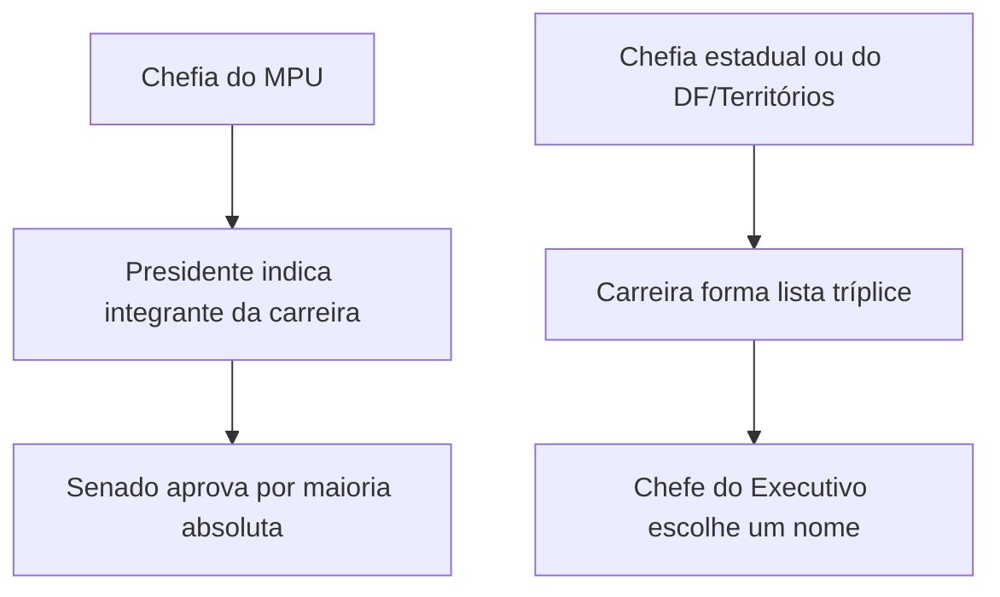

Este capítulo examina as garantias e vedações dos membros do Ministério Público, a escolha dos chefes institucionais, a posição dos membros que atuam junto aos Tribunais de Contas e o Conselho Nacional do Ministério Público (CNMP). As regras permitem separar proteção funcional de privilégio pessoal e identificar quem pode nomear, destituir ou controlar cada autoridade.

> [!objetivos]
> - Identificar vitaliciedade, inamovibilidade e irredutibilidade de subsídio.
> - Reconhecer as vedações impostas aos membros do MP.
> - Comparar a escolha do PGR e dos Procuradores-Gerais de Justiça.
> - Distinguir o MP comum do órgão que atua junto aos Tribunais de Contas.
> - Explicar a composição e as competências do CNMP.

## Garantias funcionais

As garantias constitucionais dos membros do MP protegem o exercício imparcial das funções, não a pessoa contra qualquer responsabilização. São vitaliciedade, inamovibilidade e irredutibilidade de subsídio, conforme as regras constitucionais de remuneração e teto.

A vitaliciedade é adquirida após dois anos de exercício. Depois disso, o membro somente perde o cargo por sentença judicial transitada em julgado. A garantia não impede processo criminal, civil ou disciplinar. Durante o estágio probatório, o desligamento segue o regime jurídico próprio e deve respeitar defesa e procedimento legal.

A inamovibilidade impede remoção contra a vontade do membro, salvo por motivo de interesse público, mediante decisão do órgão colegiado competente, pelo voto da maioria absoluta de seus integrantes e com ampla defesa. A regra protege a atuação contra transferências usadas como represália. Remoção voluntária ou movimentação segundo critérios gerais não se confunde com remoção compulsória.

A irredutibilidade protege o valor nominal do subsídio, mas não impede incidência tributária nem afasta o teto remuneratório. O subsídio é fixado na forma constitucional. O direito não assegura valor líquido imune a alterações legais gerais.

| Garantia | Proteção | Exceção ou limite |
| --- | --- | --- |
| Vitaliciedade | Permanência no cargo | Após dois anos, perda somente por decisão judicial transitada em julgado |
| Inamovibilidade | Permanência na lotação | Interesse público, decisão por maioria absoluta e ampla defesa |
| Irredutibilidade | Valor nominal do subsídio | Teto constitucional e tributos |

> [!pegadinha]
> A inamovibilidade não é absoluta: há remoção por interesse público, com decisão colegiada e defesa. Vitaliciedade também não significa imunidade funcional.

## Vedações e quarentena

A Constituição proíbe ao membro do MP receber honorários, percentagens ou custas processuais; exercer advocacia; participar de sociedade comercial na forma da lei; exercer outra função pública, salvo uma de magistério; exercer atividade político-partidária; e receber auxílios ou contribuições de pessoas físicas ou entidades públicas ou privadas, ressalvadas exceções legais.

A vedação à advocacia evita conflito entre a função pública e a representação de cliente privado. A exceção de uma função pública de magistério não autoriza acumulação irrestrita: a atividade deve ser compatível com o cargo e observar as normas institucionais. Atividades acadêmicas privadas também permanecem sujeitas a impedimentos e regras éticas.

O membro que se aposenta ou deixa o cargo fica sujeito à quarentena constitucional de três anos antes de exercer advocacia perante o juízo ou tribunal em que atuava. A regra reduz o risco de utilização imediata de relações e conhecimentos institucionais obtidos no cargo.

> [!esquema]
> Proibições centrais: advocacia; honorários e custas; atividade político-partidária; função pública adicional, salvo um magistério. Após sair do cargo: quarentena de três anos perante o juízo ou tribunal de atuação.

## Chefia do Ministério Público

O Procurador-Geral da República (PGR) chefia o MPU. É nomeado pelo Presidente da República dentre integrantes da carreira com mais de 35 anos, após aprovação da maioria absoluta do Senado. O mandato dura dois anos e admite recondução, mediante novo procedimento. A destituição por iniciativa presidencial depende de autorização da maioria absoluta do Senado.

Nos Estados e no Distrito Federal e Territórios, membros da carreira formam lista tríplice segundo a lei. O chefe do Poder Executivo nomeia o Procurador-Geral de Justiça (PGJ) para mandato de dois anos, permitida uma recondução. A destituição antes do término depende de deliberação da maioria absoluta do Poder Legislativo respectivo, na forma da lei complementar.

| Cargo | Escolha | Mandato | Destituição |
| --- | --- | --- | --- |
| PGR | Presidente nomeia após aprovação da maioria absoluta do Senado | Dois anos; recondução permitida | Iniciativa presidencial com autorização do Senado |
| PGJ | Executivo escolhe dentre lista tríplice da carreira | Dois anos; uma recondução | Maioria absoluta do Legislativo respectivo |

O PGR não é chefe dos Ministérios Públicos estaduais. A autonomia entre MPU e MPEs é compatível com a unidade interna de cada instituição.

## Ministério Público junto aos Tribunais de Contas

O Ministério Público que atua junto aos Tribunais de Contas não se confunde com o Ministério Público dos arts. 127 a 130. Seus integrantes ocupam quadro próprio do Tribunal de Contas e atuam nos processos de controle externo, segundo a organização constitucional e legal de cada Tribunal.

A nomenclatura pode induzir a erro: a presença de procuradores junto a um Tribunal de Contas não incorpora o MP comum ao Tribunal nem transforma promotores estaduais em membros daquele quadro. Carreira, atribuições e regime são distintos. O parecer ministerial de contas subsidia a deliberação do Tribunal e reforça a fiscalização técnica das receitas, despesas e atos de gestão pública.

> [!exemplo]
> Em auditoria de contrato, o procurador que atua junto ao Tribunal de Contas manifesta-se naquele processo de controle. Se surgirem indícios de crime, o MP competente poderá atuar em procedimento próprio.

## Conselho Nacional do Ministério Público

O CNMP controla a atuação administrativa e financeira do MP e o cumprimento dos deveres funcionais de seus membros. Pode receber reclamações, rever processos disciplinares nos limites constitucionais, expedir atos regulamentares na sua competência e recomendar providências. Não é instância recursal ordinária para rever o mérito de toda manifestação funcional.

O Conselho tem 14 integrantes, mandato de dois anos e uma recondução. Integram-no o PGR, quatro membros do MPU, três membros dos MPEs, dois juízes indicados pelo STF e pelo STJ, dois advogados indicados pelo Conselho Federal da OAB e dois cidadãos de notável saber jurídico e reputação ilibada, um indicado pela Câmara e outro pelo Senado. O PGR preside o órgão.

> [!lei] CF, art. 130-A, § 2º, caput
> Compete ao Conselho Nacional do Ministério Público o controle da **atuação administrativa e financeira** do Ministério Público e do cumprimento dos deveres funcionais de seus membros, cabendo lhe: (...)

As decisões do CNMP podem ser submetidas ao Judiciário quando houver questão de legalidade, competência ou violação de direitos, conforme as regras jurisdicionais. A autonomia do MP não impede controle; o controle tampouco converte o Conselho em chefe hierárquico dos membros.

## A chefia e a autonomia dos ramos

O desenho constitucional equilibra legitimidade democrática e independência funcional. No MPU, a nomeação do PGR combina escolha presidencial e aprovação do Senado. O chefe precisa vir da carreira e ultrapassar a idade mínima constitucional. A aprovação parlamentar não converte o PGR em subordinado do Senado; trata-se de requisito para investidura. A possibilidade de recondução exige repetição do processo de escolha, não prorrogação automática.

Nos Estados, o procedimento começa com lista tríplice formada por integrantes da carreira. O Governador escolhe um dos nomes, sem poder indicar alguém de fora da lista. A destituição do PGJ segue deliberação do Legislativo estadual por maioria absoluta, conforme lei complementar. O modelo protege a autonomia, mas não torna o chefe irremovível durante todo o mandato.

A chefia do MPU não se projeta sobre os MPEs. O PGR pode atuar em hipóteses constitucionais de competência federal, mas não exerce comando administrativo sobre promotores estaduais. Essa distinção é importante em conflitos de atribuição: a solução depende dos órgãos envolvidos e do regime legal e jurisprudencial aplicável.

> [!exemplo]
> Se um Estado precisa escolher a chefia do MP, o Governador recebe lista tríplice formada pela carreira e escolhe um dos integrantes. Não pode ignorar a lista e nomear pessoa externa. No caso do PGR, há nomeação pelo Presidente após a sabatina e aprovação do Senado.

## Vedações como proteção institucional

As vedações preservam imparcialidade e confiança pública. A proibição de advocacia impede que o membro atue como representante privado em conflito com seu dever público. A proibição de atividade político-partidária procura afastar compromisso formal com partido, mas não apaga direitos políticos em geral. A Constituição disciplina candidatura e afastamento para integrantes de carreiras jurídicas de modo específico; por isso, não se deve converter vedação de filiação em proibição absoluta de candidatura.

A participação em sociedade comercial é regulada por lei. A regra não deve ser ampliada sem examinar a forma de participação e a legislação aplicável. O membro não pode exercer outra função pública, mas a Constituição ressalva uma de magistério. Atividades acadêmicas precisam respeitar horários, produtividade, sigilo e impedimentos funcionais.

O membro também não pode receber honorários, percentagens ou custas processuais pela atuação institucional. Essa vedação é diferente do regime de subsídios e impede remuneração privada vinculada a processos. As exceções legais a auxílios ou contribuições não autorizam pagamentos disfarçados de vantagem pessoal; dependem de previsão válida e respeito às regras constitucionais.

| Vedação | Finalidade prática | Cuidado de prova |
| --- | --- | --- |
| Advocacia | Evitar conflito de representação | Não confundir com atuação institucional do MP |
| Atividade partidária | Preservar independência pública | Vedação não é automaticamente proibição de candidatura |
| Honorários/custas | Impedir remuneração privada por função pública | Subsídio segue regime constitucional próprio |
| Outra função pública | Dedicação e ausência de conflito | Há exceção para uma função de magistério |

## Controle disciplinar

O controle disciplinar inclui procedimentos internos e a atuação do CNMP nos limites do art. 130-A. O Conselho pode rever processos disciplinares julgados há menos de um ano e aplicar sanções administrativas, assegurada ampla defesa. Também pode receber reclamações contra membros e serviços auxiliares. A revisão não converte o CNMP em órgão acusador criminal ou em instância para alterar decisões judiciais.

As corregedorias realizam atividade correcional dentro das respectivas instituições, enquanto o CNMP exerce controle nacional. A existência de controle externo administrativo não elimina os controles judiciais e não afasta o devido processo. Em questões objetivas, observe o objeto do ato: sanção disciplinar pode ser controlada administrativamente; mérito de denúncia e decisão judicial seguem vias próprias.

> [!pegadinha]
> O CNMP controla administração, finanças e deveres funcionais. Não substitui o juiz, não chefia os ramos e não determina como o membro deve concluir uma ação penal concreta.

## Composição e competências do CNMP

A composição do Conselho combina representantes do próprio Ministério Público com membros de outras instituições e cidadãos. Essa pluralidade traz perspectivas de fiscalização sem transferir para um órgão externo a condução cotidiana das funções finalísticas. A Constituição fixa integrantes, forma de indicação e mandato; a lei e o regimento detalham funcionamento dentro desses limites.

Entre as competências do CNMP estão zelar pela autonomia funcional e administrativa do Ministério Público, expedir atos regulamentares no âmbito de sua competência, receber reclamações contra membros e serviços auxiliares, avocar processos disciplinares em curso e rever processos julgados dentro do intervalo de um ano. Pode determinar remoção, disponibilidade ou aposentadoria com subsídios proporcionais ao tempo de serviço, assegurada ampla defesa, conforme a Constituição. Também pode representar ao MP quando houver crime contra a Administração Pública ou abuso de autoridade.

A revisão disciplinar não é ilimitada no tempo. O prazo constitucional de um ano refere-se à revisão de processos disciplinares julgados, sem confundir com a possibilidade de receber reclamações ou avocar processo em curso. Em prova, identifique qual poder do Conselho está sendo descrito e confira o marco temporal correspondente.

> [!pegadinha]
> O prazo de um ano refere-se à revisão de processos disciplinares já julgados; não é um limite geral para receber qualquer reclamação contra integrante do MP.

## Garantias e responsabilização

Garantia funcional não apaga o dever de prestar contas. A vitaliciedade protege contra perda sumária do cargo; não impede processo penal ou ação por ato ilícito. A inamovibilidade protege a independência do membro, mas permite remoção por interesse público segundo procedimento constitucional. Irredutibilidade protege o subsídio contra redução nominal, mas não elimina o teto ou tributos.

As três garantias funcionam em conjunto. Imagine que um promotor investigue contrato ligado a autoridade influente. A vitaliciedade dificulta que uma simples decisão administrativa o retire do cargo; a inamovibilidade impede transferência arbitrária; e a independência funcional permite que examine os fatos de acordo com a lei. Ainda assim, se praticar infração, poderá responder perante os órgãos competentes com direito de defesa.

> [!bizu]
> V-I-I: vitaliciedade, inamovibilidade, irredutibilidade. Lembre-se de associar cada garantia à sua ressalva, porque as bancas frequentemente retiram a exceção para tornar a afirmação absoluta.

## Pontos específicos sobre organização

O art. 128 distingue o MPU dos Ministérios Públicos estaduais. Dentro do MPU estão MPF, MPT, MPM e MPDFT. Essa lista ajuda a reconhecer que a atuação eleitoral pode reunir membros de carreiras existentes sem criar uma nova instituição. O PGR chefia apenas o MPU, e os Procuradores-Gerais de Justiça chefiam os Ministérios Públicos locais.

A Constituição também exige critérios legais para vitaliciedade, inamovibilidade e subsídio. A inamovibilidade pode ceder diante de interesse público, desde que a medida venha de órgão colegiado competente, tenha motivação adequada e assegure defesa. Essa combinação permite que a instituição se organize e, ao mesmo tempo, impede remoção usada como ameaça. A decisão administrativa fica sujeita à revisão judicial quanto à legalidade.

O procedimento de escolha do PGR e dos PGJs possui mandatos definidos, mas não garante recondução ilimitada para todos: o texto constitucional permite reconduções do PGR e uma recondução do PGJ. Não confunda número de pessoas na lista tríplice, duração de mandato e quantidade de reconduções, pois são pontos autônomos.

## Exemplo de controle sem subordinação

Imagine que uma reclamação apresente indícios de demora injustificada em procedimento disciplinar de um membro. A corregedoria pode apurar o caso segundo a lei interna; o CNMP pode receber a reclamação e atuar dentro de suas competências constitucionais. Se instaurar procedimento, deve assegurar contraditório e ampla defesa quando houver possibilidade de sanção. O Conselho não escolhe o resultado de uma ação judicial em que o membro atua, nem substitui os tribunais disciplinares previstos em lei.

A revisão de processo disciplinar julgado deve ser distinguida da avocação de procedimento ainda em curso. A primeira tem limite temporal constitucional de um ano; a segunda integra a competência do Conselho para garantir regularidade e eficiência institucional. Essa diferença costuma aparecer em assertivas que trocam os verbos “rever” e “avocar”.

O controle administrativo também não é o mesmo que controle judicial. O CNMP pode corrigir ato administrativo incompatível com seus deveres constitucionais; a jurisdição permanece disponível para examinar legalidade e direitos. Membros externos no Conselho não conduzem investigações criminais nem passam a integrar carreiras do MP.

> [!exemplo]
> Se uma decisão de remoção compulsória for tomada sem defesa, o interessado poderá impugná-la administrativamente e buscar tutela judicial. O CNMP pode fiscalizar deveres e regularidade institucional, mas a validade final do ato pode ser examinada pelo Poder Judiciário.

## Procuradores junto aos Tribunais de Contas em perspectiva

O Ministério Público junto ao Tribunal de Contas exerce atividade jurídica relevante no controle externo. Seus integrantes podem emitir pareceres e participar de sessões conforme a lei orgânica do Tribunal. A autonomia e a organização desse quadro devem ser lidas com a Constituição e com a jurisprudência sobre cada Tribunal de Contas. A semelhança de nomenclatura com o Ministério Público comum não autoriza concluir que os membros tenham a mesma carreira, garantias e funções penais. A atuação junto ao Tribunal de Contas é dirigida à fiscalização de contas e à regularidade financeira. Ela não inclui titularidade da ação penal pública nem substitui a defesa judicial do ente fiscalizado. A carreira própria integra o desenho dos órgãos de controle externo, conforme as regras constitucionais e legais aplicáveis a cada Tribunal.

Os tribunais de contas auxiliam o Poder Legislativo no controle de contas públicas, mas não se tornam órgãos legislativos. O procurador que atua junto ao Tribunal participa do processo de controle externo; não se torna defensor da Administração nem titular da ação penal pública. Havendo notícia de delito, a apuração compete às autoridades com atribuição legal e constitucional.

> [!pegadinha]
> O membro do Ministério Público de Contas não é, por essa razão, membro do Ministério Público previsto nos arts. 127 e 128. Atribuições e carreiras são diferentes.

## Mapa do capítulo

| Tema | Regra essencial |
| --- | --- |
| Garantias | Vitaliciedade após dois anos; inamovibilidade com exceção; subsídio irredutível sujeito a limites |
| Vedações | Sem advocacia, atividade partidária, honorários e acumulação fora da exceção docente |
| PGR | Nomeação presidencial após aprovação do Senado; mandato de dois anos |
| PGJ | Lista tríplice e escolha pelo Executivo; uma recondução |
| MP junto ao TC | Quadro próprio, distinto do MP comum |
| CNMP | 14 conselheiros; controle administrativo, financeiro e disciplinar |

### Para fixar
- A vitaliciedade é adquirida após dois anos de exercício.
- Remoção por interesse público exige decisão colegiada e ampla defesa.
- Membro do MP não pode exercer advocacia nem atividade político-partidária.
- É admitida uma função pública de magistério, com compatibilidade.
- O PGR tem mandato de dois anos, com recondução permitida.
- O PGJ é escolhido pelo Executivo a partir de lista tríplice.
- O MP junto ao Tribunal de Contas tem quadro próprio.
- O CNMP possui 14 integrantes e mandato de dois anos.
- O Conselho controla atividade administrativa, financeira e deveres funcionais.
- Controle administrativo não significa subordinação hierárquica do MP ao CNMP.
