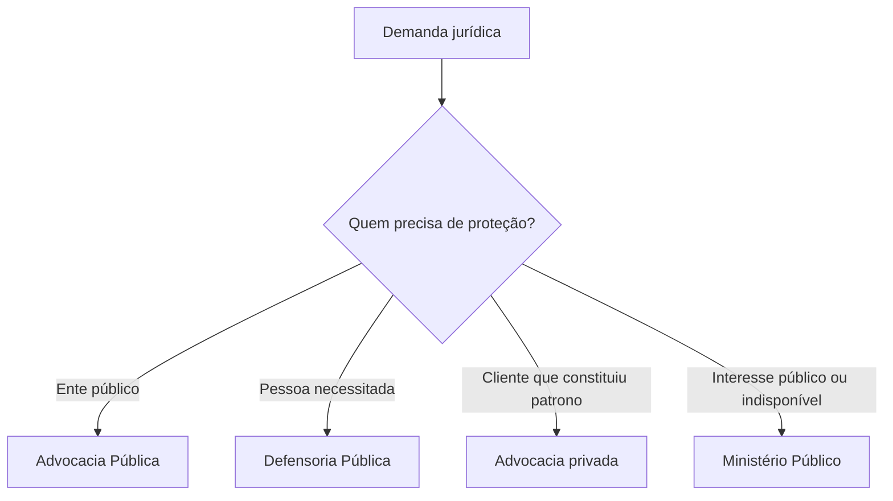

A Constituição organiza três funções jurídicas complementares: a representação judicial e a consultoria dos entes públicos, a advocacia privada e a assistência jurídica integral aos necessitados. Elas não se confundem com a função jurisdicional nem com o Ministério Público. Este capítulo compara Advocacia-Geral da União, Procuradorias dos Estados e do Distrito Federal, advocacia e Defensoria Pública, destacando missão, ingresso e garantias institucionais.

> [!objetivos]
> - Diferenciar representação judicial e consultoria jurídica pública.
> - Identificar a posição constitucional da AGU e das Procuradorias estaduais.
> - Explicar a inviolabilidade profissional da advocacia e seus limites legais.
> - Reconhecer os princípios e garantias da Defensoria Pública.
> - Comparar as funções essenciais à Justiça sem confundir suas atribuições.

## Advocacia-Geral da União

O art. 131 atribui à Advocacia-Geral da União (AGU) a representação judicial e extrajudicial da União e as atividades de consultoria e assessoramento jurídico do Poder Executivo. Representar judicialmente significa defender a União em juízo. A atuação extrajudicial inclui a defesa de seus interesses fora do processo. Consultoria e assessoramento orientam juridicamente a Administração, sem substituir a decisão política ou administrativa da autoridade competente.

A AGU é chefiada pelo Advogado-Geral da União, escolhido pelo Presidente da República entre pessoas com pelo menos 35 anos, reconhecida qualificação jurídica e reputação íntegra. O requisito não é ser membro de carreira, ao contrário da regra constitucional para o PGR. A lei complementar organiza a instituição e disciplina sua atuação.

A execução da dívida ativa tributária da União cabe à Procuradoria-Geral da Fazenda Nacional (PGFN), na forma da lei. Dívida ativa é crédito público inscrito para cobrança. A Constituição diferencia a representação geral da União da atuação específica em matéria fiscal, embora ambas estejam no âmbito da AGU.

> [!esquema]
> - AGU: representa a União em juízo e fora dele; presta consultoria e assessoramento ao Executivo.
> - AGU: chefia ocupada por Advogado-Geral nomeado pelo Presidente, atendidos os requisitos constitucionais.
> - PGFN: executa a dívida ativa tributária da União conforme a lei.

A AGU não exerce defesa pessoal do agente público por qualquer ato. A representação constitucional é da União; a defesa individual depende de previsão legal e de compatibilidade do ato com o exercício das funções públicas. Tampouco a AGU decide, por si, a política administrativa: sua função é jurídica.

## Procuradorias dos Estados e do Distrito Federal

O art. 132 prevê que os Procuradores dos Estados e do Distrito Federal, organizados em carreira e ingressos por concurso público de provas e títulos, com participação da OAB em todas as fases, exercem a representação judicial e a consultoria jurídica das respectivas unidades federadas. A estabilidade reforçada das instituições depende de autonomia funcional de seus procuradores nos termos definidos pela Constituição e pela jurisprudência.

A direção da carreira cabe a seus integrantes na forma da lei, com observância da escolha entre membros da carreira para o cargo de Procurador-Geral do Estado ou do Distrito Federal. A disciplina local deve respeitar o modelo constitucional. A Constituição não confere aos Municípios uma Procuradoria com regime idêntico ao art. 132; sua organização decorre da autonomia municipal, das leis locais e dos limites constitucionais.

A Procuradoria defende o Estado ou o Distrito Federal, e não o governante em caráter pessoal. Se uma ação discute a validade de contrato estadual, a Procuradoria atua pelo ente. A defesa particular do agente, se cabível, é questão diferente, regida por normas próprias.

| Instituição | Representado | Consultoria/assessoramento | Regra de ingresso/chefia |
| --- | --- | --- | --- |
| AGU | União | Executivo federal | AGU nomeado pelo Presidente, conforme art. 131 |
| Procuradoria estadual | Estado | Administração estadual | Carreira; concurso de provas e títulos |
| Procuradoria do DF | Distrito Federal | Administração distrital | Modelo do art. 132 |

> [!pegadinha]
> A AGU representa a União; as Procuradorias do art. 132 representam os Estados e o Distrito Federal. O Ministério Público não presta consultoria jurídica a entes públicos e não substitui a advocacia pública.

## Advocacia privada

A Constituição reconhece a importância essencial do advogado para o funcionamento da Justiça e protege suas manifestações profissionais, observadas as condições e limites legais. A indispensabilidade explica a relevância da defesa técnica para assegurar contraditório e ampla defesa. A inviolabilidade não é licença para abusos: protege manifestações ligadas à atividade profissional e pode ser delimitada nos termos legais.

A advocacia é função privada, exercida por profissional habilitado. O advogado defende o interesse de seu cliente dentro da lei e dos deveres éticos. Isso a distingue da Advocacia Pública, que representa o ente estatal e presta consultoria institucional. Um defensor público também é agente estatal, mas possui missão constitucional própria de assistência jurídica integral aos necessitados.

> [!exemplo]
> Em processo criminal, a pessoa investigada contrata advogada para orientar sua defesa. Em ação contra o Estado, a Procuradoria estadual representa o ente público. Se a pessoa não puder custear orientação jurídica e satisfizer as condições de atendimento, a Defensoria pode prestar assistência.

## Defensoria Pública

A Defensoria Pública é instituição permanente e essencial à função jurisdicional do Estado. Incumbe-lhe prestar orientação jurídica, promover direitos humanos e defender, em todos os graus, judicial e extrajudicialmente, direitos individuais e coletivos dos necessitados, de forma integral e gratuita, nos termos do art. 134.

A assistência jurídica é mais ampla que a representação em processo. Pode envolver orientação, solução extrajudicial, educação em direitos e atuação coletiva. A condição de necessitado é aferida pelos critérios legais e institucionais; a missão constitucional não se limita a pessoas já formalmente em juízo. A Defensoria pode atuar em tutela coletiva quando haja pertinência com suas finalidades e com a proteção de grupos vulneráveis.

São princípios institucionais da Defensoria a unidade, a indivisibilidade e a independência funcional. A Constituição assegura autonomia funcional e administrativa e iniciativa de proposta orçamentária, dentro dos limites da LDO. A organização abrange a Defensoria Pública da União, as Defensorias dos Estados e a do Distrito Federal e Territórios, observadas as normas constitucionais e legais.

A carreira exige concurso público de provas e títulos. Seus integrantes têm garantias e deveres previstos na Constituição e na legislação. O subsídio é fixado na forma constitucional. A autonomia institucional não significa ausência de controle: atos administrativos estão sujeitos à lei, ao controle judicial e às regras orçamentárias.

> [!lei] CF, art. 134, caput
> A Defensoria Pública é instituição permanente, essencial à função jurisdicional do Estado, incumbindo-lhe, como expressão e instrumento do regime democrático, fundamentalmente, a orientação jurídica, a **promoção dos direitos humanos** e a defesa, em todos os graus, judicial e extrajudicial, dos direitos individuais e coletivos, de forma integral e gratuita, aos necessitados, na forma do inciso LXXIV do art. 5º desta Constituição Federal.

> [!pegadinha]
> Defensoria Pública não é sinônimo de advocacia privada gratuita: é instituição estatal com princípios, autonomia e competências constitucionais próprias. Advocacia Pública, por sua vez, representa o ente público.

## Comparação das funções

As quatro instituições ocupam posições distintas. O MP atua como fiscal da ordem jurídica e titular da ação penal pública. A Advocacia Pública defende e orienta juridicamente o Estado. A advocacia privada representa clientes. A Defensoria presta assistência jurídica a quem dela necessita.

| Ator | Interesse institucional imediato | Exemplo de atuação |
| --- | --- | --- |
| Ministério Público | Ordem jurídica, democracia e interesses indisponíveis | Ação penal pública; ação civil pública |
| AGU/Procuradorias | Defesa jurídica do ente público | Contestação de ação contra União ou Estado |
| Advogado | Defesa técnica do cliente | Orientação e representação em processo |
| Defensoria Pública | Assistência jurídica integral aos necessitados | Defesa individual e tutela coletiva compatível |

As funções podem atuar no mesmo caso, mas em posições distintas. Em ação coletiva sobre acesso a serviço público, a Defensoria pode defender o grupo vulnerável; o MP pode atuar na proteção da ordem jurídica e dos interesses coletivos; e a Procuradoria apresenta a posição do ente público. A existência de mais de um órgão não implica duplicidade de representação do mesmo interesse.

## A consultoria pública e os limites da representação

A consultoria jurídica pública oferece análise de legalidade para apoiar decisões administrativas. O parecer pode ser obrigatório ou facultativo conforme a lei, mas a decisão de conveniência e oportunidade continua com a autoridade administrativa quando a Constituição e a legislação assim dispõem. Representação judicial é a defesa do ente público perante o Judiciário; não é serviço particular ao governante.

Na União, a AGU representa o ente federado e presta consultoria ao Executivo. A Procuradoria-Geral da Fazenda Nacional integra a estrutura da AGU e cuida da dívida ativa tributária federal. Nos Estados e no Distrito Federal, as Procuradorias exercem representação e consultoria nos limites do art. 132. O ingresso na carreira depende de concurso de provas e títulos com participação da OAB em todas as fases, conforme o texto constitucional.

A administração pública municipal pode organizar sua representação jurídica em razão da autonomia municipal e das leis locais. Isso não significa que o art. 132, dirigido a Estados e DF, se aplique automaticamente aos Municípios em todos os seus detalhes. O desenho municipal deve observar iniciativa legislativa, orçamento, concurso e demais normas constitucionais.

> [!exemplo]
> Se uma empresa ajuíza ação contra contrato firmado pelo Estado, a Procuradoria representa o Estado e sustenta a posição institucional. O servidor que assinou o contrato não se torna automaticamente cliente particular da Procuradoria em matéria estranha à defesa do ente.

## Advogado, defensor e procurador

O advogado privado representa pessoa ou organização que o contratou, observando deveres profissionais e limites legais. A inviolabilidade protege os atos e manifestações ligados ao exercício profissional, mas não abrange abuso, crime ou conduta desconectada da defesa técnica. A indispensabilidade à administração da Justiça é compatível com exceções processuais previstas na lei.

A Defensoria Pública tem missão estatal própria: garantir orientação jurídica e defesa integral e gratuita a quem necessita, em juízo e fora dele. A instituição pode atuar em demandas individuais e coletivas, inclusive em defesa de grupos vulneráveis, desde que exista conexão entre a demanda e suas funções constitucionais. O atendimento não depende sempre de existir processo em curso: orientação e solução extrajudicial também são parte da assistência jurídica.

O MP protege a ordem jurídica e interesses indisponíveis; não presta defesa pessoal ao réu nem consultoria ao Executivo. A Advocacia Pública defende o ente público e assessora juridicamente a Administração. A Defensoria defende pessoas necessitadas e promove direitos humanos. A advocacia privada defende o cliente. Em uma demanda coletiva, mais de uma dessas instituições pode aparecer, cada qual em posição institucional própria.

| Situação | Instituição mais diretamente relacionada | Exemplo |
| --- | --- | --- |
| Ação penal pública | Ministério Público | Oferecimento de denúncia |
| Ação contra a União | AGU | Defesa judicial do ente federal |
| Ação contra Estado | Procuradoria estadual | Defesa institucional do Estado |
| Pessoa sem recursos para orientação | Defensoria Pública | Atendimento jurídico integral |
| Defesa contratada | Advocacia privada | Patrocínio de cliente |

## Autonomia da Defensoria

A autonomia funcional permite que a Defensoria estabeleça suas prioridades institucionais sem subordinação indevida a outro Poder na atuação finalística. A autonomia administrativa permite autogoverno e organização dos serviços nos limites constitucionais. A proposta de orçamento deve respeitar a LDO e integrar o ciclo orçamentário público.

Os princípios de unidade e indivisibilidade permitem coordenação e substituição regular entre defensores; independência funcional protege sua atuação técnica no caso concreto. Essa autonomia não significa imunidade: membros podem ser responsabilizados por ilícitos, e a administração está sujeita a controles legais. A missão de assistência gratuita também não é uma procuração geral para representar qualquer interesse sem verificar os critérios legais de atendimento.

A Defensoria pode ajuizar ação civil pública para proteção de interesses transindividuais conforme a jurisprudência constitucional, desde que a atuação guarde pertinência com a proteção de necessitados e as funções institucionais. A insuficiência de recursos pode justificar assistência individual; em tutela coletiva, o vínculo com grupos vulneráveis deve ser demonstrado. A legislação prevê honorários sucumbenciais em favor de fundos de aparelhamento da instituição. A organização interna inclui corregedorias e unidades de atendimento, conforme a lei. Não existe exclusividade do MP para toda tutela coletiva. A coexistência de legitimados aumenta as possibilidades de proteção e não anula os requisitos de cada ação.

> [!pegadinha]
> Gratuidade refere-se ao serviço institucional prestado ao público atendido; não transforma a Defensoria em órgão de advocacia pública. O destinatário da defesa, e não a natureza do litígio, distingue em geral as atribuições.

## A Defensoria como instituição permanente

A Constituição chama a Defensoria Pública de instituição permanente e atribui-lhe a promoção dos direitos humanos. A permanência sinaliza que a assistência jurídica integra a estrutura essencial do Estado, não sendo programa temporário sujeito à conveniência de um governante. A instituição deve existir nos diferentes entes e atuar com autonomia suficiente para defender pessoas em situação de vulnerabilidade, inclusive contra o próprio Estado quando necessário.

O caráter integral da assistência envolve informação, orientação, educação em direitos, atuação extrajudicial e patrocínio judicial. A gratuidade atende a quem não pode arcar com os custos nos termos legais. A avaliação não deve reduzir a missão da instituição ao momento em que um juiz nomeia defensor em processo criminal. Uma pessoa pode buscar ajuda para obter documento, negociar solução, ajuizar demanda de família ou questionar política pública.

O art. 134 prevê ainda defesa de direitos individuais e coletivos. A atuação coletiva pode beneficiar grupo de pessoas, desde que a demanda tenha relação com a função constitucional e com os necessitados. A legitimidade da Defensoria não é ilimitada, mas tampouco está restrita a processos em que o Estado seja réu. A instituição pode litigar contra particulares em situações cabíveis.

A autonomia funcional e administrativa protege a definição de planos institucionais e organização interna. A iniciativa da proposta orçamentária permite planejar serviços, mas a proposta respeita os limites da LDO, os procedimentos do orçamento e os controles de execução. O defensor não atua como advogado particular, e a instituição não pode ser subordinada ao órgão que eventualmente conteste.

> [!exemplo]
> Uma comunidade de baixa renda relata que empresa privada interrompeu serviço essencial e que a medida afeta famílias de modo uniforme. A Defensoria pode examinar atendimento individual e, havendo pertinência coletiva, avaliar ação coletiva. A presença de empresa privada no polo contrário não exclui a competência institucional.

## Limites e conceitos cobrados

O acesso à justiça não significa apenas obter uma sentença. Consultoria orienta previamente; representação leva a pretensão ao Judiciário; assistência jurídica compreende essas atividades e outras formas de solução. A Constituição distribui esses serviços entre instituições para evitar que uma pessoa sem recursos fique sem orientação ou que o Estado seja defendido por órgão encarregado de fiscalizá-lo.

A Procuradoria não exerce a função de julgar. O MP não substitui a defesa técnica. A Defensoria não presta consultoria geral à Administração. Cada órgão atua segundo seus destinatários e finalidades. A advocacia privada possui garantias profissionais, mas não integra a estrutura pública por isso.

Ao estudar cargos e carreiras, verifique a norma de ingresso, a forma de escolha da chefia, as garantias e a responsabilidade. A Constituição não dá automaticamente a cada instituição as mesmas prerrogativas. A Defensoria tem autonomia prevista no art. 134; a AGU se organiza conforme o art. 131 e lei complementar; e as Procuradorias dos Estados e do DF seguem o art. 132. Aos defensores públicos, a Constituição também assegura inamovibilidade e veda o exercício da advocacia fora das atribuições institucionais. O Advogado-Geral da União deve ser cidadão com idade mínima de 35 anos, notável saber jurídico e reputação ilibada. A estrutura da Defensoria do Distrito Federal passou a ser organizada e mantida pelo próprio DF após a EC 69/2012.

## Mapa do capítulo

| Instituição | Fundamento | Núcleo da função |
| --- | --- | --- |
| AGU | Art. 131 | Representar a União e assessorar juridicamente o Executivo |
| Procuradorias estaduais e do DF | Art. 132 | Representar e prestar consultoria jurídica aos entes |
| Advocacia | Art. 133 | Defesa técnica privada e indispensabilidade à Justiça |
| Defensoria Pública | Arts. 134 e 135 | Orientação, direitos humanos e defesa integral dos necessitados |

### Para fixar
- A AGU representa a União judicial e extrajudicialmente.
- A PGFN atua na execução da dívida ativa tributária da União.
- O Advogado-Geral da União é nomeado pelo Presidente e não precisa integrar carreira.
- Procuradores estaduais e do DF ingressam por concurso de provas e títulos.
- O art. 133 reconhece a indispensabilidade e a inviolabilidade profissional nos limites da lei.
- A Defensoria oferece assistência integral, judicial e extrajudicial.
- Unidade, indivisibilidade e independência funcional são princípios da Defensoria.
- A Defensoria atua em defesa de necessitados; a Advocacia Pública defende o ente estatal.
- A autonomia orçamentária permanece sujeita à LDO.
- As funções essenciais à Justiça são complementares e não intercambiáveis.
