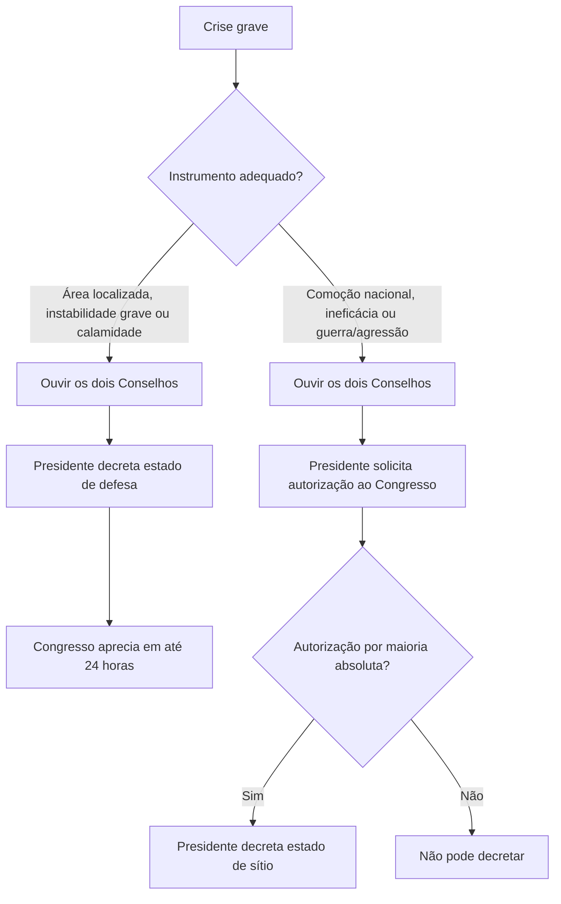

A Constituição prevê instrumentos excepcionais para responder a crises graves sem suspender a própria ordem constitucional. O estado de defesa e o estado de sítio restringem direitos em hipóteses específicas, por tempo limitado e sob controle do Congresso Nacional. Este capítulo compara requisitos, procedimento, medidas possíveis e controles, para que a escolha do instrumento não seja confundida com autorização geral para afastar direitos.

> [!objetivos]
> - Explicar a finalidade do sistema constitucional de crises.
> - Comparar hipóteses e procedimento do estado de defesa e do estado de sítio.
> - Identificar medidas coercitivas autorizadas em cada regime.
> - Calcular os limites constitucionais de duração e prorrogação.
> - Reconhecer controles do Congresso e responsabilidades por abusos.

## Finalidade e limites da exceção

O sistema constitucional de crises estabelece respostas jurídicas extraordinárias para situações em que os instrumentos ordinários são insuficientes. A excepcionalidade não suspende a Constituição: ao contrário, a Constituição define quando e como os poderes podem agir. Os princípios centrais são necessidade, temporariedade, proporcionalidade e controle. As medidas devem guardar relação com a crise, durar apenas o período autorizado e permanecer sujeitas à fiscalização política e judicial.

O estado de defesa é a resposta mais localizada e menos intensa. O estado de sítio pode alcançar todo o território nacional e autorizar restrições mais severas. A Constituição não permite escolher livremente entre os dois: cada instrumento possui hipóteses próprias. Nem um decreto presidencial nem a gravidade política do momento substituem os pressupostos constitucionais.

> [!pegadinha]
> Estado de defesa e estado de sítio não são sinônimos. O primeiro protege áreas determinadas diante de grave instabilidade ou calamidade de grandes proporções; o segundo depende de autorização prévia do Congresso e atende às hipóteses do art. 137.

## Estado de defesa

O Presidente da República pode decretar estado de defesa, após consulta ao Conselho da República e ao Conselho de Defesa Nacional, com a finalidade de proteger ou recompor, em locais restritos e determinados, a ordem pública ou a paz social. A Constituição exige grave e iminente instabilidade institucional ou calamidade de grandes proporções na natureza. A consulta aos Conselhos é obrigatória, mas seus pareceres não são vinculantes.

O decreto deve indicar a duração, as áreas abrangidas e as medidas coercitivas. Pode restringir o direito de reunião, ainda que exercido no seio de associações; o sigilo de correspondência; e o sigilo de comunicação telegráfica e telefônica. Em caso de calamidade pública, também pode haver ocupação e uso temporário de bens e serviços públicos, respondendo a União pelos danos e custos decorrentes.

O prazo inicial é de até 30 dias, prorrogável uma vez por igual período se persistirem as razões. Logo, o limite ordinário é de 60 dias. A prorrogação exige novo ato presidencial e submissão ao controle previsto. A regra é diferente da duração do estado de sítio.

> [!esquema]
> Grave e iminente instabilidade institucional OU calamidade natural de grandes proporções → consulta aos Conselhos → decreto presidencial delimitado → controle do Congresso em até 24 horas.

Decretado o estado de defesa ou sua prorrogação, o Presidente submete o ato e a justificação ao Congresso em 24 horas. O Congresso decide por maioria absoluta. Se estiver em recesso, deve ser convocado extraordinariamente em cinco dias e apreciar a medida em até dez dias do recebimento. A sessão legislativa não pode ser encerrada enquanto durar o estado de defesa.

Na vigência da medida, a prisão por crime contra o Estado determinada pelo executor não pode superar dez dias, salvo autorização judicial. É vedada a incomunicabilidade do preso. O preso tem direito a conhecer a identidade dos responsáveis pela custódia e a comunicar-se com advogado e família conforme as regras aplicáveis.

## Estado de sítio

O Presidente da República pode solicitar autorização ao Congresso Nacional para decretar estado de sítio. A consulta aos Conselhos da República e de Defesa Nacional é anterior ao pedido, e a autorização legislativa deve ser prévia. O Congresso decide por maioria absoluta. O decreto deve indicar duração, normas de execução e garantias suspensas; após sua publicação, designa-se o executor e as áreas abrangidas.

Há duas hipóteses. A primeira é comoção séria que alcance o plano nacional, ou demonstração de que as providências adotadas no estado de defesa não surtiram efeito. A duração nessa hipótese é de até 30 dias por vez, admitidas prorrogações sucessivas, cada uma de até 30 dias, enquanto persistirem os motivos e mediante nova autorização do Congresso.

A segunda hipótese é declaração de estado de guerra ou resposta a agressão armada estrangeira. Nela, a Constituição não fixa limite de 30 dias: a duração pode estender-se pelo tempo necessário à guerra ou à agressão, com controle político e respeito às normas constitucionais.

As medidas coercitivas dependem da hipótese. Para comoção de repercussão nacional ou ineficácia do estado de defesa, o art. 139 permite: dever de permanecer em local definido; custódia em instalações distintas das destinadas a acusados ou condenados por delitos comuns; limitações a cartas, comunicações, divulgação de informações e expressão por imprensa, rádio ou televisão; suspensão da liberdade de reunião; busca e apreensão em domicílio; intervenção em empresas de serviços públicos; e requisição de bens. A Constituição veda que a medida restrinja a divulgação de pronunciamentos parlamentares feitos em suas Casas, quando a respectiva Mesa permitir.

| Aspecto | Estado de defesa | Estado de sítio |
| --- | --- | --- |
| Hipótese | Instabilidade institucional localizada ou calamidade natural grave | Comoção nacional, ineficácia do estado de defesa, guerra ou agressão externa |
| Ato presidencial | Decreta após ouvir os Conselhos | Solicita autorização prévia do Congresso |
| Alcance típico | Locais restritos e determinados | Abrangência definida pelo decreto; pode ser nacional |
| Duração | Até 30 dias + uma prorrogação por igual período | Até 30 dias prorrogáveis na hipótese interna; duração necessária em guerra/agressão |
| Controle legislativo | Submissão em 24 horas | Autorização prévia por maioria absoluta |

Em guerra ou agressão armada estrangeira, podem ser adotadas medidas necessárias à defesa do Estado. As medidas concretas devem ser indicadas no decreto e guardam relação com a situação que justificou o sítio; não se pode transportar automaticamente o rol do art. 139 para hipóteses diversas.

> [!exemplo]
> Uma enchente de proporção excepcional destrói serviços essenciais em área determinada e compromete a ordem local. Satisfeitos os pressupostos, o Presidente pode avaliar estado de defesa para aquela área. Se a crise evoluir para comoção grave de repercussão nacional e o estado de defesa se mostrar ineficaz, cabe solicitar ao Congresso autorização para estado de sítio.

## Controle, fiscalização e regras comuns

O Congresso permanece em funcionamento durante os estados excepcionais. Uma comissão de cinco membros, eleita pela Mesa do Congresso, acompanha e fiscaliza a execução das medidas. Encerrada a medida, cessam seus efeitos, sem prejuízo da responsabilização pelos ilícitos praticados por executores ou agentes. A declaração não autoriza impunidade nem afasta o controle judicial de lesões a direitos.

A Constituição não pode ser emendada durante intervenção federal, estado de defesa ou estado de sítio. Essa restrição impede a alteração do texto constitucional enquanto a normalidade institucional estiver comprometida. O controle é, portanto, político, judicial e temporal.

Se o Congresso rejeitar o decreto de estado de defesa, o estado de exceção cessa imediatamente. Se rejeitar pedido de estado de sítio, a medida não pode ser decretada. Se o Congresso estiver em recesso, aplica-se a convocação extraordinária prevista para cada regime. A rejeição parlamentar não apaga eventual responsabilidade pelos atos praticados.

> [!bizu]
> Defesa: decreto e controle posterior rápido. Sítio: autorização do Congresso antes do decreto. Para prazos, memorize 30 + 30 para defesa e 30 + prorrogações sucessivas na crise interna do sítio.

## Procedimento em etapas

O procedimento constitucional separa preparação, decretação e controle. Primeiro, identificam-se os pressupostos materiais e a área afetada. Depois, o Presidente consulta os Conselhos previstos, cuja manifestação deve ser solicitada antes do ato. No estado de defesa, o Presidente decreta e em seguida submete o decreto ao Congresso. No estado de sítio, o Congresso autoriza antes de o Presidente decretar. Por fim, o ato especifica medidas e duração, e os órgãos de controle acompanham sua execução.

A figura sintetiza a diferença procedimental, mas não substitui os pressupostos legais. A consulta dos Conselhos é obrigatória nos dois instrumentos. A autorização parlamentar prévia distingue o sítio; no estado de defesa, a análise parlamentar é posterior ao decreto, embora rápida.

O Congresso Nacional não fica impedido de fiscalizar enquanto o regime está em vigor. Uma comissão de cinco parlamentares acompanha e fiscaliza a execução das medidas. O funcionamento do Congresso não é suspenso, e a sessão legislativa não pode ser encerrada durante o estado de defesa ou de sítio. A renovação de medida requer novo exame segundo os prazos próprios.

## Medidas e direitos afetados

No estado de defesa, as restrições são delimitadas aos direitos que a Constituição enumera: reunião, sigilo de correspondência e sigilo de comunicação telegráfica e telefônica. Em calamidade de grande proporção, admite-se ocupação e uso temporário de bens e serviços públicos, com responsabilidade da União pelos custos e danos. A autoridade não pode transformar essas possibilidades em suspensão geral de direitos.

No estado de sítio por comoção nacional ou ineficácia do estado de defesa, o decreto pode prever medidas do art. 139, como permanência em localidade indicada, detenção em lugar apropriado, limitação de comunicações e informação, suspensão de reunião, busca domiciliar, intervenção em serviço público e requisição de bens. A restrição à imprensa e aos meios de comunicação deve observar os limites constitucionais, inclusive a proteção a pronunciamentos parlamentares liberados pela Mesa respectiva.

| Instrumento e hipótese | Medidas típicas | Limite de liberdade |
| --- | --- | --- |
| Defesa | Reunião, correspondência, comunicações; uso temporário em calamidade | Lista constitucional específica e área delimitada |
| Sítio por crise interna | Permanência, detenção, comunicações, reunião, busca, serviços e bens | Decreto deve indicar normas e garantias afetadas |
| Sítio por guerra/agressão | Medidas necessárias à defesa | Relação com a situação bélica e controle político |

A prisão no estado de defesa tem disciplina própria: prisão por crime contra o Estado, determinada pelo executor, não pode exceder dez dias sem autorização judicial, e é vedada incomunicabilidade. A Constituição não permite que a emergência elimine o acesso a advogado ou o controle judicial.

> [!lei] CF, art. 136, caput e § 2º
> Art. 136. O Presidente da República pode, ouvidos o Conselho da República e o Conselho de Defesa Nacional, decretar estado de defesa para preservar ou prontamente restabelecer, em **locais restritos e determinados**, a ordem pública ou a paz social ameaçadas por grave e iminente instabilidade institucional ou atingidas por calamidades de grandes proporções na natureza. (...)
> § 2º O tempo de duração do estado de defesa não será superior a **trinta dias**, podendo ser prorrogado uma vez, por igual período, se persistirem as razões que justificaram a sua decretação.

## Proporcionalidade e responsabilidade

O princípio da necessidade exige demonstrar por que medidas ordinárias não bastam. A temporariedade impede prolongar o estado excepcional depois de cessada a crise. A proporcionalidade pede adequação entre risco e medida. O controle político obriga o Presidente a prestar contas ao Congresso; o controle judicial examina ilegalidades e lesões concretas, sem transferir ao juiz a escolha política sobre conveniência de cada providência.

Encerrado o estado de defesa ou o estado de sítio, cessam imediatamente seus efeitos. Isso não apaga a responsabilidade por ilícitos cometidos por executores ou agentes. O Presidente deve apresentar mensagem ao Congresso com as providências adotadas, justificativas e relação de atingidos, nos termos constitucionais. A prestação de contas torna possível verificar se as medidas foram efetivamente necessárias.

> [!bizu]
> Pergunta de prova: o Congresso autoriza antes ou aprecia depois? Defesa: aprecia depois, em 24 horas. Sítio: autoriza antes. Depois, confira hipótese, área e prazo antes de escolher a medida.

## Duração e prorrogação sem confusão

Os prazos são parte do controle constitucional. Estado de defesa tem duração inicial de até trinta dias, com uma única renovação por período equivalente se persistirem os motivos. A soma máxima, portanto, é de sessenta dias. Não cabe decretar nova prorrogação de trinta dias ao fim do limite ordinário como se a Constituição tivesse autorizado renovações sucessivas.

No estado de sítio motivado por crise interna, cada decreto pode durar até trinta dias e a Constituição admite prorrogações sucessivas, desde que o Congresso autorize cada uma e permaneçam as causas. A hipótese de guerra ou agressão estrangeira tem regime temporal diferente e pode durar enquanto a situação exigir. A autorização legislativa prévia é necessária para o sítio em ambas as hipóteses.

> [!exemplo]
> Se a calamidade persiste no 25º dia do estado de defesa, o Presidente pode prorrogá-lo uma única vez por até trinta dias, depois de observar os requisitos. Se no final do período máximo persistir uma crise interna que corresponda à hipótese constitucional de sítio, será necessário avaliar esse instrumento e obter autorização prévia do Congresso; não se pode simplesmente chamar a medida de uma segunda prorrogação da defesa.

A distinção entre duração máxima e período efetivo também importa. O decreto pode fixar prazo menor que o teto constitucional. A medida deve terminar quando cessarem os motivos, ainda que o prazo não tenha expirado. A autorização legislativa não obriga o Executivo a usar todos os dias permitidos.

O estado excepcional exige retorno à normalidade como objetivo. Por isso, prazos máximos não são metas de duração: se a situação se normalizar antes, as medidas devem cessar. A persistência da crise precisa ser justificada para cada prorrogação autorizada.

## Mapa do capítulo

| Instrumento | Pressuposto-chave | Controle | Limite temporal principal |
| --- | --- | --- | --- |
| Defesa | Instabilidade grave localizada ou calamidade de grandes proporções | Congresso em até 24 horas; maioria absoluta | Até 30 dias, uma prorrogação por igual período |
| Sítio — crise interna | Comoção nacional ou ineficácia do estado de defesa | Autorização prévia por maioria absoluta | Até 30 dias por decreto, com prorrogações sucessivas |
| Sítio — guerra/agressão | Guerra ou agressão armada estrangeira | Autorização prévia do Congresso | Enquanto necessária a resposta à situação |
| Ambos | Excepcionalidade constitucional | Congresso, comissão fiscalizadora e controle judicial | Cessam efeitos ao término; agentes respondem por abusos |

### Para fixar
- O estado de defesa é decretado pelo Presidente após ouvir dois Conselhos.
- A consulta aos Conselhos não vincula o Presidente.
- O estado de defesa dura até 30 dias, prorrogável uma vez por igual período.
- O Congresso aprecia o decreto de defesa em até 24 horas.
- No sítio, a autorização do Congresso é prévia e exige maioria absoluta.
- A crise interna no estado de sítio permite decretos de até 30 dias, prorrogáveis sucessivamente.
- Guerra ou agressão armada estrangeira não tem limite constitucional fixo de 30 dias.
- A incomunicabilidade do preso é vedada no estado de defesa.
- Uma comissão parlamentar acompanha e fiscaliza a execução das medidas.
- A Constituição não pode ser emendada durante estado de defesa ou de sítio.
