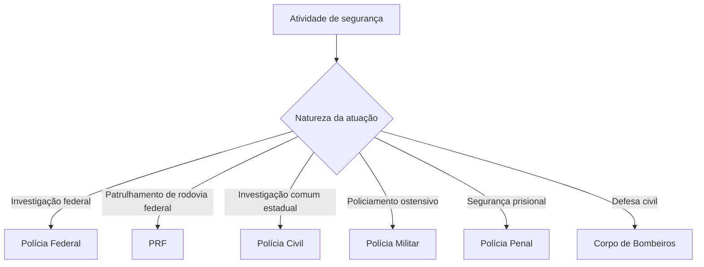

A Constituição trata a segurança pública como dever estatal, direito e responsabilidade de todos. O art. 144 distribui competências entre órgãos federais, estaduais e distritais e prevê a possibilidade de guardas municipais. O capítulo organiza essas atribuições e explica a solidariedade federativa, as polícias penais e a segurança viária. O foco é reconhecer o órgão competente sem misturar policiamento ostensivo, investigação, defesa civil e custódia prisional.

> [!objetivos]
> - Explicar o conceito constitucional de segurança pública e a cooperação entre entes.
> - Enumerar os órgãos previstos no art. 144 e suas missões.
> - Distinguir polícia ostensiva, polícia judiciária e polícia penal.
> - Reconhecer a posição constitucional dos bombeiros militares e das guardas municipais.
> - Identificar a competência relativa à segurança viária.

## Conceito e cooperação federativa

Segurança pública é dever do Estado, direito e responsabilidade de todos. Sua finalidade constitucional é manter a tranquilidade social e proteger a integridade física e os bens. Incolumidade significa proteção contra lesões ou perigos. O art. 144 lista os órgãos encarregados dessa função, sem excluir a participação social nem a cooperação federativa.

A solidariedade federativa exige atuação coordenada da União, dos Estados, do Distrito Federal e dos Municípios, cada qual dentro de sua competência. A estrutura nacional combina órgãos federais, corporações estaduais, instituições do Distrito Federal submetidas a regras próprias e serviços municipais, entre eles guardas facultativas e unidades de trânsito. Cooperação não autoriza um ente a criar corporação policial com atribuições constitucionais alheias.

O rol do art. 144 é constitucionalmente estruturante. A jurisprudência do STF tem impedido a criação estadual de novos órgãos com funções próprias de segurança pública fora do modelo constitucional, embora haja espaço de organização administrativa e cooperação dentro das competências existentes. O sistema não impede que outros órgãos públicos contribuam para a segurança em atividades próprias.

> [!pegadinha]
> Segurança pública é direito e responsabilidade de todos, mas os órgãos policiais e suas competências são definidos pela Constituição. A colaboração social não cria poder de polícia para qualquer instituição.

## Órgãos e atribuições

O art. 144 relaciona: Polícia Federal; Polícia Rodoviária Federal; Polícia Ferroviária Federal; polícias civis; polícias militares e corpos de bombeiros militares; e polícias penais federal, estaduais e distrital. As atribuições não são intercambiáveis.

| Órgão | Atribuição constitucional central | Abrangência |
| --- | --- | --- |
| Polícia Federal | Apuração de infrações de competência federal, repressão a certos ilícitos e polícia judiciária da União | União; atuação interestadual ou internacional em hipóteses legais |
| PRF | Patrulhamento ostensivo das rodovias federais | Rodovias federais |
| PFF | Patrulhamento ostensivo das ferrovias federais | Ferrovias federais |
| Polícia Civil | Polícia judiciária e apuração de infrações, exceto militares, ressalvada a União | Estados e DF |
| Polícia Militar | Polícia ostensiva e preservação da ordem pública | Estados e DF |
| Corpo de Bombeiros Militar | Defesa civil e atribuições definidas em lei | Estados e DF |
| Polícia Penal | Segurança dos estabelecimentos penais | União, Estados e DF |

A tabela resume a competência expressa de cada órgão. Polícia judiciária relaciona-se à investigação criminal e ao auxílio à persecução penal; policiamento ostensivo envolve presença uniformizada e prevenção visível. O Corpo de Bombeiros Militar executa atividades de defesa civil, sem prejuízo de atribuições definidas em lei. Polícia penal é vinculada ao órgão administrador do sistema penal da respectiva unidade federativa.

## Órgãos federais

A Polícia Federal é carreira estável mantida nacionalmente. Entre suas atribuições está investigar delitos que afetem a ordem política ou prejudiquem bens e atividades da União, inclusive de autarquias e empresas públicas federais. Também apura outras infrações com repercussão interestadual ou internacional que exijam repressão uniforme, conforme a lei.

A PF atua também na prevenção e repressão de tráfico de drogas, entrada ou saída clandestina de mercadorias e fraude tributária aduaneira, sem retirar as competências fazendárias e de outras entidades. Exerce funções de polícia marítima, aeroportuária e de fronteiras, além de desempenhar de modo privativo a função de polícia judiciária federal. Exclusividade limita-se à polícia judiciária da União; não significa que só a PF possa investigar qualquer crime federal.

A PRF faz patrulhamento ostensivo das rodovias federais. A Polícia Ferroviária Federal destina-se ao patrulhamento ostensivo das ferrovias federais. Nenhuma dessas atribuições corresponde à investigação geral de crimes, que segue a repartição constitucional e legal.

> [!exemplo]
> Um crime comum ocorrido em rodovia federal não se torna automaticamente crime de competência federal apenas pelo local. A PRF realiza patrulhamento e pode agir no flagrante; a atribuição investigativa dependerá da competência definida pela Constituição e pela legislação.

## Polícias estaduais, distritais e defesa civil

As corporações civis estaduais, chefiadas por delegados de carreira, investigam infrações comuns e exercem atribuições judiciárias, fora dos delitos militares e dos casos reservados à União. Isso abrange investigação de crimes comuns estaduais e outras atribuições legais compatíveis. A polícia civil não exerce a polícia ostensiva constitucionalmente atribuída à Polícia Militar.

À Polícia Militar compete exercer policiamento ostensivo e manter a ordem pública. Às Polícias Militares e aos Corpos de Bombeiros Militares cabe, além das atribuições estaduais legais, a condição constitucional de forças auxiliares e reserva do Exército. Eles se subordinam aos Governadores juntamente com polícias civis e polícias penais estaduais e distrital. A expressão “força auxiliar” não converte o Exército em superior hierárquico cotidiano das corporações estaduais.

Aos Corpos de Bombeiros Militares incumbe executar atividades de defesa civil, além das atribuições definidas em lei. Defesa civil compreende ações de prevenção, mitigação, preparação, resposta e recuperação diante de desastres, conforme a legislação. A Constituição também reserva aos bombeiros militares e às polícias atribuições próprias de seus regimes estaduais, sem permitir que lei local desfigure o modelo federal.

O Distrito Federal acumula competências estaduais e municipais, mas a União organiza e mantém as polícias civil e penal, a polícia militar e o corpo de bombeiros militar do DF e presta assistência financeira para sua execução por fundo próprio. Isso não elimina a subordinação dessas corporações ao Governador do Distrito Federal prevista no art. 144, § 6º.

> [!pegadinha]
> A Polícia Militar exerce policiamento ostensivo; a Polícia Civil exerce polícia judiciária e apura infrações comuns; o Corpo de Bombeiros Militar executa defesa civil. A polícia penal protege estabelecimentos penais, não a ordem pública em geral.

## Polícias penais

A Emenda Constitucional 104/2019 incluiu as polícias penais federal, estaduais e distrital no rol do art. 144. Elas são vinculadas ao órgão administrador do sistema penal da unidade federativa e têm como função constitucional a segurança dos estabelecimentos penais. No DF, a organização e manutenção competem à União, nos termos do regime especial constitucional.

A missão de segurança penitenciária não se confunde com polícia ostensiva externa ou investigação geral. A polícia penal atua na custódia e segurança das unidades prisionais, sem prejuízo de outras atividades previstas em lei e da cooperação com os demais órgãos. A inclusão no art. 144 não transforma a polícia penal em força auxiliar do Exército. A sua administração acompanha a estrutura responsável pela execução penal no respectivo ente, e a atuação deve respeitar as garantias das pessoas custodiadas, as decisões judiciais e a fiscalização dos órgãos competentes.

## Guardas municipais e segurança viária

Aos Municípios é permitido criar guardas para proteger seus imóveis, equipamentos e serviços, respeitadas as normas aplicáveis. A criação é opcional para cada Município: a Carta permite a instituição, mas não a torna obrigatória. O Estatuto Geral das Guardas Municipais estabelece parâmetros nacionais sem eliminar a autonomia local.

O STF reconheceu na ADPF 995 que as guardas municipais devidamente criadas e instituídas integram o Sistema de Segurança Pública. No Tema 656 (RE 608.588), assentou-se a constitucionalidade de ações de segurança urbana pelas guardas, inclusive policiamento ostensivo e comunitário, respeitadas as competências dos demais órgãos e excluída atividade de polícia judiciária. A tese não autoriza investigar crimes como função de polícia judiciária nem suprimir a repartição constitucional.

A segurança viária compreende educação, engenharia e fiscalização de trânsito, além de outras atividades legais que assegurem mobilidade urbana eficiente. Nos Estados, no DF e nos Municípios, compete aos respectivos órgãos ou entidades executivos e a seus agentes de trânsito estruturados em carreira. Segurança viária relaciona-se à segurança pública, mas o órgão de trânsito não passa a integrar automaticamente a lista de polícias do art. 144.

> [!esquema]
> Proteção municipal → guarda municipal, se instituída por lei.
> Segurança dos presídios → polícia penal.
> Policiamento ostensivo geral e preservação da ordem → Polícia Militar.
> Segurança viária e fiscalização de trânsito → órgãos executivos e agentes de trânsito competentes.

## Solidariedade federativa e limites do sistema

A atuação articulada permite resposta rápida a crises e crimes que ultrapassam fronteiras estaduais. A Constituição prevê cooperação, e a legislação pode organizar sistemas nacionais de integração e intercâmbio de informações. Cooperação não apaga a competência de cada órgão. Uma operação conjunta pode reunir PF, polícias estaduais, bombeiros e guardas, mas cada agente continua sujeito às atribuições, comandos e responsabilidades legais de sua instituição.

A jurisprudência sobre o rol constitucional precisa ser apresentada com precisão. Em precedentes, o STF afirmou que Estados não podem criar órgãos de segurança pública fora do modelo do art. 144 com a mesma natureza policial. Ao mesmo tempo, reconheceu a participação das guardas municipais no Sistema de Segurança Pública e em ações de segurança urbana dentro de suas atribuições. Portanto, “rol fechado” não deve ser usado para negar toda atuação de guarda, nem “integra o sistema” deve ser lido como autorização para exercer polícia judiciária.

> [!pegadinha]
> Guarda municipal integra o Sistema de Segurança Pública segundo o STF, mas não exerce polícia judiciária. A expressão sistema inclui cooperação institucional e não apaga as diferenças constitucionais entre os órgãos.

## Polícia penal e execução da custódia

A criação das polícias penais pela EC 104/2019 alterou a estrutura constitucional da segurança. Os cargos e a carreira se organizam a partir dos servidores penitenciários definidos na forma legal. A vinculação ao órgão gestor do sistema penal garante coordenação com a política de execução penal. A segurança interna de estabelecimentos não elimina direitos de pessoas presas, fiscalização judicial, atuação do Ministério Público ou dever de assistência jurídica da Defensoria.

Em situações de motim ou risco de fuga, a polícia penal protege a unidade e atua segundo protocolos e normas de execução. A PM pode ser chamada em apoio conforme os instrumentos legais, mas apoio operacional não muda a atribuição primária constitucional. A investigação de crimes ocorridos no presídio segue a divisão entre polícia judiciária, Ministério Público e Judiciário.

> [!esquema]
> Custódia e segurança prisional: Polícia Penal.
> Investigação criminal: órgão de polícia judiciária competente, sem prejuízo de poderes investigatórios reconhecidos ao MP.
> Fiscalização da execução penal: Judiciário, Ministério Público, Defensoria e órgãos administrativos dentro de suas competências.

## Atribuições em contraste

A Polícia Federal reúne competências materiais e territoriais previstas na Constituição e em lei. A PRF atua no patrulhamento ostensivo das rodovias federais, mas não se torna polícia judiciária da União por isso. A PFF possui destinação constitucional semelhante quanto às ferrovias federais. Polícias estaduais não podem ser definidas apenas pelo uniforme ou pelo local do flagrante; o tipo de atividade e a competência do caso importam.

A Polícia Civil apura infrações comuns, com exceção das militares e ressalva da competência da União. Isso não impede flagrante por qualquer pessoa nas condições legais, nem ações investigativas próprias de outros órgãos autorizados. A PM previne e preserva a ordem pela presença ostensiva. Bombeiros desempenham defesa civil e atribuições legais, que podem incluir prevenção contra incêndio e salvamento conforme a legislação estadual.

A segurança viária é um componente de mobilidade urbana e proteção nas vias. Educação no trânsito modifica comportamento; engenharia organiza vias e sinalização; fiscalização verifica cumprimento e aplica medidas legais. As funções podem ser exercidas por órgãos executivos de trânsito dos entes e por agentes de carreira. A existência de poder de fiscalização não transforma automaticamente esse órgão em polícia do art. 144.

| Atividade | Órgão constitucionalmente relacionado | Distinção necessária |
| --- | --- | --- |
| Patrulhar rodovia federal | PRF | Não equivale à investigação geral federal |
| Investigar crime comum estadual | Polícia Civil | Exclui infração militar e competência federal |
| Preservar ordem por policiamento ostensivo | PM | Não é a mesma função da Polícia Civil |
| Executar defesa civil | Bombeiros Militares | Além das missões definidas em lei |
| Proteger unidade prisional | Polícia Penal | Vinculada à gestão do sistema penal |
| Fiscalizar trânsito municipal | Órgão/agente de trânsito | Não integra automaticamente a lista policial |

> [!lei] CF, art. 144, §§ 4º, 5º e 5º-A
> § 4º Às polícias civis, dirigidas por delegados de polícia de carreira, incumbem, ressalvada a competência da União, as funções de polícia judiciária e a apuração de infrações penais, exceto as militares.
> § 5º Às polícias militares cabem a polícia ostensiva e a preservação da ordem pública; aos corpos de bombeiros militares, além das atribuições definidas em lei, incumbe a **execução de atividades de defesa civil**.
> § 5º-A. Às polícias penais, vinculadas ao órgão administrador do sistema penal da unidade federativa a que pertencem, cabe a segurança dos estabelecimentos penais.

> [!esquema]
> - Federação: coordenação sem perda das competências de cada ente.
> - Órgãos policiais: PF, PRF, PFF, Polícias Civis, PMs e Corpos de Bombeiros Militares.
> - Polícia Penal e guardas municipais possuem funções específicas e delimitadas.

## Cooperação sem confusão de papéis

A Constituição combina órgãos policiais e administrativos. Uma fiscalização de trânsito pode contribuir para prevenir acidentes e proteger a vida, embora os agentes de trânsito não se convertam por isso em polícia civil ou militar. Da mesma forma, bombeiros atuam em resgate e proteção contra desastres, mas não recebem automaticamente competência para investigar todos os crimes ocorridos durante a ocorrência.

A cooperação entre Estados, União e Municípios pode envolver compartilhamento de dados, apoio logístico e operações conjuntas. Cada convênio deve respeitar competências, sigilo, proteção de dados, comando operacional e responsabilização. A solidariedade federativa amplia a capacidade de resposta, sem dissolver a estrutura constitucional.

| Entidade | Comando ou vínculo | Atividade principal |
| --- | --- | --- |
| PF | União | Investigações e polícia judiciária federal |
| Polícia Civil | Estado/DF | Investigação de infrações comuns |
| PM/CBM | Governador | Ordem pública e defesa civil |
| Polícia Penal | Administração penal | Segurança prisional |

## Mapa do capítulo

| Área | Quem atua | Palavra-chave |
| --- | --- | --- |
| Competência federal | PF | Investigação federal; polícia judiciária da União |
| Vias federais | PRF/PFF | Patrulhamento ostensivo rodoviário/ferroviário |
| Investigação estadual | Polícia Civil | Polícia judiciária e apuração, exceto infrações militares |
| Ordem pública | Polícia Militar | Ostensividade e preservação |
| Desastres | Corpo de Bombeiros Militar | Defesa civil |
| Estabelecimentos penais | Polícia Penal | Segurança penitenciária |
| Bens e serviços municipais | Guarda Municipal | Proteção municipal, dentro dos limites legais |
| Trânsito | Órgãos executivos e agentes | Educação, engenharia e fiscalização |

### Para fixar
- A segurança pública preserva a ordem e a incolumidade das pessoas e do patrimônio.
- A PF exerce com exclusividade a polícia judiciária da União.
- A PRF patrulha ostensivamente rodovias federais.
- A Polícia Civil apura infrações comuns, exceto as militares, ressalvada a competência da União.
- A PM exerce polícia ostensiva e preserva a ordem pública.
- O Corpo de Bombeiros Militar executa atividades de defesa civil.
- A Polícia Penal protege os estabelecimentos penais e se vincula ao órgão administrador do sistema.
- Guardas municipais são facultativas e protegem bens, serviços e instalações municipais.
- O STF reconhece a integração das guardas ao Sistema de Segurança Pública, com competências delimitadas.
- Segurança viária cabe aos órgãos e agentes de trânsito competentes.
