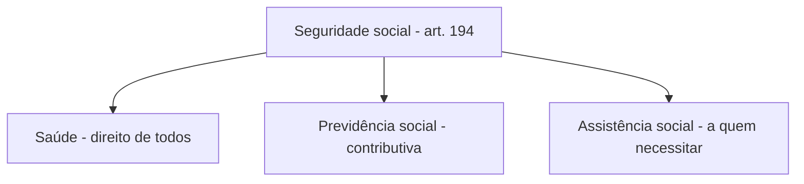

A Constituição de 1988 não se limita a organizar o Estado e a garantir liberdades. Ela dedica um título inteiro, o Título VIII, à **ordem social**, que reúne as normas voltadas ao bem-estar da população: saúde, previdência, assistência, educação, cultura, desporto, ciência, comunicação, meio ambiente, família, criança, adolescente, jovem, idoso e indígenas. Este capítulo abre o título com a disposição geral do art. 193 e com as regras comuns da **seguridade social**, isto é, o conceito do art. 194, seus sete objetivos e a forma de financiamento do art. 195. É um dos pontos mais cobrados de todo o volume, porque as bancas trocam os princípios entre si e confundem seguridade com previdência.

> [!objetivos]
> - Explicar a base e o objetivo da ordem social e a função de planejamento criada pela EC 108/2020.
> - Distinguir seguridade social, saúde, previdência e assistência social.
> - Reconhecer os sete objetivos da seguridade social e aplicá-los a exemplos.
> - Identificar as fontes de financiamento do art. 195 e as regras de seus parágrafos.

## A ordem social na Constituição

O art. 6º enumera os **direitos sociais**. Entre eles estão educação, saúde, alimentação, trabalho e moradia; somam-se transporte, lazer, segurança, previdência, amparo à maternidade e à infância e socorro a quem está desamparado. Esses direitos pertencem à chamada **segunda geração**, que exigem do Estado **prestações positivas**, ou seja, uma atuação concreta em favor das pessoas. Por isso se fala em liberdades positivas. O conjunto de normas que busca concretizar esses direitos é a **ordem social**.

A constitucionalização da ordem social foi consequência de uma mudança no papel do Estado: ao final da Primeira Guerra Mundial, ele passou a atuar como garantidor do bem-estar e da justiça social. No Brasil, a primeira Constituição a trazer normas de ordem social foi a de **1934**. A de 1988 reservou a elas todo o **Título VIII**, e a doutrina de José Afonso da Silva destaca que a ordem social, ao lado dos direitos fundamentais, compõe o centro do regime democrático instituído. Há ainda matérias nesse título que não são propriamente sociais, como a ciência e tecnologia e o meio ambiente.

Segundo o texto constitucional, a ordem social engloba as seguintes matérias, que serão vistas neste volume:

| Matéria | Onde está | Capítulo deste volume |
| --- | --- | --- |
| Seguridade social (saúde, previdência e assistência) | arts. 194 a 204 | 1, 2 e 3 |
| Educação, cultura e desporto | arts. 205 a 217 | 4 |
| Ciência, tecnologia e inovação; comunicação social; meio ambiente | arts. 218 a 225 | 5 |
| Família, criança, adolescente, jovem e idoso; índios | arts. 226 a 232 | 6 |

### Base e objetivo da ordem social

> [!lei] CF, art. 193
> A ordem social tem como base o primado do trabalho, e como objetivo o bem-estar e a justiça sociais.

A **base** da ordem social é o **primado do trabalho**: é pelo trabalho que as pessoas obtêm recursos para satisfazer suas necessidades. O **objetivo** é o **bem-estar e a justiça sociais**. Há relação direta com a ordem econômica, que, nos termos do art. 170, está fundada na valorização do trabalho humano.

A **Emenda Constitucional 108/2020** acrescentou ao art. 193 um **parágrafo único**. Por ele, cabe ao Estado **planejar as políticas sociais**, e a lei deve garantir que a sociedade participe de quatro etapas: formular, monitorar, controlar e avaliar essas políticas. É norma de **eficácia limitada**, pois depende de lei para produzir todos os seus efeitos.

> [!bizu]
> Base e objetivo do art. 193 caem em dupla: **trabalho** é a base; **bem-estar e justiça sociais** são o objetivo. Se a assertiva inverter os dois, ou trocar "primado do trabalho" por "livre iniciativa", está errada.

### Planejar e participar: o que a EC 108/2020 mudou

Antes da emenda, o art. 193 só dizia qual era a base e qual era o objetivo. Agora ele atribui ao Estado a **função de planejamento**, que significa organizar metas, prioridades e recursos das políticas sociais com antecedência, e não apenas reagir a problemas. A segunda parte da norma, a **participação da sociedade**, completa o desenho democrático da ordem social: conselhos, conferências e audiências são exemplos de espaços em que essa participação acontece, sempre na forma da lei. Como a participação depende de regulamentação, a norma é de eficácia limitada, e uma assertiva que a trate como autoaplicável erra.

## Seguridade social: conceito

> [!lei] CF, art. 194
> A seguridade social compreende um conjunto integrado de ações de iniciativa dos Poderes Públicos e da sociedade, destinadas a assegurar os direitos relativos à saúde, à previdência e à assistência social.

Três observações decorrem do caput. Primeira: a seguridade social é **gênero**, e a **saúde**, a **previdência** e a **assistência social** são suas três áreas. Segunda: as ações são de **iniciativa dos Poderes Públicos e da sociedade**; o Estado tem papel central, mas não age sozinho. Terceira: a finalidade é montar um sistema de proteção social que permita às pessoas prover seu sustento e o de sua família diante de situações de vulnerabilidade, como doença, idade avançada, morte, acidente, reclusão e maternidade.

A tabela compara as três áreas, e a diferença entre elas é o que as bancas mais exploram.

| Área | Quem tem direito | Exige contribuição? |
| --- | --- | --- |
| Saúde | Todos | Não |
| Previdência social | Quem contribui (segurados) e seus dependentes | Sim, tem caráter contributivo |
| Assistência social | Quem dela necessitar | Não |

> [!pegadinha]
> Trocar os conceitos: afirmar que é a **previdência social** que reúne as ações integradas voltadas à saúde e à assistência. Esse conjunto integrado é a **seguridade social**. A previdência é apenas uma de suas três áreas. Outra variação comum diz que a seguridade compreende "a assistência social, o **trabalho** e a saúde"; o trabalho não faz parte, a terceira área é a previdência.

## Objetivos da seguridade social

> [!lei] CF, art. 194, parágrafo único
> Compete ao Poder Público, nos termos da lei, organizar a seguridade social, com base nos seguintes objetivos:
> I - universalidade da cobertura e do atendimento;
> II - uniformidade e equivalência dos benefícios e serviços às populações urbanas e rurais;
> III - seletividade e distributividade na prestação dos benefícios e serviços;
> IV - irredutibilidade do valor dos benefícios;
> V - equidade na forma de participação no custeio;
> VI - diversidade da base de financiamento, identificando-se, em rubricas contábeis específicas para cada área, as receitas e as despesas vinculadas a ações de saúde, previdência e assistência social, preservado o caráter contributivo da previdência social;
> VII - caráter democrático e descentralizado da administração, mediante gestão quadripartite, com participação dos trabalhadores, dos empregadores, dos aposentados e do Governo nos órgãos colegiados.

O parágrafo único do art. 194 entrega ao **Poder Público** a tarefa de **organizar a seguridade social**, conforme a lei, a partir de sete objetivos, reproduzidos abaixo. A Constituição os chama de objetivos, e a doutrina os trata também como **princípios**. Atenção a um detalhe cobrado com frequência: eles são princípios da **seguridade social**, e não só da previdência; aplicam-se, portanto, às três áreas.

### Universalidade da cobertura e do atendimento

São dois princípios em um. A **universalidade da cobertura**, ou universalidade **objetiva**, consiste em proteger o maior número possível de situações de risco social, como doença, velhice, maternidade, acidente e reclusão. A **universalidade do atendimento**, ou universalidade **subjetiva**, consiste em proteger todos os indivíduos que precisarem da seguridade social. Na prática, o alcance varia conforme a área: a previdência atende quem contribui, a saúde atende todos e a assistência atende quem dela necessitar, sem exigir contribuição.

### Uniformidade e equivalência para populações urbanas e rurais

O objetivo é dar proteção **isonômica** a quem vive na cidade e a quem vive no campo. Os benefícios, como a aposentadoria e a pensão por morte, e os serviços, como o atendimento médico no SUS, devem ser os mesmos para as duas populações. Note que o texto fala em **uniformidade e equivalência**; não se trata de "universalidade".

### Seletividade e distributividade

Os recursos são limitados e as necessidades, muitas. Por isso o legislador **seleciona** quem será atendido e quais riscos serão cobertos (seletividade) e dá **prioridade a quem mais precisa**, redistribuindo renda para as camadas mais pobres (distributividade). O **salário-família** ilustra bem a ideia, porque só chega ao trabalhador de baixa renda, como determina o texto constitucional.

### Irredutibilidade do valor dos benefícios

Esse objetivo protege o beneficiário de duas maneiras. Nos **benefícios previdenciários**, como a aposentadoria e a pensão por morte, a Constituição garante a preservação do **valor real**, isto é, o poder aquisitivo, de modo que a inflação não corroa o benefício (art. 201, § 4º). Nos demais benefícios da seguridade, como o benefício assistencial, garante-se a preservação do **valor nominal**: a lei não pode reduzir o valor, mas o benefício não está protegido contra a inflação.

### Equidade na forma de participação no custeio

Decorre da capacidade contributiva: cada um contribui na proporção de sua capacidade, e quem tem renda maior contribui mais. O princípio rege o **custeio de toda a seguridade**, e não só da previdência. Ele aparece nas contribuições das empresas, que podem ter **alíquotas diferenciadas** conforme a atividade econômica, o uso intensivo de mão de obra, o porte da empresa ou a condição do mercado de trabalho (art. 195, § 9º). Também aparece nas **alíquotas progressivas** do trabalhador, que crescem conforme a faixa do salário de contribuição, admitidas pela EC 103/2019.

### Diversidade da base de financiamento

A seguridade social tem **múltiplas fontes de financiamento**, o que dá estabilidade ao sistema: se uma fonte oscila, as outras sustentam o conjunto, como na máxima popular de não pôr todos os ovos na mesma cesta. A EC 103/2019 passou a exigir que o orçamento identifique, **em rubricas contábeis próprias de cada área**, o que entra e o que sai em saúde, em previdência e em assistência, sem apagar o caráter contributivo da previdência. Com isso, o orçamento mostra separadamente cada área, e a sociedade acompanha o que se gasta em cada uma.

### Caráter democrático e descentralizado da administração

A administração da seguridade tem **gestão quadripartite**, com participação de **trabalhadores, empregadores, aposentados e Governo** nos órgãos colegiados. O caráter democrático assegura a participação da sociedade, e o caráter descentralizado permite que vários setores participem da administração do sistema.

> [!esquema] Os sete objetivos em uma palavra-chave cada
> - I: **alcance** (cobertura e atendimento universais)
> - II: **igualdade** entre campo e cidade
> - III: **escolha** dos riscos e prioridade a quem precisa
> - IV: **proteção** do valor dos benefícios
> - V: **justiça** na divisão do custeio, só na previdência
> - VI: **várias fontes** de dinheiro, com rubricas separadas
> - VII: **participação** de quatro setores na gestão

Memorizar os verbos de cada um evita a "mistureba" que as bancas fazem. A tabela traz as trocas mais comuns e a correção.

| Assertiva da prova | Está certa? | Correção |
| --- | --- | --- |
| "Uniformidade da cobertura e do atendimento" | Errada | O correto é universalidade da cobertura e do atendimento |
| "Uniformidade na participação no custeio" | Errada | O correto é equidade na forma de participação no custeio |
| "Gestão bipartite entre gestores e representantes da população" | Errada | A gestão é quadripartite |
| "Seletividade e distributividade na prestação dos benefícios e serviços" | Certa | É o inciso III |

> [!bizu]
> Uma frase para fixar a ordem dos sete objetivos: **U**niversalidade, **U**niformidade, **S**eletividade, **I**rredutibilidade, **E**quidade, **D**iversidade, **G**estão. A primeira letra de cada palavra ajuda a lembrar que são sete e a não inventar um oitavo.

## Financiamento da seguridade social

Quem sustenta a seguridade, diz o art. 195, é **toda a sociedade**, de modo **direto e indireto**, conforme a lei. A via **indireta** é o dinheiro dos **orçamentos** das quatro esferas: União, Estados, Distrito Federal e Municípios. A via **direta** são as **contribuições sociais** listadas nos incisos. A Constituição não institui nenhuma contribuição: ela apenas **autoriza** que a lei as institua.

### Contribuições sociais do art. 195

| Inciso | Quem paga | Incidência | Exemplos |
| --- | --- | --- | --- |
| I | Empregador, empresa e entidade equiparada | Pagamentos pelo trabalho, receita ou faturamento e lucro | PIS/PASEP e COFINS (receita ou faturamento); CSLL (lucro) |
| II | Trabalhador e demais segurados | Salário de contribuição, com alíquotas que podem subir por faixa | Contribuição do segurado do RGPS |
| III | Apostadores | Receita de concursos de prognósticos | Loterias |
| IV | Importador de bens ou serviços do exterior, ou quem a lei equiparar | Importação | PIS/PASEP-Importação e COFINS-Importação |
| V | Contribuinte de bens e serviços | Bens e serviços, nos termos de lei complementar | Contribuição sobre bens e serviços, da reforma tributária |

Alguns pontos merecem destaque:

- **Empregador (inciso I).** Há três incidências. A primeira é a folha de salários, que abrange qualquer pagamento pelo trabalho a pessoa física, mesmo sem vínculo empregatício. A segunda é a receita ou o faturamento. A terceira é o lucro, alcançado pela **CSLL**, a Contribuição Social sobre o Lucro Líquido.
- **Trabalhador (inciso II).** O RGPS não cobra contribuição sobre as **aposentadorias e pensões que ele mesmo paga**. No regime próprio de previdência (RPPS), o art. 40, § 18, prevê contribuição sobre os proventos que superem o teto do RGPS.
- **Prognósticos (inciso III).** Concursos de prognósticos são as loterias.
- **Importador (inciso IV).** Foi incluído pela EC 42/2003.
- **Bens e serviços (inciso V).** É novidade da **EC 132/2023** (reforma tributária). Deve ser instituída por **lei complementar**, mas a **alíquota** pode ser fixada em **lei ordinária** (§ 15). Prevê-se ainda a possibilidade de devolução da contribuição a pessoas físicas, com o objetivo de reduzir desigualdades de renda (§ 18), e essa devolução não conta na receita corrente líquida da União para certos fins (§ 19). Os §§ 15 a 19 foram todos incluídos pela EC 132/2023.

> [!pegadinha]
> Dizer que a contribuição social do empregador incide **exclusivamente** sobre a folha de salários. Ela incide também sobre a **receita ou faturamento** e sobre o **lucro**. Outra armadilha é afirmar que a Constituição permite contribuição sobre aposentadoria e pensão do RGPS: o inciso II **veda** essa incidência.

### Regras dos parágrafos do art. 195

Os parágrafos reúnem regras que as bancas cobram quase em literalidade.

**Orçamento da seguridade (§§ 1º e 2º).** O dinheiro que Estados, Distrito Federal e Municípios reservam à seguridade fica nos **orçamentos de cada um** e **não entra no orçamento da União**. A proposta orçamentária da seguridade nasce de um trabalho **conjunto** dos órgãos de saúde, previdência e assistência, seguindo as metas e prioridades da **LDO** (lei de diretrizes orçamentárias), e cada área conserva a **gestão dos seus recursos**.

**Sanção ao devedor (§ 3º).** A empresa que deve à seguridade fica **impedida de contratar com o Poder Público** e de receber dele **incentivos fiscais ou de crédito**, nos termos da lei.

**Outras fontes (§ 4º).** A lei poderá instituir outras fontes para garantir a manutenção ou a expansão da seguridade, **obedecido o art. 154, I**. Esse inciso trata da competência residual da União, que exige **lei complementar**, e as novas fontes devem ser **não cumulativas**, além de não repetirem o fato gerador nem a base de cálculo de tributos que a Constituição já nomeou. Por isso, as contribuições **previstas** na Constituição são criadas por lei ordinária, e as **novas** exigem lei complementar.

**Preexistência do custeio (§ 5º).** Antes de criar, aumentar ou ampliar benefício ou serviço, é preciso já existir o dinheiro que o sustentará por inteiro.

> [!lei] CF, art. 195, § 5º
> Nenhum benefício ou serviço da seguridade social poderá ser criado, majorado ou estendido sem a correspondente fonte de custeio total.

**Noventena (§ 6º).** As contribuições sociais só podem ser exigidas **90 dias** depois da publicação da lei que as instituiu ou modificou, e **não se aplica** a elas a anterioridade de exercício do art. 150, III, "b". Ou seja, elas obedecem à **anterioridade nonagesimal**, mas não precisam esperar o exercício financeiro seguinte.

**Entidades beneficentes (§ 7º).** O texto fala em "isentas", mas tecnicamente se trata de **imunidade** das entidades beneficentes de assistência social que atendam às exigências legais. O STF exige que os requisitos dessa imunidade estejam em lei complementar.

**Segurado especial (§ 8º).** Trabalham em **regime de economia familiar, sem empregados permanentes**, o produtor, o parceiro, o meeiro e o arrendatário rurais, o pescador artesanal e seus cônjuges. Eles pagam à seguridade aplicando uma alíquota ao **resultado da venda da produção** e recebem os benefícios previstos em lei. Como não têm renda periódica, a contribuição precisa ser diferenciada. Entre os segurados do RGPS estão os empregados, os domésticos, os autônomos (contribuintes individuais), os avulsos, os facultativos e, por fim, os especiais.

**Alíquotas e bases diferenciadas (§ 9º).** As contribuições do empregador podem variar de alíquota segundo quatro fatores: o ramo de atividade, o uso intensivo de mão de obra, o tamanho da empresa e a situação estrutural do mercado de trabalho. Desde a EC 103/2019, a **base de cálculo** também pode variar, porém só nas contribuições sobre receita ou faturamento e sobre o lucro (alíneas "b" e "c"). Assim, a base da CSLL pode favorecer ou onerar certos tipos de empresa.

**Transferências ao SUS e à assistência (§ 10).** Caberá à lei fixar como a União repassa verbas do SUS e da assistência a Estados, Distrito Federal e Municípios, e como os Estados repassam aos Municípios, sempre com contrapartida de quem recebe.

**Moratória e parcelamento (§ 11).** A Constituição proíbe moratória e parcelamento que passem de **60 meses**. Proíbe também a **remissão e a anistia**, salvo nos termos de lei complementar, quando se trata da contribuição patronal sobre a folha (inciso I, "a") e da contribuição do trabalhador (inciso II).

**Não cumulatividade (§ 12).** A lei escolhe os ramos da economia em que as contribuições sobre receita ou faturamento e sobre a importação funcionam de modo **não cumulativo**.

**Tempo de contribuição (§ 14).** O segurado só tem reconhecida como tempo de contribuição ao RGPS a competência cuja contribuição seja igual ou superior ao mínimo exigido para sua categoria, assegurado o agrupamento de contribuições. O § 13 foi revogado.

> [!atencao] O que costuma cair e o que quase nunca cai
> Os §§ 8º a 14 são pouco cobrados em provas de Direito Constitucional, e, quando aparecem, a banca raramente vai além da literalidade. O aprofundamento pertence ao Direito Previdenciário. Concentre-se em: contribuições do caput, sanção do § 3º, fontes novas do § 4º, custeio prévio do § 5º, noventena do § 6º e imunidade do § 7º.

## Comparando os conceitos de custeio

Para fechar o assunto, vale comparar três ideias que a banca mistura: o que é **fonte** de financiamento, o que é **princípio** e o que é **regra de aplicação**. Uma fonte é de onde vem o dinheiro, como a CSLL ou a receita das loterias. Um princípio é uma orientação geral para organizar o sistema, como a diversidade da base. Uma regra de aplicação diz como e quando a fonte funciona, como a noventena. Quando a assertiva apresenta uma fonte como se fosse princípio, ou o contrário, ela está errada, ainda que cada termo, isoladamente, exista na Constituição.

| Ideia | Natureza | Dispositivo |
| --- | --- | --- |
| Diversidade da base de financiamento | Princípio (objetivo) | Art. 194, parágrafo único, VI |
| Equidade na forma de participação no custeio | Princípio (objetivo) | Art. 194, parágrafo único, V |
| Preexistência da fonte de custeio total | Regra de aplicação | Art. 195, § 5º |
| Noventena das contribuições sociais | Regra de aplicação | Art. 195, § 6º |

## Como a banca cobra este assunto

As provas de nível médio e superior usam a literalidade dos arts. 193 a 195, quase sempre com uma troca de palavra. Os padrões mais frequentes são:

- **Conceito de seguridade social:** troca entre seguridade e previdência, ou inclusão do "trabalho" entre as áreas.
- **Lista de princípios:** substituição de um termo (uniformidade por universalidade, equidade por igualdade, gestão quadripartite por bipartite).
- **Previdência contributiva, saúde e assistência não:** frase do tipo "a seguridade social tem caráter contributivo e filiação obrigatória".
- **Fontes de financiamento:** incidência da contribuição do empregador, vedação de contribuição sobre aposentadoria e pensão do RGPS, loterias como receita.
- **Parágrafos do art. 195:** exigência de fonte de custeio total, noventena, imunidade das entidades beneficentes, lei complementar para novas fontes, orçamento dos entes fora do orçamento da União.

## Mapa do capítulo

| Tema | Regra | Cuidado |
| --- | --- | --- |
| Ordem social (art. 193) | Base: primado do trabalho; objetivo: bem-estar e justiça sociais | Não inverter base e objetivo |
| Seguridade social | Saúde, previdência e assistência | Previdência é só uma das três áreas |
| Contribuição | Só a previdência é contributiva | Saúde é de todos; assistência, de quem precisar |
| Objetivos | Sete, no art. 194, parágrafo único | Universalidade, não uniformidade, da cobertura |
| Equidade no custeio | Vale para o custeio de toda a seguridade | Alíquotas diferenciadas das empresas (art. 195, § 9º) e progressivas do trabalhador (EC 103/2019) |
| Financiamento | Orçamentos dos entes e contribuições sociais | A Constituição autoriza, a lei institui |
| Novas fontes | Lei complementar (art. 154, I) | Fontes já previstas: lei ordinária |
| Contribuições sociais | Noventena, sem anterioridade de exercício | Não é a regra dos impostos |

### Para fixar

- O trabalho é a base da ordem social, e o bem-estar com justiça social é seu objetivo.
- A EC 108/2020 criou a função de planejamento das políticas sociais, com participação da sociedade.
- A seguridade social é o conjunto integrado de ações de saúde, previdência e assistência social.
- Só a previdência é contributiva; a saúde é direito de todos e a assistência atende a quem necessitar.
- Os sete objetivos do art. 194 orientam as três áreas, e a equidade no custeio permite alíquotas diferenciadas e progressivas.
- A irredutibilidade preserva o valor real nos benefícios previdenciários e o valor nominal nos demais.
- O financiamento vem dos orçamentos dos entes e das contribuições do empregador, do trabalhador, dos prognósticos, do importador e de bens e serviços.
- Não incide contribuição sobre aposentadoria e pensão do RGPS.
- Criar, aumentar ou ampliar benefício exige fonte de custeio total.
- As contribuições sociais respeitam a noventena e não a anterioridade de exercício; novas fontes exigem lei complementar.
