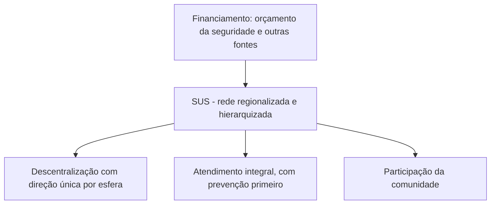

A saúde recebeu da Constituição de 1988 um tratamento nunca visto nas constituições anteriores: deixou de ser um favor ligado à carteira de trabalho e virou **direito de todos e dever do Estado**. Para dar conta dessa promessa, a Constituição criou o **Sistema Único de Saúde**, o SUS, e fixou regras de organização, de financiamento e de participação da iniciativa privada. Este capítulo percorre os arts. 196 a 200, com ênfase no que mais cai: as diretrizes do SUS, o piso de aplicação dos recursos, as vedações à iniciativa privada e os dispositivos sobre agentes de saúde e pisos salariais.

> [!objetivos]
> - Explicar o que o art. 196 afirma sobre o direito à saúde e quais princípios decorrem dele.
> - Descrever a estrutura do SUS, suas três diretrizes e a forma de financiamento.
> - Identificar o papel da iniciativa privada e as vedações do art. 199.
> - Reconhecer os dispositivos sobre agentes comunitários de saúde, agentes de combate às endemias e pisos salariais da enfermagem.

## O direito à saúde

> [!lei] CF, art. 196
> A saúde é direito de todos e dever do Estado, garantido mediante políticas sociais e econômicas que visem à redução do risco de doença e de outros agravos e ao acesso universal e igualitário às ações e serviços para sua promoção, proteção e recuperação.

Desse artigo se extraem quatro conclusões. A saúde é direito de **todos**, sem exigir contribuição. É **dever do Estado**, que o cumpre por meio de políticas sociais e econômicas. Essas políticas têm dupla finalidade: **reduzir o risco** de doença e de outros agravos e garantir o **acesso universal e igualitário** às ações e serviços de promoção, proteção e recuperação. Por isso o direito à saúde se apoia nos princípios da **universalidade** e da **igualdade de acesso**.

O Supremo Tribunal Federal já afirmou que o caráter programático do art. 196 não pode virar "promessa constitucional inconsequente": o Poder Público não pode alegar que a norma é meramente programática para deixar de cumprir seu dever. Ao mesmo tempo, a igualdade de acesso tem consequências práticas. O STF julgou constitucional a regra que impede, no âmbito do SUS, a internação em acomodação superior ou o atendimento diferenciado por médico do sistema ou conveniado mediante pagamento da diferença de valores. Em outras palavras, o paciente do SUS **não pode pagar a mais** para ter conforto ou prioridade, porque isso quebraria o acesso igualitário.

> [!jurisprudencia] STF, RE 581.488
> Após o julgamento de 2015, entende-se que é constitucional a regra que veda, no SUS, a internação em acomodações superiores e o atendimento diferenciado mediante pagamento da diferença de valores. Quem quiser esse tipo de serviço deve procurar a rede privada.

### Relevância pública e execução

> [!lei] CF, art. 197
> São de relevância pública as ações e serviços de saúde, cabendo ao Poder Público dispor, nos termos da lei, sobre sua regulamentação, fiscalização e controle, devendo sua execução ser feita diretamente ou através de terceiros e, também, por pessoa física ou jurídica de direito privado.

O art. 197 separa duas tarefas. **Regulamentar, fiscalizar e controlar** as ações e serviços de saúde cabe ao **Poder Público**. **Executá-los**, em contrapartida, pode ser feito pelo próprio Estado ou por terceiros, inclusive pessoas físicas e jurídicas de direito privado. A relevância pública é o que justifica que o Estado fiscalize até os serviços prestados por particulares.

## O Sistema Único de Saúde

O art. 198 institucionaliza o SUS. Segundo ele, as ações e os serviços públicos de saúde se organizam em **rede**, com **regionalização** e **hierarquização**, e compõem um **sistema único**. A **regionalização** adapta os serviços às necessidades de cada região. A **hierarquização** distribui as tarefas entre os entes conforme o grau de complexidade: a atenção básica fica mais perto do cidadão, e os casos mais complexos sobem para unidades de maior capacidade.

### As três diretrizes

A organização do SUS obedece a três diretrizes.

1. **Descentralização, com direção única em cada esfera de governo.** Em cada nível da federação há uma autoridade que gerencia a saúde: o Ministério da Saúde, na União, e as Secretarias de Saúde, nos Estados, no Distrito Federal e nos Municípios. A direção do sistema é, portanto, única em cada esfera, e as ações e serviços são descentralizados.
2. **Atendimento integral.** A prevenção tem prioridade, mas os serviços de assistência continuam sendo oferecidos. É a integralidade: a cobertura deve ser a mais ampla possível, e a prevenção vem primeiro, para evitar ou reduzir doenças.
3. **Participação da comunidade.** Assegura aos cidadãos voz na definição das políticas de saúde, por meio de conselhos e conferências.

| Diretriz | Ideia central | Erro de prova comum |
| --- | --- | --- |
| Descentralização | Direção única em cada esfera de governo | Dizer que há direção única nacional no Ministério da Saúde |
| Atendimento integral | Prevenção em primeiro lugar, sem excluir a assistência | Dizer que a prioridade é a atividade assistencial |
| Participação da comunidade | Cidadãos participam das políticas | Atribuir a participação só aos servidores da saúde |

> [!pegadinha]
> Escrever que a gestão do SUS é descentralizada, mas que seu comando fica concentrado no Ministério da Saúde. A direção única existe em **cada esfera de governo** (União, Estados, DF e Municípios), e não de forma centralizada em Brasília.

A EC 140/2026 acrescentou uma quarta diretriz ao art. 198, o inciso IV: a **atuação obrigatória e permanente de agentes comunitários de saúde e de agentes de combate às endemias**, cuja atividade é essencial ao SUS e exclusiva de Estado. O tema volta adiante neste capítulo.

### Financiamento e piso de aplicação

O dinheiro do SUS vem, conforme o art. 195, do **orçamento da seguridade social** de cada uma das quatro esferas (União, Estados, DF e Municípios) e também de **outras fontes**. Isso é natural, já que a saúde é uma das áreas da seguridade.

A Constituição fixa **pisos de aplicação anual** em ações e serviços públicos de saúde, calculados por esfera.

| Ente | Base de cálculo do piso | Percentual |
| --- | --- | --- |
| União | Receita corrente líquida do respectivo exercício | No mínimo 15% |
| Estados e Distrito Federal | Impostos estaduais (arts. 155 e 156-A) e transferências, deduzidas as parcelas dos Municípios | Definido em lei complementar |
| Municípios e Distrito Federal | Impostos municipais (arts. 156 e 156-A) e transferências | Definido em lei complementar |

A **lei complementar**, que deve ser reavaliada pelo menos a cada **cinco anos**, define os percentuais de Estados, DF e Municípios, os critérios de rateio dos recursos federais e estaduais, com o objetivo de reduzir as disparidades regionais, e as regras para fiscalizar, avaliar e controlar os gastos com saúde nas quatro esferas. Essa lei é a **Lei Complementar 141/2012**, que fixa 12% para Estados e DF e 15% para Municípios.

### Competências do SUS

O art. 200 relaciona as atribuições do SUS, em **rol não exaustivo**: a lei pode atribuir outras.

| Inciso | Competência | Palavra-chave |
| --- | --- | --- |
| I | Controlar e fiscalizar procedimentos, produtos e substâncias; participar da produção de medicamentos, equipamentos, imunobiológicos e hemoderivados | Controle de produtos |
| II | Executar vigilância sanitária, vigilância epidemiológica e saúde do trabalhador | Vigilância |
| III | Ordenar a formação de recursos humanos na saúde | Formação |
| IV | Participar da política e da execução do saneamento básico | Saneamento |
| V | Incrementar o desenvolvimento científico e tecnológico e a inovação | Ciência |
| VI | Fiscalizar e inspecionar alimentos, bebidas e águas para consumo humano | Alimentos |
| VII | Participar do controle de substâncias psicoativas, tóxicas e radioativas | Substâncias |
| VIII | Colaborar na proteção do meio ambiente, inclusive o do trabalho | Meio ambiente |

> [!bizu]
> Para gravar o art. 200, pense no caminho de um alimento até a mesa: o SUS fiscaliza o que se **come e bebe** (VI), vigia a **doença e o ambiente de trabalho** (II e VIII), participa do **saneamento** (IV) e forma os **profissionais** (III). O que a Constituição não diz é que o SUS cuida sozinho de tudo, pois o rol é aberto.

## Iniciativa privada na saúde

> [!lei] CF, art. 199, § 2º
> É vedada a destinação de recursos públicos para auxílios ou subvenções às instituições privadas com fins lucrativos.

Pelo art. 199, o setor privado tem **liberdade** para atuar na assistência à saúde. As instituições privadas podem participar de forma **complementar** do SUS, segundo as diretrizes dele, por meio de **contrato de direito público ou convênio**, com preferência para as **entidades filantrópicas e as sem fins lucrativos**. Há duas vedações importantes: não pode haver auxílio ou subvenção com recursos públicos às instituições privadas **com fins lucrativos**, e a Constituição impede, direta ou indiretamente, a entrada de **empresas ou capital estrangeiro** na assistência à saúde, exceto nos casos que a lei previr. O § 4º manda a lei disciplinar a remoção de órgãos, tecidos e substâncias humanas para transplante, pesquisa e tratamento, e a coleta e a transfusão de sangue, **vedada toda comercialização**.

> [!atencao] Medicamentos sem registro
> Segundo o STF, o Estado, em regra, não pode ser obrigado a fornecer medicamento experimental, e a falta de registro na Anvisa impede o fornecimento por decisão judicial. Excepcionalmente, admite-se a concessão quando houver demora irrazoável da Anvisa em analisar o pedido e estiverem presentes três requisitos: pedido de registro no Brasil (dispensado para medicamentos órfãos de doenças raras e ultrarraras), registro em agências renomadas do exterior e ausência de substituto terapêutico registrado no país. Essas ações devem ser propostas contra a **União** (Tema 500).

## Agentes de saúde e pisos salariais

O art. 198 trata ainda de categorias específicas.

**Agentes comunitários de saúde e de combate às endemias.** Quem comanda o SUS no plano local (as Secretarias Municipais de Saúde, por exemplo) pode admiti-los por **seleção pública**, sem concurso, ajustada às atribuições de cada função. Eles têm **regime jurídico próprio**, definido em lei federal (Lei 11.350/2006), que também fixa o piso salarial profissional nacional e as diretrizes de carreira. Pela redação atual, trazida pela EC 140/2026, é vedada a contratação **temporária ou terceirizada** desses agentes, salvo emergência em saúde pública, e eles se submetem ao regime dos servidores de **cargo efetivo**. Podem perder o cargo, além das hipóteses gerais dos arts. 41, § 1º, e 169, § 4º, em caso de descumprimento dos requisitos fixados em lei para o exercício da função.

O **vencimento** desses agentes fica a cargo da **União**, em dotação própria e exclusiva no orçamento geral, e **não pode ser inferior a dois salários mínimos**. Os repasses aos demais entes não entram no cálculo do limite de despesa com pessoal. Cabe aos Estados, ao DF e aos Municípios estabelecer incentivos, auxílios, gratificações e indenizações. Em razão dos riscos da função, os agentes têm direito a **aposentadoria com requisitos diferenciados** e a **adicional de insalubridade**.

**Pisos da enfermagem.** Pela EC 124/2022, uma lei federal deve criar **pisos salariais nacionais** para quatro profissões: enfermeiro, técnico de enfermagem, auxiliar de enfermagem e parteira. A regra vale para quem contrata nessas áreas, seja órgão público, seja empresa ou entidade de **direito privado**. A Lei 14.434/2022 instituiu esses pisos. A EC 127/2022 acrescentou os §§ 14 e 15: a União presta **assistência financeira complementar** a Estados, DF, Municípios, entidades filantrópicas (como as Santas Casas) e prestadores contratualizados que atendam, no mínimo, **60% de pacientes do SUS**, com recursos em dotação própria e exclusiva. Ao julgar a ADI 7222, o STF entendeu que, para os trabalhadores celetistas em geral, a implementação deve ser regionalizada, por negociação coletiva, e que o piso se refere à **remuneração global**, podendo ser reduzido proporcionalmente quando a jornada for inferior a 8 horas diárias ou 44 semanais.

| Categoria | Responsável pelo pagamento | Mínimo ou piso |
| --- | --- | --- |
| Agentes comunitários de saúde e de combate às endemias | União, que repassa aos demais entes | Não inferior a 2 salários mínimos |
| Enfermeiro, técnico, auxiliar e parteira | Empregador público ou privado, com ajuda financeira da União | Piso nacional fixado em lei |

## Como a banca cobra este assunto

Os padrões mais frequentes são:

- **Direção única:** o SUS tem direção única em cada esfera, e não direção central no Ministério da Saúde.
- **Admissão de agentes:** possibilidade de seleção pública, e não de concurso obrigatório, para os agentes comunitários e de combate às endemias; a banca pode também cobrar a vedação à contratação temporária, trazida pela EC 140/2026.
- **Iniciativa privada:** só entidades filantrópicas e sem fins lucrativos recebem recursos públicos; instituições com fins lucrativos, não.
- **Percentual da União:** 15% da receita corrente líquida.
- **Direito de todos:** a saúde independe de contribuição, ao contrário da previdência.
- **Acesso igualitário:** vedação de pagar diferença para acomodação superior no SUS.
- **Medicamentos:** fornecimento judicial sem registro na Anvisa só em hipótese excepcional, contra a União.
- **Pisos salariais:** quem paga o vencimento dos agentes comunitários e quem fixa o piso da enfermagem.

Quando a assertiva repete o texto constitucional com uma palavra trocada, a troca costuma estar em quem decide (União, Estado, Município), em quem pode receber recursos (com ou sem fins lucrativos) ou no número (15%, 60%, dois salários mínimos).

## Mapa do capítulo

| Tema | Regra | Cuidado |
| --- | --- | --- |
| Art. 196 | Saúde é direito de todos e dever do Estado | Não depende de contribuição |
| Art. 197 | Relevância pública | Estado regulamenta; execução pode ser privada |
| Diretrizes do SUS | Descentralização, atendimento integral e participação da comunidade | Direção única em cada esfera |
| Piso da União | 15% da receita corrente líquida | Estados e Municípios: lei complementar |
| Iniciativa privada | Complementar, por contrato ou convênio | Sem recursos públicos para fins lucrativos |
| Capital estrangeiro | Vedado, salvo em lei | Vale para a assistência à saúde |
| Agentes comunitários | Processo seletivo; vencimento a cargo da União | Mínimo de 2 salários mínimos |

### Para fixar

- A saúde é direito de todos e dever do Estado, independentemente de contribuição.
- O SUS é uma rede regionalizada e hierarquizada, que forma um sistema único.
- As diretrizes são descentralização com direção única em cada esfera, atendimento integral com prioridade para a prevenção e participação da comunidade.
- A União aplica no mínimo 15% da receita corrente líquida em saúde; os demais percentuais vêm de lei complementar.
- O rol de competências do art. 200 não é exaustivo.
- A iniciativa privada atua de forma complementar, com preferência para filantrópicas e sem fins lucrativos.
- Não se destinam recursos públicos a instituições privadas com fins lucrativos, nem se admite capital estrangeiro na assistência à saúde, salvo em lei.
- Agentes comunitários de saúde e de combate às endemias têm vencimento a cargo da União, não inferior a dois salários mínimos.
- A lei federal fixa pisos salariais para enfermeiros, técnicos, auxiliares e parteiras, com ajuda financeira da União.
