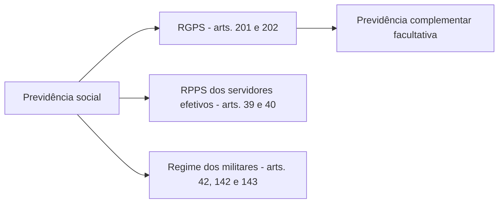

A previdência social e a assistência social são as duas áreas da seguridade que mais se parecem à primeira vista, porque ambas pagam benefícios em dinheiro, e mais se diferenciam na essência: a primeira exige contribuição, a segunda não. As provas exploram exatamente essa fronteira. Este capítulo estuda o **Regime Geral de Previdência Social** (art. 201), a **previdência complementar** (art. 202) e a **assistência social** (arts. 203 e 204), com atenção especial às idades de aposentadoria, aos benefícios cobertos e ao benefício assistencial.

> [!objetivos]
> - Distinguir os regimes de previdência e as características do RGPS.
> - Listar os eventos cobertos pelo art. 201 e os principais parágrafos sobre valor, reajuste e aposentadoria.
> - Explicar a previdência complementar, suas entidades e as vedações do art. 202.
> - Descrever os objetivos e as diretrizes da assistência social e o benefício assistencial.

## Previdência social

A previdência social protege as pessoas diante de eventos que reduzem ou eliminam a capacidade de trabalhar e de se sustentar. Diferentemente da saúde e da assistência, ela tem **caráter contributivo**: só usufrui dos benefícios quem contribui para o sistema, ou seus dependentes. O sistema brasileiro tem três regimes.

| Regime | Quem protege | Onde está |
| --- | --- | --- |
| Regime Geral de Previdência Social (RGPS) | Trabalhadores da iniciativa privada e demais segurados em geral | Arts. 201 e 202 |
| Regime Próprio de Previdência Social (RPPS) | Servidores titulares de cargo efetivo | Arts. 39 e 40 |
| Regime dos militares | Militares das Forças Armadas e dos Estados | Arts. 42, 142 e 143 |

O foco deste capítulo é o RGPS, que a Constituição define em seu art. 201.

> [!lei] CF, art. 201, caput
> A previdência social será organizada sob a forma do Regime Geral de Previdência Social, de caráter contributivo e de filiação obrigatória, observados critérios que preservem o equilíbrio financeiro e atuarial, e atenderá, na forma da lei, a:

O caput traz quatro marcas do RGPS: é um **regime geral**, de **caráter contributivo**, de **filiação obrigatória** e sujeito ao **equilíbrio financeiro e atuarial**. Quem exerce atividade remunerada enquadrada pela lei se filia automaticamente, sem escolha. O equilíbrio financeiro e atuarial pede que as contas fechem hoje e no futuro, considerando a expectativa de vida e o número de contribuintes.

### Eventos cobertos

Os incisos indicam o que a previdência deve cobrir e o benefício que concretiza cada cobertura.

| Inciso | Evento protegido | Benefício correspondente |
| --- | --- | --- |
| I | Afastamento temporário ou definitivo do trabalho por incapacidade, e velhice | Auxílio por incapacidade, aposentadoria por incapacidade, aposentadoria por idade |
| II | Maternidade, com atenção especial à gestante | Salário-maternidade |
| III | Desemprego involuntário | Seguro-desemprego e manutenção da qualidade de segurado por período de graça |
| IV | Dependentes dos segurados de baixa renda | Salário-família e auxílio-reclusão |
| V | Morte do segurado, homem ou mulher | Pensão por morte, ao cônjuge ou companheiro e dependentes |

Dois detalhes merecem destaque. No inciso IV, a baixa renda é do **segurado**: sem ela, não há salário-família nem auxílio-reclusão. O auxílio-reclusão é devido aos dependentes do segurado que está preso. No inciso V, a pensão por morte vale para segurado **homem ou mulher**, e o benefício não pode ser inferior a um salário mínimo, conforme o § 2º.

> [!jurisprudencia] STF, ADI 6096 e ADI 6327
> O Supremo entendeu que o núcleo do direito à previdência é imprescritível, irrenunciável e indisponível, de modo que não existe prazo decadencial para o **indeferimento, o cancelamento ou a cessação** do benefício, embora exista prazo para **revisar** o ato de concessão. Decidiu ainda que, se a internação depois do parto passar de duas semanas, a licença e o salário-maternidade só começam a contar quando receber alta a mãe ou o bebê, valendo a data mais tardia.

### Parágrafos do art. 201

**Requisitos diferenciados (§ 1º).** A regra é vedar critérios diferentes para a concessão de benefícios. A exceção, por lei complementar, permite idade e tempo de contribuição diferentes na aposentadoria de duas categorias: os segurados **com deficiência**, avaliados por uma equipe multiprofissional e interdisciplinar (avaliação biopsicossocial), e os que atuam sob **exposição efetiva a agentes nocivos à saúde**, sejam químicos, físicos ou biológicos, ou combinados. A Constituição proíbe reconhecer a condição especial só pela profissão ou pela ocupação. Essa exceção sustenta a **aposentadoria especial**.

**Valor mínimo (§ 2º).** Quando o benefício toma o lugar do que o segurado ganhava, seja contribuição, seja rendimento do trabalho, a parcela mensal não pode ficar abaixo do **salário mínimo**. Por isso aposentadorias e pensões nunca ficam abaixo dele. Já benefícios que **não substituem** a remuneração, como o salário-família e o auxílio-acidente, podem ter valor menor.

**Atualização e valor real (§§ 3º e 4º).** Os salários de contribuição usados no cálculo são atualizados na forma da lei, e os benefícios são reajustados para preservar o **valor real** de modo permanente. Essa proteção do valor real é própria dos benefícios previdenciários. O reajuste, porém, não é vinculado aos índices do salário mínimo.

**Servidor de RPPS (§ 5º).** É proibida a filiação ao RGPS, como **segurado facultativo**, de quem participa de regime próprio. O servidor efetivo, portanto, não é facultativo do RGPS.

**Gratificação natalina (§ 6º).** O décimo terceiro dos aposentados e pensionistas tem por base os proventos de **dezembro**.

> [!pegadinha]
> Afirmar que o requisito reduzido em cinco anos para o docente da educação básica é o "tempo de contribuição e a idade". O § 8º reduz **somente a idade**. Outra troca frequente é dizer que o servidor de regime próprio pode ser segurado facultativo do RGPS; o § 5º **proíbe**.

### Aposentadoria no RGPS

O § 7º garante a aposentadoria pelo RGPS com dois requisitos que se somam: **idade** e **tempo mínimo de contribuição** (definido em lei).

| Categoria | Idade do homem | Idade da mulher | Tempo de contribuição |
| --- | --- | --- | --- |
| Regra geral | 65 anos | 62 anos | Mínimo fixado em lei |
| Trabalhadores rurais e em economia familiar (inclui o produtor rural, o garimpeiro e o pescador artesanal) | 60 anos | 55 anos | A Constituição não prevê mínimo |
| Docente de educação básica (infantil, fundamental e médio) | Reduz 5 anos | Reduz 5 anos | Exclusivamente efetivo exercício do magistério |
| Agentes comunitários de saúde e de combate às endemias (EC 140/2026) | 60 anos | 57 anos | Mínimo de 25 anos de contribuição e de efetivo exercício |

Outras regras do art. 201 completam o quadro:

- **Contagem recíproca (§ 9º).** O tempo contribuído no RGPS vale nos regimes próprios, o dos regimes próprios vale no RGPS e entre si, com compensação financeira entre os regimes. O § 9º-A estende a contagem recíproca ao tempo de serviço militar, para inativação militar ou aposentadoria.
- **Benefícios não programados (§ 10).** A lei complementar pode disciplinar a cobertura, inclusive de acidente do trabalho, de forma concorrente entre o RGPS e o setor privado.
- **Ganhos habituais (§ 11).** Os ganhos habituais do empregado, a qualquer título, entram no salário para contribuição e para reflexo nos benefícios, nos casos e na forma da lei.
- **Inclusão previdenciária (§§ 12 e 13).** A lei institui sistema especial, com alíquotas diferenciadas, para trabalhadores de baixa renda, inclusive os informais, e para quem se dedica exclusivamente ao trabalho doméstico em sua residência, em famílias de baixa renda. A aposentadoria desse segurado vale **um salário mínimo**.
- **Tempo fictício (§ 14).** Fica vedada a contagem de tempo de contribuição fictício.
- **Acumulação de benefícios (§ 15).** Lei complementar estabelece vedações, regras e condições.
- **Aposentadoria compulsória (§ 16).** Os empregados de consórcios públicos, empresas públicas, sociedades de economia mista e subsidiárias aposentam-se compulsoriamente, cumprido o tempo mínimo de contribuição, ao atingir a idade máxima do art. 40, § 1º, II (75 anos).

> [!bizu]
> Gravar a escada de idades do § 7º: **65/62** na regra geral, **60/55** no campo, e menos cinco anos para o docente da educação básica. Como a idade do homem vem sempre antes da da mulher, o par "maior primeiro" ajuda a não inverter.

## Previdência complementar

O art. 202 cria um sistema paralelo e **facultativo**. O regime de previdência privada, de caráter complementar, é **autônomo** em relação ao RGPS, assenta-se na formação de **reservas** que sustentem o benefício contratado e é regulado por **lei complementar**. Uma pessoa pode ser segurada do RGPS e, ao mesmo tempo, contratar um plano privado para complementar a renda.

Existem dois tipos de entidades. As **abertas** oferecem planos ao público em geral, como os planos vendidos por bancos. As **fechadas** oferecem planos a um grupo específico, como os empregados de uma empresa ou de um grupo de empresas, e contam com um **patrocinador**, que pode ser uma empresa ou um ente público.

| Característica | Entidade aberta | Entidade fechada |
| --- | --- | --- |
| Público | Qualquer pessoa | Grupo específico, como empregados de uma empresa |
| Patrocinador | Não há | Empresa ou ente federativo |
| Exemplo | Plano oferecido por banco | Fundo de pensão de uma empresa estatal |

Pontos relevantes do art. 202:

- A lei complementar garante ao participante **pleno acesso às informações** sobre a gestão de seu plano (§ 1º).
- As contribuições do empregador, os benefícios e as condições contratuais **não integram o contrato de trabalho** e, salvo os benefícios já concedidos, **não integram a remuneração** (§ 2º).
- Os entes federativos e suas entidades não podem **aportar** dinheiro a entidade de previdência privada, **salvo como patrocinadores**, caso em que a contribuição normal nunca pode exceder a do participante (§ 3º).
- A lei complementar disciplina a relação entre os entes patrocinadores e as entidades de previdência complementar (§§ 4º e 5º), inclusive os requisitos para designar diretores das entidades fechadas e a presença dos participantes nos colegiados (§ 6º).

## Assistência social

> [!lei] CF, art. 203, caput
> A assistência social será prestada a quem dela necessitar, independentemente de contribuição à seguridade social, e tem por objetivos:

Foi a Constituição de 1988 a primeira a tratar a assistência social como política pública, alinhada ao objetivo fundamental de erradicar a pobreza e reduzir desigualdades. A marca da assistência é a **ausência de contribuição**: quem precisa recebe, tenha ou não contribuído.

### Objetivos

1. A **proteção** à família, à maternidade, à infância, à adolescência e à velhice.
2. O **amparo** às crianças e adolescentes carentes.
3. A **promoção da integração ao mercado de trabalho**.
4. A **habilitação e a reabilitação** de quem tem deficiência, com apoio para que viva integrado à comunidade.
5. O **pagamento de um salário mínimo por mês** ao idoso e à pessoa com deficiência que demonstrem não ter como se sustentar nem receber sustento da família, nos termos da lei.
6. A **diminuição da vulnerabilidade** socioeconômica das famílias pobres e extremamente pobres.

O inciso V descreve o **benefício de prestação continuada (BPC)**, também chamado de benefício assistencial. Para recebê-lo não basta ser idoso ou ter deficiência: é preciso **comprovar** a insuficiência de recursos. A Lei 8.742/1993 (Lei Orgânica da Assistência Social) considera incapaz de prover a manutenção a família com renda mensal por pessoa inferior a **um quarto do salário mínimo**; o STF reconheceu que esse critério isolado é insuficiente e admite outros meios de prova da miséria. O Tribunal também decidiu que **estrangeiros residentes** no País, preenchidos os requisitos constitucionais, têm direito ao BPC, porque a igualdade entre brasileiros e estrangeiros residentes decorre do art. 5º.

> [!pegadinha]
> Dizer que o benefício de prestação continuada é um benefício da **previdência social**. Ele pertence à **assistência social**, não exige contribuição e não gera pensão. Do mesmo modo, a habilitação e a reabilitação de pessoas com deficiência são **serviços da assistência social**, e não da previdência.

### Diretrizes e financiamento

Segundo o art. 204, a assistência social é custeada pelo **orçamento da seguridade**, previsto no art. 195, e por outras receitas, e se organiza por duas diretrizes:

| Diretriz | Conteúdo |
| --- | --- |
| Descentralização político-administrativa | Coordenação e normas gerais na esfera federal; coordenação e execução dos programas nas esferas estadual e municipal e em entidades beneficentes e de assistência social |
| Participação da população | A sociedade, por organizações que a representam, ajuda a desenhar as políticas e a fiscalizar as ações em qualquer nível de governo |

O parágrafo único permite que Estados e Distrito Federal vinculem a programa de apoio à inclusão e promoção social até **0,5% da receita tributária líquida**, vedado usar esses recursos para pagar despesas com **pessoal e encargos sociais**, o **serviço da dívida** ou outra despesa corrente não ligada diretamente aos investimentos ou ações apoiados.

> [!atencao] Quem decide o que
> Na assistência social, a União coordena e edita normas gerais, mas **executa pouco**: a execução dos programas fica com Estados, Municípios e entidades beneficentes. Em prova, a troca mais comum é atribuir à União a execução direta de todos os programas.

## Comparação final das três áreas

Depois de ver as três áreas separadamente, vale compará-las lado a lado. A pergunta que resolve a maior parte das assertivas é simples: **quem tem direito e precisa pagar algo?** Se a resposta for "todos, e ninguém paga" é saúde; "quem necessitar, e ninguém paga" é assistência; "quem contribui e seus dependentes" é previdência. Um exemplo ajuda a fixar: o idoso sem renda que recebe um salário mínimo do BPC está na assistência, ainda que o dinheiro venha do mesmo orçamento da seguridade que paga aposentadorias; já o trabalhador que contribuiu por décadas e se aposenta está na previdência.

| Aspecto | Saúde | Previdência | Assistência |
| --- | --- | --- | --- |
| Quem tem direito | Todos | Quem contribui e dependentes | Quem necessitar |
| Contribuição | Dispensada | Exigida | Dispensada |
| Benefício típico | Atendimento do SUS | Aposentadoria, pensão, salário-maternidade | BPC |
| Dispositivos | Arts. 196 a 200 | Arts. 201 e 202 | Arts. 203 e 204 |

## Como a banca cobra este assunto

Os enunciados de previdência cobram quase sempre a literalidade dos parágrafos do art. 201, e os de assistência exploram a diferença entre BPC e benefício previdenciário. Os padrões mais frequentes são:

- **Natureza contributiva:** a previdência é contributiva e de filiação obrigatória; a seguridade como um todo, não.
- **Servidor e RGPS:** vedação de filiação facultativa de participante de regime próprio.
- **Idades e reduções:** 65/62, 60/55, e a redução de cinco anos só na idade do docente.
- **Valor real e salário mínimo:** nenhum benefício substitutivo da renda abaixo do mínimo; reajuste não é vinculado ao salário mínimo.
- **BPC:** é da assistência social, exige comprovação de insuficiência de recursos e vale um salário mínimo.
- **Decadência:** não há prazo para o direito ao benefício, mas há para revisar a concessão.
- **Previdência complementar:** facultativa, autônoma e regulada por lei complementar, com vedação de aporte público salvo como patrocinador.

## Mapa do capítulo

| Tema | Regra | Cuidado |
| --- | --- | --- |
| RGPS | Contributivo, de filiação obrigatória e com equilíbrio financeiro e atuarial | Os servidores de RPPS não são facultativos |
| Eventos cobertos | Incapacidade, idade, maternidade, desemprego, baixa renda e morte | Salário-família e auxílio-reclusão exigem baixa renda |
| Valor mínimo | Benefício que substitui a renda não é menor que o salário mínimo | Salário-família e auxílio-acidente podem ser menores |
| Aposentadoria | 65/62 na regra geral; 60/55 no campo | Docente: reduz só a idade, em 5 anos |
| Previdência complementar | Facultativa, autônoma e com reservas | Entidades abertas e fechadas |
| Assistência social | A quem necessitar, sem contribuição | BPC é da assistência, não da previdência |
| Diretrizes | Descentralização e participação | Execução fica com Estados e Municípios |

### Para fixar

- A previdência é contributiva e de filiação obrigatória; a assistência e a saúde não exigem contribuição.
- Os três regimes de previdência são o RGPS, o dos servidores efetivos e o dos militares.
- O art. 201 cobre incapacidade, idade avançada, maternidade, desemprego involuntário, baixa renda e morte.
- Benefício que substitui a renda do trabalho não é menor que o salário mínimo.
- A regra geral de aposentadoria é de 65 anos para homens e 62 para mulheres, e no campo é de 60 e 55.
- O docente da educação básica tem só a idade reduzida em cinco anos.
- O servidor de regime próprio não pode ser segurado facultativo do RGPS.
- A previdência privada complementar é facultativa e autônoma; entes públicos só aportam como patrocinadores.
- O benefício de prestação continuada é assistencial, de um salário mínimo, para o idoso ou a pessoa com deficiência sem meios de sustento.
