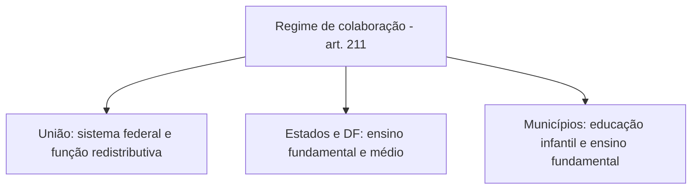

Educação, cultura e desporto compõem o **Capítulo III** do Título VIII e têm em comum a ideia de que o Estado deve formar, preservar e estimular a vida em sociedade. Na prova, a educação concentra a maior parte das questões, por causa dos números (idades, percentuais) e dos nomes (Fundeb, plano nacional). Cultura e desporto aparecem em assertivas curtas, quase sempre de literalidade. Este capítulo percorre os arts. 205 a 217 na ordem em que a Constituição os apresenta.

> [!objetivos]
> - Identificar a finalidade da educação, seus princípios e o dever do Estado, da família e da sociedade.
> - Descrever as garantias do art. 208, a repartição de competências do art. 211 e os percentuais de financiamento.
> - Explicar o Fundeb, a destinação de recursos públicos a escolas privadas e o plano nacional de educação.
> - Reconhecer as regras constitucionais sobre cultura e sobre desporto, inclusive a justiça desportiva.

## Educação

> [!lei] CF, art. 205
> A educação, direito de todos e dever do Estado e da família, será promovida e incentivada com a colaboração da sociedade, visando ao pleno desenvolvimento da pessoa, seu preparo para o exercício da cidadania e sua qualificação para o trabalho.

A educação é direito de **todos** e dever do **Estado e da família**, com a colaboração da **sociedade**. A finalidade é tripla: o desenvolvimento pleno da pessoa, a preparação para a cidadania e a qualificação para o trabalho. Quem acha que só o Estado tem esse dever erra: a família tem responsabilidade própria, porque é nela que a pessoa tem o primeiro contato com os valores sociais.

Sobre o ensino domiciliar, o STF decidiu, no RE 888.815, que não existe direito público subjetivo do aluno ou da família a essa modalidade, que a legislação brasileira não prevê. A Corte considerou inconstitucionais formas radicais de desescolarização, mas admitiu que uma **lei federal** crie o ensino domiciliar, desde que respeite a obrigatoriedade da educação básica dos 4 aos 17 anos, a solidariedade entre família e Estado e a supervisão, a avaliação e a fiscalização pelo Poder Público.

### Princípios do ensino (art. 206)

O art. 206 enumera nove princípios para o ensino.

> [!lei] CF, art. 206, caput e incisos
> O ensino será ministrado com base nos seguintes princípios:
> I - igualdade de condições para o acesso e permanência na escola;
> II - liberdade de aprender, ensinar, pesquisar e divulgar o pensamento, a arte e o saber;
> III - pluralismo de idéias e de concepções pedagógicas, e coexistência de instituições públicas e privadas de ensino;
> IV - gratuidade do ensino público em estabelecimentos oficiais;
> V - valorização dos profissionais da educação escolar, garantidos, na forma da lei, planos de carreira, com ingresso exclusivamente por concurso público de provas e títulos, aos das redes públicas;
> VI - gestão democrática do ensino público, na forma da lei;
> VII - garantia de padrão de qualidade.
> VIII - piso salarial profissional nacional para os profissionais da educação escolar pública, nos termos de lei federal.
> IX - garantia do direito à educação e à aprendizagem ao longo da vida.

Uma palavra-chave por inciso ajuda a não trocar os princípios entre si.

| Inciso | Palavra-chave | Para lembrar |
| --- | --- | --- |
| I | Igualdade | Entrar e permanecer na escola em condições iguais |
| II | Liberdade | Aprender, ensinar, pesquisar e divulgar ideias |
| III | Pluralismo | Várias concepções pedagógicas e escolas públicas e privadas lado a lado |
| IV | Gratuidade | Só no ensino público e em estabelecimentos oficiais |
| V | Valorização | Carreira e concurso público de provas e títulos nas redes públicas |
| VI | Gestão democrática | Só no ensino público |
| VII | Qualidade | Padrão mínimo garantido |
| VIII | Piso nacional | Remuneração mínima fixada em lei federal |
| IX | Aprendizagem contínua | Direito à educação ao longo da vida, incluído pela EC 108/2020 |

O parágrafo único determina que a lei defina as categorias de trabalhadores consideradas **profissionais da educação básica** e fixe prazo para elaboração ou adequação de seus planos de carreira, em todas as esferas.

> [!jurisprudencia] STF, Súmula Vinculante 12
> A cobrança de taxa de matrícula nas universidades públicas viola o disposto no art. 206, IV, da Constituição. A súmula alcança as atividades de ensino, e não as de pesquisa e de extensão. No RE 597.854, o Tribunal admitiu mensalidade em cursos de especialização oferecidos por universidades públicas quando a atividade principal não for de ensino regular, e afirmou que essa cobrança não tem natureza tributária.

O raciocínio do STF é o seguinte. A Constituição diferencia **ensino**, **pesquisa** e **extensão**. O ensino em estabelecimentos oficiais tem financiamento público obrigatório, por meio dos percentuais do art. 212. Já a pesquisa e a extensão **podem** receber apoio público, mas não precisam de financiamento exclusivamente estatal, o que abre espaço para receitas privadas. Se um curso de pós-graduação tem como atividade preponderante o ensino, deve ser gratuito; se está ligado à pesquisa e à extensão, a universidade pode cobrar mensalidade. A decisão de enquadramento é da própria universidade, em razão de sua autonomia.

### Universidades (art. 207)

As universidades têm **autonomia** em quatro frentes: **didático-científica**, **administrativa**, **financeira** e **patrimonial**. Elas se submetem ainda à **indissociabilidade entre ensino, pesquisa e extensão**, isto é, devem tratar as três atividades de forma conjugada. A autonomia didático-científica diz respeito às atividades-fim, e a administrativa, às atividades-meio. A lei pode permitir que as universidades contratem docentes, técnicos e cientistas **estrangeiros**, e as mesmas regras alcançam as instituições de pesquisa científica e tecnológica.

Na ADI 3.792, o STF aplicou a autonomia universitária para decidir que lei estadual não pode obrigar escritórios de prática jurídica de universidades a prestar plantão de assistência jurídica a presos em flagrante. Convênio com o Estado, firmado livremente pela universidade, é possível.

### Dever do Estado com a educação (art. 208)

> [!lei] CF, art. 208, I
> educação básica obrigatória e gratuita dos 4 (quatro) aos 17 (dezessete) anos de idade, assegurada inclusive sua oferta gratuita para todos os que a ela não tiveram acesso na idade própria;

O Estado efetiva a educação mediante garantias que a tabela resume.

| Inciso | Garantia | Palavra de prova |
| --- | --- | --- |
| I | Educação básica obrigatória e gratuita dos 4 aos 17 anos, também para quem não a cursou na idade certa | 4 a 17 |
| II | Ensino médio gratuito que se universaliza aos poucos | Progressiva |
| III | Apoio educacional especializado a estudantes com deficiência | Preferencialmente na rede regular |
| IV | Creche e pré-escola para crianças de até 5 anos | Até 5 anos |
| V | Chegar aos graus mais altos do ensino, da pesquisa e da criação artística conforme o mérito de cada pessoa | Capacidade |
| VI | Ensino regular à noite, adaptado a quem trabalha | Noturno |
| VII | Programas de apoio com livros, transporte, merenda e atenção à saúde | Em todas as etapas da educação básica |

Quem tem acesso garantido ao ensino obrigatório e gratuito titulariza um **direito público subjetivo**, que pode exigir do Estado. Se o Poder Público não oferece essa vaga ou a oferece de modo irregular, responde a **autoridade competente**. Cabe ainda ao Poder Público recensear os educandos no ensino fundamental, fazer a chamada e zelar pela frequência. O STF entende que a educação básica, inclusive a creche e a pré-escola, é direito fundamental de eficácia plena, que pode ser exigido individualmente.

> [!pegadinha]
> Dizer que o atendimento educacional às pessoas com deficiência deve ser prestado preferencialmente em instituições especializadas. A Constituição manda priorizar a **rede regular de ensino**. Outra troca é afirmar que a educação infantil, até 5 anos, pode ser cobrada porque a gratuidade obrigatória só vale de 4 a 17 anos; o dever do Estado inclui a creche e a pré-escola.

### Ensino privado, conteúdo mínimo e ensino religioso

O ensino é **livre à iniciativa privada** (art. 209), desde que cumpridas as normas gerais da educação nacional e obtidas a **autorização** e a **avaliação de qualidade** do Poder Público. O art. 210 manda fixar **conteúdos mínimos** para o ensino fundamental, a fim de assegurar uma base comum de formação que respeite a diversidade cultural e artística do país e de suas regiões. O ensino fundamental regular é em **língua portuguesa**, e as comunidades indígenas podem usar suas línguas maternas e processos próprios de aprendizagem. O **ensino religioso** entra na grade regular das escolas públicas de ensino fundamental, mas a **matrícula é facultativa**. Na ADI 4439, o STF admitiu que ele seja confessional, ligado a uma religião específica, sem ferir o Estado laico.

### Organização dos sistemas de ensino (art. 211)

A União, os Estados, o DF e os Municípios organizam seus sistemas de ensino **em regime de colaboração**. A atuação prioritária de cada um aparece abaixo.

| Ente | Atuação |
| --- | --- |
| União | Organiza o sistema federal e o dos Territórios; financia as instituições federais; exerce função redistributiva e supletiva, com assistência técnica e financeira aos demais |
| Municípios | Prioritariamente no ensino fundamental e na educação infantil |
| Estados e Distrito Federal | Prioritariamente no ensino fundamental e médio |

A educação básica pública atende prioritariamente o **ensino regular**, e todos os entes exercem **ação redistributiva** em relação a suas escolas. O padrão mínimo de qualidade tem como referência o **Custo Aluno Qualidade (CAQ)**, pactuado em regime de colaboração por lei complementar.

### Financiamento: mínimos constitucionais e Fundeb

> [!lei] CF, art. 212, caput
> A União aplicará, anualmente, nunca menos de dezoito, e os Estados, o Distrito Federal e os Municípios vinte e cinco por cento, no mínimo, da receita resultante de impostos, compreendida a proveniente de transferências, na manutenção e desenvolvimento do ensino.

O mínimo da **União é de 18%** e o dos **Estados, DF e Municípios é de 25%** da receita de impostos, incluídas as transferências. A parcela de impostos transferida a outro ente não conta como receita de quem transfere. Os programas suplementares do art. 208, VII, são financiados com recursos de contribuições sociais e outros recursos orçamentários, e a educação básica pública tem como fonte adicional o **salário-educação**. É vedado usar os recursos do art. 212 e do salário-educação para pagar aposentadorias e pensões.

O **Fundeb**, previsto no art. 212-A, tornou-se **permanente** com a EC 108/2020; antes, seria extinto em 2020. É um fundo contábil de cada Estado e do DF, formado por **20%** de certos impostos e transferências, e distribuído entre o Estado e seus Municípios em proporção ao número de **matrículas** na educação básica presencial. A **União complementa** o fundo com, no mínimo, **23%** do total, em três parcelas: 10 pontos percentuais por Estado, 10,5 pontos por rede de ensino quando o valor por aluno não alcançar o mínimo nacional, e 2,5 pontos para redes que cumpram condicionalidades e melhorem indicadores. Pelo menos **70%** de cada fundo vão para o pagamento dos profissionais da educação básica em efetivo exercício. Pela redação atual, a partir de 2026, no mínimo 4% dos recursos dos fundos devem ser usados na criação de matrículas em tempo integral.

> [!bizu]
> Memorize os números da educação em pares: **18 e 25** (mínimos do art. 212, União e demais), **20** (percentual dos impostos que compõe o Fundeb), **23** (complementação da União) e **70** (parte do fundo para os profissionais). Se um deles aparecer trocado na assertiva, ela está errada.

### Recursos para escolas privadas e plano nacional

O dinheiro público vai **para as escolas públicas**, e a lei pode estender o benefício a escolas **comunitárias, confessionais ou filantrópicas** que provem **finalidade não lucrativa**, apliquem os excedentes em educação e garantam que seu patrimônio vá, ao encerrarem as atividades, a outra escola do mesmo tipo ou ao Poder Público (art. 213). Admitem-se **bolsas de estudo** no ensino fundamental e médio para quem demonstre insuficiência de recursos, quando faltarem vagas na rede pública local, ficando o Poder Público obrigado a investir na expansão dessa rede. Pesquisa, extensão e fomento à inovação em universidades e instituições de educação profissional e tecnológica podem receber apoio público.

O **plano nacional de educação** tem **duração decenal** e é instituído por lei (art. 214). Articula o sistema nacional de educação em regime de colaboração e define metas para conduzir a: erradicação do analfabetismo, universalização do atendimento escolar, melhoria da qualidade, formação para o trabalho, promoção humanística, científica e tecnológica e uma meta de investimento público em educação medida como fração do PIB.

## Cultura

A Constituição manda o Estado garantir a todos o **pleno exercício dos direitos culturais** e o **acesso às fontes da cultura nacional**, apoiando e incentivando a valorização e a difusão das manifestações culturais (art. 215). Protege as culturas **populares, indígenas e afro-brasileiras** e as de outros grupos do processo civilizatório nacional, num modelo multicultural. A lei fixa as datas comemorativas de grande significado para cada grupo étnico e institui o **Plano Nacional de Cultura**, de duração **plurianual**, voltado à defesa do patrimônio, à produção e difusão de bens culturais, à formação de gestores, à democratização do acesso e à valorização da diversidade étnica e regional.

### Patrimônio cultural (art. 216)

> [!lei] CF, art. 216, § 1º
> O Poder Público, com a colaboração da comunidade, promoverá e protegerá o patrimônio cultural brasileiro, por meio de inventários, registros, vigilância, tombamento e desapropriação, e de outras formas de acautelamento e preservação.

O patrimônio cultural brasileiro reúne bens **materiais e imateriais**, isolados ou em conjunto, que carregam a identidade, a ação e a memória dos grupos que formaram a sociedade. A Constituição cita cinco categorias: as formas de expressão; os modos de criar, fazer e viver; as criações científicas, artísticas e tecnológicas; as obras, os objetos, os documentos e os espaços das manifestações artísticas; e os conjuntos urbanos e sítios de valor histórico, paisagístico, arqueológico, ecológico e científico, entre outros.

Outras regras do art. 216: a **gestão da documentação governamental** é da administração pública, que deve franquear a consulta a quem dela precisar (§ 2º); a lei estabelece incentivos para a produção e o conhecimento dos bens culturais (§ 3º); danos e ameaças ao patrimônio serão **punidos** (§ 4º); ficam **tombados** os documentos e sítios com reminiscências históricas dos antigos **quilombos** (§ 5º); e Estados e DF podem vincular **até 0,5% da receita tributária líquida** a um fundo de fomento à cultura, sem usar esse dinheiro na folha de servidores, no serviço da dívida nem em despesas correntes alheias aos projetos apoiados (§ 6º).

### Sistema Nacional de Cultura (art. 216-A)

O **Sistema Nacional de Cultura** funciona em colaboração entre os entes, com gestão descentralizada e participação social, e serve para conduzir em conjunto políticas culturais democráticas e permanentes. Fundamenta-se na política nacional e no Plano Nacional de Cultura, com princípios como diversidade, universalização do acesso, cooperação entre os entes, transversalidade, transparência e participação social. Sua estrutura inclui órgãos gestores, conselhos de política cultural, conferências, comissões intergestores, planos, sistemas de financiamento, de informações e de formação e sistemas setoriais. Lei federal regulamenta o sistema, e Estados, DF e Municípios organizam os seus por leis próprias.

> [!atencao] Cultura: o que decorar
> Na cultura, decore poucas coisas: material e imaterial no patrimônio; os cinco instrumentos de proteção do § 1º (inventários, registros, vigilância, tombamento e desapropriação); os quilombos tombados; e o fato de que o Plano Nacional de Cultura é **plurianual**, ao contrário do plano de educação, que é **decenal**.

## Desporto

O art. 217 coloca o fomento ao esporte entre os deveres do Estado.

> [!lei] CF, art. 217, caput e incisos
> É dever do Estado fomentar práticas desportivas formais e não-formais, como direito de cada um, observados:
> I - a autonomia das entidades desportivas dirigentes e associações, quanto a sua organização e funcionamento;
> II - a destinação de recursos públicos para a promoção prioritária do desporto educacional e, em casos específicos, para a do desporto de alto rendimento;
> III - o tratamento diferenciado para o desporto profissional e o não- profissional;
> IV - a proteção e o incentivo às manifestações desportivas de criação nacional.

Em resumo, os quatro pontos são a autonomia das entidades, a prioridade do desporto educacional, a distinção entre profissional e amador e a proteção do esporte de criação nacional.

O § 1º cria uma condição para a ação judicial: o Judiciário só admite ações relativas à **disciplina e às competições desportivas** depois de **esgotadas as instâncias da justiça desportiva**, regulada em lei. Essa justiça tem prazo máximo de **60 dias**, a partir da instauração do processo, para decisão final (§ 2º). O Poder Público também incentiva o **lazer**, como forma de promoção social (§ 3º).

| Tema | Regra | Armadilha |
| --- | --- | --- |
| Prioridade dos recursos | Desporto educacional primeiro; alto rendimento em casos específicos | Inverter a prioridade |
| Justiça desportiva | Esgotar as instâncias antes de ir ao Judiciário | Dizer que o acesso é livre desde o início |
| Prazo da justiça desportiva | 60 dias contados da instauração do processo | Trocar por 30 ou 90 dias |
| Alcance da exigência | Disciplina e competições | Estendê-la a qualquer questão esportiva |

## Por que a ordem dos assuntos importa

Educação, cultura e desporto têm lógicas diferentes. Na educação, a Constituição fixa números e dá direitos exigíveis, porque o ensino obrigatório é direito público subjetivo. Na cultura, predominam normas de incentivo e de proteção, que dependem de lei e de políticas públicas para ganhar forma. No desporto, o centro é a autonomia das entidades, com um único filtro judicial relevante, a justiça desportiva. Quando a assertiva atribui a um desses blocos a lógica de outro, por exemplo exigindo "responsabilidade da autoridade" por falta de incentivo cultural, a resposta tende a ser errada.

Vale lembrar também a relação entre as normas deste capítulo e as de outros pontos do volume. O percentual mínimo de educação convive com o piso da saúde do capítulo 2, e ambos são vinculações de receita. O dever de colaboração entre os entes aparece na educação, na saúde (SUS) e na cultura (Sistema Nacional de Cultura), sempre com o mesmo desenho: coordenação federal e execução descentralizada.

## Como a banca cobra este assunto

As assertivas de educação costumam repetir o texto da Constituição com um número ou um sujeito trocado. Os padrões mais frequentes são:

- **Números:** 4 a 17 anos de educação obrigatória, até 5 anos na educação infantil, 18% e 25% de receita de impostos, 60 dias de justiça desportiva, 0,5% da receita tributária líquida.
- **Atendimento especializado:** preferencialmente na rede regular de ensino.
- **Ensino religioso:** facultativo, e confessional segundo o STF.
- **Ensino privado:** livre, com autorização e avaliação do Poder Público.
- **Competências:** Municípios na educação infantil e no fundamental; Estados e DF no fundamental e no médio.
- **Fundeb:** permanente e com complementação da União; em geral a prova cobra o conceito, não todos os percentuais.
- **Justiça desportiva:** esgotamento das instâncias antes do Judiciário.
- **Patrimônio cultural:** inclusão de bens imateriais e instrumentos de proteção.

## Mapa do capítulo

| Tema | Regra | Cuidado |
| --- | --- | --- |
| Finalidade da educação | Desenvolvimento, cidadania e trabalho | Dever do Estado e da família |
| Educação básica | Obrigatória e gratuita de 4 a 17 anos | Educação infantil vai até 5 anos |
| Atendimento especializado | Preferencialmente na rede regular | Não em instituição especializada |
| Mínimos de recursos | 18% da União; 25% dos demais | Receita de impostos, com transferências |
| Fundeb | Permanente; 20% de impostos; União complementa com no mínimo 23% | 70% do fundo para os profissionais |
| Ensino privado | Livre, com autorização e avaliação | Normas gerais da educação nacional |
| Plano de educação | Decenal | Plano de cultura é plurianual |
| Patrimônio cultural | Material e imaterial | Quilombos tombados |
| Justiça desportiva | Esgotar as instâncias; 60 dias | Só disciplina e competições |

### Para fixar

- A educação é direito de todos e dever do Estado e da família, com colaboração da sociedade.
- Os princípios do art. 206 incluem gratuidade do ensino público e gestão democrática, e o ingresso na rede pública é por concurso.
- A educação básica é obrigatória e gratuita dos 4 aos 17 anos, e a educação infantil vai até os 5.
- O atendimento especializado às pessoas com deficiência deve ocorrer preferencialmente na rede regular de ensino.
- A União aplica no mínimo 18% da receita de impostos em ensino; Estados, DF e Municípios, no mínimo 25%.
- O Fundeb é permanente, e a União o complementa; ao menos 70% vão para os profissionais da educação básica.
- O ensino religioso é facultativo, e o ensino privado depende de autorização e avaliação.
- O patrimônio cultural abrange bens materiais e imateriais, e o plano nacional de cultura é plurianual.
- O Judiciário só aprecia disciplina e competições desportivas depois de esgotada a justiça desportiva, que decide em 60 dias.
