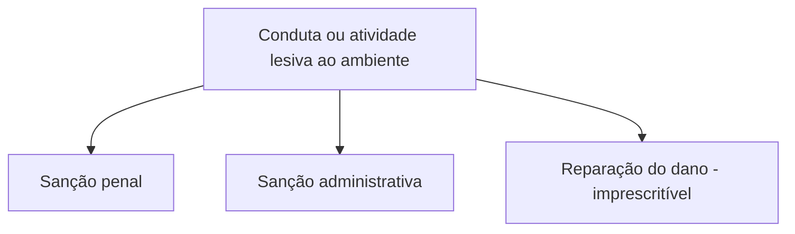

Os três blocos deste capítulo parecem distantes, mas têm em comum o fato de dependerem de políticas públicas e de leis para sair do papel. A **ciência, tecnologia e inovação** têm um capítulo próprio desde a EC 85/2015. A **comunicação social** combina liberdade de informar com limites de propaganda, propriedade de empresas e concessão de rádio e televisão. O **meio ambiente** ocupa um único artigo, o 225, mas é um dos mais extensos e mais cobrados de todo o título, porque envolve conceitos, deveres do Poder Público, responsabilidade e jurisprudência recente.

> [!objetivos]
> - Descrever os deveres do Estado em ciência, tecnologia e inovação e o Sistema Nacional de Ciência, Tecnologia e Inovação.
> - Explicar a liberdade de comunicação e suas restrições constitucionais, incluindo propriedade e concessão de emissoras.
> - Reconhecer o direito ao meio ambiente ecologicamente equilibrado e os deveres do Poder Público.
> - Aplicar as regras sobre patrimônio nacional, responsabilidade ambiental e atividades que usam animais.

## Ciência, tecnologia e inovação

O art. 218 coloca nas mãos do Estado a tarefa de **promover e incentivar** quatro frentes: a ciência, a pesquisa, a capacitação científica e tecnológica e a inovação. A tabela resume os parágrafos.

| Dispositivo | Ideia central | Detalhe de prova |
| --- | --- | --- |
| § 1º | Pesquisa científica básica e tecnológica recebe tratamento prioritário | Visa ao bem público e ao progresso da ciência |
| § 2º | Pesquisa tecnológica voltada preponderantemente aos problemas brasileiros e ao sistema produtivo nacional e regional | Foco nacional e regional |
| § 3º | Apoio à formação de recursos humanos e a quem se dedica a essas áreas, com condições especiais de trabalho | Inclui extensão tecnológica |
| § 4º | Estímulo às empresas que invistam em pesquisa e tecnologia adequada ao país e que partilhem ganhos com os empregados, sem vínculo com o salário | Participação nos ganhos de produtividade |
| § 5º | Estados e DF podem destinar parte de sua receita a entidades públicas que financiam o ensino e a pesquisa | É faculdade |
| §§ 6º e 7º | Articulação entre entes públicos e privados e atuação no exterior das instituições públicas de ciência e tecnologia | Introduzidos pela EC 85/2015 |

Para o art. 219, o **mercado interno faz parte do patrimônio nacional**. Por isso deve ser estimulado, conforme lei federal, de modo a favorecer o progresso cultural e econômico, o bem-estar do povo e a independência tecnológica do Brasil. O parágrafo único manda o Estado estimular a inovação nas empresas e em outros entes, os parques e polos tecnológicos, os inventores independentes e a criação, a absorção, a difusão e a transferência de tecnologia.

Dois artigos novos completam o capítulo. O **art. 219-A** autoriza União, Estados, DF e Municípios a firmar **instrumentos de cooperação** com órgãos públicos e entidades privadas, inclusive para compartilhar recursos humanos e capacidade instalada em projetos de pesquisa e inovação, com contrapartida financeira ou não financeira do ente beneficiário. O **art. 219-B** cria o **Sistema Nacional de Ciência, Tecnologia e Inovação (SNCTI)**, que funciona por **colaboração** entre instituições públicas e privadas; **lei federal** dispõe sobre as normas gerais, e Estados, DF e Municípios **legislam concorrentemente** sobre suas peculiaridades.

> [!bizu]
> Para lembrar que o capítulo mistura público e privado, guarde a palavra **colaboração**: o art. 219-B fala em regime de colaboração entre entes públicos e privados, e o art. 218, § 6º, em articulação entre eles. Nesse capítulo, o setor privado é parceiro, não adversário.

## Comunicação social

### Liberdade e vedação à censura

> [!lei] CF, art. 220, caput
> A manifestação do pensamento, a criação, a expressão e a informação, sob qualquer forma, processo ou veículo não sofrerão qualquer restrição, observado o disposto nesta Constituição.

Esse comando está ligado à liberdade de pensamento e de expressão do art. 5º. O § 1º veda qualquer lei que embarace a **plena liberdade de informação jornalística** em qualquer veículo, respeitados os incisos IV, V, X, XIII e XIV do art. 5º (anonimato, direito de resposta, intimidade, exercício profissional e sigilo da fonte). O § 2º veda qualquer **censura**, seja ela de cunho político, ideológico ou artístico. O § 6º dispensa de licença a publicação de veículo impresso.

O STF decidiu que **não é obrigatório o diploma de curso superior** de jornalismo para o exercício da profissão de jornalista (RE 511.961). Ele entendeu também, quando examinou a classificação indicativa, que a atribuição de faixas etárias a obras audiovisuais é um aviso ao público, e não censura.

### Competências da lei federal e propaganda

O § 3º atribui à **lei federal** duas tarefas:

1. **Regular as diversões e os espetáculos públicos.** O Estado deve avisar de que tipo é cada um, para que idades não é indicado e em que locais e horários não deve ser exibido. É o fundamento da classificação indicativa.
2. **Criar meios legais de defesa** da pessoa e da família contra programação de rádio e televisão que fira os princípios do art. 221 e contra propaganda de produtos, práticas e serviços que prejudiquem a saúde ou o ambiente.

O § 4º cuida da publicidade de cinco produtos ou serviços sensíveis: tabaco, bebidas alcoólicas, agrotóxicos, medicamentos e terapias. Ela está sujeita a **restrições legais** e, quando necessário, deve trazer **advertência** sobre os malefícios do consumo. As imagens nas embalagens de cigarro são um exemplo conhecido.

O § 5º diz que os meios de comunicação social **não podem ser objeto de monopólio ou oligopólio**, direto ou indireto.

### Princípios da programação (art. 221)

Quatro princípios orientam o que as emissoras de rádio e televisão produzem e programam.

| Inciso | Princípio | Ideia |
| --- | --- | --- |
| I | Finalidades educativas, artísticas, culturais e informativas | Preferência de conteúdo |
| II | Divulgação da cultura do país e das regiões, com incentivo a produtores independentes | Valorizar o que é local |
| III | Regionalização da produção cultural, artística e jornalística | Percentuais fixados em lei |
| IV | Cuidado com os valores éticos e sociais da pessoa e da família | Limite ético |

### Propriedade das empresas (art. 222)

> [!lei] CF, art. 222, caput e § 1º
> A propriedade de empresa jornalística e de radiodifusão sonora e de sons e imagens é privativa de brasileiros natos ou naturalizados há mais de dez anos, ou de pessoas jurídicas constituídas sob as leis brasileiras e que tenham sede no País.
> § 1º Em qualquer caso, pelo menos setenta por cento do capital total e do capital votante das empresas jornalísticas e de radiodifusão sonora e de sons e imagens deverá pertencer, direta ou indiretamente, a brasileiros natos ou naturalizados há mais de dez anos, que exercerão obrigatoriamente a gestão das atividades e estabelecerão o conteúdo da programação.

Em termos práticos, a regra tem duas camadas. A primeira diz **quem pode ser dono**: brasileiros natos, naturalizados há mais de dez anos ou empresas brasileiras com sede no país. A segunda reserva a esses brasileiros **70% do capital total e do capital votante** e, principalmente, o **comando** da empresa: são eles que dirigem as atividades e decidem o conteúdo exibido. A **responsabilidade editorial** e a seleção e direção da programação são privativas deles em qualquer meio de comunicação social. Quanto ao capital estrangeiro, a lei disciplina sua participação, e toda mudança no controle societário deve ser comunicada ao Congresso Nacional. Já os meios eletrônicos, qualquer que seja a tecnologia, obedecem aos princípios do art. 221 por meio de lei específica, que também dá prioridade a profissionais brasileiros nas produções nacionais.

> [!pegadinha]
> Dizer que um brasileiro naturalizado há menos de dez anos pode participar da gestão de empresa jornalística ou de radiodifusão. A gestão e o conteúdo ficam com **brasileiros natos ou naturalizados há mais de dez anos**. Outra troca comum é afirmar que a participação estrangeira é proibida: ela é permitida, por lei, até o limite de 30% do capital.

### Concessão de rádio e televisão (arts. 223 e 224)

Compete ao **Poder Executivo outorgar e renovar** concessão, permissão e autorização do serviço de radiodifusão sonora e de sons e imagens, observado o princípio da **complementaridade dos sistemas privado, público e estatal**. O Congresso Nacional aprecia o ato nos prazos do art. 64, § 2º e § 4º, e o ato só produz efeitos **depois da deliberação do Congresso**. A não renovação exige aprovação de, no mínimo, **dois quintos** do Congresso, em votação nominal. O cancelamento antes do fim do prazo exige **decisão judicial**. O prazo é de **dez anos** para rádio e de **quinze** para televisão. O art. 224 manda o Congresso instituir o **Conselho de Comunicação Social**, órgão auxiliar.

| Tema | Regra | Quórum ou prazo |
| --- | --- | --- |
| Outorga e renovação | Poder Executivo, com deliberação do Congresso | Prazos do art. 64 |
| Não renovação | Aprovação do Congresso | 2/5, em votação nominal |
| Cancelamento antes do prazo | Decisão judicial | Sem quórum |
| Prazo da concessão | Rádio e televisão | 10 anos (rádio) e 15 anos (TV) |

> [!atencao] 2/5 e não 3/5
> A não renovação exige **dois quintos** do Congresso, um quórum pequeno de propósito: a renovação é a regra, e é mais difícil impedi-la. Se a assertiva trocar por maioria absoluta ou por três quintos, está errada. O cancelamento antes do prazo, por sua vez, não depende do Congresso, mas do Judiciário.

## Meio ambiente

> [!lei] CF, art. 225, caput
> Todos têm direito ao meio ambiente ecologicamente equilibrado, bem de uso comum do povo e essencial à sadia qualidade de vida, impondo-se ao Poder Público e à coletividade o dever de defendê-lo e preservá-lo para as presentes e futuras gerações.

A Constituição de 1988 foi a primeira a tratar do tema. O direito ao ambiente é de **terceira geração**, de titularidade coletiva, e o bem pertence ao **uso comum do povo**: não é de um indivíduo, mas de todos. Defender e preservar são deveres do **Poder Público e da coletividade**, em favor de quem vive hoje e de quem viverá depois (**gerações presentes e futuras**). A doutrina distingue o meio ambiente **natural**, o **artificial** (as cidades e edificações), o **cultural** (o patrimônio histórico e artístico) e o **do trabalho**. O art. 225 protege diretamente o natural, mas a Constituição trata dos demais em outros artigos.

### Incumbências do Poder Público (§ 1º)

Para garantir a efetividade desse direito, o Poder Público deve:

| Inciso | Incumbência | Observação |
| --- | --- | --- |
| I | Preservar e restaurar os processos ecológicos essenciais e manejar espécies e ecossistemas | Manejo ecológico |
| II | Preservar a diversidade e a integridade do patrimônio genético e fiscalizar a pesquisa e a manipulação de material genético | Genética |
| III | Definir espaços territoriais especialmente protegidos | Alteração e supressão só por lei |
| IV | Exigir estudo prévio de impacto ambiental para obra ou atividade potencialmente causadora de significativa degradação | Com publicidade |
| V | Fiscalizar a fabricação, a venda e o uso de técnicas, métodos e substâncias que ofereçam perigo | Risco à vida e ao ambiente |
| VI | Incluir a educação ambiental em todas as etapas do ensino e despertar a consciência coletiva | Educação |
| VII | Defender a fauna e a flora, proibindo práticas que ameacem sua função ecológica, levem espécies à extinção ou imponham crueldade aos animais | Crueldade |
| VIII | Manter regime fiscal favorecido para biocombustíveis e hidrogênio de baixa emissão de carbono, por lei complementar | Incluído pela EC 132/2023 |

Sobre o inciso III, uma distinção que cai em prova: a **criação** de espaços protegidos pode ser feita por atos do Poder Público diversos da lei em sentido estrito, mas a **alteração** e a **supressão** dependem de lei. O STF decidiu também que **medida provisória não pode** alterar espaços territoriais especialmente protegidos.

### Outras regras do art. 225

- **Mineração (§ 2º).** Quem explora recursos minerais deve recuperar o ambiente degradado, segundo a solução técnica que o órgão público competente exigir. Não há liberdade de escolha do explorador.
- **Responsabilidade tríplice (§ 3º).** Quem pratica conduta lesiva ao ambiente, seja pessoa física, seja jurídica, responde com **sanções penais e administrativas** e ainda deve **reparar o dano**. Por isso a pessoa jurídica pode ser responsabilizada penalmente por crime ambiental, e o STF admite a condenação dela mesmo que as pessoas físicas dirigentes sejam absolvidas. O Tribunal também fixou que a **reparação civil do dano ambiental é imprescritível** (Tema 999).
- **Patrimônio nacional (§ 4º).** A Constituição dá esse status a cinco áreas: o Pantanal Mato-Grossense, a Zona Costeira, a Serra do Mar, a Mata Atlântica e a floresta da Amazônia brasileira. Elas não ficam intocáveis; sua exploração é possível, na forma da lei, desde que as condições preservem o ambiente.
- **Terras devolutas (§ 5º).** São indisponíveis as terras devolutas ou arrecadadas pelos Estados, por ações discriminatórias, necessárias à proteção dos ecossistemas naturais.
- **Usinas nucleares (§ 6º).** Sua localização é definida em **lei federal**, sem a qual não podem ser instaladas.
- **Esportes com animais (§ 7º).** Não contam como cruéis as práticas que sejam manifestação cultural, tenham registro como bem imaterial do patrimônio cultural e recebam regulamentação em lei específica que proteja o bem-estar dos animais.

> [!pegadinha]
> Chamar a Amazônia, a Mata Atlântica ou o Pantanal de **bens da União**. A Constituição os declara **patrimônio nacional**, o que não os transforma em propriedade da União nem dos Estados em que estão. Outra pegadinha é afirmar que a **criação** de espaço protegido exige lei específica; só a alteração e a supressão exigem.

### Vaquejada e a EC 96/2017

Na ADI 4983, o STF derrubou uma lei estadual que tratava a **vaquejada** como esporte e manifestação cultural, porque a prática configura maus-tratos aos animais, e entre a proteção da fauna e o direito às manifestações culturais fez prevalecer a primeira. O Congresso respondeu com a **EC 96/2017**, que acrescentou o § 7º ao art. 225. Essa emenda é exemplo de **reação legislativa**: as decisões do STF em controle abstrato vinculam a Administração e os demais órgãos do Judiciário, mas não o Poder Legislativo, que pode legislar em sentido contrário. A emenda só poderia cair se violasse cláusula pétrea.

Em outras decisões citadas pela doutrina, o STF vedou o sacrifício de animais apreendidos por maus-tratos (ADPF 640) e considerou constitucional lei estadual que proíbe testes de cosméticos em animais, na ausência de norma federal (ADI 5995). Admitiu ainda que Municípios restrinjam a circulação de sacolas plásticas, com base em sua competência suplementar (Tema 970).

## Ligações entre os três blocos

Embora o capítulo trate de assuntos diferentes, três ideias atravessam todos eles. A primeira é a **reserva de lei**: a Constituição manda a lei fazer o detalhe da propaganda, da propriedade das emissoras, das normas gerais do SNCTI e dos espaços protegidos. A segunda é a **proteção coletiva**: o mercado interno, a informação e o meio ambiente são tratados como valores de toda a sociedade, e não só de quem os explora. A terceira é a **cooperação federativa**: o SNCTI, a competência concorrente para ciência e tecnologia e a competência comum em matéria ambiental envolvem todos os entes. Ao ler uma assertiva, pergunte-se qual dessas três lógicas ela está tocando. Isso ajuda a perceber quando a banca troca "lei" por "decreto", "coletivo" por "individual" ou "concorrente" por "privativo".

## Como a banca cobra este assunto

Os padrões mais frequentes são:

- **Natureza do direito:** meio ambiente como direito de terceira geração e bem de uso comum do povo.
- **Patrimônio nacional:** lista de cinco áreas, sem trocar por bens da União ou incluir o Cerrado e a Caatinga.
- **Estudo prévio de impacto ambiental:** exigência para atividade potencialmente causadora de significativa degradação.
- **Lei específica:** para alterar ou suprimir espaços protegidos (e não para criá-los) e para definir a localização de usinas nucleares.
- **Responsabilidade:** sanções penais e administrativas somadas à reparação do dano, inclusive para pessoas jurídicas.
- **Comunicação:** vedação de censura, 70% de capital nacional, dez anos de naturalização e 2/5 para não renovação.
- **Ciência e tecnologia:** SNCTI em regime de colaboração e competência concorrente de Estados e DF.

## Mapa do capítulo

| Tema | Regra | Cuidado |
| --- | --- | --- |
| Ciência e tecnologia | Estado promove e incentiva pesquisa e inovação | SNCTI com colaboração entre públicos e privados |
| Liberdade de expressão | Sem restrição, sem censura | Observados os limites do art. 5º |
| Propaganda | Restrições legais e advertência | Tabaco, álcool, agrotóxicos, medicamentos e terapias |
| Empresas de comunicação | 70% do capital com brasileiros | Gestão e conteúdo: natos ou naturalizados há mais de dez anos |
| Concessões | Executivo outorga; Congresso delibera | Não renovação: 2/5; cancelamento antes do prazo: decisão judicial |
| Meio ambiente | Direito de terceira geração e bem de uso comum | Dever do Poder Público e da coletividade |
| Espaços protegidos | Alteração e supressão só por lei | Criação não exige lei específica |
| Responsabilidade | Penal, administrativa e reparação | Reparação civil imprescritível |

### Para fixar

- O Estado promove e incentiva a ciência, a tecnologia e a inovação, e o SNCTI funciona em regime de colaboração.
- A liberdade de comunicação é ampla, e a Constituição proíbe a censura política, ideológica e artística.
- A propaganda de tabaco, bebidas, agrotóxicos, medicamentos e terapias é restringida por lei e traz advertência.
- A propriedade de empresas jornalísticas e de radiodifusão exige 70% do capital com brasileiros natos ou naturalizados há mais de dez anos.
- O Executivo outorga as concessões, o Congresso delibera, e a não renovação exige 2/5 em votação nominal.
- O meio ambiente é bem de uso comum do povo e direito de terceira geração.
- A alteração e a supressão de espaços protegidos dependem de lei; a localização de usinas nucleares, de lei federal.
- Amazônia, Mata Atlântica, Serra do Mar, Pantanal e Zona Costeira são patrimônio nacional, não bens da União.
- O infrator ambiental responde na esfera penal, na administrativa e na obrigação de reparar o dano.
