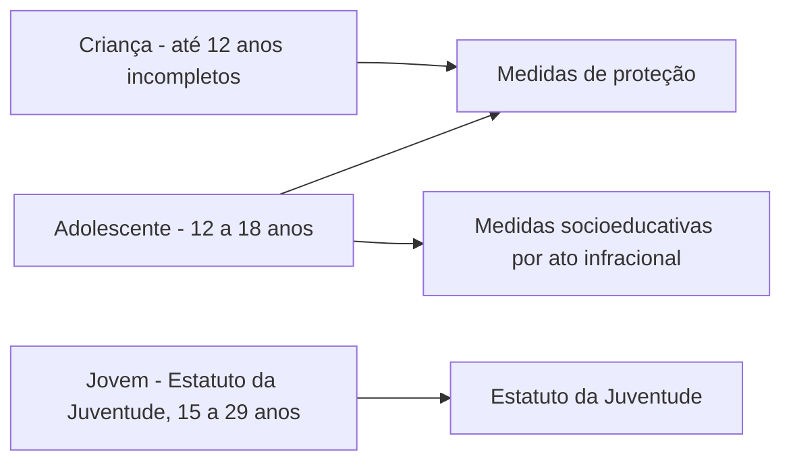

Este último capítulo reúne os grupos a quem a Constituição reservou proteção especial: a **família**, a **criança**, o **adolescente**, o **jovem**, o **idoso** e os **povos indígenas**. As regras são curtas, mas muito cobradas, porque usam números (idades, prazos) e conceitos fáceis de trocar. Para a criança e o adolescente, o texto constitucional convive com o **Estatuto da Criança e do Adolescente (ECA, Lei 8.069/1990)**, que também faz parte do edital e será visto aqui nos pontos centrais: definições, prioridade absoluta, medidas de proteção, ato infracional e Conselho Tutelar.

> [!objetivos]
> - Descrever a proteção constitucional à família e os modelos de entidade familiar reconhecidos.
> - Explicar o dever de absoluta prioridade e a proteção especial à criança, ao adolescente e ao jovem.
> - Aplicar os conceitos centrais do ECA: faixa etária, medidas de proteção, ato infracional e medidas socioeducativas.
> - Reconhecer os direitos dos idosos e as regras sobre terras e direitos dos povos indígenas.

## Família

> [!lei] CF, art. 226, caput
> A família, base da sociedade, tem especial proteção do Estado.

A família é a **base da sociedade**, e por isso o Estado a protege de modo especial. A Constituição não oferece um conceito fechado, mas reconhece uma **pluralidade de modelos**: o **casamento**, a **união estável** entre homem e mulher e a **família monoparental**, em que um dos pais vive com os filhos ou outros descendentes. A tabela resume os parágrafos do art. 226.

| Dispositivo | Regra | Observação |
| --- | --- | --- |
| § 1º | O casamento é civil e gratuita é sua celebração | Cerimônia sem custo |
| § 2º | A cerimônia religiosa pode produzir efeitos civis, conforme a lei | Depende de registro |
| § 3º | A união estável entre homem e mulher é entidade familiar, e a lei deve facilitar a conversão em casamento | Conversão, não equiparação automática |
| § 4º | Um dos pais e seus descendentes formam entidade familiar | Família monoparental |
| § 5º | Homem e mulher exercem em igualdade os direitos e deveres da vida conjugal | Igualdade |
| § 6º | O casamento civil pode ser dissolvido pelo divórcio | Sem prazo nem separação prévia (EC 66/2010) |
| § 7º | Planejamento familiar é livre decisão do casal, com dignidade da pessoa humana e paternidade responsável | O Estado dá recursos educacionais e científicos e não pode coagir |
| § 8º | O Estado assiste a família na pessoa de cada integrante e cria mecanismos contra a violência doméstica | Combate à violência |

O Supremo Tribunal Federal ampliou a leitura do texto em quatro pontos: reconheceu a **união homoafetiva** como entidade familiar, em decisão fundada na dignidade, na igualdade e na liberdade; considerou inconstitucional distinguir o regime sucessório de cônjuges e companheiros; admitiu que a **paternidade socioafetiva** coexista com o vínculo biológico; e tratou o vínculo parental biológico e o afetivo sem hierarquia entre eles.

O art. 229 consagra a **reciprocidade de assistência**: enquanto os filhos são menores, cabe aos pais sustentá-los, criá-los e educá-los; quando os filhos se tornam maiores e os pais ficam velhos, carentes ou doentes, cabe aos filhos ampará-los.

> [!pegadinha]
> Afirmar que a Constituição exige separação judicial prévia para o divórcio. Desde a **EC 66/2010**, o casamento civil pode ser dissolvido pelo divórcio sem requisito de prazo ou de separação. Outra troca comum é dizer que a união estável se equipara ao casamento por ato automático; o texto manda a lei **facilitar a conversão**.

## Criança, adolescente e jovem

> [!lei] CF, art. 227, caput
> É dever da família, da sociedade e do Estado assegurar à criança, ao adolescente e ao jovem, com absoluta prioridade, o direito à vida, à saúde, à alimentação, à educação, ao lazer, à profissionalização, à cultura, à dignidade, ao respeito, à liberdade e à convivência familiar e comunitária, além de colocá-los a salvo de toda forma de negligência, discriminação, exploração, violência, crueldade e opressão.

Três ideias aparecem nesse dispositivo. A responsabilidade é **compartilhada** entre família, sociedade e Estado. A prioridade é **absoluta**: o interesse da criança, do adolescente e do jovem vem antes na formulação de políticas e na destinação de recursos. E o texto cobre **direitos** e **proteção** contra negligência, discriminação, exploração, violência, crueldade e opressão.

### Proteção especial (art. 227, §§ 1º a 8º)

O Estado promove **programas de assistência integral à saúde**, admitida a participação de entidades não governamentais, com a destinação de parte dos recursos de saúde à assistência materno-infantil e com programas de prevenção e atendimento especializado às pessoas com deficiência. A lei dispõe sobre normas de construção de logradouros, edifícios e veículos coletivos para garantir acesso às pessoas com deficiência. O direito à proteção especial abrange:

1. **Idade mínima de 14 anos** para admissão ao trabalho, observado o art. 7º, XXXIII: nenhum trabalho antes dos 16 anos, salvo como aprendiz a partir dos 14.
2. Garantia de direitos **previdenciários e trabalhistas**.
3. Garantia de que o adolescente e o jovem que trabalham possam **frequentar a escola**.
4. Garantias processuais ao adolescente acusado de ato infracional: ser informado de modo formal e completo da acusação, ter **igualdade na relação processual** e contar com **defesa técnica** de profissional habilitado.
5. Em qualquer medida que retire a liberdade, observância de três princípios: **brevidade**, **excepcionalidade** e **respeito à condição de pessoa em desenvolvimento**.
6. Estímulo do Poder Público, por assistência jurídica, incentivos fiscais e subsídios, ao **acolhimento, sob guarda**, de criança ou adolescente órfão ou abandonado.
7. Programas de **prevenção e atendimento especializado** a dependentes de entorpecentes e drogas afins.

Outras regras: a lei **pune severamente** o abuso, a violência e a exploração sexual da criança e do adolescente (§ 4º); a **adoção** é assistida pelo Poder Público, que estabelece casos e condições para estrangeiros (§ 5º); os filhos, havidos ou não do casamento, ou por adoção, têm os **mesmos direitos e qualificações**, sendo proibidas designações discriminatórias (§ 6º); a lei estabelece o **estatuto da juventude** e o **plano nacional de juventude**, de duração decenal (§ 8º). O Estatuto da Juventude (Lei 12.852/2013) considera jovens as pessoas entre 15 e 29 anos.

> [!bizu]
> Nos números do art. 227: **14** anos para trabalhar (como aprendiz), **16** para trabalhar sem ser aprendiz e **18** para a maioridade penal. O art. 228 diz que os menores de 18 anos são **penalmente inimputáveis**, sujeitos à legislação especial. Menor de idade não comete crime, mas **ato infracional**, e responde com **medidas socioeducativas** do ECA.

## O Estatuto da Criança e do Adolescente

O ECA regulamenta a prioridade absoluta e a proteção do art. 227. Os pontos centrais para a prova estão abaixo.

### Conceitos e prioridade

O art. 2º define **criança** como a pessoa **até doze anos incompletos** e **adolescente** como aquela **entre doze e dezoito anos**. Em casos expressos em lei, o Estatuto se aplica excepcionalmente a pessoas entre dezoito e vinte e um anos. O art. 4º repete a prioridade absoluta: é dever da **família, da comunidade, da sociedade em geral e do poder público** assegurar a efetivação dos direitos fundamentais da criança e do adolescente. Essa prioridade se traduz em quatro vantagens: primazia de proteção e socorro, precedência de atendimento nos serviços públicos, preferência na formulação e execução de políticas sociais e destinação privilegiada de recursos. O art. 6º manda interpretar a lei considerando os fins sociais, o bem comum e a condição peculiar da criança e do adolescente como **pessoas em desenvolvimento**.

### Medidas de proteção

> [!lei] ECA, art. 98
> As medidas de proteção à criança e ao adolescente são aplicáveis sempre que os direitos reconhecidos nesta Lei forem ameaçados ou violados:
> I - por ação ou omissão da sociedade ou do Estado;
> II - por falta, omissão ou abuso dos pais ou responsável;
> III - em razão de sua conduta.

O rol de medidas do art. 101 inclui o encaminhamento aos pais ou responsável, a orientação e o apoio temporários, a matrícula e frequência obrigatórias na escola, a inclusão em programas de proteção à família, a requisição de tratamento médico, psicológico ou psiquiátrico, a inclusão em programas de auxílio a quem tem dependência de álcool ou drogas, o acolhimento institucional e a inclusão em programa de acolhimento familiar. As medidas valem para **crianças** e para adolescentes.

### Ato infracional e medidas socioeducativas

O art. 103 considera **ato infracional** a conduta descrita como **crime ou contravenção penal**. A criança que o pratica recebe **medidas de proteção**; o adolescente pode receber **medidas socioeducativas**, previstas no art. 112.

| Medida | Natureza |
| --- | --- |
| Advertência | Admoestação verbal |
| Obrigação de reparar o dano | Reparação patrimonial |
| Prestação de serviços à comunidade | Medida em meio aberto |
| Liberdade assistida | Medida em meio aberto, com acompanhamento |
| Inserção em regime de semiliberdade | Restritiva de liberdade |
| Internação em estabelecimento educacional | Privativa de liberdade |
| Medidas de proteção do art. 101, I a VI | Podem ser aplicadas também ao adolescente |

A medida considera a **capacidade de cumpri-la**, as circunstâncias e a **gravidade da infração**. Nunca se admite **trabalho forçado**, e adolescentes com doença ou deficiência mental recebem tratamento individual e especializado.

### Conselho Tutelar

O Conselho Tutelar é **órgão permanente, autônomo e não jurisdicional**, encarregado pela sociedade de zelar pelo cumprimento dos direitos da criança e do adolescente. Atende crianças e adolescentes em risco e aplica medidas de proteção, atende e aconselha os pais ou responsáveis, requisita serviços públicos, encaminha ao Ministério Público os fatos que constituam infração contra os direitos da criança ou do adolescente, expede notificações e requisita certidões. Por ser não jurisdicional, **não aplica medida socioeducativa**: quem a impõe é a autoridade judiciária.

> [!atencao] Quem decide o quê
> O Conselho Tutelar aplica **medidas de proteção** e **não** medidas socioeducativas, que são judiciais. A criança que pratica ato infracional **não** recebe medida socioeducativa; recebe medida de proteção. Essas duas trocas aparecem com frequência em prova.

## Idoso

Segundo o art. 230, cabe à **família, à sociedade e ao Estado** cuidar das pessoas idosas: garantir que participem da vida comunitária, preservar sua dignidade e seu bem-estar e proteger o direito à vida. Os programas de amparo devem ocorrer, de preferência, **dentro da casa do idoso**. Quem passa dos **65 anos** tem direito à **gratuidade nos transportes coletivos urbanos**. Para fins de proteção legal, considera-se idosa a pessoa com idade igual ou superior a **60 anos**, e o Estatuto da Pessoa Idosa (Lei 10.741/2003) concretiza os direitos.

| Faixa etária | Consequência |
| --- | --- |
| A partir de 60 anos | Pessoa idosa, protegida pelo Estatuto |
| Maiores de 65 anos | Gratuidade dos transportes coletivos urbanos |

> [!pegadinha]
> Dizer que a gratuidade nos transportes coletivos urbanos vale a partir dos **60 anos**. O art. 230, § 2º, fala em **maiores de 65 anos**, embora a condição de idoso comece aos 60.

## Povos indígenas

A Constituição de 1934 foi a primeira a proteger os índios, que então chamava de silvícolas. A de 1988 ampliou a proteção nos arts. 231 e 232. A competência para legislar sobre populações indígenas é **privativa da União** (art. 22, XIV).

> [!lei] CF, art. 231, caput
> São reconhecidos aos índios sua organização social, costumes, línguas, crenças e tradições, e os direitos originários sobre as terras que tradicionalmente ocupam, competindo à União demarcá-las, proteger e fazer respeitar todos os seus bens.

Os direitos sobre a terra seguem estas regras.

| Dispositivo | Regra |
| --- | --- |
| § 1º | Terras tradicionalmente ocupadas são as habitadas em caráter permanente, as usadas para atividades produtivas, as necessárias à preservação ambiental e à reprodução física e cultural, segundo usos, costumes e tradições |
| § 2º | Destinam-se à posse permanente; só os índios aproveitam as riquezas do solo, dos rios e dos lagos dessas terras |
| § 3º | Aproveitamento de recursos hídricos, pesquisa e lavra mineral exigem autorização do Congresso Nacional, ouvidas as comunidades afetadas, que participam dos resultados |
| § 4º | Terras inalienáveis e indisponíveis; direitos imprescritíveis |
| § 5º | Remoção vedada, salvo por catástrofe, epidemia ou soberania, com referendo ou deliberação do Congresso e retorno imediato quando cessar o risco |
| § 6º | Atos de ocupação, domínio e posse são nulos, ressalvado relevante interesse público da União por lei complementar; sem indenização, salvo benfeitorias de boa-fé |
| § 7º | Não se aplica às terras indígenas o regime de garimpo dos §§ 3º e 4º do art. 174 |

Pelo art. 232, os índios, suas comunidades e suas organizações têm **legitimidade** para ir a juízo defender seus direitos e interesses, e o **Ministério Público** intervém em todos os atos do processo. A União, por meio da Funai, deve proteger as terras indígenas independentemente de homologação da demarcação.

Sobre o chamado **marco temporal**, o STF fixou, no Tema 1.031, que a demarcação é procedimento declaratório do direito originário e que a proteção às terras **não depende** de os índios estarem ocupando a área em 5 de outubro de 1988. O assunto teve desdobramentos legislativos e judiciais posteriores, e a prova deve ser respondida com o texto constitucional e a tese do Tribunal vigente na data do concurso.

## Leitura integrada: Constituição, ECA e estatutos

A Constituição fixa princípios e o ECA, o Estatuto da Pessoa Idosa e o Estatuto da Juventude detalham a proteção. Um jeito prático de raciocinar é sempre perguntar de quem se trata e qual a idade. Até os doze anos incompletos, a pessoa é criança e só recebe medidas de proteção. Entre doze e dezoito, é adolescente e pode receber também medidas socioeducativas. Entre quinze e vinte e nove, a lei considera a pessoa jovem para fins de políticas de juventude, o que se sobrepõe em parte ao adolescente. A partir dos sessenta, há o idoso, com a gratuidade no transporte a partir dos sessenta e cinco. A sobreposição entre adolescente e jovem entre quinze e dezoito anos explica por que o art. 227 cita os três grupos juntos.

## Como a banca cobra este assunto

As assertivas de família e infância repetem o art. 227 e as faixas etárias. Os padrões mais frequentes são:

- **Família:** troca do divórcio por exigência de separação prévia, e a questão da união homoafetiva e da paternidade socioafetiva.
- **Idades:** 14 e 16 anos no trabalho, 18 anos para a imputabilidade, 60 e 65 anos para o idoso, 12 anos que separam criança de adolescente.
- **Responsabilidade:** família, sociedade e Estado têm dever de proteção; o Estado sozinho, não.
- **Ato infracional:** medidas socioeducativas só para adolescentes; medidas de proteção para crianças.
- **Conselho Tutelar:** natureza não jurisdicional e sua lista de atribuições.
- **Terras indígenas:** inalienabilidade, usufruto exclusivo, autorização do Congresso para recursos e mineração, remoção só nos casos previstos.

## Mapa do capítulo

| Tema | Regra | Cuidado |
| --- | --- | --- |
| Família | Base da sociedade, com especial proteção | Casamento, união estável e monoparental |
| Divórcio | Sem separação prévia (EC 66/2010) | Não exige prazo |
| Prioridade absoluta | Família, sociedade e Estado | Inclui o jovem |
| Trabalho | 14 anos como aprendiz; 16 anos em geral | Proteção previdenciária e escolar |
| Imputabilidade | Menores de 18 são inimputáveis | Ato infracional, não crime |
| ECA | Criança até 12 incompletos; adolescente de 12 a 18 | Medidas de proteção e socioeducativas |
| Idoso | 60 anos para o Estatuto; gratuidade aos maiores de 65 | Amparo preferencialmente nos lares |
| Terras indígenas | Posse permanente e usufruto exclusivo | Autorização do Congresso para recursos |

### Para fixar

- A família é a base da sociedade e tem proteção especial; casamento, união estável e família monoparental são entidades familiares.
- O divórcio não exige prazo nem separação prévia desde a EC 66/2010.
- É dever da família, da sociedade e do Estado assegurar, com absoluta prioridade, os direitos da criança, do adolescente e do jovem.
- A idade mínima para trabalhar é de 14 anos como aprendiz e de 16 anos em geral; os menores de 18 anos são inimputáveis.
- Pelo ECA, criança tem até 12 anos incompletos e adolescente tem de 12 a 18 anos.
- O ato infracional é conduta descrita como crime ou contravenção; o adolescente recebe medida socioeducativa e a criança, medida de proteção.
- O Conselho Tutelar é órgão permanente, autônomo e não jurisdicional.
- A gratuidade no transporte coletivo urbano vale para os maiores de 65 anos.
- As terras indígenas são inalienáveis e indisponíveis, com usufruto exclusivo, e a exploração de recursos exige autorização do Congresso.
