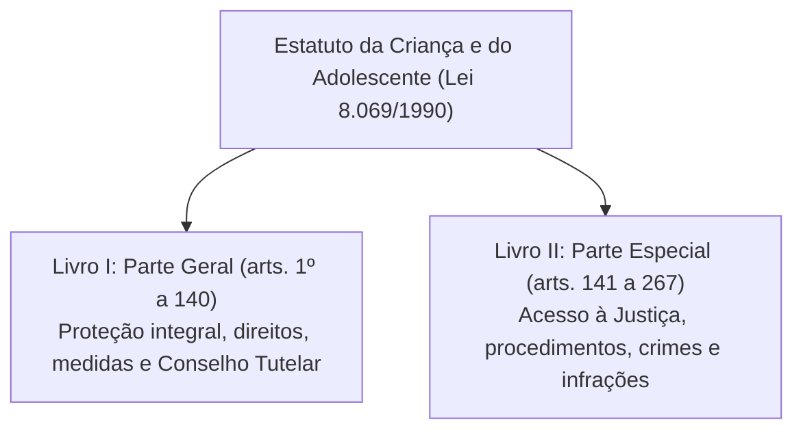
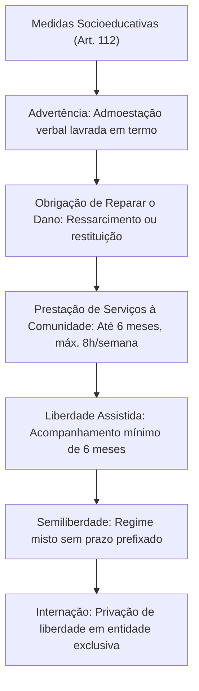
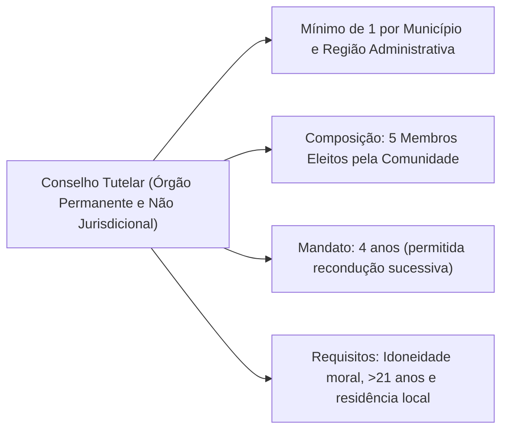
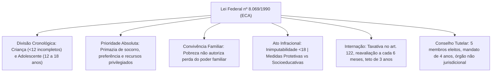

O Estatuto da Criança e do Adolescente (Lei Federal nº 8.069/1990) representa o marco legal da doutrina da proteção integral no ordenamento jurídico brasileiro, em cumprimento direto ao mandamento do artigo 227 da Constituição Federal de 1988. Rompendo definitivamente com o antigo Código de Menores e com a doutrina da situação irregular, o diploma estatutário reconhece crianças e adolescentes como autênticos sujeitos de direitos civis, políticos, sociais e econômicos, destinatários de prioridade absoluta e titulares de garantias peculiares decorrentes de sua condição especial de pessoas em processo de desenvolvimento biopsicossocial.

> [!objetivos]
> - Compreender a doutrina da proteção integral e a distinção etária entre criança e adolescente.
> - Dominar a escala dos direitos fundamentais e o princípio da prioridade absoluta.
> - Diferenciar as medidas de proteção das medidas socioeducativas aplicáveis a atos infracionais.
> - Identificar a natureza jurídica, competências e vedações de atuação do Conselho Tutelar.

## Estrutura da Lei e Diretrizes de Estudo

O Estatuto da Criança e do Adolescente estrutura-se em mais de duzentos e sessenta artigos, divididos sistematicamente em dois livros fundamentais: a Parte Geral e a Parte Especial. A compreensão dessa arquitetura legislativa orienta o candidato a priorizar os temas de maior incidência em provas militares e de segurança pública.

| Livro | Conteúdo Temático | Artigos Correspondentes |
|---|---|---|
| **Livro I — Parte Geral** | Princípios, direitos fundamentais, prevenção, política de atendimento, medidas de proteção, ato infracional e Conselho Tutelar | Arts. 1º a 140 |
| **Livro II — Parte Especial** | Acesso à Justiça, procedimentos infracionais, proteção judicial, crimes em espécie e infrações administrativas | Arts. 141 a 267 |

> [!bizu] Doutrina da Proteção Integral e Sujeito de Direitos
> O artigo 1º do Estatuto consagra solenemente a doutrina da proteção integral à criança e ao adolescente. Toda a interpretação normativa parte da premissa de que a criança e o adolescente não são meros objetos passivos de intervenção estatal ou familiar, mas sujeitos plenos de direitos que demandam tutela jurídica reforçada em razão de sua vulnerabilidade desenvolvimental.

## Conceitos, Princípios e Prioridade Absoluta

A definição dos destinatários das normas estatutárias estabelece uma divisão cronológica objetiva entre duas faixas etárias distintas:

| Categoria | Delimitação Etária Legal | Regime Primário Aplicável |
|---|---|---|
| **Criança** | Pessoa de até **12 anos de idade incompletos** | Medidas de proteção (art. 101) |
| **Adolescente** | Pessoa entre **12 e 18 anos de idade** | Medidas socioeducativas (art. 112) |

> [!lei] Idade e Regime Etário no ECA (art. 2º)
> Art. 2º Considera-se criança, para os efeitos desta Lei, a pessoa até doze anos de idade incompletos, e adolescente aquela entre doze e dezoito anos de idade.
> Parágrafo único. Nos casos expressos em lei, aplica-se excepcionalmente este Estatuto às pessoas entre dezoito e vinte e um anos de idade.

Em caráter excepcionalíssimo, o Estatuto aplica-se a pessoas entre dezoito e vinte e um anos de idade nos casos expressamente previstos em lei (art. 2º, parágrafo único), a exemplo da execução continuada da medida socioeducativa de internação e da semiliberdade até o limite etário de vinte e um anos.

O artigo 4º impõe à família, à comunidade, à sociedade em geral e ao poder público o dever indeclinável de assegurar, com **absoluta prioridade**, a efetivação dos direitos fundamentais referentes à vida, à saúde, à alimentação, à educação, ao esporte, ao lazer, à profissionalização, à cultura, à dignidade, ao respeito, à liberdade e à convivência familiar e comunitária. A garantia constitucional e estatutária de prioridade compreende quatro desdobramentos operacionais indeclináveis:
1. **Primazia de receber proteção e socorro** em quaisquer circunstâncias;
2. **Precedência de atendimento** nos serviços públicos ou de relevância pública;
3. **Preferência na formulação e na execução** das políticas sociais públicas;
4. **Destinação privilegiada de recursos públicos** nas áreas relacionadas com a proteção à infância e à juventude.

> [!lei] Primazia no Socorro e Salvamento Militar (art. 4º, parágrafo único, a)
> A alínea a do parágrafo único do art. 4º assegura expressamente a primazia de receber proteção e socorro em quaisquer circunstâncias. Em salvamentos e emergências conduzidas pelo Corpo de Bombeiros e polícias militares, crianças e adolescentes devem ser socorridos com absoluta precedência em relação a outros indivíduos.

Complementando os princípios fundamentais:
- **Art. 3º:** Gozam de todos os direitos fundamentais inerentes à pessoa humana, sem prejuízo da proteção integral, assegurando-se-lhes oportunidades e facilidades para desenvolvimento físico, mental, moral, espiritual e social, sem qualquer discriminação de nascimento, etnia, raça, sexo, religião ou condição socioeconômica.
- **Art. 5º:** Nenhuma criança ou adolescente será objeto de qualquer forma de negligência, discriminação, exploração, violência, crueldade e opressão, punido na forma da lei qualquer atentado, por ação ou omissão, aos seus direitos fundamentais.
- **Art. 6º:** Na interpretação desta lei levar-se-ão em conta os fins sociais a que ela se dirige, as exigências do bem comum, os direitos e deveres individuais e coletivos, e a condição peculiar da criança e do adolescente como pessoas em desenvolvimento.

## Catálogo dos Direitos Fundamentais

O Título II da Parte Geral estabelece o elenco dos direitos fundamentais, organizado em cinco núcleos materiais sistemáticos.

### Direito à Vida e à Saúde (arts. 7º a 14)

O artigo 7º assegura a proteção à vida e à saúde mediante a efetivação de políticas sociais públicas que permitam o nascimento e o desenvolvimento sadio e harmonioso, em condições dignas de existência. A assistência prestada pelo Sistema Único de Saúde (SUS) abrange atenção humanizada à gestante e à parturiente, com apoio pré-natal, parto e puerpério, além de atendimento odontológico e suporte psicológico especializado.

O artigo 14, em seu parágrafo primeiro, estabelece como obrigatória a **vacinação das crianças** nos casos recomendados pelas autoridades sanitárias competentes. O descumprimento dessa diretriz pelos pais ou responsáveis enseja aplicação de sanções administrativas e medidas de proteção.

O artigo 13 institui regra de comunicação obrigatória de suma importância em concursos: os casos de suspeita ou confirmação de castigo físico, de tratamento cruel ou degradante e de maus-tratos praticados contra criança ou adolescente serão compulsoriamente comunicados ao **Conselho Tutelar** da respectiva localidade, sem prejuízo da tomada de outras providências legais de índole penal.

### Direito à Liberdade, ao Respeito e à Dignidade (arts. 15 a 18-B)

O direito à liberdade compreende os seguintes aspectos expressos no artigo 16:

| Inciso | Dimensão do Direito de Liberdade |
|---|---|
| I | Ir, vir e estar nos logradouros públicos e espaços comunitários, ressalvadas as restrições legais |
| II | Opinião e expressão |
| III | Crença e culto religioso |
| IV | Brincar, praticar esportes e divertir-se |
| V | Participar da vida familiar e comunitária, sem discriminação |
| VI | Participar da vida política, na forma da lei |
| VII | Buscar refúgio, auxílio e orientação |

O direito ao respeito (art. 17) consiste na inviolabilidade da integridade física, psíquica e moral da criança e do adolescente, abrangendo a preservação da imagem, da identidade, da autonomia, dos valores, ideias e crenças, dos espaços e dos objetos pessoais. O artigo 18 reforça o dever de todos de velar pela dignidade da criança e do adolescente, pondo-os a salvo de qualquer tratamento desumano, violento, aterrorizante, vexatório ou constrangedor.

Com o advento da Lei Federal nº 13.010/2014 (conhecida como Lei Menino Bernardo), inseriram-se os artigos 18-A e 18-B, garantindo à criança e ao adolescente o direito de serem educados e cuidados sem o uso de **castigo físico** (conduta de caráter disciplinar ou punitivo aplicada com uso da força física que resulte em sofrimento físico ou lesão) ou de **tratamento cruel ou degradante** (conduta que humilhe, ameace gravemente ou ridicularize a criança).

### Direito à Convivência Familiar e Comunitária (arts. 19 a 52-D)

O artigo 19 consagra a regra geral de que toda criança ou adolescente tem direito a ser criado e educado no seio de sua **família natural** e, excepcionalmente, em **família substituta**, assegurada a convivência familiar e comunitária em ambiente livre da presença de pessoas dependentes de substâncias entorpecentes.

O acolhimento institucional e o acolhimento familiar configuram medidas protetivas rigorosamente provisórias e excepcionais. A situação jurídica e psicossocial da criança acolhida deve ser reavaliada judicialmente no prazo máximo de **três meses**, e a permanência na instituição de acolhimento não pode exceder o período limite de **dezoito meses**, salvo comprovada e justificada necessidade que atenda ao superior interesse do acolhido.

O poder familiar (arts. 21 a 24) é exercido em perfeita igualdade de condições entre pai e mãe. Compete aos genitores o dever recíproco de sustento, guarda e educação dos filhos menores.

> [!pegadinha] Pobreza Não Justifica Destituição do Poder Familiar
> O artigo 23 estabelece expressamente que **a falta ou a carência de recursos materiais não constitui motivo suficiente para a perda ou a suspensão do poder familiar**. Questões de prova costumam tentar induzir em erro afirmando que a extrema penúria financeira dos genitores autoriza a destituição familiar. Diante de carência socioeconômica, a determinação legal consiste na inclusão compulsória da família em programas oficiais de auxílio e renda governamentais.

O Estatuto conceitua três modalidades de arranjo familiar:
- **Família Natural (art. 25):** Comunidade formada pelos pais ou por qualquer deles e seus descendentes.
- **Família Extensa ou Ampliada (art. 25, parágrafo único):** Aquela que se estende para além da unidade de pais e filhos, formada por parentes próximos com os quais a criança ou adolescente convive e mantém laços de afinidade e afetividade.
- **Família Substituta (art. 28):** Inserção mediante os institutos jurídicos da guarda, tutela ou adoção.

Os institutos de colocação em família substituta distinguem-se com clareza:
- **Guarda (art. 33):** Obriga à prestação de assistência material, moral e educacional, conferindo ao guardião o direito de opor-se a terceiros, inclusive em relação aos genitores. Destina-se prioritariamente a regularizar a posse de fato.
- **Tutela (art. 36):** Pressupõe a prévia decretação da perda ou suspensão do poder familiar (ou falecimento dos genitores) e implica necessariamente o dever de guarda.
- **Adoção (art. 39):** Medida judicial excepcional e **irrevogável**, à qual apenas se recorre após o esgotamento comprovado de todas as possibilidades de manutenção na família natural ou extensa.

> [!esquema] Diferenças Cruciais entre Guarda, Tutela e Adoção
> - **Guarda:** Regulariza posse de fato; não destitui o poder familiar dos pais; revogável a qualquer tempo.
> - **Tutela:** Pressupõe destituição ou suspensão prévia do poder familiar ou morte dos pais; envolve dever de guarda e administração de bens; revogável.
> - **Adoção:** Rompe em definitivo os vínculos com a família de origem (salvo impedimentos matrimoniais); confere condição irrevogável de filho; cria novos vínculos de parentesco.

| Requisito Legal da Adoção | Parâmetro Fixado pelo ECA |
|---|---|
| Idade mínima do adotante | **18 anos**, independentemente do estado civil |
| Diferença etária mínima | O adotante deve ser pelo menos **16 anos mais velho** que o adotando |
| Consentimento do adotando | Obrigatório se a criança tiver **mais de 12 anos de idade** |
| Estágio de convivência prévio | Fixado pelo juiz, prazo máximo de **90 dias**, prorrogável uma vez |
| Caráter da decisão | Adoção constitui vínculo definitivo e **irrevogável** |

### Direito à Educação, Cultura, Esporte e Lazer (arts. 53 a 59)

O artigo 53 garante o direito à educação visando ao pleno desenvolvimento da pessoa humana, ao preparo para o exercício da cidadania e à qualificação para o mercado de trabalho. Assegura-se a igualdade de condições de acesso e permanência, o direito de ser respeitado por educadores, o direito de contestar critérios avaliativos e de recorrer a instâncias escolares superiores, além do direito de organização em entidades estudantis.

O artigo 56 impõe aos dirigentes de estabelecimentos de ensino fundamental o dever de comunicar formalmente ao Conselho Tutelar os seguintes fatos escolares:
1. Casos de maus-tratos envolvendo seus alunos;
2. Reiteração de faltas injustificadas e de evasão escolar, após esgotados todos os recursos pedagógicos e escolares cabíveis;
3. Elevados níveis de repetência escolar.

### Direito à Profissionalização e Proteção no Trabalho (arts. 60 a 69)

Em consonância com o artigo 7º, inciso XXXIII, da Constituição Federal, é expressamente proibido qualquer trabalho a menores de dezesseis anos, salvo na condição de **aprendiz, a partir dos quatorze anos de idade**. O artigo 67 elenca as proibições absolutas de trabalho para o adolescente:

| Hipótese Proibida | Justificativa Protetiva Legal |
|---|---|
| **Trabalho Noturno** | Realizado entre as **22 horas de um dia e as 5 horas** do dia seguinte |
| **Trabalho Perigoso, Insalubre ou Penoso** | Preservação da integridade física e saúde ocupacional |
| **Locais Prejudiciais** | Ambientes que comprometam a formação moral, psíquica ou social |
| **Incompatibilidade Escolar** | Realizado em horários ou locais que impeçam a frequência obrigatória à escola |

## Medidas Específicas de Proteção

As medidas de proteção (arts. 98 a 102) são mecanismos jurídicos voltados a resguardar a integridade dos direitos reconhecidos no Estatuto sempre que estes forem ameaçados ou violados:
- Por ação ou omissão da sociedade ou do Estado;
- Por falta, omissão ou abuso cometido pelos pais ou responsável legal;
- Em razão de conduta praticada pela própria criança ou adolescente.

O artigo 101 lista as medidas protetivas aplicáveis pela autoridade competente:
1. Encaminhamento aos pais ou responsável, mediante lavratura de termo de responsabilidade;
2. Orientação, apoio e acompanhamento temporários;
3. Matrícula e frequência obrigatórias em estabelecimento oficial de ensino fundamental;
4. Inclusão em serviços e programas comunitários de proteção e promoção da família;
5. Requisição de tratamento médico, psicológico ou psiquiátrico ambulatorial ou hospitalar;
6. Inclusão em programa oficial ou comunitário de auxílio e tratamento a usuários de substâncias psicoativas;
7. Acolhimento institucional;
8. Inclusão em programa de acolhimento familiar;
9. Colocação em família substituta.

> [!atencao] Caráter Excepcional do Acolhimento Institucional
> As medidas de acolhimento institucional e de acolhimento familiar **não implicam qualquer forma de privação de liberdade** e possuem natureza transitória. Em situações extraordinárias de extrema urgência, entidades de acolhimento podem receber a criança sem determinação judicial prévia, cabendo ao responsável pelo programa comunicar formalmente o fato à Vara da Infância e da Juventude no prazo improrrogável de **até vinte e quatro horas** (art. 93).

## Prática de Ato Infracional e Regime Socioeducativo

Define-se ato infracional como toda conduta descrita expressamente na lei como **crime ou contravenção penal** (art. 103). São penalmente inimputáveis os menores de dezoito anos de idade (art. 104), considerando-se a **idade do indivíduo na data exata da prática do fato** infracional.

A resposta estatal ao ato infracional varia conforme a idade do autor:
- Praticado por **criança** (menos de 12 anos incompletos): aplicam-se **exclusivamente medidas de proteção** (art. 101). A criança jamais responde por medida socioeducativa.
- Praticado por **adolescente** (12 a 18 anos): aplicam-se as **medidas socioeducativas** previstas no artigo 112.

Nenhum adolescente será privado de sua liberdade individual senão em situação de **flagrante de ato infracional** ou por **ordem escrita e fundamentada da autoridade judiciária competente** (art. 106). A internação provisória decretada antes do trânsito em julgado da sentença tem prazo peremptório máximo de **quarenta e cinco dias** (art. 108).

O rol do artigo 112 abrange seis medidas socioeducativas principais:
1. **Advertência (art. 115):** Admoestação verbal reduzida a termo escrito e assinada perante a autoridade judicial.
2. **Obrigação de Reparar o Dano (art. 116):** Restituição da coisa subtraída, ressarcimento financeiro ou compensação do prejuízo experimentado pela vítima.
3. **Prestação de Serviços à Comunidade (art. 117):** Realização de tarefas gratuitas em entidades assistenciais ou órgãos públicos, por prazo máximo de **seis meses**, com jornada semanal máxima de **oito horas**.
4. **Liberdade Assistida (art. 118):** Acompanhamento, orientação e supervisão de equipe pedagógica, pelo período mínimo legal de **seis meses**.
5. **Semiliberdade (art. 120):** Medida de privação parcial da liberdade sem prazo determinado prefixado, com frequência escolar e capacitação profissional obrigatórias no meio aberto durante o período diurno.
6. **Internação em Estabelecimento Educacional (art. 121):** Medida de privação total de liberdade em ambiente especializado.

### Regime Jurídico da Medida de Internação

A medida de internação sujeita-se rigorosamente a três princípios constitucionais e estatutários (art. 121): **brevidade**, **excepcionalidade** e **respeito à condição peculiar de pessoa em desenvolvimento**.

| Regra Legal da Internação | Critério Técnico Estabelecido |
|---|---|
| Determinação de Prazo | **Não comporta prazo determinado prefixado** na sentença |
| Reavaliação Periódica | Obrigatória no prazo máximo de **a cada 6 meses** |
| Limite Temporal Máximo | Prazo máximo absoluto improrrogável de **3 anos** |
| Desinternação Compulsória | Ocorre compulsoriamente aos **21 anos de idade** |
| Atividades Externas | Autorizadas a critério da equipe técnica, salvo veto judicial |

O artigo 122 estabelece hipóteses taxativas (numerus clausus) que autorizam a decretação da internação:
1. Prática de ato infracional cometido mediante **grave ameaça ou violência real contra a pessoa**;
2. **Reiteração** no cometimento de outras infrações de natureza grave;
3. **Descumprimento reiterado e injustificável** de medida socioeducativa anteriormente imposta. Nesta hipótese específica de descumprimento, o prazo de internação sanção não poderá ultrapassar o limite temporal de **três meses**.

Em nenhuma hipótese será admitida a decretação de internação se houver qualquer outra medida socioeducativa em meio aberto que se mostre adequada ao caso concreto (art. 122, § 2º).

> [!lei] Hipóteses Taxativas de Internação (art. 122)
> A internação só é cabível em três situações excepcionais: 1) ato infracional com grave ameaça ou violência à pessoa; 2) reiteração de infrações graves; 3) descumprimento reiterado e injustificável de medida anterior (com limite de três meses).

> [!jurisprudencia] STJ, Súmula 108: Competência Jurisdicional Exclusiva do Juiz
> A aplicação de medidas socioeducativas ao adolescente, pela prática de ato infracional, é de competência exclusiva do juiz. O Conselho Tutelar não detém poder jurisdicional para cominar sanções socioeducativas.

## O Conselho Tutelar: Natureza, Composição e Atribuições

O artigo 131 define o Conselho Tutelar como órgão **permanente e autônomo, não jurisdicional**, encarregado pela sociedade de zelar pelo cumprimento estrito dos direitos da criança e do adolescente.

| Elemento Estrutural | Regra Estatutária (Arts. 132 a 135) |
|---|---|
| Quantitativo por localidade | No mínimo **um Conselho Tutelar** por Município e por região administrativa do DF |
| Composição do colegiado | Composto por **5 membros titulares** |
| Processo de escolha | Escolhidos pelo **voto direto dos cidadãos da comunidade local** |
| Duração do mandato | Mandato de **4 anos**, permitida a recondução em novos pleitos |
| Requisitos dos conselheiros | Reconhecida idoneidade moral, **idade superior a 21 anos** e residência no Município |

Dentre as principais atribuições fixadas no artigo 136, destacam-se:
- Atender crianças e adolescentes em situação de risco e aplicar medidas de proteção (art. 101, incisos I a VII);
- Atender e aconselhar pais ou responsáveis, aplicando medidas disciplinares (art. 129, incisos I a VII);
- Promover a execução de suas decisões, requisitando serviços públicos essenciais nas áreas de saúde, educação, previdência, trabalho e segurança;
- Encaminhar ao Ministério Público notícia de fatos que constituam crimes ou infrações administrativas;
- Representar em juízo pelo afastamento de agressor nos termos da Lei Henry Borel (Lei nº 14.344/2022).

> [!pegadinha] Limites e Vedações Atribuídos ao Conselho Tutelar
> O Conselho Tutelar é órgão administrativo autônomo, mas **não possui natureza jurisdicional**. Portanto:
> 1. O Conselho Tutelar **não julga processos judiciais**;
> 2. O Conselho Tutelar **não aplica medidas socioeducativas** (competência privativa do juiz da Infância e da Juventude);
> 3. O Conselho Tutelar **não decreta a perda ou suspensão do poder familiar**, limitando-se a representar perante o Ministério Público para que este proponha a ação judicial adequada.

## Resumo para Revisar

Para consolidar a revisão estratégica dos pontos mais frequentes em provas de concursos públicos e seleções militares sobre o Estatuto da Criança e do Adolescente, sintetizamos as regras fundamentais na tabela comparativa a seguir:

| Instituto Jurídico | Regra Chave do ECA | Ponto Crítico em Provas |
|---|---|---|
| **Criança vs Adolescente** | Criança até 12 incompletos; adolescente de 12 a 18 anos | Criança só recebe medida de proteção (art. 101) |
| **Prioridade Absoluta** | Primazia de proteção e socorro em qualquer circunstância | Prioridade militar e policial em resgates e sinistros |
| **Maus-tratos e Castigo** | Comunicação obrigatória ao Conselho Tutelar (arts. 13 e 18-A) | Envolve agentes públicos, escolas e unidades de saúde |
| **Poder Familiar** | Falta de recursos materiais não justifica suspensão ou perda | Vedada a destituição por mera pobreza familiar |
| **Acolhimento Institucional** | Medida excepcional com reavaliação a cada 3 meses e teto de 18 meses | Não implica privação de liberdade individual |
| **Adoção Legal** | Adotante maior de 18 anos com diferença mínima de 16 anos | Medida judicial excepcional e irrevogável |
| **Trabalho do Menor** | Proibido para menores de 16 anos, salvo aprendiz a partir de 14 | Vedações: trabalho noturno (22h às 5h), perigoso ou penoso |
| **Internação Socioeducativa** | Sem prazo determinado, reavaliação a cada 6 meses, teto de 3 anos | Desinternação obrigatória ao completar 21 anos |
| **Conselho Tutelar** | Órgão permanente, autônomo e não jurisdicional com 5 membros | Não aplica medidas socioeducativas nem julga ações |

## Mapa do capítulo

### Para fixar

- A doutrina da proteção integral considera crianças e adolescentes como sujeitos plenos de direitos e pessoas em desenvolvimento.
- Criança é a pessoa até doze anos incompletos; adolescente situa-se na faixa etária entre doze e dezoito anos de idade.
- A prioridade absoluta confere primazia de recebimento de socorro e proteção em qualquer circunstância de emergência.
- A insuficiência de recursos econômicos dos genitores jamais autoriza a suspensão ou perda do poder familiar.
- O acolhimento institucional é medida protetiva provisória com permanência máxima de dezoito meses e reavaliação trimestral.
- A adoção é medida judicial excepcional e irrevogável, exigindo diferença de pelo menos dezesseis anos entre adotante e adotando.
- O ato infracional cometido por criança atrai exclusivamente a imposição de medidas protetivas do artigo 101.
- As medidas socioeducativas de semiliberdade e internação não comportam prazo determinado fixado antecipadamente na sentença.
- A internação submete-se ao prazo máximo absoluto de três anos, operando-se a liberação compulsória aos vinte e um anos.
- O Conselho Tutelar é órgão não jurisdicional composto por cinco membros eleitos para mandatos de quatro anos.
