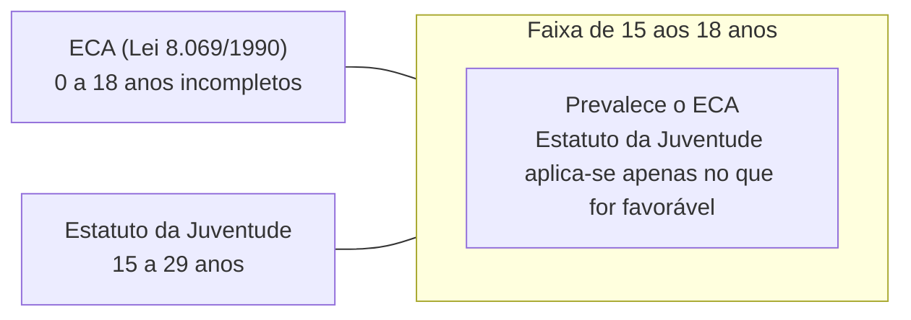
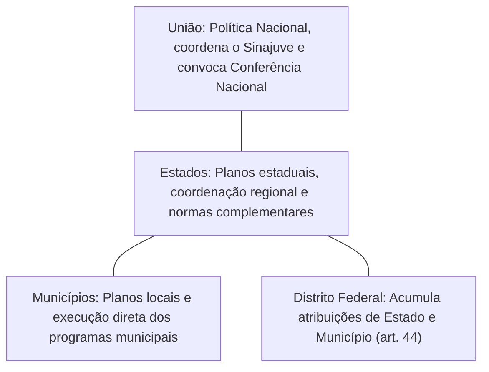
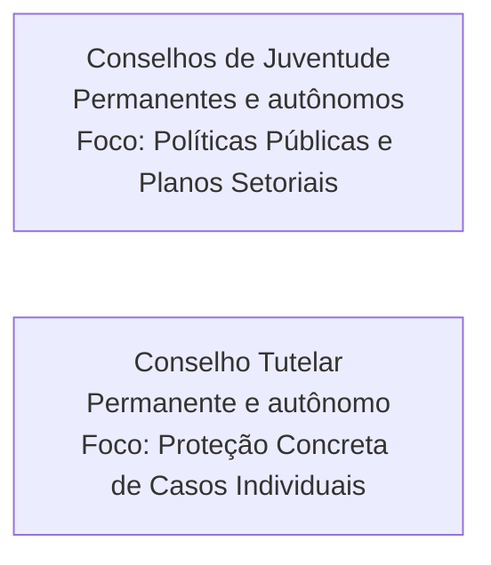
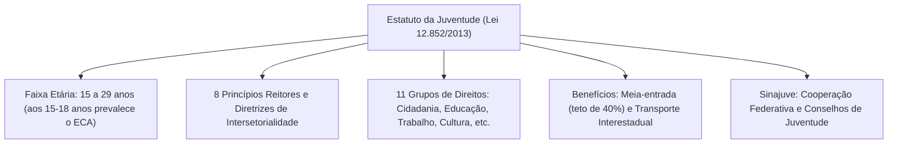

O Estatuto da Juventude (Lei Federal nº 12.852/2013) institui os princípios, diretrizes e direitos dos jovens no Brasil. A norma regulamenta o artigo 227 da Constituição Federal, alterado pela Emenda Constitucional nº 65/2010. Com quarenta e oito artigos, a lei consagra o jovem como sujeito de direitos universais, geracionais e singulares. Além disso, estrutura o Sistema Nacional de Juventude (Sinajuve).

> [!objetivos]
> - Compreender a delimitação etária dos jovens e a relação de subsidiariedade com o ECA.
> - Dominar os oito princípios fundamentais e as diretrizes gerais das políticas de juventude.
> - Conhecer o catálogo dos onze grupos de direitos estatutários e os benefícios de meia-entrada e transporte.
> - Identificar a organização, competências e estrutura de conselhos do Sistema Nacional de Juventude.

## O que é o Estatuto e quem ele protege

O Estatuto da Juventude estabelece um marco regulatório próprio. Seu objetivo é assegurar a transição segura para a vida adulta. A lei divide-se em dois títulos principais:

| Título da Lei | Matéria Regulada | Artigos Correspondentes |
|---|---|---|
| **Título I** | Direitos e Políticas Públicas de Juventude (princípios, diretrizes e 11 grupos de direitos) | Arts. 1º a 38 |
| **Título II** | Sistema Nacional de Juventude — Sinajuve (competências federativas e conselhos) | Arts. 39 a 48 |

A definição dos jovens baseia-se em critério cronológico direto:

> [!lei] Delimitação Etária da Juventude (art. 1º, § 1º)
> São consideradas jovens as pessoas com idade entre 15 (quinze) e 29 (vinte e nove) anos de idade.

> [!pegadinha] Sobreposição Etária entre ECA e Estatuto da Juventude
> Dos quinze aos dezoito anos incompletos há sobreposição de normas. Nesses casos, prevalece o **Estatuto da Criança e do Adolescente (ECA)**. O Estatuto da Juventude incide apenas subsidiariamente, naquilo que não conflitar com a proteção integral. No trabalho, aplica-se integralmente o regime do ECA.

## Princípios Fundamentais das Políticas de Juventude

O artigo 2º da Lei nº 12.852/2013 enumera oito princípios orientadores:
1. Promoção da autonomia e emancipação dos jovens;
2. Valorização e promoção da participação social e política;
3. Promoção da criatividade e da participação no desenvolvimento do País;
4. Reconhecimento do jovem como sujeito de direitos universais, geracionais e singulares;
5. Promoção do bem-estar, da experimentação e do desenvolvimento integral;
6. Respeito à identidade e à diversidade individual e coletiva;
7. Promoção da vida segura, da cultura da paz, da solidariedade e da não discriminação;
8. Valorização do diálogo e convívio com as demais gerações.

> [!atencao] Conceito Estatutário de Emancipação Juvenil
> A emancipação juvenil do artigo 2º **não se confunde com a emancipação civil** do Código Civil. Ela expressa a trajetória social de autonomia, inclusão e cidadania do jovem. Não altera a capacidade civil antes dos dezoito anos.

## Diretrizes Gerais das Ações Governamentais

O artigo 3º impõe diretrizes gerais para o planejamento das políticas públicas de juventude em todas as esferas estatais. Os agentes públicos devem atuar de modo integrado, assegurando a eficácia social das ações direcionadas aos jovens:
- Promoção da **intersetorialidade** entre órgãos governamentais de educação, saúde, trabalho e segurança;
- Incentivo à ampla e efetiva participação dos jovens na criação, execução e avaliação dos programas;
- Ampliação sistemática das oportunidades de inserção produtiva, educacional e comunitária;
- Respeito integral às especificidades regionais, culturais e socioeconômicas da população jovem;
- Garantia de acesso continuado a equipamentos públicos de cultura, esporte, lazer e mobilidade;
- Fortalecimento da cooperação federativa entre União, Estados, Municípios e conselhos setoriais;
- Promoção da integração internacional prioritária com a América Latina e países africanos lusófonos;
- Tutela dos direitos fundamentais dos jovens de 18 a 29 anos privados de liberdade e dos egressos prisionais.

A intersetorialidade exige que as políticas de segurança pública dialoguem com a assistência social e a educação. Dessa forma, combate-se a vulnerabilidade juvenil nas periferias urbanas e previne-se o ingresso de adolescentes na criminalidade.

## Os Onze Grupos de Direitos Estatutários

O Estatuto distribui os direitos juvenis ao longo dos artigos 4º a 38, divididos em onze seções:

| Seção | Direitos Assegurados | Principais Destaques Legais |
|---|---|---|
| **I** | **Cidadania e Participação Social e Política** | Livre associação, manifestação e criação de conselhos de juventude |
| **II** | **Educação** | Ensino básico obrigatório e gratuito, EJA, ações afirmativas e transporte |
| **III** | **Profissionalização, Trabalho e Renda** | Trabalho digno, proteção ao jovem aprendiz e apoio ao empreendedorismo |
| **IV** | **Diversidade e Igualdade** | Vedação a preconceitos de raça, etnia, gênero, orientação sexual ou religião |
| **V** | **Saúde** | Acesso ao SUS, atenção integral e veto à propaganda de bebidas com menores |
| **VI** | **Cultura** | Livre fruição cultural e garantia da meia-entrada em espetáculos |
| **VII** | **Comunicação e Liberdade de Expressão** | Inclusão digital gratuita e direito à produção comunicativa |
| **VIII** | **Desporto e Lazer** | Estímulo ao desporto educacional e construção de quadras poliesportivas |
| **IX** | **Território e Mobilidade** | Direito à mobilidade urbana e vagas em transporte interestadual |
| **X** | **Sustentabilidade e Meio Ambiente** | Educação ambiental em todos os níveis e preservação ecológica |
| **XI** | **Segurança Pública e Acesso à Justiça** | Prevenção da violência letal e assistência jurídica pela Defensoria Pública |

> [!bizu] Mnemônico dos Onze Direitos Estatutários
> Para guardar a ordem dos direitos em provas: **C**idadania, **E**ducação, **T**rabalho, **D**iversidade, **S**aúde, **C**ultura, **C**omunicação, **D**esporto, **T**erritório, **S**ustentabilidade e **S**egurança. Guarde: "Cada Estudante Trabalhador Deve Saber: Cultura e Comunicação Desenvolvem Território, Sustentabilidade e Segurança".

### Regras Quantitativas de Meia-Entrada e Transporte

Os artigos 23 e 32 trazem números muito cobrados em certames:

| Benefício Legal | Regra do Estatuto | Critério de Elegibilidade |
|---|---|---|
| **Meia-Entrada Cultural e Esportiva** | Desconto de **50% no valor do ingresso** | Jovens de até 29 anos de baixa renda e estudantes |
| **Critério de Baixa Renda** | Renda familiar mensal de **até 2 salários mínimos** | Inscrição ativa no Cadastro Único (CadÚnico) |
| **Limite Geral da Meia-Entrada** | Reserva de **até 40% do total de ingressos** | Controle do organizador em cada evento |
| **Validade da Carteira de Estudante** | Válida até **31 de março do ano seguinte** | Padrão nacional emitido por entidades estudantis |
| **Transporte Rodoviário Interestadual** | Reserva de **2 vagas gratuitas por veículo convencional** | Jovens de baixa renda inscritos no CadÚnico |
| **Vagas Suplementares com Desconto** | Mais **2 vagas com desconto de 50%** | Concedidas após esgotadas as vagas gratuitas |

> [!lei] Regras da Meia-Entrada e Transporte Interestadual (arts. 23 e 32)
> O transporte interestadual gratuito abrange ônibus convencionais entre Estados. Não se aplica a transporte aéreo ou a serviços executivos. Exige reserva prévia conforme regulamento federal.

## Sistema Nacional de Juventude (Sinajuve)

O Sinajuve (Título II) organiza as políticas públicas de juventude em cooperação federativa entre a União, Estados, Distrito Federal e Municípios.

As atribuições dividem-se de forma descentralizada:
- **União (art. 41):** Elabora o Plano Nacional de Juventude, coordena o Sinajuve e apoia financeiramente os demais entes.
- **Estados (art. 42):** Coordenam o sistema regional, criam planos estaduais e cofinanciam ações locais.
- **Municípios (art. 43):** Executam políticas locais e elaboram os planos municipais.
- **Distrito Federal (art. 44):** Cumula expressamente as competências estaduais e municipais.

As Conferências de Juventude ocorrem a cada quatro anos no máximo.

> [!esquema] Comparação Institucional: Conselhos de Juventude vs Conselho Tutelar
> Ambos são órgãos permanentes, autônomos e **não jurisdicionais**. Contudo, o Conselho Tutelar atua em casos concretos de ameaça a direitos de crianças e adolescentes. Já os conselhos de juventude deliberam sobre diretrizes gerais, orçamento e planos de políticas públicas.

## Resumo para Revisar

Para fixação rápida da Lei Federal nº 12.852/2013 antes da prova, revise a tabela abaixo:

| Tema Central | Regra do Estatuto | Ponto de Atenção em Concurso |
|---|---|---|
| **Conceito de Jovem** | Pessoas entre 15 e 29 anos de idade | Dos 15 aos 18 anos prevalece o ECA |
| **Princípios** | Oito princípios fundamentais | Emancipação cidadã não é emancipação civil |
| **Direitos** | Onze núcleos estruturados | Sequência exata de cidadania a segurança pública |
| **Meia-Entrada** | 50% de desconto limitado a 40% dos ingressos | Estudantes e jovens no CadÚnico com até 2 salários mínimos |
| **Transporte Interestadual** | 2 vagas gratuitas mais 2 vagas com 50% | Exclusivo para ônibus convencionais entre Estados |
| **Distrito Federal** | Cumula atribuições estaduais e municipais | Regra expressa do artigo 44 |
| **Conferências** | Periodicidade máxima de 4 anos | Unem poder público e juventude organizada |

## Mapa do capítulo

### Para fixar

- O Estatuto da Juventude protege a população com idade entre quinze e vinte e nove anos.
- Dos quinze aos dezoito anos incompletos, prevalecem as regras do ECA sobre a proteção integral.
- A emancipação juvenil estatutária refere-se ao desenvolvimento cidadão, sem alterar a capacidade civil.
- O Estatuto estrutura onze grupos de direitos fundamentais para a população jovem.
- A meia-entrada assegura cinquenta por cento de desconto, limitada a quarenta por cento dos ingressos.
- Jovens de baixa renda inscritos no CadÚnico com renda de até dois salários mínimos têm direito à meia-entrada.
- O transporte interestadual convencional reserva duas vagas gratuitas e duas vagas com cinquenta por cento de desconto.
- O Sistema Nacional de Juventude (Sinajuve) organiza a atuação federativa compartilhada.
- O Distrito Federal cumula as atribuições estaduais e municipais na gestão do Sinajuve.
- Os conselhos de juventude são órgãos colegiados autônomos e não jurisdicionais focados em políticas públicas.
