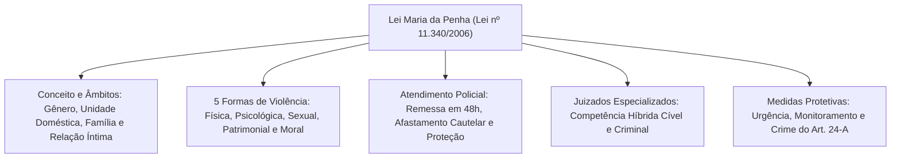
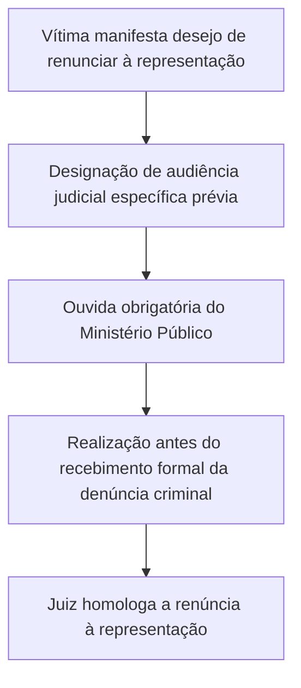
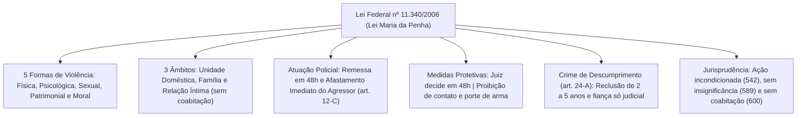

A Lei Maria da Penha (Lei Federal nº 11.340/2006) é o principal instrumento legislativo de enfrentamento à violência doméstica e familiar contra a mulher no Brasil. Em cumprimento ao artigo 226, parágrafo 8º, da Constituição Federal e a tratados internacionais de direitos humanos ratificados pelo Estado brasileiro, a norma estabelece mecanismos multidisciplinares de prevenção, assistência jurídica, acolhimento psicossocial, medidas protetivas de urgência e rigor procedimental penal para coibir a opressão de gênero.

> [!objetivos]
> - Compreender a finalidade protetiva da lei e os âmbitos de incidência da violência doméstica.
> - Caracterizar as cinco formas de violência doméstica tipificadas no artigo 7º.
> - Dominar os procedimentos policiais de urgência e as hipóteses de afastamento cautelar do agressor.
> - Analisar a concessão e a execução das medidas protetivas de urgência e o crime de descumprimento.
> - Conhecer as súmulas e julgados paradigmáticos do STF e do STJ aplicáveis à matéria.

## Como a banca cobra a Lei Maria da Penha

A cobrança da Lei Maria da Penha em concursos de segurança pública e corporações militares organiza-se em torno de cinco blocos temáticos estruturantes:
1. Finalidade, princípios interpretativos e abrangência conceitual (arts. 1º a 6º);
2. Formas de violência doméstica e familiar contra a mulher (art. 7º);
3. Assistência e atendimento da autoridade policial e de socorro (arts. 8º a 12-D);
4. Procedimentos judiciais e regras de competência dos Juizados (arts. 13 a 17-A);
5. Medidas protetivas de urgência e o crime de descumprimento (arts. 18 a 24-A).

As bancas examinadoras cobram frequentemente a literalidade dos artigos e a jurisprudência sumulada dos tribunais superiores. Nas provas, o foco costuma recair sobre o atendimento emergencial de socorro, as hipóteses de afastamento imediato do agressor do lar, a apreensão de armas de fogo e a caracterização das formas de agressão. Compreender a articulação entre as garantias constitucionais do artigo 226 da Carta Magna e os instrumentos processuais da Lei nº 11.340/2006 permite resolver com segurança qualquer questão sobre a matéria.

A lei é composta por quarenta e seis artigos principais, acrescidos de dispositivos complementares que consolidam a atuação das polícias e do Poder Judiciário.

## Finalidade e Direitos Fundamentais (arts. 1º a 4º)

O artigo 1º da Lei nº 11.340/2006 enuncia expressamente que o diploma cria mecanismos para coibir e prevenir a violência doméstica e familiar contra a mulher. Seu fundamento assenta-se no artigo 226, parágrafo 8º, da Carta Magna e em convenções internacionais de direitos humanos, notadamente a Convenção sobre a Eliminação de Todas as Formas de Discriminação contra a Mulher (CEDAW) e a Convenção Interamericana para Prevenir, Punir e Erradicar a Violência contra a Mulher (Convenção de Belém do Pará).

O artigo 2º assegura a todas as mulheres, independentemente de classe social, raça, etnia, orientação sexual, renda, cultura, escolaridade, idade ou religião, o pleno gozo dos direitos fundamentais inerentes à dignidade humana.

O artigo 3º comina ao poder público, em conjunto com a família e a sociedade, o dever de assegurar as condições necessárias para o exercício dos direitos à vida, segurança, saúde, alimentação, educação, moradia, trabalho, dignidade, respeito e convivência comunitária. Na interpretação da lei (art. 4º), o aplicador deve atentar para os fins sociais a que ela se dirige e para a condição peculiar da mulher em situação de violência.

## O que é "Violência Doméstica e Familiar" (arts. 5º e 6º)

Configura violência doméstica e familiar contra a mulher qualquer ação ou omissão baseada no gênero que lhe cause morte, lesão, sofrimento físico, sexual ou psicológico e dano moral ou patrimonial.

> [!lei] Conceito Legal de Violência Doméstica (art. 5º)
> Para os efeitos desta Lei, configura violência doméstica e familiar contra a mulher qualquer ação ou omissão baseada no gênero que lhe cause morte, lesão, sofrimento físico, sexual ou psicológico e dano moral ou patrimonial, ocorrida em três âmbitos: no espaço de convívio permanente doméstico, na comunidade familiar ou em qualquer relação íntima de afeto.

Os três âmbitos espaciais e relacionais definem-se taxativamente:

| Âmbito Legal de Incidência | Definição Estatutária (Art. 5º) | Requisitos Especiais |
|---|---|---|
| **I — Unidade Doméstica** | Espaço de convívio permanente de pessoas | Com ou sem vínculo familiar, inclusive agregadas |
| **II — Família** | Comunidade formada por indivíduos aparentados | Unidos por laços naturais, afinidade ou vontade expressa |
| **III — Relação Íntima de Afeto** | Convivência amorosa presente ou pretérita | **Independe expressamente de coabitação** |

O parágrafo único do artigo 5º destaca que as relações pessoais enunciadas no dispositivo independem de orientação sexual.

> [!pegadinha] Desnecessidade de Coabitação e Motivação de Gênero
> Para a incidência da Lei Maria da Penha:
> 1. **Não se exige coabitação** sob o mesmo teto (Súmula 600 do STJ). Agressões entre namorados ou ex-namorados enquadram-se na lei se houver relação íntima de afeto.
> 2. A violência deve ser **baseada no gênero**, envolvendo dominação, subjugação ou vulnerabilidade da mulher na dinâmica relacional.
> 3. O artigo 6º estabelece expressamente que a violência doméstica contra a mulher constitui **uma das formas de violação dos direitos humanos**.

## As Cinco Formas de Violência (art. 7º)

O artigo 7º apresenta um rol exemplificativo das formas pelas quais a violência doméstica se manifesta. As bancas de concurso exigem a identificação precisa de cada conduta:

| Modalidade | Conceito Legal Estrito | Condutas Típicas Exemplificativas |
|---|---|---|
| **Física** (inciso I) | Ofensa à integridade corporal ou saúde física da mulher | Socos, tapas, empurrões, queimaduras, cortes e fraturas |
| **Psicológica** (inciso II) | Conduta que cause dano emocional e prejuízo ao desenvolvimento pessoal | Ameaça, humilhação, isolamento social, vigilância constante e perseguição contumaz |
| **Sexual** (inciso III) | Constrangimento a presenciar, manter ou participar de relação não desejada | Estupro conjugal, impedimento de contracepção e imposição de aborto ou prostituição |
| **Patrimonial** (inciso IV) | Retenção, subtração ou destruição parcial ou total de bens e documentos | Reter cartão bancário, quebrar celular, rasgar certidões e queimar instrumentos de trabalho |
| **Moral** (inciso V) | Conduta que configure calúnia, difamação ou injúria contra a honra | Atribuir falsamente crime, imputar fato desonroso ou proferir xingamentos degradantes |

## Assistência e Atendimento Policial (arts. 8º a 12-D)

O atendimento de segurança pública à mulher vítima de agressão orienta-se pela cooperação articulada e agilidade operacional.

### Medidas Integradas de Prevenção e Assistência (arts. 8º e 9º)

As diretrizes do artigo 8º prescrevem a integração operacional do Judiciário, Ministério Público e Defensoria com a segurança pública, saúde e assistência social. Institui-se o atendimento especializado em Delegacias de Defesa da Mulher (Deams).

O artigo 9º confere à mulher vítima de violência o direito a medidas assistenciais prioritárias:
- Inclusão em programas assistenciais de renda governamentais;
- Acesso prioritário à **remoção funcional**, quando for servidora pública da administração direta ou indireta;
- Manutenção do vínculo trabalhista por **até seis meses**, quando for necessário o afastamento do local de trabalho para resguardar sua integridade física;
- Acesso compulsório a serviços médicos de contracepção de emergência e profilaxia de ISTs no SUS.

### Atuação Policial em Situação de Urgência (arts. 10 a 12-D)

O artigo 11 estabelece os deveres operacionais da autoridade policial no atendimento da ocorrência:
- Garantir proteção policial imediata à mulher e aos dependentes;
- Encaminhar a ofendida a atendimento hospitalar ou ao Instituto Médico Legal (IML);
- Fornecer transporte seguro para abrigo ou residência de familiares;
- Acompanhar a vítima para retirada de seus bens e objetos pessoais do lar comum;
- Informar detalhadamente sobre a rede de apoio e medidas protetivas disponíveis.

A autoridade policial deve colher a representação, instaurar o inquérito e remeter ao juiz o pedido de medidas protetivas de urgência no prazo improrrogável de **quarenta e oito horas** (art. 12, inciso III).

> [!lei] Afastamento Cautelar do Agressor pelo Policial (art. 12-C)
> Verificada a existência de risco atual ou iminente à vida ou à integridade física da mulher ou de seus dependentes, o agressor será imediatamente afastado do lar:
> I — Pela **autoridade judicial**;
> II — Pelo **delegado de polícia**, quando o Município não for sede de comarca;
> III — Pelo **policial**, quando o Município não for sede de comarca e não houver delegado disponível no momento da denúncia.
> Nas hipóteses dos incisos II e III, o juiz será formalmente comunicado no prazo de até **vinte e quatro horas**, decidindo em igual prazo sobre a manutenção ou revogação da medida.

## Procedimentos Processuais e Juizados Especializados (arts. 13 a 17-A)

O artigo 14 cria os Juizados de Violência Doméstica e Familiar contra a Mulher como órgãos da Justiça Comum dotados de **competência cumulativa cível e criminal**. A ofendida pode ajuizar nos Juizados pedidos de medidas protetivas criminais e ações de divórcio ou dissolução de união estável (art. 14-A). Contudo, a **partilha de bens fica expressamente excluída** da competência desses Juizados especializados.

O artigo 15 confere à mulher a opção de eleger a competência civil entre o foro de seu domicílio ou residência, o lugar do fato ou o domicílio do agressor.

> [!atencao] Notificação da Ofendida e Vedações Processuais
> O artigo 16 estabelece que a renúncia à representação somente será admitida perante o juiz, em audiência especialmente designada para tal finalidade, antes do recebimento da denúncia e com prévia oitiva do Ministério Público.
> Além disso:
> - O artigo 17 proíbe expressamente a cominação de penas de prestação pecuniária isolada, como a entrega de **cestas básicas**, e o pagamento de multa substitutiva.
> - O artigo 41 veda de forma absoluta a aplicação da Lei dos Juizados Especiais (Lei nº 9.099/1995) aos crimes praticados com violência doméstica contra a mulher.
> - O artigo 21 determina que a ofendida seja comunicada de todos os atos processuais relativos ao agressor, especialmente o ingresso e a saída da prisão, sendo expressamente proibido encarregá-la da intimação do agressor.

## Medidas Protetivas de Urgência (arts. 18 a 24-A)

Recebido o pedido da ofendida ou a representação policial, o magistrado dispõe do prazo legal de **quarenta e oito horas para decidir** sobre as medidas protetivas (art. 18).

As medidas podem ser deferidas de plano pelo juiz, sem audiência prévia das partes e independentemente de prévia manifestação do Ministério Público, podendo ser concedidas isolada ou cumulativamente.

### Medidas que Obrigam o Agressor (art. 22)

O magistrado pode cominar ao agressor as seguintes obrigações restritivas:
- **Suspensão da posse ou restrição do porte de armas**, comunicando imediatamente a corporação militar ou órgão policial ao qual o agressor pertença, sob pena de responsabilidade do comandante hierárquico;
- **Afastamento imediato do lar**, domicílio ou local de convivência familiar;
- **Proibição de aproximação** da ofendida, seus familiares e testemunhas, fixando limite mínimo de distância;
- Proibição de contato por qualquer meio de comunicação (mensagens, ligações ou redes sociais);
- Proibição de frequentação de determinados lugares públicos ou de trabalho da vítima;
- Restrição ou suspensão de visitas aos filhos menores;
- Prestação de alimentos provisionais ou provisórios;
- Comparecimento obrigatório a programas de reeducação e recuperação;
- Monitoramento eletrônico por tornozeleira.

### Medidas de Proteção Direta à Ofendida (arts. 23 e 24)

O juiz pode determinar a recondução da ofendida ao lar após a saída do agressor, o afastamento da vítima com preservação integral de direitos patrimoniais, a separação de corpos e a matrícula compulsória dos dependentes escolares na instituição mais próxima do novo domicílio. Na esfera patrimonial (art. 24), autoriza-se o bloqueio de contas, restituição de bens subtraídos e suspensão de procurações.

### Crime de Descumprimento de Medida Protetiva (art. 24-A)

> [!lei] Tipificação do Crime de Descumprimento de Medida Protetiva (art. 24-A)
> Descumprir decisão judicial que defere medidas protetivas de urgência previstas nesta Lei:
> Pena — reclusão, de 2 (dois) a 5 (cinco) anos, e multa.
> § 1º A configuração do crime independe da competência cível ou criminal do juiz prolator.
> § 2º Na hipótese de prisão em flagrante, apenas a autoridade judicial poderá conceder fiança.
> § 4º A pena é aumentada de 1/3 até metade se o descumprimento decorrer de violação de área de exclusão eletrônica ou alteração do dispositivo de monitoramento.

## Disposições Transitórias e Finais (arts. 33 a 46)

O Título VII da Lei Federal nº 11.340/2006 reúne comandos transitórios e integradores indispensáveis para a aplicação prática do microssistema de proteção à mulher:
- **Competência Provisória (art. 33):** Enquanto não forem estruturados os Juizados de Violência Doméstica e Familiar contra a Mulher em determinada comarca, as varas criminais comuns acumulam as competências cível e criminal para os feitos da lei. Tais processos possuem preferência absoluta de tramitação sobre os demais feitos judiciais.
- **Estruturas de Apoio Multidisciplinar (art. 35):** A União, os Estados, o Distrito Federal e os Municípios poderão criar centros de atendimento integral, casas-abrigo, delegacias especializadas, núcleos de Defensoria Pública e centros de perícia médico-legal vocacionados ao atendimento da mulher. Também se prevê a criação de programas de recuperação e reeducação para os agressores.
- **Legitimação Coletiva (art. 37):** A defesa dos interesses e direitos transindividuais das mulheres em situação de violência doméstica pode ser exercida concorrentemente pelo Ministério Público e por associações civis regularmente constituídas há pelo menos um ano.
- **Estatísticas Oficiais (art. 38):** Os órgãos do sistema de justiça e de segurança pública devem incluir estatísticas detalhadas sobre violência doméstica em suas bases públicas de dados, contemplando a perspectiva de raça e etnia.
- **Vedação à Lei dos Juizados Especiais (art. 41):** Aos crimes praticados com violência doméstica e familiar contra a mulher, independentemente da pena cominada em abstrato, não se aplica a Lei nº 9.099/1995. Ficam afastados benefícios despenalizadores como a composição civil dos danos, a transação penal e o procedimento sumariíssimo.

## Jurisprudência Consolidada dos Tribunais Superiores

A eficácia prática da Lei Maria da Penha é acompanhada por enunciados consolidados de jurisprudência sumulada e precedentes vinculantes do Supremo Tribunal Federal e do Superior Tribunal de Justiça:

| Precedente Vinculante | Tribunal | Tese Jurídica Fixada |
|---|---|---|
| **ADI 4.424 e ADC 19** | **STF** | Constitucionalidade integral da lei; ação penal por lesão corporal é pública incondicionada |
| **Súmula 536** | **STJ** | Inaplicabilidade da suspensão condicional do processo e da transação penal |
| **Súmula 542** | **STJ** | Ação penal por lesão corporal resultante de violência doméstica é pública incondicionada |
| **Súmula 588** | **STJ** | Inviabilidade de substituição de pena privativa de liberdade por restritivas de direitos |
| **Súmula 589** | **STJ** | Inaplicabilidade do princípio da insignificância em violência doméstica contra a mulher |
| **Súmula 600** | **STJ** | Configuração de violência doméstica e familiar não exige coabitação sob o mesmo teto |

> [!jurisprudencia] STJ, Súmula 542: Natureza Incondicionada da Ação Penal por Lesão Corporal
> A ação penal por crime de lesão corporal cometido no ambiente doméstico e familiar contra a mulher é pública incondicionada. Não se admite renúncia ou desistência da vítima para trancar a persecução penal por lesão leve.

> [!jurisprudencia] STJ, Súmula 589: Inaplicabilidade do Princípio da Insignificância
> É inaplicável o princípio da insignificância aos crimes e contravenções penais praticados contra a mulher no âmbito das relações domésticas e familiares. A relevância penal e a reprovabilidade moral afastam teses de bagatela.

> [!jurisprudencia] STJ, Súmula 600: Configuração de Violência sem Exigência de Coabitação
> Para a configuração da violência doméstica e familiar prevista no artigo 5º da Lei nº 11.340/2006, não se exige a coabitação entre autor e vítima sob o mesmo domicílio. O vínculo íntimo de afeto pretérito basta para atrair o regime protetivo.

## Resumo para Revisar

Para assegurar revisão precisa da Lei Maria da Penha antes do certame, memorize as diretrizes sintéticas da tabela a seguir:

| Ponto Central | Comando Normativo da Lei nº 11.340/2006 | Impacto em Provas |
|---|---|---|
| **Fundamento Constitucional** | Artigo 226, § 8º, da CF/88 e tratados de Belém do Pará | Mandamento expresso de proteção contra violência familiar |
| **Formas de Violência** | Física, psicológica, sexual, patrimonial e moral | Rol exemplificativo do artigo 7º |
| **Coabitação** | Desnecessária conforme a Súmula 600 do STJ | Incide em namoros presentes ou findos |
| **Remessa Policial** | Remessa ao juiz em até 48 horas | Juiz tem 48 horas para deliberar |
| **Afastamento do Lar** | Juiz, delegado (sem comarca) ou policial (sem delegado) | Garantia de integridade física no artigo 12-C |
| **Crime do Artigo 24-A** | Reclusão de 2 a 5 anos e multa | Fiança privativa da autoridade judicial |
| **Ação Penal por Lesão** | Pública incondicionada (Súmula 542 do STJ) | Não cabe renúncia ou retratação na delegacia |
| **Vedações Penais** | Vedada cesta básica e suspensão condicional do processo | Afasta a aplicação da Lei nº 9.099/1995 |

## Mapa do capítulo

### Para fixar

- A Lei Maria da Penha fundamenta-se no artigo 226, parágrafo oitavo, da Constituição e na Convenção de Belém do Pará.
- A violência doméstica configura-se em ações baseadas no gênero ocorridas no ambiente doméstico, familiar ou relação íntima.
- A configuração da violência independe de coabitação sob o mesmo teto, aplicando-se plenamente a namoros findos.
- O artigo 7º consagra cinco formas de violência: física, psicológica, sexual, patrimonial e moral.
- A autoridade policial dispõe de quarenta e oito horas para remeter o expediente com o pedido de medidas protetivas ao juiz.
- Em municípios sem comarca, o delegado ou o policial de plantão pode afastar cautelarmente o agressor do lar.
- O magistrado tem o prazo legal de quarenta e oito horas para deliberar sobre as medidas protetivas de urgência.
- O descumprimento de medidas protetivas comina pena de reclusão de dois a cinco anos, com fiança exclusiva do juiz.
- A ação penal por crime de lesão corporal cometida contra a mulher em ambiente doméstico é pública incondicionada.
- É vedada a aplicação da Lei nº 9.099/1995, cestas básicas e o princípio da insignificância em violência doméstica.
