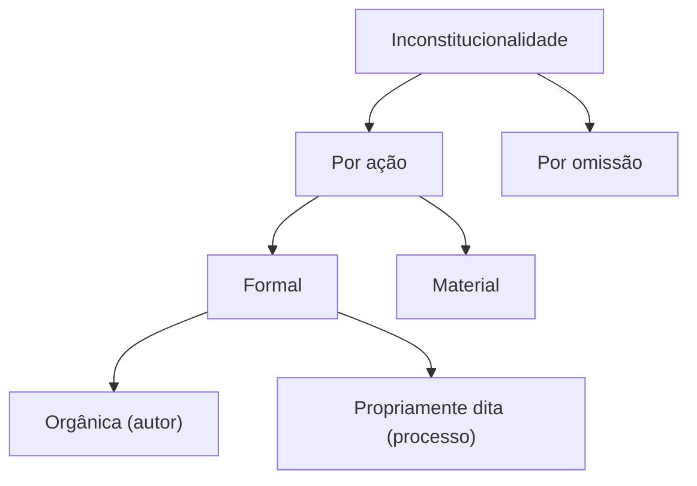

Uma Constituição só vale como norma suprema se existir um mecanismo capaz de retirar do ordenamento as leis que a contrariam. Esse mecanismo é o **controle de constitucionalidade**. Este capítulo abre o volume com o conceito, os pressupostos, a origem do instituto nos Estados Unidos e na Áustria, a história do controle no Brasil e as espécies de inconstitucionalidade, ponto em que as bancas mais gostam de fazer perguntas conceituais. Fecha com a **recepção**, que é o fenômeno oposto: a norma anterior que a nova Constituição aproveita.

> [!objetivos]
> - Definir controle de constitucionalidade e seus pressupostos.
> - Explicar a origem do controle nos Estados Unidos e na Áustria.
> - Resumir a evolução do controle nas Constituições brasileiras.
> - Distinguir as espécies de inconstitucionalidade e a recepção.

## Conceito e pressupostos

**Controlar a constitucionalidade** é verificar se uma lei ou ato normativo está de acordo com a Constituição, formal e materialmente, e, se não estiver, retirá-lo do ordenamento ou afastá-lo do caso. O parâmetro do controle é a Constituição, e o objeto é a lei ou ato normativo do Poder Público. A ideia só faz sentido com três pressupostos:

| Pressuposto | Significado |
| --- | --- |
| Supremacia da Constituição | A Constituição está no topo do ordenamento, e as demais normas retiram dela seu fundamento de validade |
| Rigidez constitucional | A Constituição só muda por processo mais difícil que o das leis; se mudasse como uma lei, não haveria hierarquia |
| Órgão competente | É preciso haver quem faça o controle, seja um tribunal, seja um órgão político |

> [!bizu]
> Para lembrar os pressupostos, pense numa pirâmide com três exigências: **topo** (supremacia), **trava** (rigidez, porque sem ela qualquer lei revogaria a Constituição) e **guardião** (órgão que fiscalize). Sem rigidez, a lei posterior simplesmente revoga a anterior, e não há controle.

Há quem inclua também a existência de uma Constituição escrita como pressuposto. Em provas, os três da tabela são os mais cobrados. Note que o controle trata da **validade** da norma: uma lei inconstitucional é uma lei inválida, ainda que tenha sido regularmente publicada.

## Parâmetro e objeto do controle

O **parâmetro** é a norma em face da qual se mede a validade das demais. No Brasil, é a **Constituição vigente**, em seu texto permanente e nas emendas, e, segundo o STF, o conjunto de normas constitucionais que forma o chamado **bloco de constitucionalidade**. Esse conjunto inclui o texto da Constituição, as emendas, os princípios implícitos e os tratados internacionais de direitos humanos aprovados com o quórum das emendas (art. 5º, § 3º). O preâmbulo, para o STF, não é parâmetro de controle, porque não tem força normativa autônoma. Os tratados de direitos humanos sem esse quórum têm hierarquia supralegal, e, portanto, servem de parâmetro para o controle de **convencionalidade**, e não de constitucionalidade.

O **objeto** é o ato do Poder Público que se quer controlar. Entram: emendas constitucionais, leis complementares, ordinárias e delegadas, medidas provisórias, decretos legislativos, resoluções, decretos autônomos e tratados internacionais já incorporados. Ficam de fora, em regra, os atos de efeitos concretos e as normas já revogadas, as normas constitucionais originárias (o Brasil não admite a tese das normas constitucionais inconstitucionais) e os atos meramente regulamentares, que violam apenas a lei.

> [!pegadinha]
> Dizer que uma norma constitucional originária pode ser declarada inconstitucional. Para o STF, não existe hierarquia entre normas da Constituição originária, e a tese das "normas constitucionais inconstitucionais" foi rejeitada. As **emendas**, por sua vez, podem ser inconstitucionais, se violarem as cláusulas pétreas ou o procedimento do art. 60.

## Origem do controle

### Estados Unidos: controle difuso

O marco é o caso **Marbury v. Madison** (1803), julgado pela Suprema Corte americana sob a presidência do juiz John Marshall. A Corte recusou aplicar uma lei que contrariava a Constituição, com o argumento de que a Constituição é a lei suprema e, em conflito, o juiz deve aplicá-la, e não a lei inferior. O modelo é de **controle difuso**: qualquer juiz pode afastar a lei inconstitucional ao decidir um caso concreto. A decisão vale entre as partes, e o precedente se impõe pelo sistema do *stare decisis*.

### Áustria: controle concentrado

O modelo europeu nasce com a Constituição austríaca de 1920, sob a influência de **Hans Kelsen**. Em vez de dar a todos os juízes o poder de afastar leis, cria-se um **tribunal constitucional**, que concentra a competência de declarar a inconstitucionalidade, em abstrato, com efeitos para todos. É o **controle concentrado**.

| Característica | Modelo americano | Modelo austríaco |
| --- | --- | --- |
| Quem controla | Qualquer juiz ou tribunal | Um único órgão, o tribunal constitucional |
| Forma | Difuso, incidental | Concentrado, em ação própria |
| Objeto | Caso concreto | Lei em tese |
| Efeitos | Entre as partes | Para todos |

> [!atencao] Brasil: modelo misto
> O Brasil adota um **modelo misto**: o controle difuso, de origem americana, e o concentrado, de origem europeia, convivem. O difuso vem desde a Constituição de 1891; o concentrado foi sendo criado ao longo do século XX e consolidado em 1988.

## Histórico no Brasil

A evolução em linhas gerais:

- **Constituição de 1824 (Império):** não havia controle judicial de constitucionalidade. A supremacia era do Poder Legislativo, e o Poder Moderador do Imperador prevalecia. O modelo europeu de soberania do parlamento, com a lei acima de tudo, influenciou o período.
- **Constituição de 1891:** primeira Constituição republicana, inspirada no modelo americano. Introduziu o **controle difuso** pelo Judiciário, e o Supremo Tribunal Federal passou a julgar em recurso as causas em que se questionasse a validade de lei.
- **Constituição de 1934:** manteve o difuso e criou três inovações: a **cláusula de reserva de plenário** (declaração de inconstitucionalidade só pela maioria absoluta dos membros do tribunal), a **suspensão da execução da lei pelo Senado** (para dar efeito geral à decisão do STF) e a **representação interventiva**, ação para a intervenção federal nos Estados por violação de princípios constitucionais.
- **Constituição de 1937:** retrocesso. Permitiu ao Parlamento, por proposta do Presidente, "confirmar" a lei declarada inconstitucional pelo Judiciário.
- **Constituição de 1946:** restabeleceu os institutos de 1934. A **Emenda Constitucional 16/1965** criou a **representação de inconstitucionalidade**, primeira forma de controle concentrado e abstrato, de competência do STF, proposta pelo Procurador-Geral da República.
- **Constituição de 1988:** manteve o difuso e ampliou o concentrado. Criou a **ação direta de inconstitucionalidade**, a **ação direta de inconstitucionalidade por omissão** e o **mandado de injunção**, e ampliou os legitimados da ADI. A **EC 3/1993** criou a **ação declaratória de constitucionalidade**, e a **EC 45/2004** estendeu aos legitimados da ADI a legitimidade para a ADC. A **arguição de descumprimento de preceito fundamental** completa o quadro, hoje regulada por lei.

| Constituição | Inovação principal |
| --- | --- |
| 1891 | Controle difuso, por influência americana |
| 1934 | Reserva de plenário, suspensão pelo Senado e representação interventiva |
| 1965 (EC 16) | Representação de inconstitucionalidade, primeira ação direta |
| 1988 | ADI, ADO, ampliação dos legitimados e, depois, ADC e ADPF |

Vale reparar na lógica dessa história. Cada Constituição acrescentou uma ferramenta sem retirar as anteriores, de modo que o sistema brasileiro é cumulativo: a pessoa que se sente lesada por uma lei pode levantar a questão em qualquer processo (difuso), e os legitimados do art. 103 podem levar a lei em tese ao STF (concentrado). Por isso, a mesma lei pode ser discutida ao mesmo tempo nas duas vias, e a decisão do STF no concentrado prevalece sobre as demais, por seu efeito vinculante. Em provas de nível médio, a pergunta típica é qual Constituição criou determinado instrumento, e a melhor forma de errar menos é guardar as três datas: 1891, 1934 e 1965.

> [!pegadinha]
> Atribuir a criação do controle concentrado à Constituição de 1988. A **representação de inconstitucionalidade**, que é o embrião da ADI, foi criada em **1965**, durante a vigência da Constituição de 1946. Também é errado dizer que a Constituição de 1824 previa controle difuso: não havia controle judicial.

## Espécies de inconstitucionalidade

### Quanto à conduta: ação e omissão

A inconstitucionalidade **por ação** decorre da edição de norma que contraria a Constituição. A **por omissão** decorre da falta de norma exigida pela Constituição, ou da falta de medida para tornar efetiva uma norma constitucional de eficácia limitada. A omissão pode ser total (nenhuma providência) ou parcial (providência insuficiente).

### Quanto à norma violada: formal e material

A inconstitucionalidade é **formal** quando o vício está no **processo de criação** da norma, e **material** quando está no **conteúdo**, que contraria a Constituição.

| Espécie | Onde está o vício | Exemplos |
| --- | --- | --- |
| Formal orgânica (subjetiva) | Autor incompetente | Lei estadual que legisla sobre matéria privativa da União |
| Formal propriamente dita (objetiva) | Etapa do processo legislativo | Lei complementar aprovada por maioria simples; vício de iniciativa |
| Material | Conteúdo incompatível | Lei que cria pena de morte em tempo de paz |

Quando uma lei de iniciativa privativa do Presidente nasce de projeto de parlamentar, o vício é **formal subjetivo**, e é considerado insanável: a sanção não o corrige. Existe ainda a inconstitucionalidade formal **por violação de pressupostos objetivos**, como a edição de medida provisória sem relevância e urgência.

### Quanto à extensão: total e parcial

**Total** é a que atinge toda a norma. **Parcial** atinge só alguns dispositivos, palavras ou expressões. No Brasil, o STF pode declarar a inconstitucionalidade parcial com **redução de texto** (retira-se uma palavra) ou **sem redução de texto** (o texto fica, mas se exclui uma interpretação), técnica estudada no capítulo seguinte.

### Quanto ao momento: originária e superveniente

A inconstitucionalidade é **originária** quando a lei nasce em conflito com a Constituição vigente. A chamada **superveniente** ocorre quando a Constituição muda depois de a lei existir. Para o STF, **não existe inconstitucionalidade superveniente**: se a norma anterior é incompatível com a Constituição nova, ela é **não recepcionada** (revogada), e não inconstitucional. Daí a regra de que não se faz ADI contra norma anterior à Constituição.

### Outras classificações que a banca cobra

**Nomoestática e nomodinâmica.** A inconstitucionalidade **nomoestática** diz respeito ao conteúdo da norma, que contraria a Constituição, e corresponde à material. A **nomodinâmica** diz respeito ao procedimento de criação, e corresponde à formal. São apenas outros nomes para a mesma divisão.

**Por arrastamento (atração ou reverberação normativa).** Quando o STF declara inconstitucional um dispositivo, pode estender a declaração a outros dispositivos que dependem dele, mesmo que ninguém os tenha impugnado. É a inconstitucionalidade por **arrastamento**: a norma dependente cai junto com a principal, por uma relação de subordinação lógica. É uma exceção à regra de que o tribunal fica adstrito ao pedido, e só vale quando a ligação entre as normas é clara. Em ADI contra um decreto regulamentar, por exemplo, a declaração de inconstitucionalidade da lei regulamentada leva o decreto de arrasto.

**Progressiva (ou "norma ainda constitucional").** Em certas situações, a norma é constitucional hoje, mas deixa de ser com a mudança da realidade, e o STF a mantém por um tempo, em atenção às circunstâncias. O caso clássico é o do prazo em **dobro** para a Defensoria Pública e o do Ministério Público: enquanto a Defensoria não estava organizada em todo o País, a regra que dava prazos diferentes era tida como "ainda constitucional", e passou a inconstitucional quando a instituição se estruturou. A inconstitucionalidade é, assim, **circunstancial**: depende do contexto de fato.

**Total e por vício de iniciativa.** Quando o vício de iniciativa contamina todo o diploma, a declaração é total; se apenas um artigo foi inserido por emenda parlamentar sem pertinência temática, a declaração é parcial.

### Quanto ao parâmetro: direta e indireta

A inconstitucionalidade é **direta** quando a lei contraria a Constituição de modo frontal. É **indireta** quando a lei viola uma norma infralegal (decreto, regulamento) ou uma lei, e só por via **reflexa** a Constituição. A violação reflexa não autoriza ADI nem recurso extraordinário. Por exemplo, um decreto que extrapola a lei regulamentada comete **ilegalidade**, e não inconstitucionalidade.

> [!resolvido] Classificando o vício
> **Enunciado.** Um Estado edita lei sobre direito penal, matéria de competência privativa da União. Classifique a inconstitucionalidade quanto à norma violada.
>
> **Raciocínio.** O vício não está no conteúdo da lei, mas em quem a editou: o ente federativo não tinha competência.
>
> **Conclusão.** É inconstitucionalidade **formal orgânica**, também chamada de subjetiva, porque o autor da norma era incompetente.

## Teoria da nulidade e efeito da declaração

Para a tradição americana, a lei inconstitucional é **nula**, e a declaração apenas reconhece essa nulidade. Por isso a regra é que a decisão produz efeitos **retroativos**, ou *ex tunc*: a lei inconstitucional nunca produziu efeitos válidos. Na tradição de Kelsen, a lei inconstitucional é **anulável**, e a decisão produz efeitos daí em diante, *ex nunc*. O Brasil adotou, como regra, a **teoria da nulidade**, com a possibilidade de **modulação** de efeitos pelo STF, por razões de segurança jurídica ou de excepcional interesse social, que se estuda no capítulo seguinte.

> [!lei] CF, art. 102, § 2º
> As decisões definitivas de mérito, proferidas pelo Supremo Tribunal Federal, nas ações diretas de inconstitucionalidade e nas ações declaratórias de constitucionalidade produzirão eficácia contra todos e efeito vinculante, relativamente aos demais órgãos do Poder Judiciário e à administração pública direta e indireta, nas esferas federal, estadual e municipal.

O dispositivo confirma que as decisões de mérito nas ações do controle concentrado têm **eficácia contra todos** (*erga omnes*) e **efeito vinculante**. O efeito vinculante alcança os demais órgãos do Judiciário e a administração pública em todas as esferas, mas não alcança o próprio STF nem o Poder Legislativo na sua função de legislar, o que permite ao Congresso editar nova lei com o mesmo conteúdo da declarada inconstitucional.

> [!atencao] Constituição flexível
> Em um país de Constituição **flexível**, que muda pelo mesmo processo das leis, a lei posterior que contraria a Constituição a altera, e não a viola; por isso a rigidez é pressuposto do controle. A Constituição de 1988 é rígida: depende de proposta de emenda aprovada em dois turnos, por três quintos, em cada Casa. Outra observação importante é que a inconstitucionalidade pode ser apontada em qualquer fase do processo, e a decisão sobre ela pode ser objeto de recurso: a parte que perde o ponto pode recorrer, e a questão pode chegar ao STF.

## Recepção

A **recepção** é o fenômeno pelo qual a nova Constituição mantém em vigor as normas anteriores que sejam materialmente compatíveis com ela. A norma recebida passa a ter o fundamento de validade da Constituição nova, e pode até mudar de natureza: o Código Tributário Nacional, lei ordinária, foi recebido como lei complementar. Em vez de verificar a forma com que a norma nasceu, a recepção compara só o **conteúdo** com a Constituição atual.

Quando a norma anterior é incompatível, ela é **revogada**, ou não recepcionada. Para o STF, o conflito entre a norma pré-constitucional e a nova Constituição se resolve pelo **direito intertemporal**, e não pelo controle de constitucionalidade: não cabe ADI contra a norma anterior à Constituição, mas cabe **ADPF**.

| Fenômeno | Ideia | Efeito |
| --- | --- | --- |
| Recepção | Norma anterior compatível com a nova Constituição | Continua em vigor, com novo fundamento de validade |
| Não recepção | Norma anterior incompatível | É revogada |
| Repristinação | Restauração de lei revogada pela revogação da lei revogadora | Não é automática; exige previsão expressa |
| Desconstitucionalização | Normas da Constituição anterior que continuam com status de lei | Não é aceita no Brasil, salvo previsão expressa |

> [!pegadinha]
> Dizer que uma lei anterior à Constituição de 1988 pode ser declarada "inconstitucional" em ADI. Para o STF, a norma incompatível foi **revogada** (não recepcionada), e a ADI não é o instrumento. Outra confusão é achar que a recepção exige que a norma tenha a mesma forma que a Constituição nova pede hoje: ela só exige **compatibilidade material**.

## Como a banca cobra este assunto

As questões deste tema são, em sua maioria, conceituais, e exigem atenção às palavras exatas. Os padrões mais frequentes são:

- **Pressupostos:** supremacia e rigidez como requisitos do controle.
- **Origem:** Marbury v. Madison (difuso) e Kelsen (concentrado).
- **Histórico:** em que Constituição surgiu cada instituto, em especial o controle difuso (1891), a reserva de plenário e a suspensão pelo Senado (1934) e a representação de inconstitucionalidade (1965).
- **Espécies:** exemplos de vícios formais e materiais, ação e omissão, e a ideia de que a inconstitucionalidade superveniente não existe.
- **Recepção:** distinguir revogação, recepção e inconstitucionalidade.

## Quem pode controlar: sistemas

Conforme o órgão de controle, os sistemas se classificam em **político**, em que o controle é feito por um órgão não judicial (como um conselho constitucional, modelo francês), **jurisdicional**, em que o controle é feito pelo Judiciário, e **misto**, em que parte das leis é controlada pelo órgão político e parte pelo Judiciário. O Brasil adota, em regra, o **sistema jurisdicional**, com algumas manifestações do controle político, como o veto jurídico do Presidente e a atuação das comissões de constituição e justiça. O capítulo seguinte detalha os sistemas, os momentos e as vias.

## Mapa do capítulo

| Tema | Regra | Cuidado |
| --- | --- | --- |
| Pressupostos | Supremacia, rigidez e órgão | Sem rigidez não há controle |
| Origem | Marbury v. Madison (difuso); Kelsen (concentrado) | Associar cada modelo ao país certo |
| Brasil | Modelo misto | Concentrado criado em 1965 |
| Formal | Vício de competência ou de processo | Vício de iniciativa é insanável |
| Material | Conteúdo contrário à Constituição | Independe do processo |
| Superveniente | Não existe, segundo o STF | Norma anterior é revogada |
| Recepção | Compatibilidade material | Não cabe ADI contra norma anterior |

### Para fixar

- O controle de constitucionalidade verifica se a lei ou ato normativo respeita a Constituição.
- Seus pressupostos são a supremacia, a rigidez e um órgão controlador.
- O controle difuso nasceu nos Estados Unidos, no caso Marbury v. Madison (1803).
- O controle concentrado nasceu na Áustria, por influência de Kelsen (1920).
- O Brasil adota modelo misto, com difuso desde 1891 e concentrado desde a EC 16/1965.
- A inconstitucionalidade é formal (orgânica ou propriamente dita) ou material.
- Não existe inconstitucionalidade superveniente: a norma anterior incompatível é revogada.
- A recepção mantém a norma anterior compatível, com novo fundamento de validade.
