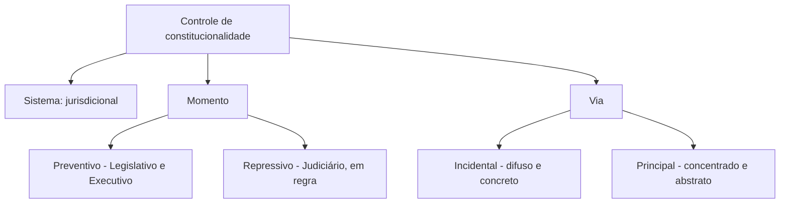

Há várias maneiras de classificar o controle de constitucionalidade, e as bancas misturam todas elas. Este capítulo organiza as classificações em quatro eixos: **quem** controla (sistemas), **como** o controle se distribui (critério formal), **quando** ocorre (momento, preventivo ou repressivo) e **por qual caminho** chega ao Judiciário (vias incidental e principal). Fecha com as **técnicas de decisão**, que mostram o que o STF faz depois de concluir que uma norma é inconstitucional.

> [!objetivos]
> - Distinguir os sistemas político, jurisdicional e misto.
> - Diferenciar o controle difuso do concentrado e as vias incidental e principal.
> - Reconhecer os momentos preventivo e repressivo e quem os exerce.
> - Descrever as técnicas de decisão do STF, inclusive a modulação de efeitos.

## Sistemas de controle

| Sistema | Quem controla | Exemplo |
| --- | --- | --- |
| Político | Órgão não judicial | Conselho Constitucional francês |
| Jurisdicional | O Poder Judiciário | Estados Unidos e Brasil |
| Misto | Parte pelo órgão político e parte pelo Judiciário | Suíça, para leis federais e cantonais |

O Brasil adota o sistema **jurisdicional**, em que o Judiciário tem a palavra final sobre a constitucionalidade. Há controle político, mas ele é exceção e não impede a revisão judicial.

## Critério formal: difuso e concentrado

Quanto à forma como a competência é repartida:

- No controle **difuso** (ou aberto), **qualquer juiz ou tribunal** pode examinar a constitucionalidade de uma lei ao julgar um caso. É o controle de origem americana.
- No controle **concentrado** (ou reservado), a competência é de **um só órgão**, que no plano federal é o STF, e nos Estados, o Tribunal de Justiça. É o controle de origem austríaca.

O sistema brasileiro é **misto** nesse critério: adota as duas formas ao mesmo tempo. O controle concentrado é exercido perante o STF para a Constituição Federal e perante os Tribunais de Justiça para as Constituições estaduais.

## Momento do controle

### Controle preventivo

Ocorre **antes** da conclusão do processo legislativo, para impedir que a lei inconstitucional nasça. Pode ser exercido:

- **Pelo Legislativo:** as **comissões de constituição e justiça** das duas Casas examinam a constitucionalidade dos projetos, e o plenário pode rejeitá-los por esse motivo.
- **Pelo Executivo:** por meio do **veto jurídico**, em que o Presidente veta o projeto por considerá-lo inconstitucional.

> [!lei] CF, art. 66, § 1º
> Se o Presidente da República considerar o projeto, no todo ou em parte, inconstitucional ou contrário ao interesse público, vetá-lo-á total ou parcialmente, no prazo de quinze dias úteis, contados da data do recebimento, e comunicará, dentro de quarenta e oito horas, ao Presidente do Senado Federal os motivos do veto.

O veto por inconstitucionalidade é o **veto jurídico**; por contrariedade ao interesse público, o **veto político**. Ambos são controle preventivo, mas só o primeiro é de constitucionalidade.

- **Pelo Judiciário:** em regra não há controle preventivo, pois não cabe ao Judiciário interferir no processo legislativo. A exceção, reconhecida pelo STF, é o **mandado de segurança impetrado por parlamentar**, para impedir a tramitação de proposta de emenda que viole cláusula pétrea ou de projeto cujo trâmite viole normas constitucionais do processo legislativo. Só o parlamentar tem legitimidade, porque o direito é seu, ao devido processo legislativo. O STF não faz controle preventivo em abstrato de projeto de lei.

### Controle repressivo

Ocorre **depois** que a lei já entrou no ordenamento, para retirá-la ou afastá-la. É feito, em regra, pelo **Judiciário**, por meio dos controles difuso e concentrado. Há exceções em que o Legislativo e o Executivo exercem controle repressivo:

| Poder | Hipótese |
| --- | --- |
| Legislativo | **Sustar atos normativos do Executivo** que exorbitem do poder regulamentar ou dos limites da delegação (art. 49, V) |
| Legislativo | **Rejeição de medida provisória** por inconstitucionalidade, e a recusa de conversão |
| Legislativo | Rejeição de lei delegada em desacordo com a delegação |
| Executivo | Negativa de cumprimento de lei inconstitucional, tema controvertido, admitido pelo STF em condições restritas |
| Tribunais de Contas | Segundo a Súmula 347, podem apreciar a constitucionalidade de leis e atos no exercício de suas competências, sem declará-las inconstitucionais |

> [!lei] CF, art. 49, V
> sustar os atos normativos do Poder Executivo que exorbitem do poder regulamentar ou dos limites de delegação legislativa;

Esse é o caso em que o Congresso, por **decreto legislativo**, retira a eficácia de um decreto do Presidente que extrapole a lei. Note que a hipótese trata de ato **do Executivo**, e não de leis.

> [!pegadinha]
> Dizer que todo controle repressivo é exercido pelo Judiciário, ou que o Judiciário nunca faz controle preventivo. A regra é essa, mas há exceções: o Legislativo sustando atos do Executivo, o Executivo vetando por inconstitucionalidade (preventivo) e o Judiciário, no mandado de segurança de parlamentar. A associação mais segura é: **preventivo, regra do Legislativo e do Executivo; repressivo, regra do Judiciário**.

## Vias de controle judicial

### Via incidental (difusa, concreta)

A questão de constitucionalidade aparece como **incidente** no processo, como fundamento do pedido ou da defesa, e deve ser resolvida antes do mérito. O pedido principal não é a declaração de inconstitucionalidade: ela é meio para decidir o caso. A decisão vale, em regra, **entre as partes**, e pode ser proferida por qualquer juiz ou tribunal. É também chamado de controle **concreto**, por tratar de um caso real.

### Via principal (concentrada, abstrata)

A inconstitucionalidade é o **pedido principal** da ação, que examina a lei **em tese**, independentemente de caso concreto. A decisão tem eficácia contra todos e efeito vinculante. É o controle **abstrato**, exercido pelo STF por ADI, ADC, ADO e ADPF.

| Aspecto | Via incidental | Via principal |
| --- | --- | --- |
| Pedido | Resolve o caso; a inconstitucionalidade é questão prejudicial | A inconstitucionalidade é o pedido |
| Objeto | Caso concreto | Lei em tese |
| Competência | Qualquer juiz ou tribunal | STF (ou TJ, no plano estadual) |
| Efeitos | Entre as partes (em regra) | Contra todos e vinculante |
| Natureza | Difuso e concreto | Concentrado e abstrato |

> [!bizu]
> Para fixar sem se perder: **difuso e concreto andam juntos** (qualquer juiz, caso real, efeito entre as partes) e **concentrado e abstrato andam juntos** (um só tribunal, lei em tese, efeito geral). Duas exceções confundem: a **ADI interventiva** é concentrada e concreta, e a **ADPF** pode ser incidental em seus efeitos, mas é concentrada no STF.

## Técnicas de decisão

Quando o STF conclui que uma norma é inconstitucional, não precisa simplesmente anulá-la. O Tribunal pode adotar técnicas que preservam o que for possível.

| Técnica | O que faz |
| --- | --- |
| Declaração de inconstitucionalidade com nulidade total | A norma inteira é nula |
| Nulidade parcial com redução de texto | Retira-se uma palavra ou expressão do texto |
| Nulidade parcial **sem** redução de texto | O texto permanece, mas se exclui uma interpretação ou aplicação |
| **Interpretação conforme** à Constituição | Entre várias interpretações, o Tribunal mantém a compatível com a Constituição |
| Inconstitucionalidade sem pronúncia de nulidade | Reconhece o vício, mas mantém a lei em vigor por um tempo, para o legislador corrigir |
| **Modulação** de efeitos | Limita o alcance temporal da decisão |

A **modulação** está prevista na Lei 9.868/1999: ao declarar a inconstitucionalidade, o STF pode, por razões de segurança jurídica ou de excepcional interesse social, e por decisão de **dois terços** de seus membros, restringir os efeitos da declaração ou decidir que ela só tenha eficácia a partir do trânsito em julgado ou de outro momento. Pode, assim, afastar a regra da retroatividade (*ex tunc*), dando efeitos *ex nunc* ou *pro futuro*.

> [!resolvido] Escolhendo a técnica
> **Enunciado.** Uma lei admite duas leituras: uma compatível com a Constituição e outra que a viola. O STF quer preservar a lei, sem alterar seu texto. Qual técnica usa?
>
> **Raciocínio.** O texto não será retirado nem alterado. O Tribunal vai fixar qual leitura é válida.
>
> **Conclusão.** Usa a **interpretação conforme à Constituição**, afirmando que a lei só é constitucional se interpretada de determinado modo. Se também excluir expressamente uma aplicação inconstitucional, adota a nulidade parcial sem redução de texto.

> [!atencao] Interpretação conforme e legislador positivo
> A interpretação conforme tem um limite: não pode contrariar o sentido literal da lei nem criar norma nova, pois o STF não atua como **legislador positivo**. Se a única leitura possível é a inconstitucional, a solução é declarar a nulidade.

### Detalhando as técnicas

A **interpretação conforme** só é possível quando a norma é **polissêmica**, isto é, admite mais de um sentido. Se o texto é unívoco, não há o que escolher, e a única saída é declarar a nulidade. Em seu uso, o Tribunal pode dizer que a lei é constitucional "desde que" entendida de certo modo, ou que ela "não abrange" determinada hipótese. Por isso a doutrina distingue a interpretação conforme da **declaração de nulidade parcial sem redução de texto**: na primeira, o Tribunal escolhe uma leitura gramaticalmente possível; na segunda, o Tribunal declara que uma **hipótese de aplicação** da norma é inconstitucional, sem mexer em palavra alguma. Em ambas, o texto da lei permanece.

A declaração **pro tantum** (só na medida em que) é uma variação: a lei é inconstitucional apenas na parte em que alcança determinada situação. Um exemplo é o de uma lei que alcança a terceirização de atividades de modo amplo: o Tribunal pode afirmar que ela é válida, mas não pode ser aplicada para fins que a Constituição proíbe. Já a inconstitucionalidade **sem pronúncia de nulidade** reconhece o vício, mas deixa a lei valer por um período, porque sua simples retirada criaria um vazio pior, como ocorre quando uma lei concede benefício a um grupo e viola a isonomia: se for anulada, ninguém recebe o benefício.

Por fim, nas chamadas decisões **aditivas**, o Tribunal amplia o alcance da norma para eliminar uma discriminação. A prática é controvertida, porque se aproxima de legislar, e por isso o STF a usa com cautela. A aferição da constitucionalidade em cada técnica depende do exame da lei em face da Constituição, e não de qualquer juízo sobre a conveniência da lei: o STF não decide se a lei é boa ou má, mas se é compatível com a Constituição.

### Quando a questão é incidente na lide

No controle difuso, a questão de constitucionalidade é **prejudicial**: precisa ser resolvida antes do mérito da lide, porque do seu resultado depende a decisão do caso. O juiz que a decide não declara a lei nula para todos; apenas deixa de aplicá-la naquele processo. Por isso o controle difuso é feito "na lide", e o controle concentrado, "fora da lide", pois não há partes em conflito de interesses concretos. As decisões prontas do STF em ações diretas, ao contrário, valem para todos e vinculam o Judiciário e a administração pública.

### Resumo das exceções ao controle repressivo judicial

Vale organizar as exceções em uma lista curta para a revisão. O Legislativo exerce controle repressivo quando susta o ato do Executivo que exorbita do poder regulamentar (art. 49, V), quando rejeita medida provisória que considera inconstitucional e quando susta lei delegada que extrapola os limites da delegação. O Executivo, em tese, pode deixar de cumprir lei que considere inconstitucional, tema em que a posição do STF é restritiva. O Tribunal de Contas, por fim, não declara a inconstitucionalidade, mas pode afastar a aplicação de lei no caso concreto, nos termos da súmula do STF. Em todos esses casos, o Judiciário pode rever a decisão.

## Como a banca cobra este assunto

Os padrões mais frequentes são:

- **Sistemas:** associar o sistema jurisdicional ao Brasil e o político à França.
- **Momentos:** quem faz o controle preventivo e as exceções do controle repressivo.
- **Veto jurídico:** diferença entre veto jurídico e político.
- **Vias:** relação entre difuso, concreto e incidental, e entre concentrado, abstrato e principal.
- **Técnicas:** nulidade sem redução de texto, interpretação conforme e quórum da modulação.

## Mapa do capítulo

| Tema | Regra | Cuidado |
| --- | --- | --- |
| Sistema brasileiro | Jurisdicional | Há exceções políticas |
| Critério formal | Misto: difuso e concentrado | O difuso é de origem americana |
| Preventivo | Legislativo e Executivo | Judiciário só em MS de parlamentar |
| Repressivo | Judiciário, em regra | Art. 49, V e rejeição de MP |
| Via incidental | Caso concreto, entre as partes | Qualquer juiz |
| Via principal | Lei em tese, contra todos | STF ou TJ |
| Modulação | Dois terços do STF | Segurança jurídica ou interesse social |

### Para fixar

- O Brasil adota o sistema jurisdicional e o critério misto, com controle difuso e concentrado.
- O controle preventivo ocorre antes da lei e é feito, em regra, pelo Legislativo e pelo Executivo.
- O veto jurídico é controle preventivo de constitucionalidade; o veto político, não.
- O Judiciário só faz controle preventivo por mandado de segurança de parlamentar.
- O controle repressivo é, em regra, do Judiciário, com exceções como o art. 49, V.
- A via incidental decide o caso entre as partes; a principal examina a lei em tese.
- A interpretação conforme mantém a lei com a leitura compatível com a Constituição.
- A modulação de efeitos exige dois terços dos membros do STF.
