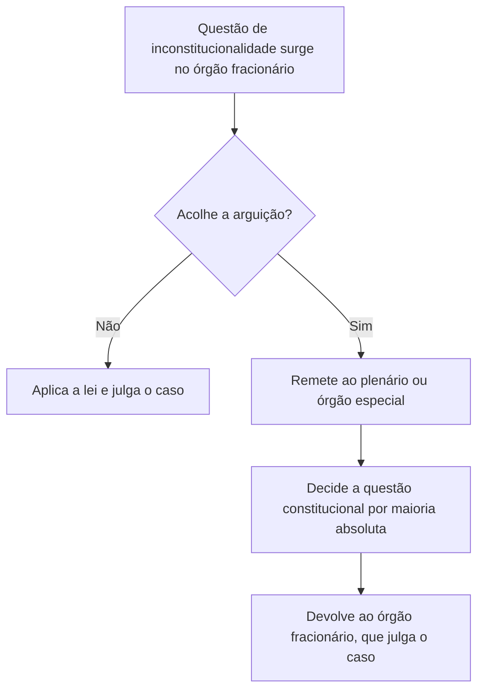

O controle difuso é o mais antigo e o mais comum no Brasil: qualquer pessoa pode levantar a questão da constitucionalidade de uma lei em qualquer processo, e qualquer juiz pode decidir. Mas a liberdade tem limites importantes nos **tribunais**, onde vale a **reserva de plenário**, e um efeito peculiar: a decisão vale, em regra, apenas entre as partes, e só a atuação do **Senado Federal** pode dar-lhe alcance geral. Este capítulo percorre esses três pontos, que correspondem aos tópicos que a prova mais cobra.

> [!objetivos]
> - Descrever as características e os efeitos do controle difuso.
> - Aplicar a cláusula de reserva de plenário e suas exceções.
> - Explicar o procedimento do controle difuso nos tribunais.
> - Entender o papel do Senado Federal no art. 52, X, e a discussão sobre a abstrativização.

## Características do controle difuso

No controle difuso, ou **aberto**, a declaração de inconstitucionalidade é feita **incidentalmente**, para resolver um caso concreto. As principais características são:

| Característica | Explicação |
| --- | --- |
| Competência | Qualquer juiz ou tribunal |
| Via | Incidental: a questão é prejudicial do mérito |
| Legitimidade | Partes, Ministério Público, terceiros intervenientes e o próprio juiz, de ofício |
| Objeto | Qualquer lei ou ato normativo, federal, estadual ou municipal, inclusive anterior à Constituição |
| Efeitos | Em regra, **entre as partes** e *ex tunc* |
| Momento | Pode ser levantado em qualquer ação e em qualquer grau de jurisdição |

A inconstitucionalidade pode ser suscitada pelo autor, pelo réu, por terceiro interveniente, pelo Ministério Público, como parte ou fiscal da lei, e até **de ofício** pelo juiz, que não depende de provocação. Pode ocorrer em qualquer tipo de ação: ordinária, mandado de segurança, *habeas corpus*, ação civil pública. No caso da **ação civil pública**, o STF admite que a inconstitucionalidade seja discutida como **causa de pedir**, isto é, fundamento do pedido, mas não como pedido principal, pois isso usurparia a ação direta, de competência do STF.

> [!bizu]
> Para decorar o controle difuso, guarde quatro palavras: **qualquer** juiz, **incidente**, **caso concreto** e **entre as partes**. Se a assertiva trouxer "só o STF", "lei em tese" ou "contra todos", ela está descrevendo o controle concentrado.

A decisão que afasta a lei **não a retira do ordenamento**. A lei continua em vigor e pode ser aplicada em outros casos, até que o STF a declare inconstitucional com eficácia geral ou o Senado suspenda sua execução. O efeito é *ex tunc* porque, pela teoria da nulidade, a lei inconstitucional nunca foi válida para as partes.

## Reserva de plenário

> [!lei] CF, art. 97
> Somente pelo voto da maioria absoluta de seus membros ou dos membros do respectivo órgão especial poderão os tribunais declarar a inconstitucionalidade de lei ou ato normativo do Poder Público.

Essa é a **cláusula de reserva de plenário** (*full bench*), que existe desde 1934. Ela tem alcance restrito aos **tribunais**: um juiz de primeira instância, que decide sozinho, não está sujeito a ela. Seu objetivo é garantir segurança jurídica e o respeito à presunção de constitucionalidade das leis, exigindo um quórum qualificado: a **maioria absoluta** dos membros do tribunal ou, onde houver, do **órgão especial**. O órgão especial existe em tribunais com mais de 25 julgadores, e tem de 11 a 25 membros.

Para o STF, a regra se aplica a qualquer tribunal, inclusive ao próprio STF, que a observa em suas Turmas: uma Turma não pode declarar a inconstitucionalidade de lei sem submetê-la ao Plenário, ressalvadas as exceções.

> [!jurisprudencia] STF, Súmula Vinculante 10
> A súmula considera ofensa ao art. 97 da Constituição a decisão de turma ou câmara que deixa de aplicar uma lei, total ou parcialmente, mesmo sem usar a palavra inconstitucionalidade, quando o fundamento real é a incompatibilidade da lei com a Constituição.

A súmula impede a chamada **declaração disfarçada**: o órgão fracionário (turma, câmara) não pode deixar de aplicar a lei sob o argumento de que ela é inconstitucional, sem submeter a questão ao plenário. Mesmo que não use a palavra "inconstitucional", o simples afastamento da lei equivale à declaração.

### Exceções

A reserva de plenário não se aplica:

- quando o órgão fracionário **já tem decisão do plenário** ou do órgão especial sobre a mesma questão, ou **do STF**, no controle concentrado ou no difuso, conforme o estatuto processual civil (Lei 13.105/2015, regra do parágrafo único do dispositivo sobre o incidente): a decisão anterior é aplicada, sem nova remessa;
- quando se trata de **norma anterior à Constituição**, pois a hipótese é de não recepção (revogação), e não de inconstitucionalidade;
- à **interpretação conforme** sem declaração de nulidade, em que o tribunal não afasta a norma;
- aos **juízes de primeira instância**, aos Juizados Especiais e às turmas recursais, que não são tribunais para esse fim;
- ao exame de **normas de outro ente** que não foram objeto de controle, em situações de simples interpretação da lei.

> [!pegadinha]
> Dizer que a reserva de plenário se aplica ao juiz de primeira instância, ou que as turmas de um tribunal podem declarar a inconstitucionalidade por maioria simples. O quórum é de **maioria absoluta dos membros do tribunal ou do órgão especial**, e só os tribunais estão sujeitos à regra. Outra confusão é achar que a reserva vale para a revogação de norma anterior à Constituição: nesse caso, ela não se aplica.

## Controle difuso nos tribunais

Quando a questão de inconstitucionalidade surge em um processo de competência de turma ou câmara, o procedimento é este:

1. A questão é suscitada pela parte, pelo Ministério Público ou de ofício.
2. O relator submete a questão ao **órgão fracionário**, que decide se há fundamento.
3. Se **rejeitar** a arguição, o julgamento continua com a aplicação da lei.
4. Se **acolher**, a questão é remetida ao **plenário** ou ao **órgão especial**, que decide sobre a constitucionalidade, depois de ouvir o Ministério Público e, se for o caso, outros interessados, inclusive o *amicus curiae*.
5. O plenário julga a questão de constitucionalidade, e o órgão fracionário aplica a tese ao caso.

A decisão do plenário é sobre a **questão constitucional** apenas; o julgamento do caso volta ao órgão fracionário. Há dois momentos de decisão, por isso se fala em **cisão funcional de competência**.

No **STF**, o controle difuso chega principalmente por **recurso extraordinário**, nos termos do art. 102, III, que será visto no próximo capítulo.

## Mais detalhes do procedimento

O estatuto processual civil (Lei 13.105/2015) regula o incidente nos tribunais. Declarada a arguição pelo órgão fracionário, os autos vão ao plenário ou ao órgão especial, e as pessoas jurídicas de direito público responsáveis pela edição do ato, bem como os legitimados do art. 103, podem se manifestar por escrito, no prazo fixado pelo relator, e o **amicus curiae** pode ser admitido. O órgão fracionário não pode divergir da decisão do plenário e aplica a tese ao caso.

A parte que perde pode recorrer: contra o acórdão final do caso cabem os recursos usuais, e, se o tribunal declarou a inconstitucionalidade de lei federal ou contrariou a Constituição, cabe **recurso extraordinário** ao STF. Não há recurso autônomo contra a decisão do plenário que resolve apenas a questão constitucional, porque ela é parte do julgamento do caso, e só se recorre do acórdão que o encerra.

### Reserva de plenário e as normas anteriores à Constituição

Como a norma anterior incompatível com a Constituição é revogada, e não inconstitucional, o tribunal pode reconhecer a não recepção sem submeter a questão ao plenário. É a **mitigação** mais citada da regra. Já a declaração de inconstitucionalidade de lei **posterior** à Constituição de 1988 exige sempre o plenário, salvo decisão anterior. A mesma lógica vale para o exame de leis municipais em face da Constituição estadual, que também se submete à reserva de plenário no tribunal local.

### Efeitos no tempo e modulação

A regra é a retroatividade da decisão entre as partes. Mas o STF admite aplicar, por analogia, a **modulação** do art. 27 da Lei 9.868 também no controle difuso, quando houver risco à segurança jurídica. Nesse caso, a decisão pode ter efeitos a partir de um momento fixado, e o quórum de dois terços é exigido. É um exemplo da aproximação entre os controles.

### Uma pergunta frequente

A questão típica é a que descreve um caso e pergunta qual o efeito da decisão de um juiz que afasta uma lei. A resposta segue um roteiro: o juiz decidiu em controle difuso, por via incidental; a decisão vale entre as partes; a lei continua válida para os demais; apenas o STF, em decisão definitiva, e o Senado, por resolução, podem generalizar o efeito. Em qualquer variação, a subsunção do caso a esse roteiro basta para responder.

## Controle difuso na prática: exemplos

Alguns exemplos ajudam a fixar. Um contribuinte, ao ser cobrado por um tributo, pode alegar em sua defesa que a lei que o instituiu é inconstitucional: o juiz examina a questão como incidente e, se acolher, afasta a lei e julga procedente o pedido de anulação da cobrança. A decisão vale para aquele contribuinte, e a lei continua sendo cobrada dos demais. Um réu em ação penal, por sua vez, pode sustentar que o tipo penal é inconstitucional, e o juiz, se concordar, o absolve; também aqui o efeito é só para o caso. Em mandado de segurança, o impetrante pode pedir que a autoridade se abstenha de aplicar uma norma, e a inconstitucionalidade aparece como causa de pedir.

A diferença em relação ao controle concentrado é que, nesses exemplos, **há partes com interesses concretos** e um **pedido de natureza subjetiva**. Por isso a decisão não atinge terceiros. Em compensação, o controle difuso é **mais rápido de acionar**, porque não depende da legitimidade restrita do art. 103: qualquer pessoa pode provocá-lo, desde que tenha uma ação em curso.

### Leis estaduais e municipais

O controle difuso alcança leis de qualquer esfera. Um juiz de primeira instância pode afastar lei estadual ou municipal em face da Constituição Federal ou da Constituição do Estado. O recurso extraordinário leva ao STF a questão de lei local contestada em face da Constituição Federal. No tribunal local, a declaração incidental de inconstitucionalidade de lei municipal em face da Constituição estadual também se submete à reserva de plenário.

### Papel do Ministério Público

O Ministério Público pode suscitar a inconstitucionalidade como parte ou como fiscal da lei, e deve ser ouvido no incidente de arguição nos tribunais. Seu parecer não vincula o tribunal. O membro do Ministério Público pode, ainda, ajuizar ação civil pública para tutelar direitos coletivos, usando a inconstitucionalidade como fundamento, mas não como pedido, para não substituir a ação direta.

## O Senado Federal e a eficácia geral

> [!lei] CF, art. 52, X
> suspender a execução, no todo ou em parte, de lei declarada inconstitucional por decisão definitiva do Supremo Tribunal Federal;

Como a decisão do controle difuso vale só entre as partes, o constituinte deu ao Senado o poder de **suspender a execução** da lei declarada inconstitucional pelo STF, o que a torna ineficaz **para todos**. Pontos importantes:

- A suspensão pressupõe decisão **definitiva** do STF, ou seja, que não admite mais recurso.
- A decisão do STF pode ser sobre lei **federal, estadual ou municipal**.
- A suspensão pode ser **total ou parcial**, e o Senado fica limitado à extensão da declaração do STF.
- A atuação do Senado é **política e discricionária**: o Senado **não é obrigado** a suspender a lei, e a suspensão não tem prazo.
- A resolução do Senado tem efeitos, segundo a doutrina majoritária, **a partir de sua publicação** (*ex nunc*), embora haja quem defenda efeito retroativo.
- A suspensão **não revoga** a lei: apenas retira sua eficácia.
- O Senado não pode ampliar nem reduzir o alcance da declaração, e não suspende lei que o STF declarou **constitucional**.

| Aspecto | Regra |
| --- | --- |
| Base | Decisão definitiva do STF no controle difuso |
| Competência | Senado Federal, por resolução |
| Natureza | Discricionária e política |
| Alcance | Total ou parcial, conforme a declaração |
| Efeito | Erga omnes; efeito em regra *ex nunc* |
| Objeto | Leis federais, estaduais ou municipais |

> [!atencao] E no controle concentrado?
> A suspensão do Senado **não é necessária** no controle concentrado (ADI, ADC e ADPF), porque a decisão já tem eficácia contra todos e efeito vinculante. O art. 52, X, só se aplica ao controle difuso. Pelo mesmo motivo, ela não alcança a decisão do STF em recurso extraordinário com repercussão geral, que já tem efeitos próprios.

### Abstrativização e mutação constitucional

Há uma discussão doutrinária sobre se o art. 52, X, teria sofrido **mutação constitucional**, de modo que a decisão do STF no controle difuso passaria a ter eficácia geral por si mesma, cabendo ao Senado apenas dar **publicidade** à decisão. Esse foi o tema da Reclamação 4.335, em que alguns ministros defenderam a mutação. A tese não prevaleceu como regra geral: o art. 52, X, continua em vigor. Mas o STF tem aproximado os efeitos do difuso aos do concentrado, em um fenômeno chamado **abstrativização** do controle difuso, em razão da repercussão geral e das teses fixadas em recursos extraordinários. Nas ADIs 3.406 e 3.470, que tratavam do amianto, o Tribunal reconheceu a inconstitucionalidade incidental de uma lei federal com efeito geral.

> [!resolvido] Qual o efeito de cada decisão
> **Enunciado.** Um juiz de primeira instância afasta uma lei municipal por inconstitucionalidade. Depois, o STF, em recurso extraordinário, declara a mesma lei inconstitucional, e a decisão transita em julgado. Quem pode estender o efeito da decisão a todos?
>
> **Raciocínio.** A decisão do juiz vale entre as partes. A do STF, em controle difuso, também. Para que a lei perca eficácia contra todos, é preciso uma providência adicional.
>
> **Conclusão.** O **Senado Federal**, por resolução, pode suspender a execução da lei municipal, com eficácia geral, mas não é obrigado a fazê-lo. O juiz de primeira instância não precisou observar a reserva de plenário.

## Comparação com o controle concentrado

Para fechar, vale um quadro de contraste, porque as bancas costumam trocar as características dos dois controles.

| Aspecto | Controle difuso | Controle concentrado |
| --- | --- | --- |
| Competência | Qualquer juiz ou tribunal | STF, ou Tribunal de Justiça no plano estadual |
| Via | Incidental | Principal |
| Objeto | Caso concreto | Lei em tese |
| Legitimidade | Qualquer parte, MP e juiz de ofício | Rol restrito do art. 103 |
| Efeito da decisão | Entre as partes, em regra | Contra todos e vinculante |
| Efeito no tempo | Em regra *ex tunc* | Em regra *ex tunc*, com modulação |
| Participação do Senado | Possível, para dar eficácia geral | Desnecessária |

Em uma questão que descreva um processo comum, em que a inconstitucionalidade é um argumento da defesa, a resposta quase sempre é controle difuso. Já quando a ação tem como único pedido a retirada da lei do ordenamento, é concentrado. O restante da prova se resolve ao aplicar as consequências de cada modelo: quórum do tribunal, efeito e necessidade de resolução do Senado.

## Como a banca cobra este assunto

Os padrões mais frequentes são:

- **Efeito:** o difuso vale, em regra, entre as partes e retroage.
- **Legitimidade:** qualquer parte, o Ministério Público e o juiz de ofício.
- **Reserva de plenário:** maioria absoluta, só para tribunais, com a súmula vinculante 10 e as exceções.
- **Senado:** decisão definitiva, discricionariedade, alcance total ou parcial e inaplicabilidade ao concentrado.
- **Ação civil pública:** inconstitucionalidade como causa de pedir, e não como pedido.

## Mapa do capítulo

| Tema | Regra | Cuidado |
| --- | --- | --- |
| Difuso | Qualquer juiz, incidental | Efeito entre as partes, em regra |
| Legitimados | Partes, MP e juiz de ofício | Ação civil pública: só como causa de pedir |
| Reserva de plenário | Maioria absoluta do tribunal ou do órgão especial | Não vale para o juiz singular |
| Súmula Vinculante 10 | Veda o afastamento disfarçado da lei | Vale para órgão fracionário |
| Exceções | Decisão anterior do plenário ou do STF | Norma anterior à Constituição |
| Senado | Suspende a execução da lei (art. 52, X) | É discricionário |
| Concentrado | Não precisa do Senado | Eficácia geral já existe |

### Para fixar

- No controle difuso, qualquer juiz pode afastar a lei, no caso concreto, com efeito em regra entre as partes.
- A inconstitucionalidade pode ser levantada pelas partes, pelo Ministério Público e pelo juiz de ofício.
- A ação civil pública pode discutir a inconstitucionalidade como causa de pedir, e não como pedido principal.
- A reserva de plenário exige maioria absoluta do tribunal ou do órgão especial.
- A Súmula Vinculante 10 proíbe o órgão fracionário de afastar a lei sem submeter a questão ao plenário.
- A reserva não vale para o juiz de primeira instância nem para a norma anterior à Constituição.
- O Senado pode suspender a execução da lei declarada inconstitucional pelo STF, por decisão definitiva.
- A atuação do Senado é discricionária, e é desnecessária no controle concentrado.
