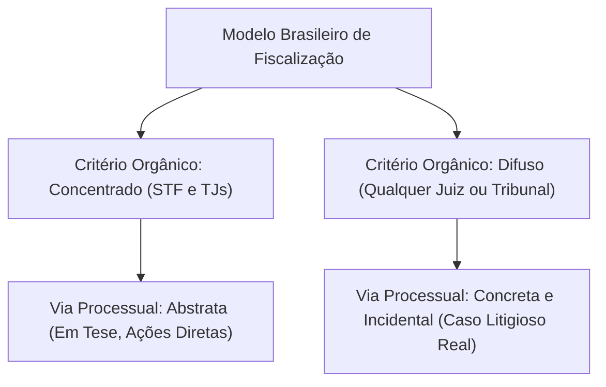
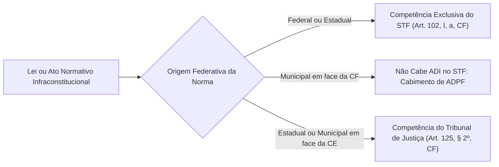
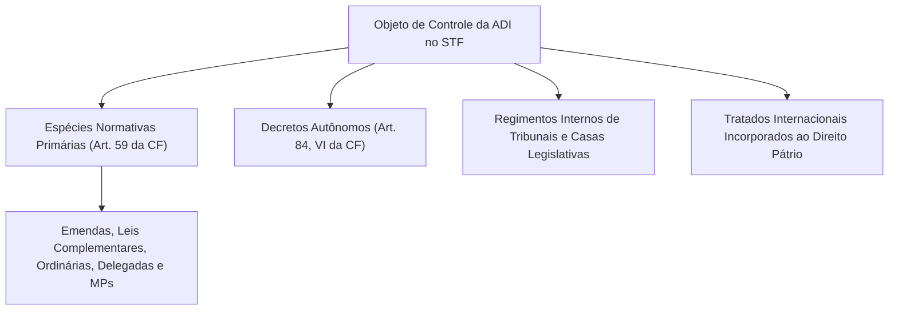
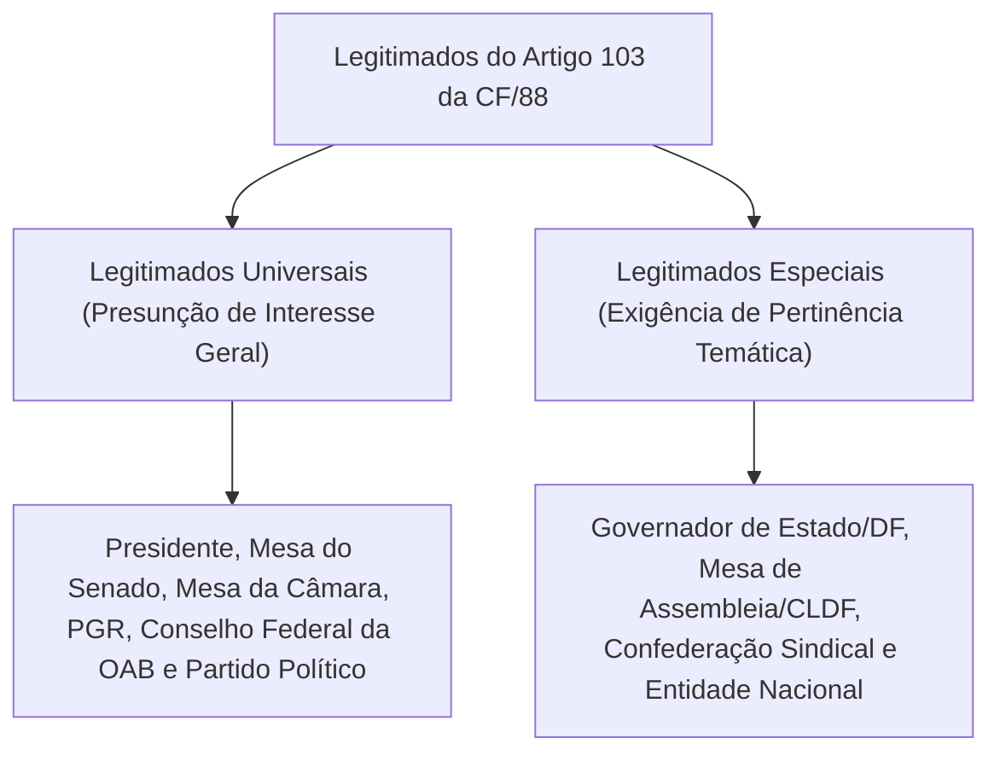
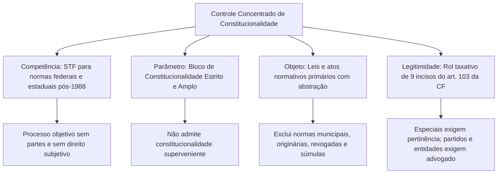

A fiscalização da constitucionalidade das leis atua como garantia mestra da estabilidade democrática e do Estado de Direito. Em uma ordem jurídica piramidal, a Constituição Federal ocupa a cúspide normativa. Nenhum ato normativo infraconstitucional pode subsistir se contrariar os preceitos fundamentais da Carta Magna. Para resguardar essa supremacia formal, o constituinte de 1988 consagrou um sistema robusto de controle abstrato e concentrado perante a Suprema Corte. Este capítulo inaugural examina a teoria geral do controle concentrado de constitucionalidade. Aqui você estudará a Ação Direta de Inconstitucionalidade genérica (ADI), compreendendo o parâmetro do bloco de constitucionalidade, o objeto fiscalizável e o rol taxativo de legitimados ativos.

> [!objetivos]
> - Diferenciar controle concentrado e controle abstrato no modelo constitucional brasileiro.
> - Compreender a competência originária exclusiva do STF e os contornos do bloco de constitucionalidade.
> - Identificar os atos normativos federais e estaduais que podem ou não figurar como objeto de ADI.
> - Classificar os legitimados ativos do artigo 103 da Constituição entre universais e especiais.
> - Analisar a exigência de capacidade postulatória e a demonstração prática da pertinência temática.

## Noções Gerais (Controle de Constitucionalidade Concentrado - Noções Gerais)

O controle concentrado de constitucionalidade caracteriza-se pela atribuição de competência a um único órgão judicial de cúpula ou a um número restrito de tribunais. No modelo federal brasileiro, a competência para processar e julgar as ações diretas em face da Constituição da República pertence exclusivamente ao Supremo Tribunal Federal, nos termos do artigo 102, inciso I, alínea "a", da Constituição Federal.

Já o controle abstrato refere-se à via processual e à natureza da cognição. A fiscalização é realizada em tese, sem a existência de um caso concreto ou de uma lide subjetiva entre partes litigantes. O processo objetivo tem como finalidade direta a tutela da integridade da ordem jurídica constitucional.

Embora no direito brasileiro o controle concentrado coincida quase sempre com a via abstrata, as duas expressões não são sinônimas perfeitas. A doutrina e a jurisprudência destacam duas distinções pontuais:

1. Há controle concentrado e concreto na representação interventiva (ADI interventiva), na qual o tribunal avalia a situação concreta de violação a princípio sensível para requisitar a intervenção federal ou estadual.
2. Há controle difuso com dimensão abstrata quando um órgão fracionário de tribunal suscita o incidente de inconstitucionalidade perante o Plenário ou Órgão Especial, que decide a constitucionalidade da lei em tese antes do julgamento do recurso.

O processo de controle abstrato não comporta partes em sentido estrito (autor e réu tradicionais), litisconsórcio nem assistência de terceiros. Trata-se de um processo de feição marcadamente objetiva.

> [!pegadinha]
> Em respeito ao princípio da separação dos Poderes (artigo 2º da Constituição Federal), o Poder Judiciário não pode exercer controle concentrado sobre normas meramente regimentais das Casas legislativas (matéria *interna corporis*). A intervenção jurisdicional só é admitida quando houver inequívoca violação direta a norma constitucional do processo legislativo (Tema 1120 do STF, RE 1.297.884).

## Ação Direta de Inconstitucionalidade (Ação Direta de Inconstitucionalidade)

A Ação Direta de Inconstitucionalidade genérica (ADI) constitui o instrumento principal de expurgo de normas incompatíveis com a Constituição Federal.

Historicamente, o controle concentrado abstrato foi introduzido no direito positivo brasileiro pela Emenda Constitucional nº 16/1965, sob a figura da representação de inconstitucionalidade. Naquele regime, apenas o Procurador-Geral da República possuía legitimidade ativa. A Constituição de 1988 reformulou profundamente o instituto: democratizou a legitimação ao prever nove incisos no artigo 103 e consagrou a ADI como instrumento primordial de defesa da ordem constitucional.

A competência originária para o processo e julgamento da ADI genérica é atribuída ao Supremo Tribunal Federal pelo artigo 102, inciso I, alínea "a", da Constituição Federal, contra lei ou ato normativo federal ou estadual.

## Parâmetro de Controle e Bloco de Constitucionalidade

O parâmetro de controle (também denominado paradigma ou norma de referência) é o conjunto de preceitos normativos com os quais a lei impugnada deve confrontar-se para a aferição de sua validade.

O Supremo Tribunal Federal adota o conceito de bloco de constitucionalidade:

- Em sentido estrito, o bloco compreende todas as normas formalmente integrantes do texto constitucional vigente. Abrange o corpo permanente da Constituição (artigos 1º a 250), as disposições do Ato das Disposições Constitucionais Transitórias (ADCT) que preservem eficácia jurídica e os tratados internacionais de direitos humanos aprovados pelo Congresso Nacional com o rito próprio das emendas constitucionais (artigo 5º, § 3º da Constituição Federal).
- Integram o parâmetro tanto as regras constitucionais expressas quanto os princípios e garantias implícitos no texto magno, a exemplo da proporcionalidade e da razoabilidade.

| Integra o Parâmetro de Controle | NÃO Integra o Parâmetro de Controle |
|---|---|
| Artigos permanentes da Constituição Federal de 1988 | Preâmbulo constitucional (desprovido de força cogente) |
| Disposições eficazes do ADCT | Normas transitórias do ADCT com eficácia já exaurida |
| Emendas constitucionais promulgadas | Normas de Constituições pretéritas revogadas |
| Tratados de direitos humanos aprovados via art. 5º, § 3º | Tratados internacionais comuns sem equivalência de emenda |
| Princípios constitucionais implícitos e explícitos | Leis infraconstitucionais federais ou estaduais |

> [!jurisprudencia] STF, ADI 2.076/AC
> O Preâmbulo da Constituição Federal não possui força normativa vinculante. Conforme fixou o Supremo Tribunal Federal na ADI 2.076/AC, a invocação da proteção de Deus contida no preâmbulo não constitui norma de reprodução obrigatória nas Constituições estaduais e não serve de parâmetro para controle abstrato de validade de leis.

### Princípio da contemporaneidade do parâmetro

No ordenamento constitucional brasileiro, vigora o postulado de que a validade de uma lei afere-se perante o parâmetro constitucional vigente no momento exato de sua edição e publicação. O direito pátrio rejeita terminantemente a teoria da constitucionalidade superveniente: uma lei que nasceu inconstitucional é portadora de vício de nulidade insanável e não se torna válida pela superveniência de uma emenda constitucional que passe a tolerar a matéria.

Caso ocorra alteração ou revogação superveniente do dispositivo constitucional parâmetro no curso de uma ADI já proposta, o STF consolidou entendimento de que a ação direta continua sendo conhecida e julgada. O Tribunal examina a validade da lei impugnada em confronto com o texto constitucional que vigorava na data de sua propositura, evitando que normas flagrantemente nulas permaneçam no sistema (ADI 145/CE).

## Objeto de Controle na Ação Direta (Objeto de Controle)

O artigo 102, inciso I, alínea "a", da Constituição Federal delimita com precisão o objeto idôneo da Ação Direta de Inconstitucionalidade perante o Supremo Tribunal Federal: leis ou atos normativos federais ou estaduais editados posteriormente à promulgação da Constituição de 1988 (direito pós-constitucional).

O ato impugnável deve ostentar natureza primária e atributos de generalidade e abstração. Por ato primário entende-se aquele que retira seu fundamento de validade diretamente do texto constitucional, inovando originariamente a ordem jurídica.

### Hipóteses especiais de cabimento

1. **Medidas provisórias**: a jurisprudência do STF admite amplamente o cabimento de ADI contra medidas provisórias em vigor. Se a medida provisória for convertida em lei sem alteração substancial de texto, a ação não é extinta, exigindo-se apenas que o autor adite a petição inicial para incluir o texto da lei resultante (ADI 1.922). Caso a medida provisória seja rejeitada expressamente pelo Congresso Nacional ou perca a eficácia por decurso de prazo, a ADI fica prejudicada por perda de objeto (ADIs 525 e 529).
2. **Leis de efeitos concretos**: em regra, atos de efeitos concretos (como portarias de nomeação ou decretos desapropriatórios individuais) não podem ser atacados por ADI por faltarem os requisitos da generalidade e da abstração. Todavia, o Supremo Tribunal Federal firmou sólida exceção: quando o ato de efeitos concretos for aprovado sob a forma de lei formal pelo Parlamento, ele pode figurar como objeto de ADI. É o caso clássico da Lei Orçamentária Anual (LOA), da Lei de Diretrizes Orçamentárias (LDO) e das medidas provisórias que abrem crédito extraordinário.
3. **Normas do Distrito Federal**: o Distrito Federal acumula competências legislativas estaduais e municipais (artigo 32, § 1º da Constituição Federal). As leis distritais editadas no exercício de competência legislativa estadual podem ser objeto de ADI perante o STF. Já as leis distritais editadas no exercício de competência genuinamente municipal não são cabíveis em ADI perante a Corte Suprema, sujeitando-se ao controle por Arguição de Descumprimento de Preceito Fundamental (ADPF).

### Atos não impugnáveis por ADI

- **Normas constitucionais originárias**: o Poder Constituinte Originário possui natureza ilimitada e autônoma. Não se admite a tese de normas constitucionais originárias inconstitucionais no direito brasileiro (princípio da unidade hierárquica da Constituição, ADI 4.097).
- **Direito pré-constitucional**: leis editadas antes de 5 de outubro de 1988 não se submetem a ADI. O confronto com a nova Constituição resolve-se pela teoria da recepção ou da revogação tácita. A via concentrada adequada perante o STF é a ADPF.
- **Leis municipais perante a Constituição Federal**: leis de Municípios não figuram no artigo 102, inciso I, alínea "a" da Carta Magna. A impugnação abstrata direta contra a Constituição Federal compete exclusivamente à ADPF.
- **Leis revogadas ou de eficácia exaurida**: se a lei for revogada antes da propositura da ADI, a ação não é conhecida por ausência de interesse processual. Se a revogação ocorrer durante a tramitação da ação, a ADI é julgada extinta por perda superveniente do objeto, ressalvadas as hipóteses de fraude processual com intuito de burlar o controle da Corte (ADIs 3.232 e 3.306).
- **Atos normativos secundários**: decretos meramente regulamentares e portarias que apenas dão execução à lei não podem ser atacados em ADI. A inobservância do conteúdo da lei caracteriza mera crise de legalidade (ofensa indireta ou reflexa à Constituição), cuja apreciação compete ao juízo comum.
- **Súmulas de tribunais**: enunciados de súmulas, mesmo as vinculantes do STF, representam a cristalização interpretativa de teses jurisprudenciais reiteradas e não constituem atos normativos primários. Portanto, não podem ser objeto de ADI.

> [!atencao]
> Súmulas comuns e súmulas vinculantes não podem ser impugnadas por Ação Direta de Inconstitucionalidade. O instrumento processual próprio para a revisão ou o cancelamento de uma Súmula Vinculante é o procedimento específico previsto no artigo 103-A, § 2º da Constituição Federal e na Lei nº 11.417/2006.

## Legitimação Ativa e Capacidade Postulatória (Legitimação ativa)

O rol de legitimados para o ajuizamento da ação direta genérica de inconstitucionalidade e da ação declaratória de constitucionalidade é taxativo (*numerus clausus*), encontrando-se expressamente fixado no artigo 103 da Carta Política:

> [!lei] CF, art. 103
> Art. 103. Podem propor a ação direta de inconstitucionalidade e a ação declaratória de constitucionalidade:
> I - o Presidente da República;
> II - a Mesa do Senado Federal;
> III - a Mesa da Câmara dos Deputados;
> IV - a Mesa de Assembleia Legislativa ou da Câmara Legislativa do Distrito Federal;
> V - o Governador de Estado ou do Distrito Federal;
> VI - o Procurador-Geral da República;
> VII - o Conselho Federal da Ordem dos Advogados do Brasil;
> VIII - partido político com representação no Congresso Nacional;
> IX - confederação sindical ou entidade de classe de âmbito nacional.

### Legitimados universais e legitimados especiais

A construção jurisprudencial do Supremo Tribunal Federal subdividiu os legitimados do artigo 103 em duas categorias operacionais:

- **Legitimados universais**: possuem presunção absoluta de interesse jurídico geral na higidez do ordenamento constitucional. Podem ajuizar ADI contra qualquer lei ou ato normativo federal ou estadual, independentemente do tema tratado. São legitimados universais: o Presidente da República, a Mesa do Senado, a Mesa da Câmara dos Deputados, o Procurador-Geral da República, o Conselho Federal da OAB e os partidos políticos com representação no Congresso Nacional.
- **Legitimados especiais**: devem comprovar formalmente a existência de pertinência temática, demonstrando que o conteúdo da norma atacada guarda nexo direto com seus interesses institucionais ou corporativos típicos. São legitimados especiais: os Governadores de Estado e do DF, as Mesas das Assembleias Legislativas e da Câmara Legislativa do DF, as confederações sindicais e as entidades de classe de âmbito nacional.

> [!esquema]
> Exemplo prático de pertinência temática:
> - O Governador de Pernambuco possui pertinência temática para impugnar lei federal que reduza as receitas estaduais ou lei de outro Estado que institua guerra fiscal prejudicial à economia pernambucana.
> - O Governador de Pernambuco NÃO possui pertinência temática para ajuizar ADI contra lei interna do Estado de Goiás que disponha exclusivamente sobre a remuneração de servidores locais sem repercussão federativa.

### Regras específicas exploradas em concursos públicos

1. **Mesa legislativa**: a legitimidade pertence ao órgão diretivo colegiado (Mesa) e não aos deputados ou senadores tomados individualmente. Parlamentar isolado não possui legitimidade para propor ação direta.
2. **Partido político com representação parlamentar**: a Constituição exige a presença de ao menos um representante no Congresso Nacional (um Deputado Federal ou um Senador da República filiado). Essa representação é aferida no momento da propositura da ação direta. A perda superveniente de representação parlamentar no curso do processo não desqualifica a legitimidade do partido nem extingue a ação. A propositura independe de deliberação de órgãos colegiados internos, bastando a manifestação expressa do presidente nacional da agremiação partidária.
3. **Entidades sindicais e associativas**: somente as confederações sindicais possuem legitimidade do artigo 103, inciso IX. Sindicatos e federações (mesmo de âmbito nacional) não têm legitimidade ativa no STF. Uma confederação sindical requer a reunião formal de pelo menos três federações sindicais. As entidades de classe de âmbito nacional devem comprovar a presença de associados em pelo menos nove Estados da Federação e reunir membros de uma mesma e homogênea categoria profissional ou econômica.

### Capacidade postulatória no controle concentrado

Em virtude da alta envergadura dos cargos exercidos, o Supremo Tribunal Federal reconhece que a quase totalidade dos legitimados do artigo 103 possui capacidade postulatória especial decorrente de suas funções de Estado.

Apenas dois legitimados não possuem capacidade postulatória e necessitam obrigatoriamente da representação por advogado regularmente inscrito na OAB, com poderes específicos na procuração:
1. O partido político com representação no Congresso Nacional;
2. A confederação sindical ou entidade de classe de âmbito nacional.

Os demais legitimados (incisos I a VII: Presidente da República, Mesas do Legislativo, Governadores de Estado/DF, Procurador-Geral da República e Conselho Federal da OAB) podem assinar a petição inicial de próprio punho, sem a necessidade de intervenção de procurador judicial.

| Categoria do Legitimado | Legitimados Integrantes | Exige Pertinência Temática? | Exige Advogado Habilitado? |
|---|---|---|---|
| Autoridades Políticas Superiores | Presidente da República e PGR | Não (Universal) | Não (Capacidade Própria) |
| Cúpula do Poder Legislativo | Mesas do Senado e da Câmara | Não (Universal) | Não (Capacidade Própria) |
| Entidade Representativa da Advocacia | Conselho Federal da OAB | Não (Universal) | Não (Capacidade Própria) |
| Agremiações Partidárias | Partido com representação no Congresso | Não (Universal) | **Sim (Exige Advogado)** |
| Chefias Executivas Regionais | Governadores de Estado e do DF | **Sim (Especial)** | Não (Capacidade Própria) |
| Mesas Legislativas Regionais | Assembleias Estaduais e CLDF | **Sim (Especial)** | Não (Capacidade Própria) |
| Entidades Sindicais e Corporativas | Confederações e Entidades Nacionais | **Sim (Especial)** | **Sim (Exige Advogado)** |

## Mapa do capítulo

### Para fixar

- O controle concentrado atribui competência a órgão judicial restrito; perante a Constituição Federal a competência é originária do STF.
- O controle abstrato analisa a lei em tese no processo objetivo, visando à proteção direta da ordem jurídica constitucional.
- O parâmetro de controle compõe o bloco de constitucionalidade: normas permanentes, ADCT eficaz e tratados com equivalência de emenda.
- O Preâmbulo da Constituição não possui força normativa e não serve de parâmetro de controle abstrato de constitucionalidade.
- O ordenamento rejeita a constitucionalidade superveniente; emenda constitucional posterior não valida lei originariamente inconstitucional.
- O objeto da ADI abrange leis e atos primários federais e estaduais posteriores a 1988, incluindo leis formais de efeitos concretos (LOA/LDO).
- Súmulas comuns e súmulas vinculantes não constituem atos normativos primários e não podem ser atacadas em sede de ADI.
- Os legitimados universais não necessitam demonstrar pertinência temática; legitimados especiais precisam demonstrar nexo temático.
