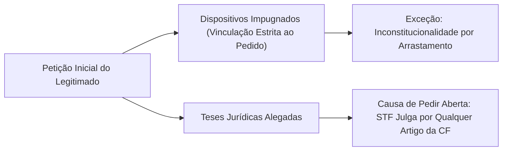
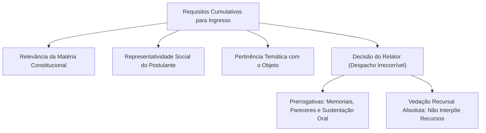
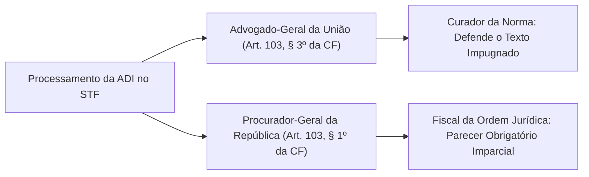
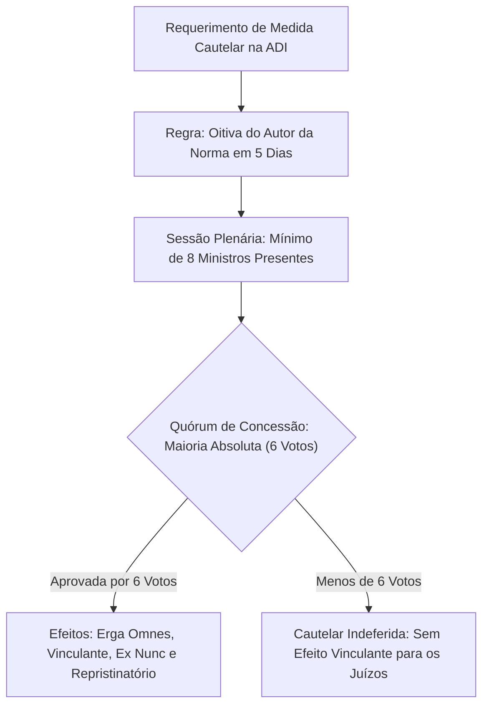
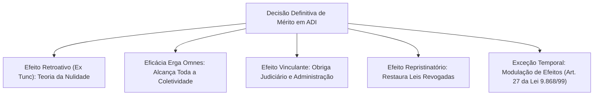
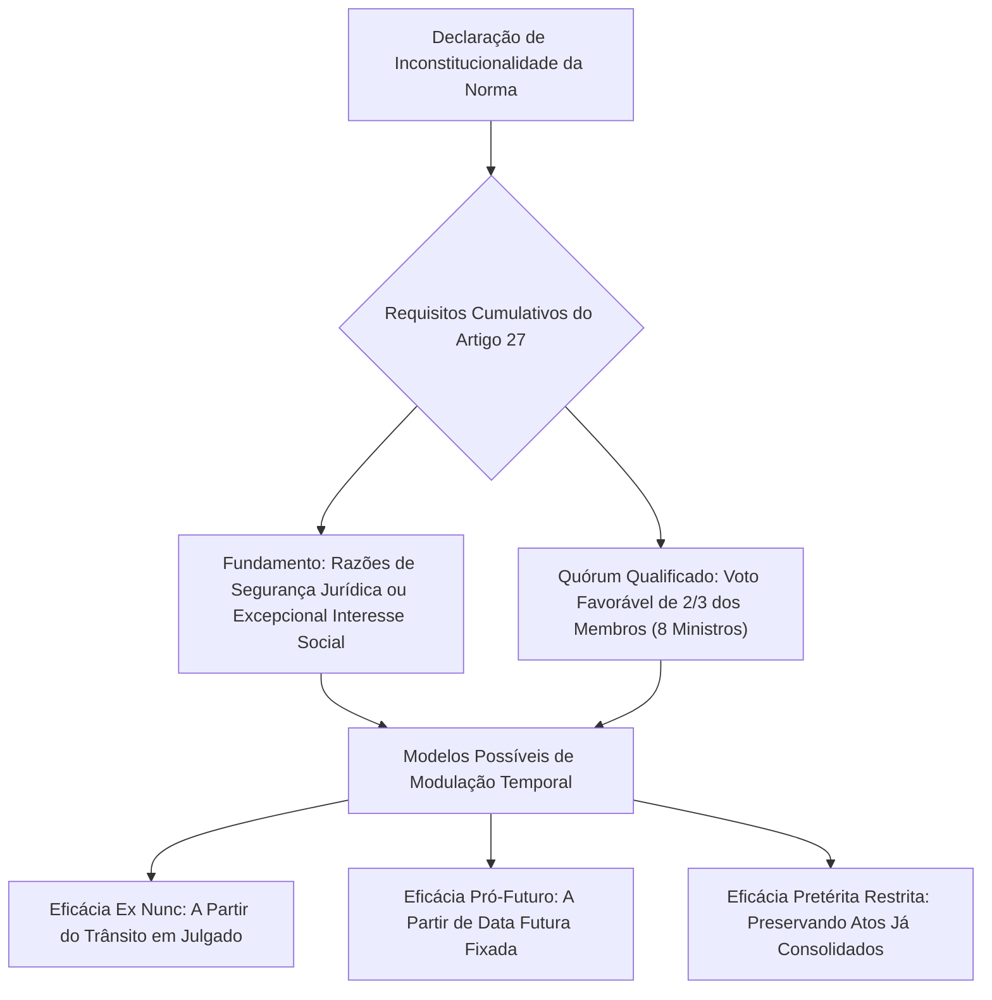
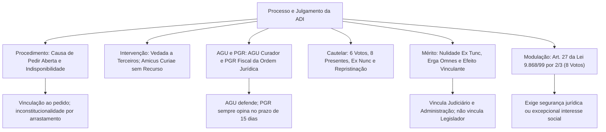

O procedimento da Ação Direta de Inconstitucionalidade (ADI) perante o Supremo Tribunal Federal materializa a jurisdição constitucional concentrada no Brasil. Disciplinada pela Lei federal nº 9.868/1999, a tramitação da ADI possui traços singulares decorrentes de sua natureza puramente objetiva. No processo abstrato, não se discutem interesses individuais ou direitos subjetivos lesados, mas a conformidade em tese da lei com a Carta Magna. Consequentemente, o processo rege-se por postulados específicos, como a causa de pedir aberta e a indisponibilidade da tutela jurisdicional. Este capítulo analisa o trâmite processual da ADI, os requisitos da medida cautelar e a decisão definitiva de mérito. Você compreenderá os efeitos retroativos, vinculantes e repristinatórios, dominando o quórum de dois terços para a modulação de efeitos temporais.

> [!objetivos]
> - Compreender a petição inicial, a causa de pedir aberta e a indisponibilidade na ADI.
> - Analisar a vedação à intervenção de terceiros e o papel democrático do *amicus curiae*.
> - Diferenciar a atuação do Advogado-Geral da União da intervenção do Procurador-Geral da República.
> - Dominar os requisitos, o quórum e os efeitos temporais da medida cautelar e do julgamento de mérito.
> - Aplicar as regras da modulação de efeitos temporais prevista no artigo 27 da Lei nº 9.868/1999.

## Processo e Julgamento da Ação Direta de Inconstitucionalidade (ADI)

O Supremo Tribunal Federal não instaura o controle concentrado de constitucionalidade por iniciativa própria. Em observância ao princípio da inércia da jurisdição, a instauração da Ação Direta de Inconstitucionalidade depende de provocação formal por um dos legitimados do artigo 103 da Constituição Federal.

A petição inicial deve apontar expressamente os dispositivos legais impugnados e expor as razões jurídicas de impugnação pertinentes a cada preceito legal atacado.

Dois princípios processuais fundamentais orientam a atuação da Corte Suprema:

1. **Princípio do pedido (congruência estrita)**: o STF fica adstrito aos artigos ou dispositivos impugnados pelo autor na petição inicial. Se o autor impugnar apenas um parágrafo de determinada lei, o Tribunal não pode, em regra, declarar a inconstitucionalidade dos demais artigos não questionados. A única ressalva admitida é a declaração de inconstitucionalidade por arrastamento (ou consequencial), quando a nulidade da norma expressamente atacada retira por completo o fundamento de validade de outros dispositivos vinculados.
2. **Princípio da causa de pedir aberta**: o STF não está vinculado aos argumentos ou fundamentos jurídicos suscitados pelo autor na petição inicial. Se o autor apontar ofensa ao artigo 5º da Constituição Federal, o Tribunal pode declarar a inconstitucionalidade com base no artigo 37 ou no artigo 150. Toda a Constituição Federal atua como parâmetro implícito na jurisdição abstrata.

### O princípio da indisponibilidade da ação direta

Uma vez ajuizada a Ação Direta de Inconstitucionalidade perante o Supremo Tribunal Federal, o legitimado ativo não pode desistir da ação (artigo 5º da Lei nº 9.868/1999). A vedação à desistência aplica-se tanto ao processo principal quanto ao pedido de concessão de medida cautelar.

A razão dessa regra decorre da natureza do processo objetivo. O controle abstrato tutela o interesse público primário de preservação da supremacia constitucional, não pertencendo o direito de ação à esfera de disponibilidade individual do proponente.

Da mesma forma, a perda superveniente da qualidade de legitimado não prejudica o prosseguimento da demanda. Se um partido político possuía bancada no Congresso Nacional no momento do ajuizamento da ADI e, posteriormente, perde seus parlamentares em eleições seguintes, a ação direta continua tramitando regularmente até o julgamento final de mérito. A legitimidade ativa afere-se estritamente no instante da propositura da ação.

### Trâmite inicial perante o relator

Distribuída a petição inicial, o Ministro Relator realiza o juízo prévio de admissibilidade:
- Se a petição for manifestamente inepta, desprovida de fundamentação jurídica idônea ou manifestamente improcedente, o relator pode indeferi-la de plano mediante decisão monocrática. Dessa decisão cabe recurso de agravo regimental ao Plenário da Corte.
- Estando a petição inicial em termos, o relator requisita informações aos órgãos ou autoridades responsáveis pela edição do ato impugnado (Congresso Nacional e Presidência da República para leis federais; Assembleia Legislativa e Governadoria para leis estaduais). As informações devem ser prestadas no prazo legal improrrogável de trinta dias (artigo 6º da Lei nº 9.868/1999).

> [!pegadinha]
> O prazo para a prestação de informações pelos órgãos prolatores da lei na ADI é de trinta dias, e não de dez ou quinze dias. As bancas examinadoras costumam alterar esse prazo temporal para confundir o candidato.

## Terceiros e o Amicus Curiae no Processo Objetivo

Em virtude de seu caráter impessoal e objetivo, o artigo 7º, caput, da Lei nº 9.868/1999 estabelece categoricamente que não se admite intervenção de terceiros no processo da ação direta de inconstitucionalidade. Intervenções típicas do processo civil comum, como assistência, denunciação da lide e chamamento ao processo, são vedadas.

Todavia, para assegurar a pluralização do debate constitucional e democratizar a interpretação da Carta Magna, o legislador instituiu a figura do *amicus curiae* (amigo da corte), prevista no artigo 7º, § 2º, da Lei nº 9.868/1999:

> [!lei] Lei nº 9.868/1999, art. 7º, § 2º
> Art. 7º Não se admitirá intervenção de terceiros no processo de ação direta de inconstitucionalidade.
> § 2º O relator, considerando a relevância da matéria e a representatividade dos postulantes, poderá, por despacho irrecorrível, admitir, manifestação de outros órgãos ou entidades.

### Características operacionais do amicus curiae

1. **Requisitos de admissão**: o relator avalia discricionariamente a presença concomitante de três elementos: a relevância jurídica ou social da matéria debatida, a representatividade institucional do postulante e a demonstração de pertinência temática com a controvérsia.
2. **Momento processual de ingresso**: o pedido de admissão deve ser formulado até o momento em que o Ministro Relator libera o processo para inclusão em pauta de julgamento do Plenário. Pedidos formulados após a liberação para pauta são considerados intempestivos pelo STF.
3. **Faculdades processuais**: uma vez admitido, o *amicus curiae* pode juntar documentos técnicos, pareceres doutrinários, apresentar memoriais escritos aos gabinetes dos Ministros e proferir sustentação oral na sessão plenária de julgamento.
4. **Ausência de legitimidade recursal**: o *amicus curiae* não possui legitimidade para recorrer de nenhuma decisão proferida no controle concentrado. Ele não pode interpor recurso contra a decisão do relator que indefere seu ingresso no processo, não pode recorrer da decisão de mérito e não possui sequer legitimidade para opor embargos de declaração contra o acórdão final.

## Atuação do Advogado-Geral da União e do Procurador-Geral da República

A Constituição Federal estabelece papéis institucionais bem delineados para a Advocacia-Geral da União e para o Ministério Público da União no processamento da Ação Direta de Inconstitucionalidade.

### O Advogado-Geral da União como curador da norma

Nos termos do artigo 103, § 3º, da Constituição Federal, quando o Supremo Tribunal Federal apreciar a inconstitucionalidade em tese de norma legal ou ato normativo, citará previamente o Advogado-Geral da União, que defenderá o ato ou texto impugnado.

O AGU atua na condição de curador da presunção de constitucionalidade das leis. Sua missão constitucional primordial consiste em defender a validade do texto legal emanado do Parlamento, seja ele de origem federal ou estadual.

> [!jurisprudencia] STF, ADI 3.916/DF
> O Supremo Tribunal Federal consolidou o entendimento de que a obrigação de defesa do ato normativo pelo Advogado-Geral da União não é absoluta. O AGU pode manifestar-se contrariamente à norma quando a Corte Suprema já houver declarado a inconstitucionalidade de texto com conteúdo idêntico, ou quando a norma impugnada for frontalmente contrária aos interesses jurídicos da própria União Federal.

O prazo legal para a manifestação do Advogado-Geral da União na ADI é de quinze dias (artigo 8º da Lei nº 9.868/1999).

### O Procurador-Geral da República como fiscal da ordem jurídica

O Procurador-Geral da República atua no controle concentrado na condição de fiscal da ordem jurídica (*custos juris*), com fundamento expresso no artigo 103, § 1º, da Carta Política.

A manifestação do Procurador-Geral da República é sempre obrigatória em todos os processos de competência originária do STF. O PGR intervém após a manifestação do AGU, dispondo do prazo de quinze dias para emitir seu parecer (artigo 8º da Lei nº 9.868/1999).

Por atuar com independência funcional, o parecer do PGR não vincula a convicção jurídica dos Ministros. O PGR pode opinar livremente pela procedência ou pela improcedência da ação. Mesmo quando o próprio Procurador-Geral da República figurar como autor da ADI, ele pode, após a instrução processual e a apresentação das informações pelas Casas legislativas, rever seu entendimento e opinar pela improcedência do pedido.

| Autoridade | Previsão Constitucional | Papel Institucional Típico | Vinculação da Manifestação | Prazo |
|---|---|---|---|---|
| Advogado-Geral da União (AGU) | CF, art. 103, § 3º | Curador da lei (defende a presunção de validade) | Pode opinar contra se o STF já pacificou a invalidade | 15 dias |
| Procurador-Geral da República (PGR) | CF, art. 103, § 1º | Fiscal da ordem jurídica (parecer independente) | Parecer não vincula a decisão do Supremo | 15 dias |

## A Medida Cautelar no Controle Concentrado

Em razão da demora natural necessária para a instrução e o julgamento definitivo do processo, a Lei nº 9.868/1999 prevê expressamente o cabimento de medida cautelar na Ação Direta de Inconstitucionalidade (artigos 10 a 12).

A concessão da medida cautelar submete-se ao preenchimento de dois requisitos clássicos:
1. *Fumus boni juris* (plausibilidade jurídica do pedido): demonstração de relevante fundamentação jurídica de que a norma impugnada padece de inconstitucionalidade aparente.
2. *Periculum in mora* (perigo da demora): risco objetivo de que a manutenção da eficácia da lei questionada até o julgamento final produza danos graves, irreparáveis ou de difícil reparação à sociedade, à ordem pública ou ao erário.

### Quórum e procedimento da cautelar

A concessão de medida cautelar em sede de ação direta de inconstitucionalidade exige o cumprimento do princípio da reserva de plenário (artigo 97 da Constituição Federal):
- A decisão deve ser proferida pela maioria absoluta dos membros do Supremo Tribunal Federal, o que corresponde ao voto favorável de no mínimo seis Ministros.
- A sessão plenária só pode deliberar validamente se estiver presente a maioria qualificada de pelo menos oito Ministros (artigo 10 da Lei nº 9.868/1999).
- Em situações de extrema urgência e durante os períodos de recesso forense, o Presidente do Tribunal pode deferir monocraticamente a liminar, submetendo-a imediatamente a referendo do Plenário na reabertura dos trabalhos.

O relator pode ouvir previamente as autoridades prolatoras do ato no prazo especial de cinco dias antes de submeter a cautelar ao Plenário. Havendo urgência excepcionalíssima, o Tribunal pode dispensar essa oitiva e conceder a cautelar *inaudita altera parte*.

### Efeitos temporais e materiais da medida cautelar

Os efeitos decorrentes da concessão da medida cautelar em ADI obedecem às seguintes regras:

1. **Efeito prospectivo (ex nunc) como regra geral**: nos termos do artigo 11, § 1º, da Lei nº 9.868/1999, a medida cautelar atua com eficácia prospectiva, valendo a partir da publicação de sua ata de julgamento no Diário da Justiça. Todavia, a lei expressamente autoriza que o Supremo Tribunal Federal confira eficácia retroativa (*ex tunc*) à cautelar, desde que o faça de maneira expressa no dispositivo da decisão.
2. **Eficácia erga omnes e efeito vinculante**: a concessão da cautelar opera contra todos e vincula de forma imediata todas as instâncias judiciais e a estrutura da administração em todos os níveis federativos.
3. **Efeito repristinatório tácito provisório**: a concessão da liminar suspende a aplicação da lei impugnada e faz restabelecer provisoriamente a legislação anterior que havia sido revogada pela norma suspensa (artigo 11, § 2º da Lei nº 9.868/1999), salvo manifestação expressa em sentido contrário pelo Plenário.
4. **Suspensão de processos correlatos**: o deferimento da cautelar autoriza o STF a determinar a suspensão do julgamento de todos os processos judiciais em curso que envolvam a aplicação da norma suspensa.

> [!atencao]
> O indeferimento da medida cautelar não significa declaração de constitucionalidade da lei e não produz efeito vinculante nem eficácia *erga omnes*. Os juízes e tribunais inferiores permanecem plenamente autorizados a afastar a lei incidentalmente no controle difuso, caso a considerem inconstitucional.

## O Julgamento de Mérito e a Teoria da Nulidade

A Ação Direta de Inconstitucionalidade é imprescritível e não se sujeita a prazos decadenciais. A lei inconstitucional pode ser impugnada no STF a qualquer tempo, enquanto permanecer em vigor na ordem jurídica.

Para o julgamento definitivo de mérito, a Lei nº 9.868/1999 exige:
- Presença mínima de oito Ministros na sessão de julgamento (quórum de instalação do Plenário).
- Voto concordante de pelo menos seis Ministros para a declaração de inconstitucionalidade ou para a declaração de constitucionalidade (maioria absoluta).

A ADI ostenta natureza dúplice ou ambivalente. A procedência do pedido resulta na declaração de inconstitucionalidade da norma; a improcedência do pedido equivale à declaração afirmativa de constitucionalidade da lei, com a mesma força vinculante e eficácia geral.

Da decisão definitiva de mérito não cabe recurso ordinário, extraordinário nem apelação, admitindo-se unicamente a oposição de embargos de declaração para sanar eventuais obscuridades, omissões ou contradições materiais. Não cabe ação rescisória contra decisões proferidas em controle abstrato de constitucionalidade (artigo 26 da Lei nº 9.868/1999).

## Efeitos da Decisão Definitiva e a Repristinação

A declaração final de inconstitucionalidade proferida pelo STF produz quatro efeitos essenciais:

### Efeito retroativo (ex tunc)

O direito constitucional brasileiro adota, como regra geral, a teoria norte-americana da nulidade da lei inconstitucional. O ato normativo que contraria a Constituição padece de vício congênito insanável, nascendo natimorto. A decisão judicial possui natureza declaratória de nulidade absoluta. Seus efeitos operam retroativamente à data de edição da lei (*ex tunc*), desconstituindo todos os efeitos materiais pretéritos produzidos durante sua aparente vigência.

### Eficácia erga omnes

Como a ADI é um processo objetivo de proteção da ordem constitucional em tese, a decisão que declara a inconstitucionalidade transcende os limites subjetivos das partes, vinculando toda a sociedade e estendendo seus efeitos a todos os cidadãos indistintamente (*erga omnes*).

### Efeito vinculante

A decisão de procedência ou improcedência vincula compulsoriamente os tribunais pátrios e o conjunto das entidades públicas federais, estaduais e municipais.

Todavia, o efeito vinculante não alcança:
- O próprio Supremo Tribunal Federal: a Corte não fica aprisionada aos seus julgados pretéritos, podendo rever e alterar sua jurisprudência consolidada (*overruling*).
- O Poder Legislativo em sua atividade típica de legislar: a declaração de inconstitucionalidade não impede o Parlamento de aprovar novo projeto de lei com conteúdo idêntico ao da norma anulada. A doutrina denomina essa prerrogativa de vedação à fossilização ou petrificação da ordem jurídica constitucional. A nova lei estará sujeita a nova impugnação perante a Corte.

### Efeito repristinatório tácito

O efeito repristinatório consiste na restauração automática da vigência da norma legal anterior que havia sido revogada pela lei declarada inconstitucional.

Como a lei inconstitucional é juridicamente nula desde a origem, ela nunca possuiu aptidão válida para revogar a legislação precedente. Declarada a nulidade da norma revogadora, a lei anterior volta a produzir efeitos normalmente.

> [!pegadinha]
> Não confunda a repristinação da lei inconstitucional com a vedação da repristinação da Lei de Introdução às Normas do Direito Brasileiro (artigo 2º, § 3º da LINDB). A LINDB proíbe a repristinação quando uma lei válida revoga outra lei válida e depois é revogada por uma terceira lei válida. No controle de constitucionalidade, a lei revogadora é nula; por isso, a norma anterior nunca deixou de existir formalmente.

Caso o autor da ADI não deseje o retorno da legislação anterior, deve formular pedido sucessivo ou cumulado na petição inicial, pleiteando a declaração de inconstitucionalidade tanto da lei atual quanto de toda a cadeia de normas revogadas anteriores.

## Modulação Temporal dos Efeitos (Modulação dos efeitos temporais:)

A aplicação cega e irrestrita da teoria da nulidade com efeito retroativo (*ex tunc*) pode gerar catástrofes sociais e grave insegurança jurídica. Imagine a anulação retroativa de uma lei tributária de incentivos industriais vigente por dez anos, ou a desconstituição de milhares de atos administrativos praticados por servidores públicos cujos cargos foram criados por lei inconstitucional.

Para harmonizar a nulidade com os princípios da segurança jurídica e da boa-fé, o legislador consagrou o instituto da modulação dos efeitos temporais no artigo 27 da Lei nº 9.868/1999:

> [!lei] Lei nº 9.868/1999, art. 27
> Art. 27. Ao declarar a inconstitucionalidade de lei ou ato normativo, e tendo em vista razões de segurança jurídica ou de excepcional interesse social, poderá o Supremo Tribunal Federal, por maioria de dois terços de seus membros, restringir os efeitos daquela declaração ou decidir que ela só tenha eficácia a partir de seu trânsito em julgado ou de outro momento que venha a ser fixado.

A concessão da modulação temporal submete-se ao preenchimento rigoroso de dois pressupostos cumulativos:

1. **Pressuposto material**: a decisão deve fundar-se exclusivamente em razões de segurança jurídica ou de excepcional interesse social amplamente demonstradas no acórdão.
2. **Pressuposto formal (quórum qualificado)**: a modulação exige a manifestação favorável de no mínimo dois terços dos membros do Supremo Tribunal Federal, o que corresponde a oito votos concordes em sessão plenária.

Com base no artigo 27, o STF pode:
- Fixar eficácia estritamente prospectiva (*ex nunc*), a contar do trânsito em julgado da decisão de mérito.
- Fixar eficácia pró-futuro, determinando que a inconstitucionalidade só passará a produzir efeitos a partir de data futura (por exemplo, após um ou dois anos), conferindo tempo hábil ao Poder Legislativo para elaborar nova disciplina legal.
- Restringir os efeitos retroativos para preservar situações jurídicas já consumadas em favor de terceiros de boa-fé.

> [!atencao]
> O quórum para declarar a inconstitucionalidade de uma lei é de maioria absoluta (seis votos). Porém, o quórum para modular os efeitos temporais dessa mesma declaração é qualificado de dois terços (oito votos). Não confunda os dois quóruns em sua prova.

A jurisprudência do STF consolidou que a modulação temporal pode ser requerida pelas partes na inicial, suscitada pelo relator de ofício durante o julgamento ou requerida em sede de embargos de declaração.

## Extensão do Efeito Vinculante e a Transcendência dos Motivos

Uma sentença judicial decompõe-se tradicionalmente em relatório, fundamentação jurídica (*ratio decidendi*) e dispositivo conclusivo. No âmbito do controle concentrado de constitucionalidade, discute-se até que ponto o efeito vinculante alcança a fundamentação do acórdão.

Duas teorias dogmáticas debatem o tema:

- **Teoria restritiva (ou limitada)**: sustenta que apenas o dispositivo da decisão judicial (a parte que declara formalmente a lei inconstitucional ou constitucional) adquire eficácia vinculante e autoridade de coisa julgada material. Os motivos determinantes e os fundamentos teóricos não vinculam os demais órgãos judiciais.
- **Teoria extensiva (ou transcendência dos motivos determinantes)**: sustenta que tanto a parte dispositiva quanto os fundamentos essenciais e as razões determinantes de decidir (*ratio decidendi*) compartilham da eficácia vinculante e alcançam casos futuros correlatos.

O Supremo Tribunal Federal adota majoritariamente a **teoria restritiva**. A Corte rejeita a transcendência dos motivos determinantes como regra geral do ordenamento pátrio, não admitindo reclamação constitucional fundada unicamente na contrariedade à fundamentação de precedente abstrato.

### A exceção histórica do caso do amianto

Em hipótese singular e excepcionalíssima, o Supremo Tribunal Federal aplicou a transcendência dos motivos determinantes no julgamento conjunto das ADIs 3.406/RJ e 3.470/RJ (o histórico caso do amianto crisotila).

Naquelas ações, questionava-se a constitucionalidade de lei estadual do Rio de Janeiro que proibia todas as formas de uso de amianto. A lei federal vigente à época permitia expressamente o amianto da variedade crisotila. Ao analisar a validade da lei estadual, o Plenário do STF concluiu incidentalmente que a própria norma permissiva federal havia se tornado inconstitucional por evolução científica e proteção aos direitos fundamentais à saúde e ao meio ambiente (artigos 196 e 225 da Constituição Federal).

De forma excepcional, a Corte Suprema conferiu eficácia *erga omnes* e efeito vinculante à declaração incidental de inconstitucionalidade da norma federal contida nos motivos da decisão, expurgando a aplicação da lei federal em todo o território nacional. A jurisprudência trata esse julgado como precedente extraordinário motivado pelo consenso científico internacional sobre os riscos mortais do amianto.

## Mapa do capítulo

### Para fixar

- A ADI rege-se pelo princípio da congruência no pedido e pela causa de pedir aberta em relação aos fundamentos jurídicos.
- Proposta a ADI, o autor não pode desistir da ação nem do pedido de cautelar; a perda posterior da legitimidade não extingue a ação.
- É vedada a intervenção de terceiros no processo da ADI; o relator pode admitir o *amicus curiae*, que não possui legitimidade recursal.
- O AGU atua como curador da norma (defendendo a lei), e o PGR intervém obrigatoriamente como fiscal da ordem jurídica constitucional.
- A concessão de medida cautelar exige maioria absoluta (seis votos), tendo eficácia *erga omnes*, vinculante e, em regra, *ex nunc*.
- A decisão de mérito possui natureza declaratória com efeito retroativo (*ex tunc*), eficácia *erga omnes*, vinculante e repristinatória.
- O efeito vinculante da ADI obriga o Poder Judiciário e a Administração Pública, mas não vincula o STF nem o Poder Legislativo.
- A modulação temporal dos efeitos da declaração de inconstitucionalidade exige o quórum qualificado de dois terços (oito votos).
