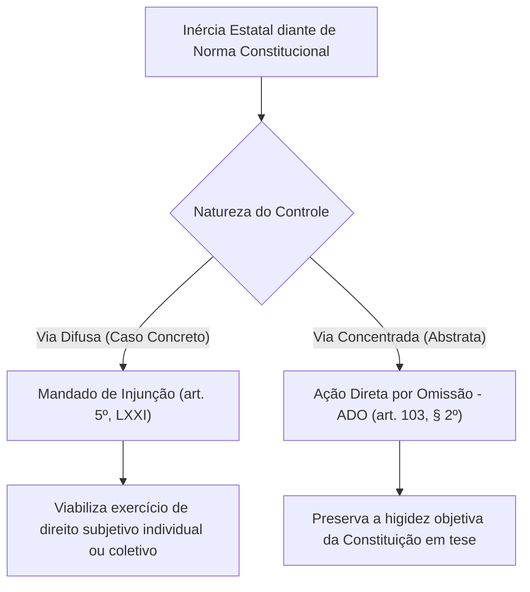
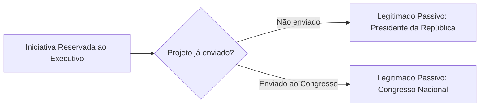
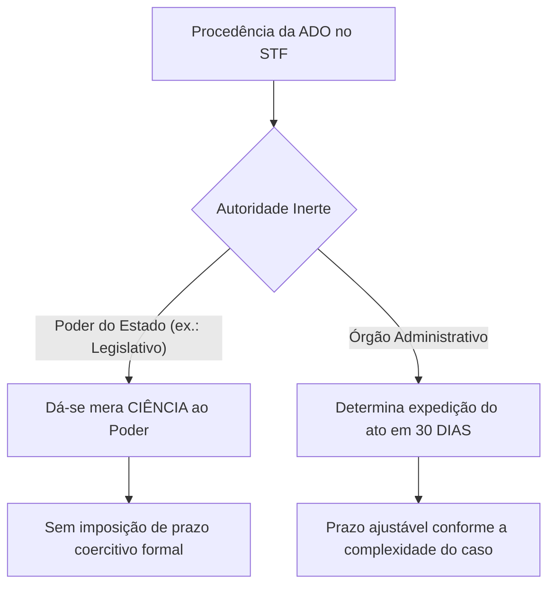
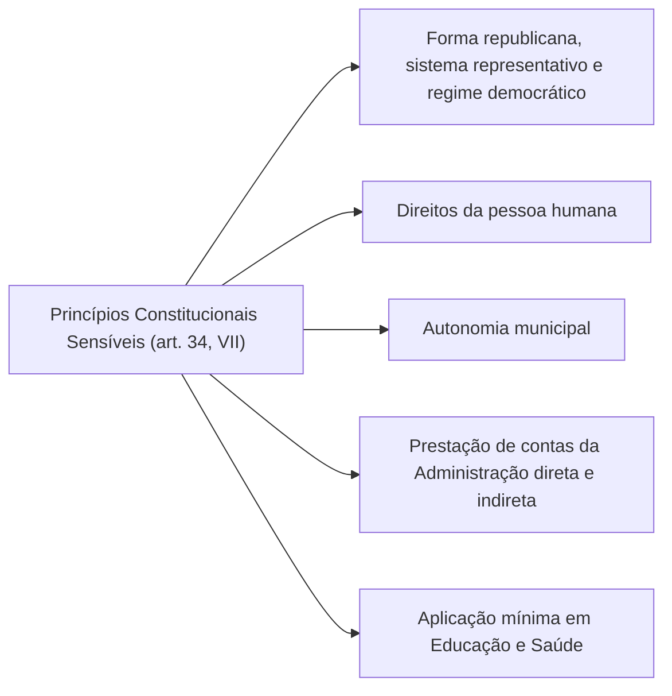
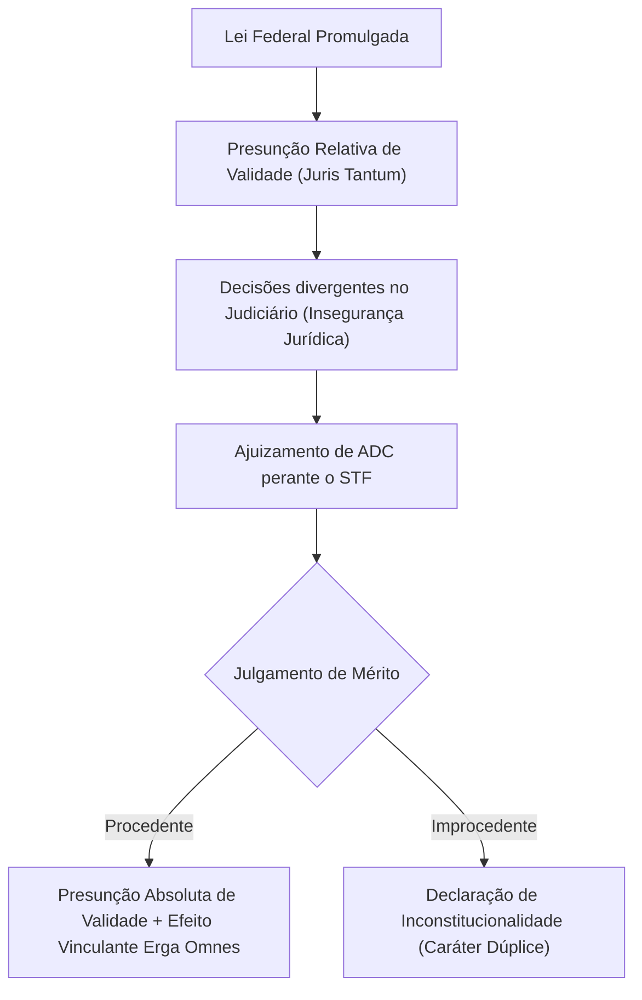
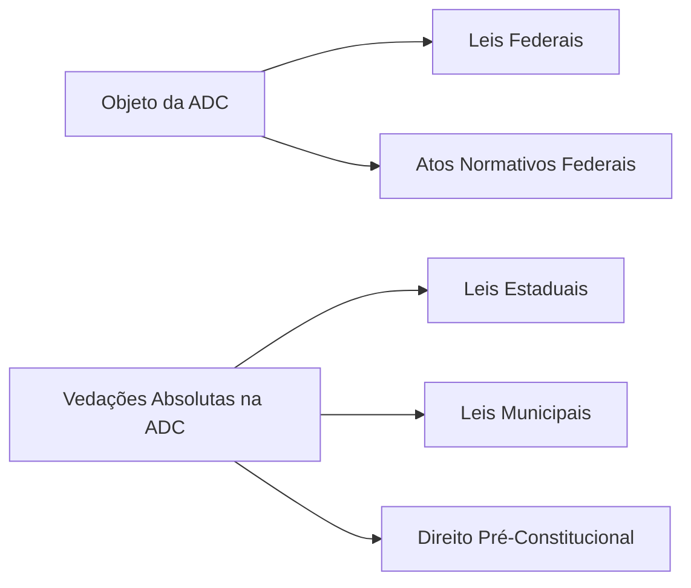
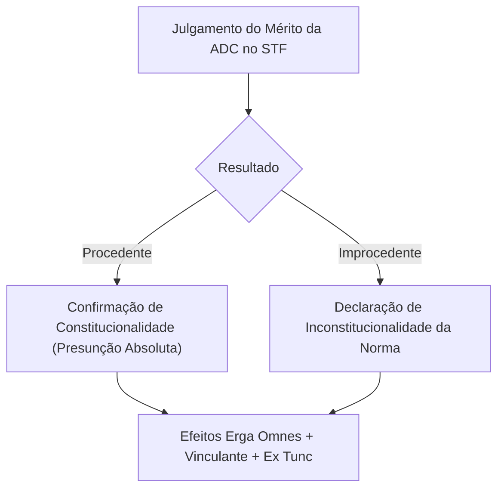
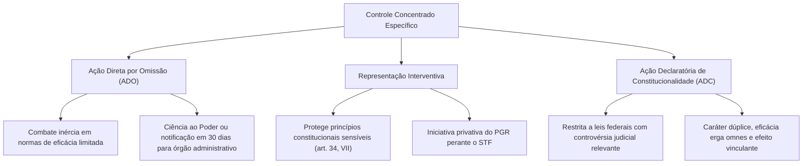

O controle abstrato não combate apenas violações normativas positivas. A omissão legislativa ou administrativa também afronta a supremacia da Constituição quando obsta a fruição de direitos. Além disso, a defesa constitucional requer a salvaguarda do pacto federativo e instrumentos para superar controvérsias judiciais sobre leis federais.

Estudaremos três ações do controle concentrado perante o Supremo Tribunal Federal: a ADO, a representação interventiva e a ADC. Analisaremos legitimados, requisitos, procedimentos, intervenção do Ministério Público e da AGU, além da eficácia decisória.

> [!objetivos]
> - Compreender o objeto, a legitimação e os efeitos da Ação Direta de Inconstitucionalidade por Omissão.
> - Diferenciar a atuação processual da PGR e da AGU na ADO e na ADC.
> - Conhecer as hipóteses, a competência e o rito da representação interventiva federal e estadual.
> - Identificar os requisitos específicos da ADC, em especial a exigência de controvérsia judicial relevante.
> - Distinguir o regime de cautelar e a natureza dúplice da ADC em face da ADI tradicional.

---

## Ação Direta de Inconstitucionalidade por Omissão (ADO)

A Constituição Federal possui normas cuja aplicação depende de regulamentação infraconstitucional. São as chamadas normas de eficácia limitada. Quando o legislador ordinário ou o administrador público competente permanece inerte, o comando constitucional torna-se inoperante.

Para evitar a desidratação da ordem constitucional pelo silêncio dos poderes, a Constituição de 1988 instituiu a Ação Direta de Inconstitucionalidade por Omissão no art. 103, § 2º. A regulamentação processual detalhada adveio com a Lei nº 12.063/2009, que inseriu o Capítulo II-A na Lei nº 9.868/1999.

A ADO caracteriza-se como processo de fiscalização abstrata em que a omissão normativa é atacada em tese. Essa característica diferencia a ADO do Mandado de Injunção (CF, art. 5º, LXXI). Enquanto o Mandado de Injunção tutela um direito subjetivo concreto de titular prejudicado pela ausência de regulamentação na via difusa, a ADO visa à integridade objetiva da ordem constitucional na via concentrada.

### Legitimados Ativos e Passivos na ADO

A legitimação ativa para a propositura da ADO coincide integralmente com o rol de legitimados da Ação Direta de Inconstitucionalidade genérica, disciplinado no art. 103, incisos I a IX, da Constituição Federal:

1. O Presidente da República.
2. A Mesa do Senado Federal.
3. A Mesa da Câmara dos Deputados.
4. Mesas diretoras dos parlamentos estaduais ou do legislativo distrital.
5. O Governador de Estado ou do Distrito Federal.
6. O Procurador-Geral da República.
7. O Conselho Federal da Ordem dos Advogados do Brasil.
8. Partido político com representação no Congresso Nacional.
9. Confederação sindical ou entidade de classe de âmbito nacional.

Mantém-se a clássica divisão jurisprudencial entre legitimados universais (que dispensam prova de pertinência temática) e legitimados especiais (Governadores, Mesas legislativas estaduais e entidades de classe, que devem comprovar nexo de interesse direto com a omissão alegada).

No polo passivo da relação processual, figura o órgão ou autoridade responsável pela omissão inconstitucional. A identificação do polo passivo subordina-se à competência de iniciativa:

- Se a Constituição reserva a iniciativa do projeto ao Presidente da República e este sequer enviou a proposta, o legitimado passivo é o Chefe do Poder Executivo.
- Caso o projeto de iniciativa reservada já tenha sido encaminhado ao Congresso Nacional, cessa a omissão do Executivo e a inércia passa a ser imputada ao Poder Legislativo.

### Objeto e Parâmetro da Omissão

O objeto da ADO é a omissão estatal inconstitucional que frustra a efetividade de norma constitucional de eficácia limitada impositiva. A inércia pode ser classificada quanto à sua extensão:

1. **Omissão total**: O Poder Público permaneceu absolutamente inerte, inexistindo qualquer regulamentação legal ou ato administrativo aplicável.
2. **Omissão parcial**: Existe ato normativo regulamentador, mas este se revela insuficiente, deficiente ou excludente, deixando desamparadas situações que a Constituição mandava tutelar. É a chamada inconstitucionalidade por insuficiência protetiva.

A ADO alcança a inércia de órgãos federais e estaduais perante a Constituição Federal. Em relação ao Distrito Federal, somente cabe ADO naquilo que corresponder às competências estaduais do ente híbrido. A omissão de órgãos municipais (ou distritais em matéria municipal) não pode ser atacada perante o Supremo Tribunal Federal por meio de ADO.

> [!jurisprudencia] STF, ADI 3.682/MT
> A inércia deliberativa prolongada e desprovida de justificativa razoável por parte do Poder Legislativo configura omissão inconstitucional sindicável pelo Supremo Tribunal Federal, ainda que haja projeto de lei em tramitação nas casas legislativas.

A tese antiga sustentava que a simples existência de tramitação legislativa descaracterizaria a omissão. Na ADI 3.682/MT, o Supremo Tribunal Federal superou essa orientação ao julgar a omissão relativa à lei complementar federal exigida pelo art. 18, § 4º, da Constituição para a criação de Municípios, pendente há mais de uma década.

### Atuação da PGR e da AGU na ADO

O papel das instituições processuais na ADO apresenta distinções essenciais em relação à ADI tradicional. No controle concentrado de normas ativas, o Advogado-Geral da União atua obrigatoriamente como curador da presunção de constitucionalidade da lei (CF, art. 103, § 3º). Na omissão, todavia, não há ato estatal positivo a defender.

Por esse motivo, o art. 12-E, § 2º, da Lei nº 9.868/1999 estabelece que o ministro relator tem a faculdade de requisitar manifestação da chefia da Advocacia-Geral da União em quinze dias, tornando sua intervenção facultativa. Em contrapartida, o Procurador-Geral da República deve intervir obrigatoriamente em todos os processos de ADO, funcionando como fiscal da ordem jurídica, consoante o art. 103, § 1º, da Constituição.

| Atuação Processual | ADI Tradicional (Ação Direta) | ADO (Ação por Omissão) |
| :--- | :--- | :--- |
| **Advogado-Geral da União (AGU)** | Obrigatória (defende a norma impugnada) | Facultativa (não há ato positivo a curar) |
| **Procurador-Geral da República (PGR)** | Obrigatória (emite parecer no mérito) | Obrigatória (fiscal da Constituição) |
| **Intervenção de Terceiros** | Vedada (admite apenas *amicus curiae*) | Vedada (admite apenas *amicus curiae*) |
| **Desistência da Ação** | Inadmissível após a propositura | Inadmissível após a propositura |

> [!atencao] Atuação do AGU na Inércia
> Em questões de prova de concurso, as bancas costumam afirmar que o AGU é obrigado a defender a omissão estatal. Isso é incorreto. Não existe dever de curadoria da inércia; a oitiva do AGU na ADO depende de determinação facultativa do Ministro Relator.

### Medida Cautelar em ADO

A Lei nº 12.063/2009 supriu a lacuna legislativa anterior ao disciplinar expressamente a medida cautelar em sede de ADO no art. 12-F da Lei nº 9.868/1999. O Supremo Tribunal Federal pode conceder medida cautelar por maioria absoluta (ao menos 6 ministros concordes), com quórum mínimo de instalação de 8 ministros.

A concessão de liminar exige audiência prévia dos órgãos ou autoridades omissas no prazo improrrogável de 5 dias. Em caso de excepcional urgência, o Tribunal poderá dispensar essa audiência prévia.

O conteúdo da medida cautelar na ADO pode compreender:
- A suspensão da aplicação da lei ou ato normativo impugnado, quando se tratar de inconstitucionalidade por omissão parcial.
- A suspensão de processos judiciais ou administrativos em curso que debatam a mesma matéria controvertida.
- A fixação de diretriz temporária ou outra providência acauteladora determinada motivadamente pela Corte.

### Efeitos da Decisão de Mérito na ADO

Declarada a inconstitucionalidade por omissão, surgem consequências jurídicas diferenciadas a depender da autoridade responsável pelo cumprimento da ordem constitucional. Essa disciplina decorre diretamente do art. 103, § 2º, da Constituição Federal.

Quando a omissão for imputada a um **Poder de Estado** (Legislativo ou Executivo no exercício de função legiferante):
- O Supremo Tribunal Federal comunica formalmente o Poder legiferante para que adote as medidas de sua alçada.
- Em homenagem ao princípio da separação dos Poderes (CF, art. 2º), o Judiciário não fixa prazo coercitivo preclusivo nem comina sanções pelo descumprimento, ressalvada a fixação de parâmetro temporal razoável.

Quando a inércia for imputada a um **órgão administrativo**:
- O Supremo Tribunal Federal determina a notificação do órgão para que adote as providências no prazo de **30 dias**.
- O prazo de 30 dias pode ser modulado para outro intervalo razoável fixado pelo Tribunal, segundo a complexidade material da providência e o interesse público justificado.

> [!bizu] Prazos da Notificação Administrativa
> Memorize o número 30: a notificação ao órgão administrativo na ADO possui o prazo constitucional de 30 dias (CF, art. 103, § 2º). Pegadinhas de bancas frequentemente substituem esse número por 15, 60 ou 90 dias.

---

## Ação Direta de Inconstitucionalidade Interventiva

A intervenção federal nos Estados (e no DF) e a intervenção estadual nos Municípios representam medidas extremas e excepcionais que suspendem provisoriamente a autonomia político-administrativa do ente federado subordinado. A intervenção busca manter a coesão da Federação e restabelecer o equilíbrio institucional violado.

Entre as hipóteses de cabimento da intervenção previstas no art. 34 da Constituição, destaca-se a defesa dos princípios constitucionais sensíveis (CF, art. 34, VII). A violação a esses postulados estruturantes viabiliza a instauração da **Ação Direta de Inconstitucionalidade Interventiva** (também denominada representação interventiva).

### Princípios Constitucionais Sensíveis

O art. 34, inciso VII, da Constituição enumera os princípios sensíveis cuja inobservância autoriza a intervenção federal:

A violação a esses princípios pode decorrer tanto da edição de ato normativo estadual frontalmente colidente quanto de atos concretos governamentais ou da omissão gravosa na garantia dos valores protegidos.

### Legitimidade e Competência na Intervenção

O procedimento da representação interventiva divide-se entre a esfera federal e a esfera estadual, guardando absoluta simetria estrutural:

1. **Representação Interventiva Federal**:
   - **Legitimado ativo exclusivo**: Procurador-Geral da República (PGR). Nenhum outro legitimado do art. 103 possui capacidade postulatória para deflagrar a ação interventiva perante o Supremo Tribunal Federal.
   - **Órgão julgador competente**: Supremo Tribunal Federal (CF, art. 36, III).
   - **Consequência do julgamento**: Se julgada procedente, o STF dá provimento à representação e encaminha a requisição ao Presidente da República, que fica vinculado a decretar a intervenção federal.

2. **Representação Interventiva Estadual**:
   - **Legitimado ativo exclusivo**: Procurador-Geral de Justiça (PGJ).
   - **Órgão julgador competente**: Tribunal de Justiça do respectivo Estado (CF, art. 35, IV, e art. 125, § 2º).
   - **Consequência do julgamento**: Julgada procedente, o Tribunal de Justiça requisita a intervenção ao Governador do Estado para aplicação no Município infrator.

> [!lei] CF, art. 36, III
> "A decretação da intervenção dependerá: [...] III - de provimento, pelo Supremo Tribunal Federal, de representação do Procurador-Geral da República, na hipótese do art. 34, VII, e no caso de recusa à execução de lei federal."

> [!jurisprudencia] STF, Súmula 614
> "Somente o Procurador-Geral de Justiça tem legitimidade para propor ação direta de inconstitucionalidade de lei municipal arguida em face da Constituição Estadual, quando se tratar de representação interventiva."

### Dinâmica Executiva do Decreto Interventivo

O Chefe do Poder Executivo (Presidente ou Governador) detém a prerrogativa política exclusiva de expedir o decreto de intervenção. Contudo, na representação interventiva por provimento judicial transitado em julgado, o Chefe do Executivo atua em regime de competência vinculada: ele não possui discricionariedade para negar o cumprimento da ordem do Tribunal.

O decreto interventivo pode assumir duas modalidades operacionais:
- **Intervenção branda**: O decreto limita-se a suspender a execução do ato impugnado, se essa providência bastar para restabelecer a normalidade e a observância dos princípios violados.
- **Intervenção efetiva (plena)**: Quando a mera suspensão do ato não for suficiente, o decreto nomeia interventor e afasta provisoriamente as autoridades locais infratoras.

Na intervenção decorrente de representação julgada procedente pelo Judiciário (CF, art. 36, § 3º), o decreto presidencial ou governamental prescinde de apreciação pelo Poder Legislativo (dispensa o controle político do Congresso Nacional ou da Assembleia Legislativa). Isso ocorre porque a intervenção já foi legitimada e autorizada pelo crivo jurisdicional máximo.

---

## Ação Declaratória de Constitucionalidade (ADC)

A Ação Declaratória de Constitucionalidade foi introduzida no ordenamento jurídico brasileiro pela Emenda Constitucional nº 3/1993, com o propósito de dissipar situações de grave insegurança jurídica decorrentes de decisões judiciais contraditórias na primeira e na segunda instâncias sobre a higidez de leis federais.

Originalmente, a ADC possuía legitimados restritos (Presidente da República, Mesas da Câmara e do Senado e Procurador-Geral da República). Com o advento da Emenda Constitucional nº 45/2004 (Reforma do Judiciário), o rol de legitimados ativos da ADC foi totalmente uniformizado com o da ADI, passando a abarcar todas as nove figuras do art. 103 da Constituição Federal.

Toda lei regularmente promulgada nasce com presunção de constitucionalidade. Todavia, no regime ordinário, essa presunção é de natureza relativa (*juris tantum*). Quando juízes de primeiro grau e tribunais de apelação começam a afastar a incidência da lei no controle difuso sob a alegação de incompatibilidade com a Carta Magna, a eficácia prática da norma é neutralizada. O ajuizamento da ADC transfere a discussão abstrata ao STF: se julgada procedente, a presunção relativa transforma-se em eficácia vinculante com presunção absoluta de constitucionalidade.

### Objeto e Requisito Específico da ADC

A admissibilidade da ADC impõe dois pressupostos inafastáveis:

1. **Objeto estrito**: Somente podem figurar no polo passivo da ADC **leis ou atos normativos federais** editados sob a vigência da Constituição de 1988. Atos estaduais, distritais e municipais jamais podem ser objeto de ADC perante o Supremo Tribunal Federal. O objeto da ADC é substancialmente mais restrito que o da ADI (que admite leis estaduais).
2. **Controvérsia judicial relevante**: O art. 14, inciso III, da Lei nº 9.868/1999 exige expressamente a demonstração de controvérsia judicial relevante sobre a aplicação da norma atacada. O autor da ação deve instruir a petição inicial com cópia de decisões judiciais divergentes que comprovem dissídio jurisprudencial fundado, capaz de gerar ameaça concreta à ordem jurídica e à segurança das relações sociais.

> [!atencao] Controvérsia Doutrinária não Autoriza ADC
> A existência de dissidência apenas entre doutrinadores, acadêmicos ou comentaristas jurídicos não atende ao requisito legal da ADC. É indispensável a existência de litígios instaurados e pronunciamentos judiciais concretos contraditórios.

A exigência de controvérsia judicial relevante é analisada sob enfoque prioritariamente qualitativo: não se exige que milhares de juízes tenham decidido contrariamente à norma, mas sim que haja decisões representativas com força desestabilizadora da eficácia da lei federal.

### Cumulação de Pedidos em Ações de Controle

O Supremo Tribunal Federal firmou o entendimento de que é admitida a cumulação de pedidos típicos de ADI e de ADC na mesma petição inicial de fiscalização abstrata. Caso o autor pretenda a declaração de inconstitucionalidade de determinados parágrafos de um diploma legislativo federal e a declaração explícita de constitucionalidade dos demais artigos do mesmo diploma, a petição única é processada conjuntamente para assegurar a harmonia do sistema.

### Não Atuação do Advogado-Geral da União na ADC

No processo da Ação Direta de Inconstitucionalidade genérica, a participação do Advogado-Geral da União decorre do mandamento imperativo do art. 103, § 3º, que lhe impõe a defesa da lei atacada. Na ADC, a dinâmica é estruturalmente distinta:

- O requerente ingressou em juízo para defender a validade e a vigência da lei federal.
- Não existe polo de ataque normativo que justifique intervenção curadora.
- Por essa razão lógica e legal, o **Advogado-Geral da União não é citado** para defender a norma na ADC.
- O Procurador-Geral da República, por sua vez, deve emitir parecer prévio em todos os casos no prazo de 15 dias (art. 19 da Lei nº 9.868/1999).

> [!bizu] Atuação do AGU: Resumo Definitivo
> - **ADI Genérica**: AGU atua obrigatoriamente como curador da lei.
> - **ADO**: AGU atua facultativamente se o Ministro Relator requisitar.
> - **ADC**: AGU não intervém nem é citado.
> - **Representação Interventiva Federal**: AGU não atua (a iniciativa é exclusiva do PGR).

### Medida Cautelar em ADC

O art. 21 da Lei nº 9.868/1999 disciplina a tutela de urgência na ADC. O Supremo Tribunal Federal, por decisão de sua maioria absoluta de membros (no mínimo 6 votos favoráveis), com o quórum de presença de ao menos 8 ministros, poderá conceder medida cautelar suspendendo os processos correlatos.

A liminar em ADC apresenta traços procedimentais rígidos:
1. **Determinação de suspensão**: Consiste na ordem endereçada a todos os juízes e tribunais do país para suspenderem o julgamento de todos os processos judiciais em trâmite que envolvam a aplicação dos dispositivos normativos questionados.
2. **Efeitos temporais**: A cautelar produz eficácia contra todos (*erga omnes*), força vinculante e tem efeitos prospectivos (*ex nunc*), salvo deliberação expressa em sentido contrário.
3. **Prazo de eficácia e caducidade**: O art. 21, parágrafo único, prescreve que o mérito da ação declaratória deve ser julgado no prazo de **180 dias**, sob pena de perda de eficácia da medida cautelar concedida. Todavia, a jurisprudência pragmática do STF costuma mitigar a caducidade automática desse prazo em situações de risco à segurança jurídica coletiva.
4. **Publicação**: A parte dispositiva da concessão da cautelar deve ser publicada no Diário Oficial e na imprensa oficial em até **10 dias**.

| Parâmetro | Medida Cautelar na ADI | Medida Cautelar na ADC |
| :--- | :--- | :--- |
| **Quórum de Concessão** | Maioria absoluta (6 ministros) | Maioria absoluta (6 ministros) |
| **Quórum de Abertura** | Mínimo de 8 ministros presentes | Mínimo de 8 ministros presentes |
| **Conteúdo Central** | Suspende a eficácia da lei impugnada | Manda suspender o julgamento dos processos |
| **Efeito Padrão** | *Ex nunc* (prospectivo) | *Ex nunc* (prospectivo) |
| **Prazo Legal de 180 dias** | Inexistente na Lei 9.868 | Previsto no art. 21, parágrafo único |

### Caráter Dúplice (Ambivalente) e Efeitos da Decisão

A via declaratória de constitucionalidade e a via direta de inconstitucionalidade guardam sinalagma processual idêntico quanto aos efeitos decisórios finais. Trata-se de ações com **natureza dúplice ou ambivalente**:

- Se o Supremo Tribunal Federal acolhe o pedido e julga **procedente a ADC**, proclama que a lei federal é harmônica com a Constituição.
- Se o STF rejeita o pedido formulado e declara a **improcedência da ADC**, a consequência imediata e inafastável é a proclamação da **inconstitucionalidade** da norma federal impugnada.
- De modo inverso, a improcedência de uma ADI equivale à declaração concentrada de sua constitucionalidade.

Quanto à eficácia temporal e subjetiva, o julgamento final do mérito na ADC possui:
- **Eficácia *erga omnes***: Produz efeitos gerais aplicáveis a toda a sociedade.
- **Efeito vinculante**: Subordina o Poder Executivo em todas as suas esferas (União, Estados, DF e Municípios) e os demais órgãos do Poder Judiciário. O Poder Legislativo, em sua função típica de legislar, não se vincula à decisão, podendo reeditar o ato legislativo se julgar oportuno.
- **Eficácia retroativa (*ex tunc*)**: Como regra geral, a confirmação ou invalidação retroage à data originária da edição da lei federal.
- **Modulação de efeitos**: Em homenagem à segurança jurídica ou a excepcional interesse social, o STF pode restringir os efeitos da declaração ou fixar momento futuro para sua eficácia, desde que observado o voto de dois terços de seus membros (8 ministros), nos moldes do art. 27 da Lei nº 9.868/1999.

Por expressa determinação do art. 26 da Lei nº 9.868/1999, a decisão de mérito proferida pelo STF em ADC é irrecorrível, ressalvada unicamente a oposição de embargos de declaração saneadores, e não autoriza o manejo de ação rescisória.

---

## Quadro Comparativo Consolidado das Ações Concentradas

Para consolidar as diferenças estruturais que costumam decidir pontos em certames públicos, a tabela abaixo confronta os aspectos essenciais de cada modalidade de controle perante o Supremo Tribunal Federal:

| Elemento Analisado | ADI Tradicional (Genérica) | ADO (Por Omissão) | ADC (Declaratória de Constitucionalidade) |
| :--- | :--- | :--- | :--- |
| **Finalidade Primária** | Invalidar ato normativo incompatível | Combater o vácuo regulamentador inconstitucional | Confirmar a validade da lei federal em crise judicial |
| **Objeto Admitido** | Leis federais e leis estaduais | Omissões normativas federais e estaduais | Somente leis e atos normativos federais |
| **Legitimação Ativa** | Rol taxativo do art. 103 (I a IX) | Rol taxativo do art. 103 (I a IX) | Rol taxativo do art. 103 (I a IX) |
| **Atuação do AGU** | Obrigatória como curador da lei atacada | Facultativa, a critério do relator | Não intervém no processo |
| **Atuação do PGR** | Obrigatória com parecer formal | Obrigatória como fiscal da ordem constitucional | Obrigatória com parecer formal |
| **Medida Cautelar** | Suspende eficácia do diploma legal | Suspende processos ou fixa diretrizes temporárias | Sobresta julgamentos em instâncias ordinárias |
| **Efeito sobre Terceiros** | *Erga omnes* e vinculante | *Erga omnes* e vinculante | *Erga omnes* e vinculante |
| **Ação Rescisória** | Inadmissível | Inadmissível | Inadmissível |
| **Desistência** | Não admitida | Não admitida | Não admitida |

---

## Mapa do Capítulo

### Para fixar

- Inércia administrativa na ADO: O STF notifica o órgão administrativo competente para editar a norma necessária no prazo peremptório de 30 dias, enquanto em relação aos Poderes de Estado limita-se a emitir ciência formal.
- Defesa da norma pelo AGU: A manifestação da Advocacia-Geral da União é curadoria obrigatória na ADI tradicional, facultativa na ADO e vedada na ADC.
- Representação interventiva federal: Apenas o Procurador-Geral da República detém legitimidade ativa perante o STF para tutelar os princípios sensíveis do art. 34, VII, da CF.
- Requisitos materiais da ADC: A ação declaratória exige prova robusta de controvérsia judicial relevante e limita-se a leis ou atos normativos federais posteriores a 1988.
- Natureza dúplice: O julgamento de improcedência de uma ADC importa automática declaração de inconstitucionalidade da norma examinada.
- Cautelar na ADC: Determina o sobrestamento dos processos judiciais ordinários em curso pelo prazo de 180 dias com eficácia vinculante e erga omnes.
- Vedação rescisória e irrecorribilidade: As decisões definitivas proferidas em controle abstrato são irrecorríveis, salvo embargos de declaração, e não admitem ação rescisória (Lei 9.868/1999, art. 26).
