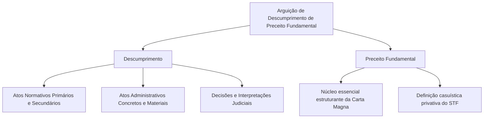
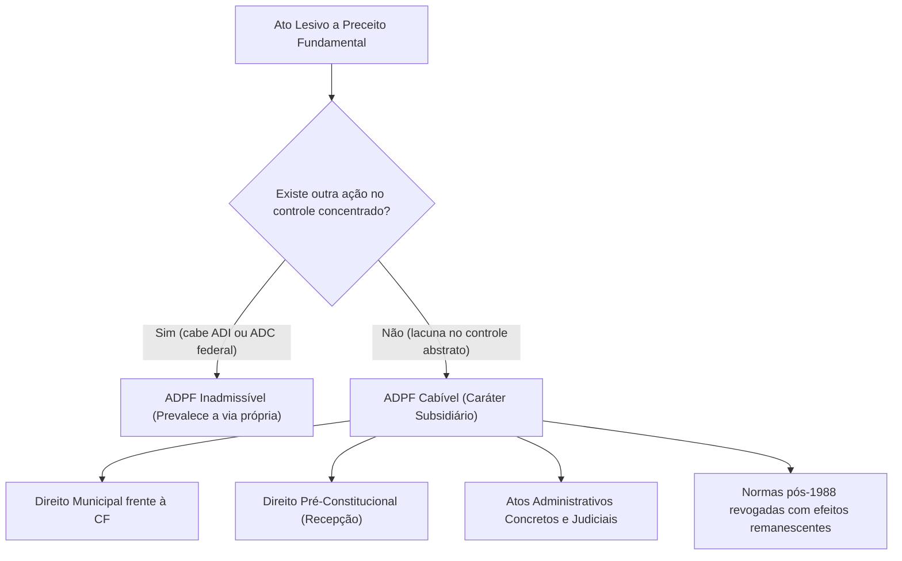
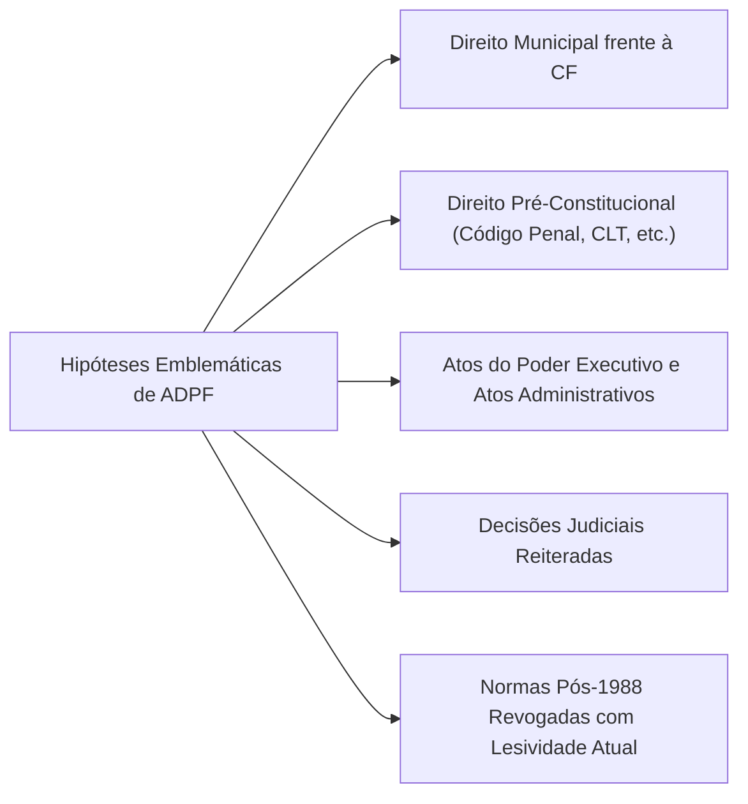
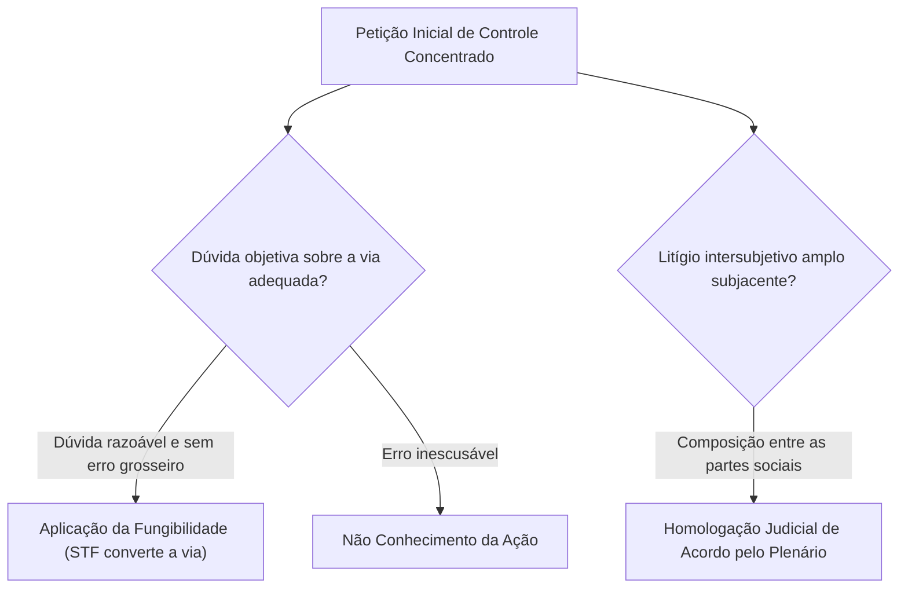
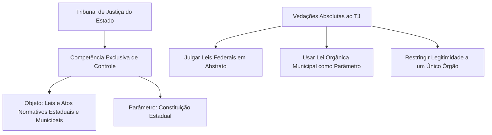
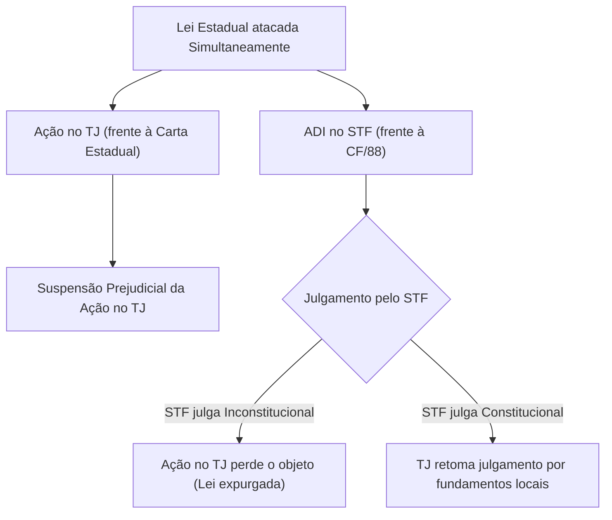
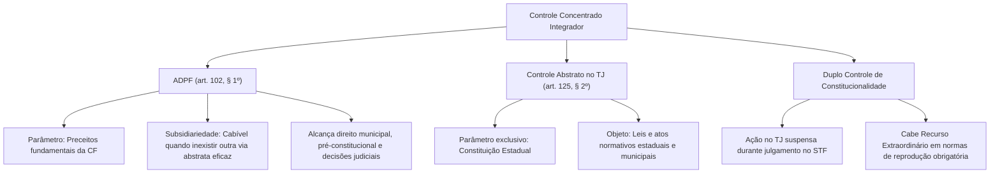

O sistema concentrado de controle de constitucionalidade desenhado em 1988 apresentava vazios normativos relevantes. A Ação Direta de Inconstitucionalidade (ADI) e a Ação Declaratória de Constitucionalidade (ADC) não alcançavam o direito municipal em face da Constituição da República, as normas editadas antes de 1988 nem os atos materiais ou judiciais do Poder Público. Para suprir essas lacunas e conferir integridade à ordem jurídica, o constituinte previu a Arguição de Descumprimento de Preceito Fundamental (ADPF), regulamentada pela Lei nº 9.882/1999.

Paralelamente, a Carta Magna estruturou a fiscalização concentrada em âmbito local, atribuindo aos Tribunais de Justiça a competência privativa para examinar leis estaduais e municipais em face da Constituição estadual. A coexistência de jurisdições constitucionais abre espaço para o fenômeno do duplo controle, em que a mesma norma é confrontada de modo simultâneo no plano estadual e no Supremo Tribunal Federal.

Neste capítulo, estudaremos o regime da ADPF, seu princípio da subsidiariedade, as hipóteses de cabimento e o rito processual. Em seguida, examinaremos o controle abstrato perante os Tribunais de Justiça estaduais, os parâmetros aplicáveis e as soluções jurisprudenciais para o duplo controle de constitucionalidade.

> [!objetivos]
> - Compreender o conceito de preceito fundamental e a finalidade integradora da ADPF.
> - Aplicar o princípio da subsidiariedade e a fungibilidade entre ações do controle abstrato.
> - Analisar a tutela do direito municipal e do direito pré-constitucional perante o STF.
> - Dominar a competência do Tribunal de Justiça no controle abstrato estadual e municipal.
> - Resolver os conflitos de competência decorrentes do duplo controle de constitucionalidade.

---

## Arguição de Descumprimento de Preceito Fundamental (ADPF)

A ADPF possui assento no art. 102, § 1º, da Constituição Federal, dispondo que a arguição terá seu processamento e julgamento perante o STF consoante estipulado em lei ordinária. Tratava-se de norma de eficácia limitada, cuja viabilidade prática dependia de densificação legislativa ordinária. Esse vácuo perdurou por mais de onze anos, até a promulgação da Lei nº 9.882/1999, declarada plenamente constitucional pelo STF no julgamento da ADI 2.231/DF.

A terminologia adotada pelo constituinte revela a amplitude do instituto. O termo **descumprimento** não se restringe à inconstitucionalidade formal ou material de atos normativos em tese. Ele abrange qualquer modalidade de conduta do Poder Público violadora de preceitos essenciais, incluindo atos administrativos concretos, portarias, omissões estatais e decisões emanadas do Poder Judiciário.

### O Conceito de Preceito Fundamental

A legislação não trouxe uma lista taxativa dos preceitos fundamentais. A delimitação conceitual coube ao próprio Supremo Tribunal Federal, que assentou na ADPF 1/RJ sua competência privativa para definir o alcance da expressão. Preceito fundamental é categoria mais densa e qualificada do que o gênero norma constitucional, mas também mais ampla do que simples princípios, pois abarca regras imperativas e cláusulas fundamentais.

Entre os temas já reconhecidos pelo Supremo Tribunal Federal como preceitos fundamentais, destacam-se:
- Os princípios fundamentais da República (CF, arts. 1º a 4º).
- Os direitos e garantias fundamentais individuais e sociais (CF, arts. 5º a 17).
- As cláusulas pétreas expressas e implícitas (CF, art. 60, § 4º).
- Os princípios constitucionais sensíveis da intervenção federal (CF, art. 34, VII).
- O postulado da separação e independência dos Poderes (CF, art. 2º).
- O direito fundamental à saúde, à vida digna e ao meio ambiente ecologicamente equilibrado.

> [!atencao] Parâmetro Mais Estrito que o da ADI
> Na Ação Direta de Inconstitucionalidade genérica, qualquer dispositivo da Constituição Federal atua como parâmetro de controle. Na ADPF, o parâmetro é substancialmente mais restrito: a alegação de violação deve recair obrigatoriamente sobre um preceito fundamental da ordem constitucional.

---

## Legitimação Ativa na ADPF

A Lei nº 9.882/1999, em seu art. 2º, inciso I, equiparou os legitimados ativos da ADPF ao rol taxativo do art. 103 da Constituição Federal. Portanto, possuem legitimidade para a propositura da ADPF exatamente os mesmos nove atores da ADI, da ADC e da ADO:

1. O Presidente da República.
2. A Mesa do Senado Federal.
3. A Mesa da Câmara dos Deputados.
4. Mesas diretoras dos parlamentos estaduais ou do legislativo distrital.
5. O Governador de Estado ou do Distrito Federal.
6. O Procurador-Geral da República.
7. O Conselho Federal da Ordem dos Advogados do Brasil.
8. Partido político com representação no Congresso Nacional.
9. Entidades sindicais confederativas ou associações de classe com representatividade nacional.

O projeto de lei original previa a faculdade de qualquer cidadão ou pessoa jurídica lesada ajuizar representação para que o Procurador-Geral da República propusesse a ADPF. No entanto, tal dispositivo foi vetado pelo Presidente da República para evitar a vulgarização do controle abstrato e a sobrecarga indevida do Tribunal. Cidadãos e entidades desprovidas de representação nacional não dispõem de capacidade postulatória autônoma para propor a ação.

A exigência de pertinência temática também se aplica rigorosamente à ADPF: os legitimados especiais (Governadores, Mesas legislativas locais e entidades de classe) devem demonstrar vínculo direto e imediato entre o conteúdo do ato atacado e seus objetivos institucionais ou corporativos.

---

## Princípio da Subsidiariedade

O traço definidor da ADPF é o princípio da subsidiariedade, consagrado no art. 4º, § 1º, da Lei nº 9.882/1999: inadmitir-se-á o manejo da arguição caso subsista qualquer outro mecanismo idôneo e eficaz para sanar o estado de lesividade alegado.

A interpretação da locução outro meio eficaz gerou profundos debates doutrinários e jurisprudenciais. O Supremo Tribunal Federal pacificou que o meio eficaz impeditivo da ADPF é aquele apto a solver a controvérsia em sede de fiscalização abstrata e concentrada com efeitos *erga omnes* e vinculantes.

A existência de ações judiciais individuais na via difusa, de mandados de segurança ou de recursos extraordinários pendentes não afasta o cabimento da ADPF. A via difusa resolve a lide apenas entre as partes do processo, sem capacidade imediata de uniformizar o direito em escala nacional com eficácia vinculante. Assim, a subsidiariedade é aferida sob a ótica da jurisdição constitucional concentrada.

Por outro lado, caso a controvérsia envolva lei federal ou estadual pós-constitucional em vigor confrontada com a Carta de 1988, o instrumento processual adequado é a ADI genérica. O manejo da ADPF nessa hipótese afronta a subsidiariedade e acarreta a inadmissibilidade da petição inicial.

---

## Hipóteses Típicas de Cabimento da ADPF

Em virtude de sua função completiva no ordenamento constitucional, a ADPF incide sobre situações fáticas e jurídicas imunes às demais ações do controle concentrado perante o Supremo Tribunal Federal. A doutrina e a jurisprudência consagram a divisão da ADPF em duas modalidades operacionais distintas:

1. **ADPF autônoma (preventiva ou repressiva)**: Tem por objetivo principal evitar ou reparar lesão a preceito fundamental decorrente de qualquer ato do Poder Público, incluindo atos administrativos concretos, portarias, instruções normativas e omissões estatais.
2. **ADPF incidental**: Visa solver controvérsia judicial relevante sobre a aplicação de lei ou ato normativo federal, estadual ou municipal, incluídos os diplomas anteriores à Constituição de 1988. Exige a comprovação de relevante dissídio jurisprudencial que gere insegurança jurídica.

### Direito Municipal em face da Constituição Federal

Os Municípios não integram o polo passivo da ADI genérica perante o STF (CF, art. 102, I, a). Diante disso, leis e atos municipais que contrariam a Constituição Federal não podiam ser impugnados em controle abstrato perante a Suprema Corte até a criação da ADPF.

Com a ADPF, viabilizou-se o controle direto de leis municipais frente à Carta da República. O julgamento vincula toda a Administração e o Judiciário, impedindo a proliferação de normas locais contraditórias em centenas de comarcas. Basta que a Suprema Corte decida uma ação paradigmática para que o efeito vinculante e a eficácia contra todos se irradiem sobre os fundamentos determinantes, projetando-se sobre diplomas normativos idênticos de outros Municípios brasileiros.

### Direito Pré-Constitucional e o Fenômeno da Recepção

O Supremo Tribunal Federal adota a teoria de Hans Kelsen sobre a sucessão constitucional: o advento de uma nova ordem constitucional revoga o direito anterior materialmente incompatível por falta de recepção. Inexiste inconstitucionalidade superveniente no direito brasileiro.

Por essa razão, leis anteriores a 5 de outubro de 1988 não podem ser objeto de Ação Direta de Inconstitucionalidade. A ADPF tornou-se o instrumento idôneo para submeter normas pré-constitucionais à fiscalização abstrata perante o STF, que declarará sua recepção ou não recepção (revogação).

> [!jurisprudencia] STF, ADPF 54/DF
> O Supremo Tribunal Federal admitiu o manejo da ADPF para conferir interpretação conforme à Constituição aos artigos 124 e 126 do Código Penal de 1940 (norma anterior à CF/88), assentando a atipicidade da interrupção terapêutica da gestação de feto anencéfalo.

### Decisões Judiciais e Atos Infralegais

A ADPF revela-se cabível contra interpretações judiciais consolidadas ou decisões jurisdicionais reiteradas que vulnerem preceitos fundamentais da ordem jurídica. Na ADPF 101/DF, por exemplo, o Supremo Tribunal Federal apreciou a higidez de decisões judiciais que autorizavam a importação de pneus usados, reconhecendo a violação ao direito constitucional ao meio ambiente equilibrado e à saúde pública.

Atos administrativos normativos secundários (regulamentos, resoluções, portarias autônomas) que operem de modo direto contra preceitos fundamentais também encontram na ADPF o mecanismo direto de expurgo, ressalvada sempre a necessidade de demonstrar que a lesão decorre de afronta imediata à Carta Magna e não de ofensa reflexa à lei ordinária regulamentada.

### Hipóteses de Não Cabimento

Em contrapartida, o STF rejeita expressamente a ADPF nas seguintes hipóteses:
- **Atos políticos típicos**: Decisões políticas praticadas nos limites da discricionariedade constitucional, como o veto legislativo motivado do Chefe do Executivo.
- **Súmulas comuns ou vinculantes**: Súmula não é ato normativo autônomo, mas consolidação de orientação pretoriana. A revisão de súmula vinculante possui rito próprio previsto no art. 103-A, § 2º, da CF.
- **Normas constitucionais originárias**: O constituinte originário não pratica inconstitucionalidade; a tese de normas constitucionais inconstitucionais originárias não é acolhida no Brasil.
- **Controvérsias de mera legalidade**: Questões de estrita ofensa reflexa ou indireta à Constituição.

---

## Procedimento e Medida Liminar na ADPF

A petição inicial da ADPF deve atender aos requisitos do art. 3º da Lei nº 9.882/1999: indicar com clareza o preceito fundamental violado, individualizar o ato do Poder Público questionado, instruir a prova da lesão e apresentar pedido certo e determinado. Petições genéricas ou ambíguas são indeferidas por inépcia.

A concessão de medida cautelar (liminar) rege-se pelas seguintes regras:
- **Quórum deliberativo**: A liminar depende de decisão da maioria absoluta dos membros do Supremo Tribunal Federal (art. 5º da Lei nº 9.882/1999), ou seja, ao menos 6 votos concordes.
- **Competência monocrática excepcional**: Em casos de extrema urgência, grave perigo de dano irreparável ou durante o recesso judiciário, o Ministro Relator pode deferir monocraticamente a medida liminar, submetendo-a prontamente ao referendo do Plenário.
- **Conteúdo da liminar**: Pode determinar a suspensão dos processos em andamento ou a eficácia dos atos impugnados, ressalvados os efeitos das decisões judiciais transitadas em julgado.

| Aspecto Processual | Regra Legal na ADPF |
| :--- | :--- |
| **Quórum de Abertura da Sessão** | Mínimo de dois terços dos ministros (8 membros presentes) |
| **Quórum para Declaração de Mérito** | Maioria absoluta (6 votos concordes de ministros) |
| **Manifestação do PGR e AGU** | PGR ouvido sempre; AGU facultativo ou dispensado |
| **Intervenção de Terceiros** | Vedada a intervenção comum; admitido o *amicus curiae* |
| **Desistência da Ação** | Inadmissível após o protocolo da petição inicial |
| **Eficácia Temporal da Decisão** | Regra *ex tunc*, admitida modulação de efeitos por 2/3 |

### Eficácia Imediata e Irrecorribilidade da Decisão

A decisão de mérito proferida pelo Supremo Tribunal Federal em sede de ADPF apresenta uma singularidade temporal relevante quando comparada à sistemática da ADI e da ADC. Em conformidade com o art. 10, § 3º, da Lei nº 9.882/1999, a decisão na arguição possui **eficácia imediata**. A produção de efeitos vinculantes e contra todos não depende da publicação formal do acórdão no Diário da Justiça, bastando a divulgação da ata do julgamento.

Além disso, a decisão final do Tribunal é absolutamente irrecorrível, admitindo-se tão somente a oposição tempestiva de embargos de declaração saneadores de omissão, contradição ou obscuridade. É categoricamente vedado o ajuizamento de ação rescisória (art. 12 da Lei nº 9.882/1999), consolidando em definitivo a segurança jurídica da orientação assentada pela Suprema Corte. Caso o pronunciamento envolva norma anterior a 1988, a decisão declarará a recepção ou revogação formal do preceito pré-constitucional.

---

## Princípio da Fungibilidade e Acordo em ADPF

A relação de complementariedade entre as ações do controle abstrato autoriza a aplicação do **princípio da fungibilidade**. O Supremo Tribunal Federal admite a conversão processual de uma ADPF em ADI, ou de uma ADI em ADPF, desde que atendidos cumulativamente dois pressupostos:
1. Existência de dúvida razoável e objetiva quanto à via processual adequada (por exemplo, discussão se determinado provimento possui natureza autônoma ou regulamentar).
2. Ausência de erro grosseiro e preenchimento dos requisitos de cabimento e representação da ação acolhida.

> [!jurisprudencia] STF, ADI 4.180 MC/DF e ADPF 314/DF
> O Supremo Tribunal Federal consagra a fungibilidade entre as ações constitucionais de controle concentrado, viabilizando o conhecimento de ADPF como ADI e vice-versa quando atendidos os pressupostos processuais e ausente má-fé ou erro inescusável.

### Celebração de Acordos em Sede de ADPF

Embora o controle concentrado tenha perfil eminentemente objetivo, certas controvérsias veiculadas em ADPF possuem substrato fático-econômico permeado por disputas judiciais intersubjetivas em massa. O exemplo mais notável ocorreu na discussão sobre as correções monetárias de cadernetas de poupança decorrentes dos planos econômicos pretéritos (Bresser, Verão, Collor I e II).

Após décadas de litígios, as entidades representativas dos poupadores e as instituições bancárias firmaram termo de autocomposição coletiva. O Supremo Tribunal Federal homologou judicialmente o acordo em sede de ADPF. A jurisprudência assentou que o Tribunal pode homologar acordos que componham o conflito material subjacente sem proferir juízo categórico de mérito vinculante que imponha tese jurídica abstrata vencedora.

---

## Controle Abstrato perante os Tribunais de Justiça Estaduais

A Carta Magna de 1988 descentralizou a jurisdição constitucional ao conferir aos Estados-membros o poder de instituir ações de controle abstrato em âmbito local. O art. 125, § 2º, da Constituição Federal estabelece:

> [!lei] CF, art. 125, § 2º
> "Cabe aos Estados a instituição de representação de inconstitucionalidade de leis ou atos normativos estaduais ou municipais em face da Constituição Estadual, vedada a atribuição da legitimação para agir a um único órgão."

O órgão julgador exclusivo dessa modalidade concentrada é o Tribunal de Justiça do respectivo Estado da Federação. Nem juízes singulares nem tribunais regionais possuem competência para processar ação direta de controle abstrato estadual.

### Legitimação Ativa na Esfera Estadual

O art. 125, § 2º, parte final, da Constituição Federal estabelece uma expressa vedação aos Estados-membros: é terminantemente proibido concentrar a legitimidade ativa para a representação de inconstitucionalidade nas mãos de um único órgão ou autoridade pública (como seria, por exemplo, outorgar competência exclusiva ao Procurador-Geral de Justiça).

Ressalvada essa proibição de exclusividade, a definição dos legitimados ativos compete privativamente ao poder constituinte decorrente de cada Estado federado. No julgamento emblemático do Recurso Extraordinário RE 261.677/RS, o Supremo Tribunal Federal assentou que a Constituição Estadual dispõe de autonomia jurídica para ampliar o rol de legitimados para além daqueles previstos no art. 103 da Constituição Federal.

Dessa forma, os textos constitucionais estaduais costumam conferir capacidade postulatória a atores locais estratégicos:
- O Governador do Estado e a Mesa da Assembleia Legislativa.
- O Procurador-Geral de Justiça e o Defensor Público-Geral do Estado.
- Prefeitos Municipais e Mesas de Câmaras de Vereadores (para impugnar leis locais).
- Deputados Estaduais individualmente considerados ou frações de parlamentares.
- Subseções estaduais da Ordem dos Advogados do Brasil e associações de classe locais.

Ademais, a jurisprudência reconhece que as Procuradorias-Gerais dos Estados e dos Municípios possuem plena legitimidade recursal autônoma para interpor recursos contra acórdãos proferidos pelos Tribunais de Justiça em sede de controle abstrato, defendendo a higidez das normas elaboradas por seus respectivos Poderes.

### Objeto e Parâmetro no Âmbito Estadual

A estrutura material do controle estadual apresenta contornos definidos:

1. **Objeto do controle**: Leis e atos normativos estaduais e municipais contestados em abstrato. O Tribunal de Justiça não possui competência para processar representação de inconstitucionalidade contra leis federais.
2. **Parâmetro de controle**: O único parâmetro admitido é a **Constituição estadual** (ou a Lei Orgânica do Distrito Federal no caso de matérias distritais de natureza estadual).
3. **Vedação da Lei Orgânica Municipal como parâmetro abstrato**: O Tribunal de Justiça não pode julgar ação direta tendo como parâmetro a Lei Orgânica de um Município. Essa pretensão reflete conflito de mera legalidade municipal, insuscetível de justificar jurisdição constitucional concentrada.

> [!jurisprudencia] STF, ADI 5.548/MG
> A Constituição Federal não autoriza que os Tribunais de Justiça exerçam controle concentrado abstrato de validade de leis municipais tendo por parâmetro leis orgânicas municipais. O parâmetro exclusivo é a Constituição do respectivo Estado-membro.

> [!jurisprudencia] STF, Súmula 642
> "Não cabe ação direta de inconstitucionalidade perante o Supremo Tribunal Federal contra lei do Distrito Federal decorrente do exercício de sua competência legislativa municipal."

### Tipologias de Normas na Constituição Estadual

Para fins de fiscalização no Tribunal de Justiça, as cláusulas da Constituição Estadual agrupam-se em três categorias distintas:
1. **Normas de reprodução obrigatória**: Dispositivos da Constituição Federal cuja transposição para a Constituição estadual é imperativa em virtude do princípio da simetria (ex.: separação de Poderes, rito orçamentário e processo legislativo básico).
2. **Normas de imitação facultativa**: Dispositivos da CF que o constituinte estadual decidiu voluntariamente incorporar ao texto estadual no exercício de sua autonomia constituinte derivada.
3. **Normas tipicamente estaduais (autônomas)**: Preceitos criados exclusivamente pela ordem local para atender a particularidades do Estado-membro, sem qualquer correspondência no texto da Carta Magna.

---

## O Fenômeno do Duplo Controle de Constitucionalidade

O duplo controle de constitucionalidade configura-se quando uma mesma lei ou ato normativo estadual é impugnado simultaneamente:
- No Tribunal de Justiça estadual, por violação à Constituição Estadual (representação de inconstitucionalidade).
- No Supremo Tribunal Federal, por ofensa à Constituição Federal (Ação Direta de Inconstitucionalidade).

Essa duplicidade de processos pode gerar sentenças contraditórias sobre a mesma norma, impondo critérios rigorosos de precedência jurisdicional construídos pela jurisprudência da Suprema Corte.

### Regras de Precedência e Suspensão Prejudicial

Quando a ação no TJ e a ADI no STF tramitam concomitantemente sobre a mesma norma estadual, o processo perante o Tribunal de Justiça deve ficar **suspenso** prejudicialmente até o julgamento final pelo Supremo Tribunal Federal:
- **STF declara a lei inconstitucional**: O ato normativo é extirpado com eficácia *erga omnes* do ordenamento pátrio. A representação de inconstitucionalidade em curso no TJ perde inteiramente o objeto, devendo ser extinta sem exame de mérito.
- **STF declara a lei constitucional**: A ação no TJ pode prosseguir se houver fundamentos autônomos ancorados em normas tipicamente estaduais não abrangidas pela decisão da Suprema Corte.

### Recursos Extraordinários e Parâmetro de Reprodução Obrigatória

Caso o Tribunal de Justiça julgue a representação local antes do STF, as regras aplicam-se conforme o desfecho:

1. **Procedência da ação no TJ**: A lei estadual ou municipal é expulsa da ordem jurídica pelo Tribunal de Justiça.
   - Como regra geral, as decisões dos Tribunais de Justiça em sede concentrada são irrecorríveis.
   - Excepcionalmente, se o parâmetro utilizado pela Constituição Estadual consistir em **norma de reprodução obrigatória** da Carta Federal, cabe **Recurso Extraordinário (RE)** para o STF.
   - No julgamento desse Recurso Extraordinário com repercussão geral, o STF atua com eficácia análoga à da ADI, proferindo juízo com efeitos vinculantes e *erga omnes*. Nessa via recursal atípica, o STF pode inclusive examinar a conformidade de uma **lei municipal** perante a Constituição Federal.
2. **Improcedência da ação no TJ**: A declaração de constitucionalidade proferida pelo Tribunal de Justiça estadual não vincula o Supremo Tribunal Federal nem gera coisa julgada material oponível à Corte Maior. A matéria pode ser apreciada diretamente em sede de ADI no STF, prevalecendo soberanamente o pronunciamento federal.

> [!jurisprudencia] STF, RE 650.898/RS e ADI 3.659/AM
> O acórdão de Tribunal de Justiça que julga representação de inconstitucionalidade com suporte em norma de reprodução obrigatória submete-se ao Recurso Extraordinário para o STF. A jurisdição da Corte Suprema sobrepõe-se à decisão estadual, salvaguardando a homogeneidade interpretativa do bloco de constitucionalidade nacional.

---

## Síntese Comparativa: Controle pelo STF vs. Controle pelo TJ

A convivência entre o controle de constitucionalidade exercido pelo Supremo Tribunal Federal e aquele desempenhado pelos Tribunais de Justiça estaduais reflete o modelo federativo cooperativo adotado pelo Brasil. Enquanto o STF atua como guardião último e soberano da Constituição da República, os Tribunais de Justiça exercem a jurisdição constitucional circunscrita aos limites territoriais e normativos das respectivas Constituições estaduais.

Essa arquitetura descentralizada busca aproximar o controle concentrado das realidades locais, permitindo que leis e regulamentos municipais sejam fiscalizados de forma célere no âmbito dos próprios Estados. Contudo, essa autonomia subordina-se à supremacia federativa: sempre que um Tribunal de Justiça interpreta uma norma de reprodução obrigatória da Constituição Federal, sua conclusão sujeita-se à revisão uniformizadora do Supremo Tribunal Federal por meio de Recurso Extraordinário com repercussão geral reconhecida.

| Critério de Comparação | Controle Abstrato pelo STF | Controle Abstrato pelo TJ |
| :--- | :--- | :--- |
| **Norma de Competência** | CF/88, art. 102, I, a, e § 1º | CF/88, art. 125, § 2º |
| **Ações Cabíveis** | ADI, ADC, ADO e ADPF | Representação de Inconstitucionalidade estadual |
| **Objeto do Processo** | Leis federais, estaduais e municipais (via ADPF) | Leis e atos normativos estaduais e municipais |
| **Parâmetro de Confronto** | Constituição Federal (Preceito fundamental na ADPF) | Constituição Estadual (ou Lei Orgânica do DF) |
| **Controle de Leis Federais** | Competência privativa originária | Vedação absoluta em controle abstrato |
| **Recurso Cabível da Decisão** | Irrecorrível (salvo embargos de declaração) | Irrecorrível (salvo RE em norma de reprodução obrigatória) |
| **Rescisória da Decisão** | Inadmissível | Inadmissível |

Em arremate, cumpre sublinhar que tanto o Supremo Tribunal Federal quanto os Tribunais de Justiça proferem decisões dotadas de eficácia geral contra todos (*erga omnes*) e caráter vinculante sobre a Administração Pública e os demais órgãos judiciais situados sob sua alçada geográfica. Em ambos os fóruns, impera o princípio da segurança jurídica, admitindo-se a modulação dos efeitos temporais mediante quórum qualificado de dois terços dos membros julgadores.

---

## Mapa do Capítulo

### Para fixar

- Preceitos fundamentais: O parâmetro da ADPF restringe-se aos preceitos estruturantes da Carta Magna definidos casuisticamente pelo STF, sendo mais estreito que o da ADI.
- Princípio da subsidiariedade: A ADPF só é cabível quando inexistir outro meio eficaz no âmbito do controle concentrado perante o STF, não sendo impedida por vias difusas ou individuais.
- Alcance integrador da ADPF: Tutela leis municipais perante a CF, normas pré-constitucionais em face do fenômeno da recepção e pronunciamentos do Poder Judiciário.
- Fungibilidade processual: O STF admite conversão entre ADPF e ADI quando presente dúvida plausível e inocorrente erro inescusável.
- Acordo em sede de ADPF: O STF pode homologar judicialmente composições amigáveis entre partes coletivas para pacificar conflitos judiciais reiterados.
- Competência privativa dos TJs: Os Tribunais de Justiça examinam leis estaduais e municipais perante a Carta local, sendo vedado o uso de Leis Orgânicas Municipais como parâmetro abstrato.
- Duplo controle e precedência: A ação no Tribunal de Justiça fica suspensa aguardando a decisão da ADI no STF, prevalecendo a autoridade da jurisdição constitucional federal.
