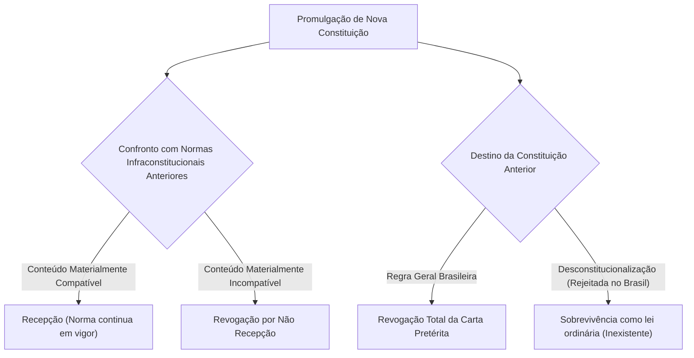
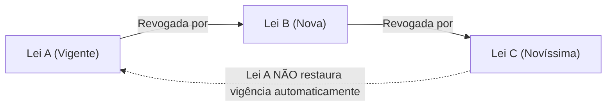
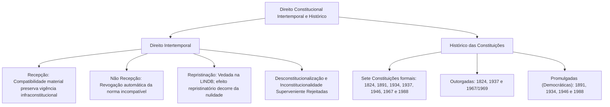

A sucessão de ordens constitucionais instaura um dos temas mais instigantes da hermenêutica jurídica: o direito constitucional intertemporal. Quando uma nova Carta Magna entra em vigor, impõe-se definir o destino das normas infraconstitucionais pretéritas e o tratamento dispensado ao próprio texto constitucional revogado. Conceitos como recepção, repristinação, desconstitucionalização e mutação constitucional definem a validade, a vigência e a eficácia das regras no tempo.

Em estreita correlação, a compreensão do ordenamento vigente pressupõe o conhecimento da trajetória histórica das Constituições brasileiras. Desde o texto imperial outorgado de 1824 até a Carta Cidadã de 1988, cada diploma refletiu momentos políticos singulares, alternando períodos autoritários e democráticos e introduzindo progressivamente os remédios constitucionais e as ferramentas de controle de constitucionalidade.

Neste capítulo, estudaremos as regras do direito intertemporal adotadas pela jurisdição brasileira e analisaremos a evolução histórico-constitucional do país, destacando as marcas institucionais cobradas em certames públicos.

> [!objetivos]
> - Compreender os fenômenos da recepção e da revogação por não recepção no direito brasileiro.
> - Diferenciar a vedação à repristinação da LINDB do efeito repristinatório da declaração de nulidade na ADI.
> - Identificar a recusa brasileira às teses da desconstitucionalização e da inconstitucionalidade superveniente.
> - Reconhecer as características essenciais, origem e estrutura das sete Constituições republicanas e imperiais.
> - Mapear o momento histórico do surgimento de cada garantia e instituto de controle de constitucionalidade.

---

## Fenômenos do Direito Constitucional Intertemporal

A indagação central do direito intertemporal pode ser sintetizada de forma simples: o que ocorre com o direito pré-existente quando entra em vigor uma nova Constituição? A resposta depende do confronto substancial entre o conteúdo da norma antiga e a tábua axiológica do novo texto fundamental.

A tabela abaixo consolida os principais institutos do direito intertemporal e a postura consolidada da doutrina e da jurisprudência do Supremo Tribunal Federal:

| Fenômeno | Situação Fática | Consequência no Direito Brasileiro |
| :--- | :--- | :--- |
| **Recepção** | Lei anterior materialmente compatível com a nova Carta | Continua válida com novo fundamento constitucional |
| **Não Recepção** | Lei anterior materialmente incompatível com a nova Carta | Norma revogada por ausência de recepção (não há inconstitucionalidade) |
| **Repristinação** | Lei revogada volta a viger porque a revogadora perdeu eficácia | Vedada como regra geral (exige previsão expressa na LINDB) |
| **Efeito Repristinatório** | STF declara nula *ab initio* a norma que havia revogado outra | A norma anterior reata sua aplicabilidade prática |
| **Desconstitucionalização** | Normas da Carta antiga sobrevivem como lei ordinária | Não adotada no Brasil (exige previsão constitucional expressa) |
| **Inconstitucionalidade Superveniente** | Lei válida que se tornaria inconstitucional por nova Carta | Rejeitada pelo STF (o fenômeno é de revogação/não recepção) |
| **Constitucionalidade Superveniente** | Lei inválida na origem que seria convalidada por emenda posterior | Rejeitada pelo STF (o vício de inconstitucionalidade é congênito) |
| **Mutação Constitucional** | Alteração do sentido da norma sem alteração de texto | Adotada como manifestação do poder constituinte difuso |

---

## Recepção Constitucional

O advento de uma nova ordem constitucional não provoca uma tábula rasa legislativa. Em homenagem à segurança jurídica e à estabilidade das relações sociais, as leis ordinárias, decretos-leis e demais normas infraconstitucionais editadas sob a égide da Carta pretérita continuam válidas, desde que materialmente harmônicas com o novo texto supremo. Esse fenômeno denomina-se **recepção**.

O exame da recepção subordina-se a diretrizes rigorosas:

1. **Exclusividade da compatibilidade material**: Para que uma lei seja recepcionada, basta que seu **conteúdo substantivo** guarde consonância com a nova Constituição. Vícios formais de tramitação, de iniciativa ou de competência legislativa existentes à época de sua elaboração original não são reavaliados pela ótica da nova ordem.
2. **Mutação do status formal da espécie normativa**: A lei anterior é recepcionada com o status formal exigido pela nova Constituição para aquela matéria. O exemplo clássico reside no **Código Tributário Nacional (Lei nº 5.172/1966)**: foi editado como lei ordinária federal sob a ordem anterior, mas foi recepcionado pela Constituição de 1988 com o status de **lei complementar**, haja vista o comando do art. 146 da Carta Cidadã. Assim, o CTN somente pode ser alterado por nova lei complementar.
3. **Recepção expressa e implícita**: A regra geral é a recepção implícita e automática de todas as leis compatíveis. Excepcionalmente, o constituinte pode prever a recepção de modo expresso, a exemplo do **art. 34, § 5º, do ADCT**, que expressamente assegurou a aplicação da legislação tributária pretérita compatível até a edição de novas normas.

> [!bizu] Regra de Ouro do Direito Intertemporal
> - **Lei velha + Constituição nova**: Hipótese de **recepção** ou **revogação pura** (não cabe controle concentrado por ADI; utiliza-se a via difusa ou a ADPF).
> - **Lei nova + Constituição vigente**: Hipótese de **constitucionalidade** ou **inconstitucionalidade** (sujeita ao controle concentrado tradicional por ADI).

### Jurisprudência do STF sobre Recepção

No julgamento de diversos diplomas pretéritos, o Supremo Tribunal Federal construiu parâmetros definidores:
- **Lei de Imprensa (Lei nº 5.250/1967)**: O STF julgou a ADPF 130/DF e declarou a **não recepção integral** da lei, por colidir frontalmente com as liberdades republicanas de manifestação de pensamento e de imprensa.
- **Lei de Anistia (Lei nº 6.683/1979)**: No julgamento da ADPF 153/DF, a Corte assentou a plena **recepção** da lei, reconhecendo a anistia ampla e bilateral como marco político da redemocratização.
- **Código Penal Militar (Decreto-Lei nº 1.001/1969)**: O STF declarou a **não recepção** das expressões discriminatórias "pederastia ou outro" e "homossexual ou não" constantes do art. 235 do CPM (ADPF 291/DF), tutelando a igualdade e a dignidade humana.

---

## Repristinação e Efeito Repristinatório

A distinção conceitual entre repristinação normativa e efeito repristinatório da decisão judicial de inconstitucionalidade é frequentemente explorada em provas de concurso.

### A Repristinação na LINDB

A **repristinação** é o fenômeno legislativo pelo qual uma norma pretérita revogada volta a vigorar pelo simples fato de a norma que a revogou ter perdido a vigência (por revogação superveniente ou caducidade).

No direito brasileiro, a repristinação tácita é **expressamente vedada**, nos termos do art. 2º, § 3º, do Decreto-Lei nº 4.657/1942 (Lei de Introdução às Normas do Direito Brasileiro - LINDB):

> [!lei] LINDB, art. 2º, § 3º
> "Salvo disposição em contrário, a lei revogada não se restaura por ter a lei revogadora perdido a vigência."

Dessa forma, a Lei "A", revogada pela Lei "B", não retorna à vigência quando uma terceira Lei "C" revoga a Lei "B", salvo se o texto da Lei "C" contiver mandamento expresso restaurando os efeitos da Lei "A".

### O Efeito Repristinatório na Jurisdição Constitucional

Situação estruturalmente diversa ocorre quando o Supremo Tribunal Federal declara a inconstitucionalidade de uma lei revogadora em sede de controle de constitucionalidade. Em razão da teoria da nulidade adotada pelo direito brasileiro (CF/88 e Lei nº 9.868/1999), o ato inconstitucional é portador de nulidade congênita e absoluta (*ex tunc*).

Por ser juridicamente nula desde a origem, a lei impugnada jamais possuiu aptidão válida para revogar a legislação anterior. Consequentemente, a norma pretérita que havia sido supostamente revogada tem sua vigência restabelecida. Não se trata de repristinação no sentido técnico da LINDB, mas sim de **efeito repristinatório** decorrente da nulidade original da norma inconstitucional.

> [!atencao] Repristinação Indesejada e Impugnação do Complexo Normativo
> Para evitar que a declaração de inconstitucionalidade restaure uma norma anterior igualmente viciada (efeito repristinatório indesejado), o autor da ação de controle abstrato deve cumular o pedido, impugnando tanto a norma atual quanto o diploma legislativo precedente por ela revogado.

---

## Desconstitucionalização e Inconstitucionalidade Superveniente

Dois outros conceitos clássicos completam a teoria do direito constitucional intertemporal:

### A Tese da Desconstitucionalização

A **desconstitucionalização** é o fenômeno pelo qual as normas da Constituição anterior, materialmente compatíveis com a nova ordem fundamental, perderiam seu status hierárquico constitucional, mas continuariam em vigor no ordenamento jurídico sob a roupagem de leis infraconstitucionais (leis ordinárias).

O ordenamento jurídico brasileiro **rejeita a desconstitucionalização**. A promulgação de uma nova Carta Magna acarreta a revogação global e integral do texto constitucional precedente. As únicas normas pretéritas que sobrevivem são as normas infraconstitucionais recepcionadas. Para que ocorresse desconstitucionalização no Brasil, seria indispensável previsão expressa e inequívoca no novo texto constitucional, o que inexistiu na Carta de 1988.

### Inexistência de Inconstitucionalidade Superveniente

No ordenamento pátrio, a conformidade de uma lei afere-se perante o parâmetro constitucional vigente no momento de sua edição originária:
- **Inconstitucionalidade superveniente**: Se uma lei federal ou estadual era válida quando editada e surge posteriormente uma nova Constituição com ela incompatível, a doutrina do STF rejeita a pecha de inconstitucionalidade superveniente. Opera-se a mera **revogação pura por ausência de recepção**.
- **Constitucionalidade superveniente**: De modo inverso, se uma lei nasceu inconstitucional por afrontar a Carta então vigente, a superveniência de uma emenda constitucional que altere o parâmetro e passe a autorizar aquele teor não possui o condão de "curar" ou convalidar a lei viciada. O vício congênito de nulidade é insanável. Para que a disciplina passe a vigorar, o Poder Legislativo deve promulgar uma nova lei.

### Mutação Constitucional

A **mutação constitucional** consiste na alteração do sentido, conteúdo e alcance da norma constitucional sem qualquer modificação em seu texto formal. Trata-se de um processo informal de mudança da Constituição, decorrente de interpretação pretoriana evolutiva, transformações nos costumes sociais ou novas práticas políticas.

> [!exemplo] Mutação Constitucional na Prática Forense
> O Supremo Tribunal Federal operou mutação constitucional ao reconhecer a união contínua entre pessoas do mesmo sexo como entidade familiar protegida pelo Estado (ADI 4.277/DF), conferindo nova densidade ao art. 226, § 3º, da Carta Magna sem alterar uma única palavra de sua redação formal. De igual modo, a Súmula Vinculante 25 vedou a prisão do depositário infiel com base no Pacto de São José da Costa Rica.

---

## Histórico das Constituições Brasileiras

O constitucionalismo brasileiro desenvolveu-se ao longo de mais de dois séculos, consolidando **sete Constituições formais**: 1824, 1891, 1934, 1937, 1946, 1967 e 1988. Parte relevante da doutrina considera a **Emenda Constitucional nº 1, de 17 de outubro de 1969**, como uma oitava Constituição, tendo em vista que reescreveu exaustivamente o diploma de 1967.

> [!pegadinha] Classificação da Origem das Constituições
> Em certames públicos, as bancas frequentemente exploram a dicotomia entre Constituições outorgadas e promulgadas. São **outorgadas** (impostas sem participação popular) as de **1824, 1937 e 1967/1969**. São **promulgadas** (democráticas, nascidas de assembleias eleitas) as de **1891, 1934, 1946 e 1988**.

A tabela comparativa abaixo sintetiza os marcos fundamentais de cada texto:

| Constituição | Origem | Forma e Sistema de Governo | Principais Conquistas e Características |
| :--- | :--- | :--- | :--- |
| **1824** | **Outorgada** (D. Pedro I) | Monarquia imperial unitária | **Quatro Poderes** (Poder Moderador privativo do Imperador); voto censitário; religião católica oficial; Constituição **semirrígida** |
| **1891** | **Promulgada** (Democrática) | República federativa presidencialista | **Três Poderes**; Estado laico; criação do STF; introdução do **controle difuso** e do **habeas corpus**; Constituição rígida |
| **1934** | **Promulgada** (Segunda República) | República federativa presidencialista | Constitucionalismo social; **voto feminino** e secreto; criação do **mandado de segurança** e da **ação popular**; **reserva de plenário**; suspensão pelo Senado |
| **1937** | **Outorgada** (Getúlio Vargas) | Ditadura do Estado Novo | Apelidada de **"Polaca"**; Executivo hegemônico; pena de morte; retrocesso no controle (Parlamento podia manter lei anulada pelo STF por 2/3) |
| **1946** | **Promulgada** (Redemocratização) | República federativa presidencialista | Redemocratização; **inafastabilidade de jurisdição**; parlamentarismo temporário (1961-1963); criação da **representação de inconstitucionalidade (EC 16/1965)** |
| **1967** | **Outorgada** (Regime Militar) | Regime militar autoritário | Forte centralização na União; ampliação de poderes do Presidente; criação do **decreto-lei**; doutrina da segurança nacional |
| **1969 (EC 1)** | **Outorgada** (Ministros Militares) | Regime militar sob o AI-5 | Promulgada em recesso legislativo; reescreveu inteiramente o texto de 1967 com perfil autoritário e supressão de garantias |
| **1988** | **Promulgada** (Constituição Cidadã) | Estado Democrático de Direito | Redemocratização plena; rol analítico de direitos fundamentais; **mandado de injunção**, **habeas data** e **ADPF**; controle concentrado ampliado |

---

## Marcos Detalhados de Cada Constituição

### Carta Imperial de 1824
Outorgada por D. Pedro I em 25 de março de 1824 após dissolver a Constituinte de 1823. Criou **quatro poderes**, destacando-se o **Poder Moderador** (art. 98) privativo do Imperador, cuja pessoa era sagrada e inviolável. Foi a Carta mais longeva da história brasileira (65 anos) e possuía natureza **semirrígida** (art. 178), permitindo alterar regras comuns por lei ordinária.

### Primeira Constituição Republicana de 1891
Promulgada sob inspiração norte-americana, adotou a república federativa presidencialista e a clássica tripartição de Poderes. Instituiu o Estado laico, o casamento civil e o Supremo Tribunal Federal. Foi o berço do **controle difuso de constitucionalidade** e do *habeas corpus* com assento constitucional no Brasil.

### Constituição Social de 1934
Promulgada sob o influxo da Carta alemã de Weimar (1919), inaugurou os direitos sociais trabalhistas e previdenciários. Consagrou o **voto feminino** e secreto, criando a Justiça Eleitoral e do Trabalho. Introduziu o **mandado de segurança**, a **ação popular**, a representação interventiva, a **reserva de plenário** e a suspensão da lei pelo Senado.

### Constituição do Estado Novo de 1937 ("A Polaca")
Outorgada por Getúlio Vargas no golpe do Estado Novo, inspirada na Carta autoritária polonesa de 1935. Concentrou poderes no Executivo e previu pena de morte. No controle de constitucionalidade, permitiu ao Parlamento manter lei invalidada pelo STF pelo voto de dois terços (art. 96, parágrafo único).

### Restauração Democrática na Carta de 1946
Promulgada após o Estado Novo, restabeleceu o Estado de Direito e as liberdades civis. Fixou o princípio da **inafastabilidade de jurisdição** (art. 141, § 4º) e restabeleceu a ação popular. Pela **EC 16/1965**, criou a **representação de inconstitucionalidade** no STF pelo PGR, gênese do controle concentrado abstrato.

### Regime Militar e a Constituição de 1967 com a Emenda nº 1 de 1969
Institucionalizou o regime militar com forte centralização na União e ampliação dos poderes do Executivo por meio do **decreto-lei**. Em 1969, a junta militar outorgou a **Emenda Constitucional nº 1/1969**, que reescreveu inteiramente a Carta de 1967 com perfil autoritário e supressão de garantias fundamentais.

### Constituição Cidadã de 1988
Promulgada em 5 de outubro de 1988 por Assembleia Nacional Constituinte, refundou o Estado Democrático de Direito. Abre diretamente com os **princípios fundamentais** e o amplo catálogo de direitos e garantias individuais e sociais. Instituiu o **mandado de injunção**, o **habeas data**, a **ADPF** e ampliou a legitimação do controle concentrado no art. 103.

---

## Cronologia das Garantias e Remédios Constitucionais

Para consolidar as questões de histórico que cobram a primeira aparição de cada instituto no ordenamento constitucional brasileiro, a tabela abaixo organiza a cronologia evolutiva:

| Instituto ou Remédio Constitucional | Carta Magna de Origem |
| :--- | :--- |
| **Controle Difuso de Constitucionalidade** | Constituição de 1891 |
| ***Habeas Corpus* com Assento Constitucional** | Constituição de 1891 |
| **Mandado de Segurança** | Constituição de 1934 |
| **Ação Popular** | Constituição de 1934 (suprimida em 1937 e restaurada em 1946) |
| **Cláusula de Reserva de Plenário** | Constituição de 1934 |
| **Suspensão de Execução da Lei pelo Senado** | Constituição de 1934 |
| **Representação Interventiva de Constitucionalidade** | Constituição de 1934 |
| **Controle Concentrado Abstrato de Normas (ADI)** | Emenda Constitucional nº 16/1965 (sob a CF de 1946) |
| **Mandado de Injunção e *Habeas Data*** | Constituição de 1988 |
| **Arguição de Descumprimento de Preceito Fundamental** | Constituição de 1988 (CF, art. 102, § 1º) |
| **Ação Declaratória de Constitucionalidade (ADC)** | Emenda Constitucional nº 3/1993 (sob a CF de 1988) |

---

## Mapa do Capítulo

### Para fixar

- Recepção material: O direito infraconstitucional pretérito permanece em vigor desde que materialmente harmônico com a nova Carta, dispensando-se a conformidade formal de sua gênese originária.
- Revogação por não recepção: O diploma anterior incompatível com a nova ordem é revogado por não recepção, rejeitando o STF a tese de inconstitucionalidade superveniente.
- Repristinação versus efeito repristinatório: A repristinação legislativa tácita é vedada pelo art. 2º, § 3º, da LINDB, ao passo que o efeito repristinatório da ADI decorre da nulidade originária da lei inconstitucional declarada pelo STF.
- Desconstitucionalização recusada: A ordem brasileira não admite que textos constitucionais pretéritos sobrevivam com força de lei ordinária, inexistindo desconstitucionalização sem previsão expressa.
- Origem das Constituições: Foram outorgadas as Cartas de 1824, 1937 e 1967/1969, enquanto as Cartas de 1891, 1934, 1946 e 1988 resultaram de processos democráticos promulgados.
- Criação do mandado de segurança e ação popular: Ambos os remédios fundamentais nasceram formalmente no texto da Constituição social de 1934.
- Gênese da representação concentrada: O controle concentrado abstrato perante o STF foi instituído pela Emenda Constitucional nº 16/1965, durante a vigência da Constituição de 1946.
