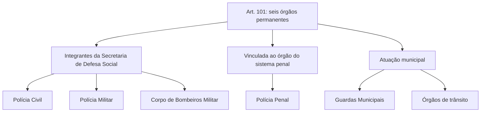

Os arts. 100 a 105-B da Constituição de Pernambuco são o núcleo do tema: dizem quem são os militares do Estado, o que eles podem e não podem fazer, como perdem o posto e a patente e quais órgãos formam o sistema de segurança pública. A banca cobra esses artigos quase palavra por palavra. O capítulo segue a ordem do texto e destaca os pontos em que a prova troca um prazo, um órgão ou uma autoridade. Há também uma atualização importante: o art. 101 ganhou dois incisos em 2026, e quem estuda por material antigo ainda lembra de quatro.

> [!objetivos]
> - Identificar quem são os militares do Estado e quais proibições e garantias a CE-PE lhes impõe.
> - Aplicar as regras de agregação, reserva e perda do posto e da patente.
> - Listar os seis órgãos permanentes da segurança pública do art. 101.
> - Diferenciar as missões da Polícia Civil, da Polícia Militar, do Corpo de Bombeiros e da Polícia Penal.
> - Reconhecer as regras sobre guardas municipais e segurança viária.

## Dos militares do Estado (art. 100)

O art. 100 define que são **militares do Estado** os membros da **Polícia Militar** e do **Corpo de Bombeiros Militar**. Os policiais civis não são militares: são servidores civis. O artigo tem catorze parágrafos, que podem ser agrupados em quatro assuntos.

### Patentes e símbolos

As **patentes**, com as prerrogativas, direitos e deveres que lhes correspondem, são asseguradas em toda a plenitude aos oficiais da ativa, da reserva e reformados. Quem as **confere é o Governador** (§ 1º). São privativos dos militares os títulos, os postos, as graduações, os uniformes, as insígnias e os distintivos (§ 2º).

### Cargos civis e agregação

A CE-PE trata de dois casos diferentes:

| Situação | Consequência |
| --- | --- |
| Militar da ativa **empossado em cargo público civil permanente** | transferido para a **reserva** (§ 3º), salvo nas acumulações lícitas do art. 37, XVI, da Constituição Federal, que valem para o militar estadual por força do art. 42, § 3º, da CF |
| Militar da ativa que aceita cargo, emprego ou função pública **temporária e não eletiva**, mesmo na administração indireta | fica **agregado** ao quadro (§ 4º) |

O agregado só pode ser promovido por **antiguidade**, e o tempo de serviço conta só para essa promoção e para a transferência para a reserva. Quando somar **dois anos de afastamento**, seguidos ou não, passa para a inatividade.

> [!pegadinha] Temporário não leva à reserva
> A banca diz que o militar que aceita função civil temporária passa logo para a reserva. Isso vale para o cargo civil **permanente**, e mesmo assim não se aplica quando a acumulação é permitida (por exemplo, um cargo de magistério). No caso temporário, ele fica agregado e só passa para a inatividade após dois anos de afastamento.

### Perda do posto e da patente

O oficial só perde o posto e a patente se for julgado **indigno do oficialato ou incompatível com ele**. Quem decide é o tribunal de justiça militar, se houver um, ou o Tribunal de Justiça do Estado, e a lei diz em quais casos o processo é instaurado e qual o seu rito (§ 5º). O comandante não decide.

Também vai a esse julgamento o oficial que, em sentença definitiva da Justiça comum ou da militar, receba pena de prisão **maior que dois anos** (§ 6º). A pena de exatamente dois anos não basta.

### Vedações e garantias

O militar tem proibida a **sindicalização** e a **greve**, e não pode, enquanto em efetivo exercício, estar **filiado a partido político** (§ 7º). A regra é mais rígida do que a do servidor civil, e a CE-PE a repete da Constituição Federal.

Há também garantias para a família do militar morto em serviço:

- O Estado promove **post mortem** o militar que falece em consequência de ferimento recebido em luta contra malfeitores, em ações de ordem pública, na prevenção ou combate de **incêndios**, em operações de **salvamento** de pessoas e bens, em **defesa civil**, em acidente de serviço ou em doença decorrente desses fatos (§ 8º).
- Os beneficiários recebem **pensão especial** igual à remuneração do posto ou da graduação alcançados, reajustável na mesma época e nos mesmos índices dos militares da ativa (§ 9º).

> [!pegadinha] Promoção post mortem não é só para combate ao crime
> A alternativa errada limita a promoção post mortem à morte em luta contra o crime. O texto inclui incêndio, salvamento, defesa civil, acidente de serviço e doença decorrente desses fatos. Para um bombeiro, esses são os casos centrais.

### Promoções, limite de idade e outras normas

As promoções são por **merecimento e antiguidade**, na forma da legislação própria (§ 10). A **lei** dispõe sobre limites de idade, estabilidade e outras condições de transferência para a inatividade (§ 11). Aplicam-se aos militares e, no que couber, aos pensionistas, o art. 40, §§ 7º e 8º, da Constituição Federal (§ 12). O § 13 manda aplicar ainda aos militares as regras federais dos arts. 14, § 8º (elegibilidade do militar), 37, XI (teto), 40, § 9º, 42, §§ 1º e 2º, e 142, §§ 2º e 3º, além do art. 171, §§ 4º, 6º a 12, da própria CE-PE.

Por fim, o militar **posto à disposição** de outro órgão continua em função militar quando o cargo em comissão ou a função de confiança que ocupa é, segundo a lei, de natureza policial militar ou bombeiro militar (§ 14).

> [!atencao] Limite de idade é matéria de lei militar
> A CE-PE não fixa o limite de idade para ingresso e transferência para a inatividade: a lei dispõe sobre isso. No art. 97, V, a Constituição diz que não há limite de idade para concurso, ressalvada a legislação militar. Os dois dispositivos se completam.

## Do sistema de segurança pública (arts. 101 e 102)

A segurança pública é **dever do Estado, direito e responsabilidade de todos**. Ela serve para preservar a ordem pública, a incolumidade das pessoas e do patrimônio e assegurar a liberdade e as garantias individuais. É exercida por **órgãos permanentes**, listados no art. 101.

Na redação atual, são **seis** órgãos:

| Inciso | Órgão | Origem |
| --- | --- | --- |
| I | Polícia Civil | texto original |
| II | Polícia Militar | texto original |
| III | Corpo de Bombeiros Militar | EC 4/1994 |
| IV | Polícia Penal, ligada ao órgão que administra o sistema penal | EC 53/2020 |
| V | Guardas Municipais | EC 70/2026 |
| VI | Órgãos e entidades executivos de trânsito, responsáveis pela segurança viária | EC 71/2026 |

Os §§ 1º e 2º do art. 101 dizem que as atividades de segurança pública são **organizadas em sistema**, na forma da lei, e que cabe ao **Governador**, assessorado pelo **Conselho de Defesa Social**, estabelecer a política de defesa social e coordenar as ações.

O art. 102 afirma que a Polícia Civil, a Polícia Militar e o Corpo de Bombeiros são **integrantes da Secretaria de Estado responsável pela defesa social**. A Polícia Penal fica **ligada ao órgão que administra o sistema penal**. Todos se regem por estatutos próprios, estruturam-se em carreira e têm por princípios a **hierarquia e a disciplina**.

> [!pegadinha] Integrar ou ser vinculada
> Civil, Militar e Bombeiros integram a Secretaria; a Polícia Penal apenas se liga ao órgão do sistema penal. Trocar "integrante" por "vinculada" é erro clássico. Outro erro frequente é lembrar só dos quatro primeiros órgãos, como no texto antigo do art. 101.

> [!bizu] Siglas do art. 101
> Pense em Civil, Militar, Bombeiros, Penal, Guardas e Trânsito. Os dois últimos incisos são de 2026 e a prova recente começa a cobrá-los. A ementa da Emenda 71 fala em "agências municipais de trânsito", mas vale o inciso VI, que tem redação mais ampla.

## Polícia Civil e Polícia Penal (arts. 103 e 104)

A **Polícia Civil** é dirigida por **delegado de polícia**, no último nível da carreira, e subordinada ao Governador. Cabe a ela, em caráter privativo e sem afastar a competência da União, atuar como **polícia judiciária** e investigar os crimes comuns, **não os crimes militares**, além de reprimir a criminalidade. O cargo de delegado é privativo de bacharel em Direito e integra as carreiras jurídicas típicas de Estado.

A lei deve criar órgãos próprios para:

1. **perícias** criminais, médico-legais e identificação civil e criminal;
2. apuração dos **atos infracionais** de menores, conforme a lei federal;
3. **vistoria e matrícula** de veículos e exames de habilitação de condutores.

O órgão de perícias tem **independência técnica e científica**, e tem como diretor um médico-legista ou um perito-criminal que esteja no topo da carreira, e esse diretor participa do Conselho de Defesa Social. Já o órgão de identificação não exige cargo específico: o chefe do Executivo escolhe livremente o dirigente, desde que seja servidor de nível superior da Polícia Civil.

A **Polícia Penal** se liga ao órgão do sistema penal e cuida da **segurança dos estabelecimentos penais**. O quadro é preenchido exclusivamente por **concurso público** e pela **transformação do cargo de Agente de Segurança Penitenciária**. A palavra "exclusivamente" costuma aparecer na prova.

## Polícia Militar e Corpo de Bombeiros (art. 105)

> [!lei] CE-PE, art. 105
> A polícia Militar, força auxiliar e reserva do Exército, cabe com exclusividade a polícia ostensiva e a preservação da ordem pública; e ao Corpo de Bombeiros Militar, também força auxiliar e reserva do Exército, cabe a execução das atividades da defesa civil, além de outras atribuições definidas em Lei.
> Parágrafo único. Os Comandantes Gerais da Polícia Militar e do Corpo de Bombeiros Militar serão nomeados em comissão pelo Governador do Estado entre os oficiais da ativa do último posto de cada Corporação.

O artigo distribui as missões. A **Polícia Militar** faz, com exclusividade, o policiamento ostensivo e a preservação da ordem pública. O **Corpo de Bombeiros** executa a **defesa civil** e as demais atribuições que a lei lhe der. As duas corporações são forças auxiliares e reservas do Exército.

No parágrafo único, o chefe de cada corporação é o Comandante-Geral, escolhido pelo **Governador** entre os oficiais da ativa que estão no **último posto**, em nomeação em comissão. Não há lista tríplice nem eleição interna.

| Órgão | Missão principal | Característica |
| --- | --- | --- |
| Polícia Civil | polícia judiciária, exceto infrações militares | dirigida por delegado de polícia |
| Polícia Militar | polícia ostensiva e preservação da ordem pública | força auxiliar e reserva do Exército |
| Corpo de Bombeiros | defesa civil e outras atribuições legais | força auxiliar e reserva do Exército |
| Polícia Penal | segurança dos estabelecimentos penais | ligada ao órgão do sistema penal |

> [!atencao] Comandante-Geral
> O Comandante-Geral é cargo em comissão, mas só pode ser ocupado por oficial da ativa do último posto da corporação. A nomeação é privativa do Governador, e o ato dispensa aprovação da Assembleia.

## Guardas municipais e segurança viária: arts. 105-A e 105-B

O art. 105-A diz que os Municípios **poderão** constituir guardas municipais para a prevenção, a proteção e a preservação de seus **bens, serviços e instalações**, observada a lei federal (Lei 13.022/2014, Estatuto Geral das Guardas Municipais). O verbo "poderão" mostra que se trata de **faculdade**, e não de dever.

O art. 105-B trata da **segurança viária**: a atividade exercida para preservar a ordem pública e a incolumidade das pessoas e do patrimônio nas vias públicas. Ela compreende **educação, engenharia e fiscalização de trânsito**, e fica a cargo dos órgãos e entidades de trânsito do Estado e de cada Município, cada um em seu território. Os agentes de trânsito devem estar organizados em **carreira**, e não em cargos isolados ou comissionados.

Na prova, vale notar a relação entre os dois artigos. A segurança viária só virou órgão permanente do art. 101 em 2026 (inciso VI), mas já era matéria do art. 105-B desde 2020. Os guardas municipais, por sua vez, só entraram no rol do art. 101 em 2026 (inciso V), enquanto o art. 105-A já tratava deles. Por isso, a banca pode cobrar tanto o rol atual como a faculdade dos Municípios.

## Mapa do capítulo

O esquema reúne os pontos mais cobrados do bloco de segurança pública da CE-PE.

### Para fixar
- São militares do Estado os membros da Polícia Militar e do Corpo de Bombeiros; as patentes são conferidas pelo Governador.
- O militar empossado em cargo civil permanente vai para a reserva; o que aceita função temporária fica agregado e passa à inatividade após dois anos.
- O oficial só perde o posto e a patente por decisão do Tribunal de Justiça (Militar, se existir), por indignidade ou incompatibilidade.
- A condenação que leva o oficial ao julgamento é a pena privativa de liberdade superior a dois anos, com trânsito em julgado.
- Ao militar são proibidas a sindicalização, a greve e a filiação partidária enquanto em exercício.
- A promoção post mortem abrange morte em luta contra malfeitores, incêndio, salvamento, defesa civil, acidente de serviço e doença decorrente.
- O art. 101 tem seis órgãos: Polícia Civil, Polícia Militar, Bombeiros, Polícia Penal, Guardas Municipais e trânsito.
- Civil, Militar e Bombeiros integram a Secretaria de defesa social; a Polícia Penal é ligada ao órgão do sistema penal.
- À PM cabe com exclusividade a polícia ostensiva; ao CBM, a defesa civil.
- O Governador nomeia em comissão o Comandante-Geral da PM e o do CBM, escolhendo oficiais da ativa do último posto de cada corporação.
