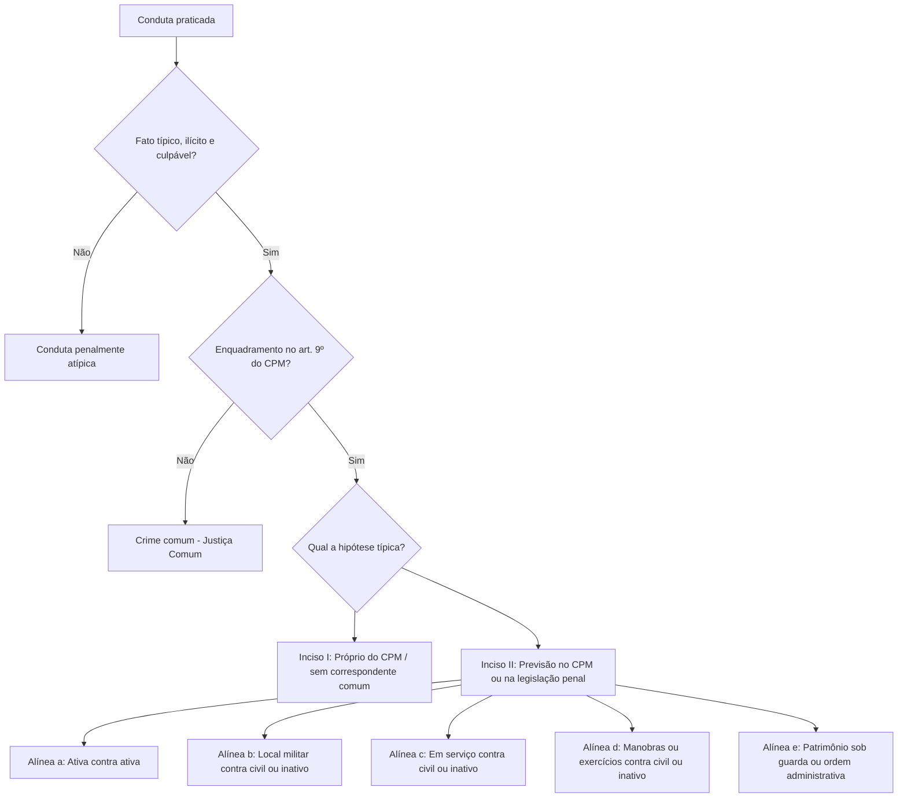

O Direito Penal Militar é o ramo especializado encarregado de proteger os pilares constitucionais das instituições militares: a hierarquia e a disciplina. O estudo da aplicação da lei penal militar no tempo, no espaço e a correta identificação do crime militar constitui a base indispensável para a resolução das questões de prova. Este capítulo examina as regras constitucionais da matéria, distingue os crimes próprios dos impróprios e detalha minuciosamente as hipóteses dos incisos I e II do artigo 9º do Código Penal Militar, com as alterações da Lei 14.688/2023.

> [!objetivos]
> - Distinguir os crimes propriamente militares dos impropriamente militares segundo as correntes doutrinárias.
> - Aplicar a lei penal militar no tempo e no espaço, reconhecendo a teoria mista e a extraterritorialidade incondicionada.
> - Identificar a forma de cômputo dos prazos penais e a detração internacional da pena.
> - Compreender a tipicidade indireta e classificar os fatos nas hipóteses do artigo 9º, incisos I e II, do CPM.

## Crimes propriamente e impropriamente militares

O texto constitucional estabelece distinções expressas para os crimes militares. O artigo 5º, inciso LXI, da Carta Magna dispõe que ninguém será preso senão em flagrante delito ou por ordem escrita e fundamentada de autoridade judiciária competente, salvo nos casos de transgressão militar ou crime propriamente militar definidos em lei.

Apesar de sua previsão na Constituição, o Código Penal Militar (Decreto-Lei nº 1.001/1969) não definiu expressamente as expressões "crime propriamente militar" e "crime impropriamente militar". Diante do silêncio normativo, a doutrina penal estruturou quatro correntes explicativas.

A tabela comparativa a seguir sintetiza as correntes que tratam da classificação dos crimes militares.

| Corrente doutrinária | Crime propriamente militar | Crime impropriamente militar | Solução para a insubmissão |
| --- | --- | --- | --- |
| Clássica (Célio Lobão) | Praticado unicamente por militar e tipificado apenas no CPM | Praticado por militar ou civil, ou com paralelo na lei comum | Crime propriamente militar por exceção após a incorporação |
| Processual (Jorge Romeiro) | Ação penal militar só pode ser proposta em face de militar | Ação penal militar pode ter como sujeito passivo um civil | O autor só passa a réu processual após formalmente incorporado |
| Topográfica | Infrações agrupadas no artigo 9º, inciso I, do CPM | Infrações agrupadas no artigo 9º, incisos II e III, do CPM | Fundamenta-se apenas na localização topográfica do dispositivo |
| Tricotômica | Cometido privativamente por militar nas hipóteses do CPM | Cometido por qualquer agente ou com duplicidade de normas | Insere a figura autônoma dos chamados delitos tipicamente militares |

Pela corrente clássica, formulada pelo jurista Célio Lobão, o crime propriamente militar exige dois requisitos simultâneos: o agente deve necessariamente ostentar a condição de militar (crime de mão própria) e a conduta deve estar tipificada com exclusividade no Código Penal Militar. Exemplos flagrantes residem na deserção (art. 187), no motim (art. 149) e na violência contra superior (art. 157). De outro lado, o crime impropriamente militar seria aquele suscetível de cometimento por militar ou civil, ou que encontra correspondência típica na legislação penal comum, tais como o furto, o homicídio e o estelionato.

Surge, contudo, a controvérsia sobre a **insubmissão** (art. 183 do CPM), delito que pune o convocado que deixa de apresentar-se no prazo legal para incorporação. Como o convocado ainda é civil no instante da recusa, indaga-se sua natureza jurídica.

Para a corrente clássica, a insubmissão configura um crime propriamente militar por **exceção**. Esse enquadramento decorre do artigo 464 do Código de Processo Penal Militar, o qual condiciona a persecução processual penal à apresentação ou captura do faltoso e sua subsequente submissão à inspeção de saúde com efetiva incorporação às Forças Armadas.

A corrente de Jorge Alberto Romeiro resolve a questão sob o ângulo do polo passivo processual: crime propriamente militar é aquele em que a ação penal só pode ser instaurada contra réu militar. Como o insubmisso somente é processado após consumada sua incorporação formal, a ação penal somente o alcança quando já investido no status militar.

A corrente topográfica, vista como reducionista pela doutrina predominante, sustentou que os crimes do inciso I seriam próprios e os dos incisos II e III seriam impróprios. Todavia, como o inciso I abrange crimes que civis podem cometer em certas hipóteses contra as instituições federais, essa classificação não se sustenta.

> [!atencao] Padrão das bancas examinadoras
> Nas provas, adota-se predominantemente a **corrente clássica**: crime propriamente militar é o previsto unicamente no CPM e cometido privativamente por militar, albergando a insubmissão como exceção legal condicionada à incorporação.

## Princípio da legalidade e medidas de segurança

A ordem militar consagra o princípio da legalidade e da anterioridade da norma penal. O artigo 1º do CPM consagra o postulado da reserva legal: nenhuma conduta humana pode ser punida como crime sem que norma legal prévia a tipifique expressamente, assim como nenhuma sanção penal militar pode ser aplicada sem prévia fixação legislativa. Esse preceito afasta a analogia desfavorável e exige lei formal anterior para definir condutas delituosas e estipular penalidades.

Cabe analisar também a aplicação temporal das **medidas de segurança**. O CPM (art. 110, com redação dada pela Lei nº 14.688/2023) estabelece que as medidas de segurança dividem-se em pessoais e patrimoniais. As pessoais subdividem-se em detentivas (internação em estabelecimento de custódia e tratamento ou seção especial) e não detentivas (tratamento ambulatorial, interdição de licença para dirigir veículo automotor, exílio local e proibição de frequentar determinados lugares). As medidas patrimoniais compreendem a interdição de estabelecimento e o confisco. O artigo 3º disciplina a incidência temporal dessas medidas: determina a aplicação da legislação que estiver vigorando na data em que o julgador prolatar a sentença, com preferência para a lei do período do cumprimento da medida caso sobrevenha modificação normativa ulterior.

Doutrinadores apontam que essa regra afronta o princípio constitucional da irretroatividade da lei penal mais gravosa (CF, art. 5º, XL). No entanto, o artigo permanece válido na legislação militar positivada e não foi anulado pelo Supremo Tribunal Federal. Além disso, quando a lei posterior abranda a medida de segurança, sua incidência no momento da sentença materializa a retroatividade da norma mais benéfica.

> [!pegadinha] Aplicação temporal das medidas de segurança
> A literalidade do art. 3º do CPM costuma ser cobrada em provas de concurso: para assertivas literais, considere correta a previsão de que a medida de segurança se subordina à lei do momento da sentença, prevalecendo a da fase de cumprimento se for distinta.

## Aplicação da lei penal militar no tempo

A incidência temporal das leis penais militares rege-se pelos postulados fundamentais da irretroatividade gravosa e da retroatividade benigna.

> [!lei] CPM, art. 2º
> Ninguém pode ser punido por fato que lei posterior deixa de considerar crime, cessando em virtude dela a execução e os efeitos penais da sentença condenatória.
> § 1º A lei posterior que, de qualquer outro modo, favorece o agente, aplica-se retroativamente, ainda quando já tenha sobrevindo sentença condenatória irrecorrível.
> § 2º Para se reconhecer qual a mais favorável, a lei posterior e a anterior devem ser consideradas separadamente, cada qual no conjunto de suas normas aplicáveis ao fato.

A Lei nº 14.688/2023 atualizou a redação do caput do artigo 2º, estabelecendo que a *abolitio criminis* faz cessar a execução e os efeitos penais da condenação, permanecendo incólumes os efeitos secundários de índole civil. O § 1º reafirma a retroatividade irrestrita da *lex mitior* (*novatio legis in melius*), inclusive após trânsito em julgado.

### Vedação à combinação de leis

O § 2º do artigo 2º consagra expressamente a **vedação à combinação de leis** (*lex tertia*). O juiz militar, ao verificar qual diploma é mais favorável ao réu, deve examinar a lei revogada e a lei superveniente isoladamente, considerando cada qual em seu conjunto integral. Não é lícito cindir preceitos normativos, aproveitando a pena-base menor de uma lei e a causa de diminuição de outra, sob pena de usurpação da competência constitucional do legislador.

> [!pegadinha] Criação judicial de terceira lei
> O Código Penal Militar veda terminantemente a combinação de leis em seu art. 2º, § 2º, diretriz também consagrada pelo STJ na Súmula 501. O magistrado é obrigado a escolher uma única norma em seu bloco integral.

### Leis excepcionais e temporárias

O artigo 4º do CPM regula as normas de vigência autolimitada. Mesmo após encerrado o prazo prefixado de vigência ou superado o estado emergencial motivador da edição da norma temporária ou excepcional, seus preceitos continuam sendo aplicados aos fatos ilícitos perpetrados sob seu domínio.

A lei temporária traz prefixada a data de sua cessação, enquanto a lei excepcional vigora durante situação emergencial ou de calamidade. Ambas operam com **ultratividade**: alcançam condutas praticadas durante a sua vigência mesmo que o julgamento ocorra após a sua revogação natural, impedindo a impunidade intencional decorrente do decurso do tempo.

### Tempo do crime e crimes permanentes

Quanto ao tempo do crime militar, o artigo 5º do CPM acolheu a **teoria da atividade**: considera-se praticado o crime no momento da ação ou da omissão, ainda que outro seja o do resultado.

Aplica-se a norma penal vigente no momento da conduta humana, desconsiderando a data posterior do evento lesivo. Todavia, impõe-se a ressalva dos crimes permanentes e continuados:

> [!jurisprudencia] STF, Súmula 711
> A lei penal mais grave aplica-se ao crime continuado ou ao crime permanente, se a sua vigência é anterior à cessação da continuidade ou da permanência.

Nos crimes de deserção e insubmissão, reputados permanentes, a consumação se protrai continuamente enquanto persistir a ausência ilegal. Se sobrevier alteração legal gravosa antes da cessação da permanência (pela apresentação voluntária ou pela captura do militar), a lei nova mais severa incidirá integralmente sobre o agente, em harmonia com a Súmula 711 do STF.

## Aplicação da lei penal militar no espaço e contagem de prazos

No plano espacial, a fixação do lugar do delito difere das regras do Direito Penal comum.

> [!lei] CPM, art. 6º
> Considera-se praticado o fato, no lugar em que se desenvolveu a atividade criminosa, no todo ou em parte, e ainda que sob forma de participação, bem como onde se produziu ou deveria produzir-se o resultado. Nos crimes omissivos, o fato considera-se praticado no lugar em que deveria realizar-se a ação omitida.

O artigo 6º estruturou a **teoria mista**:
1. Para crimes **comissivos**, adota-se a **teoria da ubiquidade** (lugar da conduta e lugar do resultado).
2. Para crimes **omissivos**, adota-se a **teoria da atividade** (lugar onde a conduta devida deveria ter sido realizada).

A tabela abaixo contrasta as regras de tempo e lugar entre os estatutos penais.

| Instituto | Código Penal Militar | Código Penal Comum | Fundamento no CPM |
| --- | --- | --- | --- |
| Tempo do crime | Teoria da Atividade | Teoria da Atividade | Art. 5º |
| Lugar: Crimes Comissivos | Teoria da Ubiquidade | Teoria da Ubiquidade | Art. 6º, 1ª parte |
| Lugar: Crimes Omissivos | Teoria da Atividade | Divergência teórica | Art. 6º, parte final |
| Denominação do Lugar | Teoria Mista | Teoria da Ubiquidade | Art. 6º integral |

> [!bizu] Lugar do crime no CPM: teoria mista
> Lembre-se: no CPM vigora a Teoria Mista para o lugar do crime, pois conjuga a ubiquidade nas ações comissivas com a atividade nos comportamentos omissivos puros ou impróprios.

### Territorialidade temperada e extraterritorialidade incondicionada

O artigo 7º do CPM disciplina o alcance espacial da legislação militar brasileira. Pelo caput, a jurisdição penal militar estende-se a infrações cometidas total ou parcialmente em solo nacional ou fora das fronteiras do país, ressalvadas normas e convenções internacionais, mesmo que o agente já responda a processo penal ou tenha sido julgado por tribunal no estrangeiro.

O princípio acolhido quanto ao território nacional é o da **territorialidade temperada**: a lei aplica-se aos fatos cometidos no país, ressalvadas as imunidades decorrentes de tratados internacionais.

Em contrapartida, no que concerne aos delitos cometidos no estrangeiro, o CPM consagra a **extraterritorialidade incondicionada (irrestrita)**. A norma militar incide mesmo diante de persecução penal em curso ou de sentença absolutória ou condenatória proferida por tribunal estrangeiro, sem exigir condições do Código Penal comum como entrada do autor no país ou dupla tipicidade.

Consideram-se extensão ficta do território pátrio as embarcações e aeronaves sob comando ou requisição militar oficial, em qualquer localidade em que naveguem ou sobrevoem, inclusive se pertencentes a entidades particulares (art. 7º, § 1º). Adicionalmente, o § 3º define como navio qualquer veículo náutico colocado sob comando de autoridade militar, desde belonaves de combate até embarcações táticas de apoio.

### Detração penal internacional

Para neutralizar a duplicidade punitiva (*bis in idem*) decorrente da extraterritorialidade incondicionada, o artigo 8º do CPM disciplina a detração no exterior: a punição corporal cumprida fora do país atenua a sanção imposta no Brasil pelo mesmo delito se de naturezas diversas, ou é abatida integralmente quando forem homogêneas.

Se a sanção cumprida no exterior e a pena imposta no Brasil forem homogêneas (privativas de liberdade), opera-se o abatimento aritmético integral (**computada**). Se forem heterogêneas (restritiva de direitos cumprida fora e reclusão aplicada aqui), a sanção externa funcionará como causa de **atenuação** judicial obrigatória.

### Cômputo de prazos no Direito Penal Militar

O cômputo dos prazos penais é matéria de estrita legalidade. O artigo 16 do CPM fixa a regra de direito penal material: inclui-se na contagem o dia inicial, desprezando-se as frações diárias e horárias e observando-se as unidades do calendário oficial gregoriano.

No prazo penal de direito material (prescrição, decadência, cumprimento de pena), inclui-se o dia inicial na contagem, desprezando-se as frações de hora e de dia.

> [!pegadinha] Distinção de contagem de prazos
> O prazo penal material (CPM, art. 16) **inclui o dia do começo** e não se prorroga para o dia útil subsequente. O prazo processual penal (CPP, art. 798, § 1º, aplicável subsidiariamente) exclui o dia do começo, computa o do vencimento e prorroga-se caso termine em feriado ou fim de semana.

## Conceito de crime militar e tipicidade indireta

Na teoria dogmática geral, o crime configura fato típico, ilícito e culpável. No Direito Penal Militar, todavia, a caracterização delitiva exige um elemento vinculante adicional: a **tipicidade indireta**.

Para que uma conduta seja crime militar, não basta subsunção à Parte Especial do CPM. Exige-se que o fato amolde-se obrigatoriamente às hipóteses do artigo 9º (tempo de paz) ou do artigo 10 (tempo de guerra). Sem essa tipicidade integradora, o fato, ainda que configure ilícito abstrato, perde a natureza militar e deve ser remetido à Justiça Comum.

O critério reitor adotado no Brasil para a definição do crime militar é o **ratione legis** (em razão da lei). É crime militar o que a legislação infraconstitucional expressamente rotula como tal. Os demais critérios (*ratione personae*, *ratione loci*, *ratione temporis* e *ratione materiae*) atuam como critérios operacionais internos distribuídos nos incisos e alíneas do artigo 9º.

## Crimes militares em tempo de paz: art. 9º, inciso I

O artigo 9º, inciso I, do CPM tipifica como delitos militares em tempo de paz aqueles tipificados no próprio texto militar que não encontrem paralelo na legislação comum extravagante ou que nesta recebam definição material diversa, independentemente de quem seja o autor, ressalvadas previsões específicas.

Este dispositivo rege-se pelo critério **ratione materiae** e abrange dois grupos de delitos:
1. Crimes que **não possuem paralelo** na lei penal comum: condutas concebidas para tutelar deveres funcionais militares, como motim (art. 149), deserção (art. 187) e abandono de posto (art. 195).
2. Crimes previstos no CPM com **definição essencialmente diversa** da legislação comum: exigem discrepância material estrutural nos elementos objetivos ou subjetivos típicos.

O preceito enuncia que o enquadramento se dá "qualquer que seja o agente". Quando cometido por militar da ativa, a subsunção ao inciso I é suficiente e imediata. Todavia, quanto a militares inativos e civis, subsiste dissídio doutrinário:
- Corrente minoritária: dispensa complemento, argumentando que a norma organizatória da Justiça Militar da União confere competência aos juízes federais da Justiça Militar para julgar civis nos incisos I e III.
- Corrente majoritária (Cícero Coimbra Neves): sustenta que para alcançar inativo ou civil é imperativo que o fato atente contra as instituições militares nos termos das alíneas do inciso III, já que este declara abranger as matérias do inciso I.

Tomemos como ilustração o tipo do art. 155 do CPM (estímulo à desobediência de ordens ou à indisciplina militar). Se perpetrado por bombeiro da ativa, enquadra-se de plano no inciso I. Se cometido por militar reformado ou civil, a configuração como crime militar exigirá vínculo com uma das alíneas do inciso III (como ato praticado contra tropa em manobra ou formatura).

## Crimes militares em tempo de paz: art. 9º, inciso II

O inciso II do artigo 9º é o dispositivo de maior incidência nas provas, cuidando das condutas com dupla previsão ou originárias da legislação extravagante.

> [!lei] CPM, art. 9º, II
> II – os crimes previstos neste Código e os previstos na legislação penal, quando praticados:
> a) por militar da ativa contra militar na mesma situação;
> b) por militar da ativa, em lugar sujeito à administração militar, contra militar da reserva ou reformado ou contra civil;
> c) por militar em serviço ou atuando em razão da função, em comissão de natureza militar, ou em formatura, ainda que fora do lugar sujeito à administração militar contra militar da reserva, ou reformado, ou civil;
> d) por militar, durante o período de manobras ou exercício, contra militar da reserva ou reformado ou contra civil;
> e) por militar da ativa contra o patrimônio sob a administração militar ou contra a ordem administrativa militar;

A Lei nº 13.491/2017 ampliou o caput do inciso II para abarcar os crimes previstos na **legislação penal comum extravagante** (crimes militares por extensão). Paralelamente, a Lei nº 14.688/2023 retirou o termo "assemelhado" das alíneas do Código Penal Militar.

### Alínea a: ativa contra ativa

A alínea a estrutura-se no critério subjetivo (*ratione personae*): pune os crimes praticados por militar da ativa contra militar na mesma situação.

A condição de militar da ativa inicia-se com a incorporação ou matrícula e encerra-se com a passagem para a inatividade. Estar em atividade não se confunde com estar de serviço: o militar permanece na ativa durante folgas, férias ou repouso domiciliar.

Sobre o crime praticado por militar da ativa contra militar da ativa fora do quartel e de folga, há duas posições relevantes:

1. **Posição do Superior Tribunal Militar (STM) e literalidade da lei**: adota o critério estritamente *ratione personae*. Para o STM, basta que autor e vítima sejam militares em situação de atividade. O delito é militar ainda que ambos estejam de folga, à paisana, em local civil e motivados por desavença particular, mesmo sem saberem da condição militar mútua.
2. **Posição do Supremo Tribunal Federal (STF) e do Superior Tribunal de Justiça (STJ)**: exige nexo funcional ou ofensa às instituições militares. Quando militares da ativa se desentendem fora do quartel por razões estritamente privadas (como desavença de trânsito em lazer ou violência doméstica familiar no lar), sem ligação com o serviço militar, a competência é da Justiça Comum.

Em concursos, a banca costuma cobrar a **literalidade do CPM** e a jurisprudência do STM (crime militar). Contudo, se a questão invocar expressamente o STF/STJ ou tratar de violência doméstica familiar, assinale a competência da Justiça Comum.

> [!jurisprudencia] STM: militar da ativa contra militar da ativa
> Na jurisprudência consolidada do STM, havendo agressão entre militares em situação de atividade, ambos de folga em estabelecimento comercial e sem farda, incide a alínea a do art. 9º, II, do CPM, pelo critério estritamente *ratione personae*.

### Alínea b: lugar militar

A alínea b funda-se no critério espacial (*ratione loci*). Exige que o militar da ativa cometa o crime no interior de local sob administração militar contra civil ou militar inativo (reserva ou reformado). Não se exige que o autor militar esteja escalado em serviço.

Para atender à qualificação de **lugar sujeito à administração militar**, a doutrina destaca três critérios principais:
1. **Fixação ou amplitude**: espaço físico estável (quartéis, bases aéreas, capitanias, grupamentos de bombeiros) ou meio móvel com espaço para abrigar contingente sob comando militar (navios e aeronaves de transporte militar). Bens móveis individuais e de pequeno porte, como uma bicicleta particular ou uma barraca individual de camping, não atendem a esse requisito.
2. **Disponibilidade**: a autoridade militar deve possuir a posse, o uso e a administração direta e efetiva do espaço, mesmo que temporária.
3. **Segurança e guarnição**: presença de postos de guarda, sentinelas ou defensas físicas militares visíveis.

> [!pegadinha] Próprio Nacional Residencial (PNR)
> O Próprio Nacional Residencial (PNR), imóvel funcional destinado à habitação familiar particular do militar, **não constitui lugar sujeito à administração militar**. Trata-se de asilo inviolável domiciliar (CF, art. 5º, XI). Infrações praticadas em seu interior submetem-se à Justiça Comum. Postos bancários e cantinas comerciais terceirizadas no quartel também não caracterizam local militar.

Por outro lado, uma base operacional avançada montada em tendas de campanha pelo Corpo de Bombeiros Militar para coordenar socorros públicos, guarnecida e sob comando de oficial, é considerada lugar sujeito à administração militar.

### Alínea c: militar em serviço

Na alínea c, a infração decorre de atuação em serviço, comissão de natureza militar ou formatura contra civil ou militar inativo. O critério definidor é o **ratione materiae**.

Diferindo das alíneas anteriores, o crime pode consumar-se em qualquer localidade, **inclusive em via pública civil**. O elemento essencial reside na vinculação direta do militar ao serviço operacional ou funcional no instante do fato.

> [!exemplo] Viatura operacional em logradouro civil
> Um sargento bombeiro militar que, durante o deslocamento em viatura de combate a incêndio em via pública de Recife, desfere agressões ilegais contra motorista civil que obstruía o trânsito comete crime militar amparado no artigo 9º, II, "c", do CPM.

### Alínea d: manobras ou exercício

A alínea d guia-se pelo critério cronológico (**ratione temporis**), alcançando crimes contra civis ou inativos perpetrados durante manobras ou exercícios militares.
- **Manobra**: deslocamento e adestramento da tropa para operações de segurança, defesa de posições ou simulação tática.
- **Exercício**: instrução física, treinamento de tiro e práticas de resgate especializado.

### Alínea e: patrimônio e ordem militar

A alínea e tutela o **patrimônio sob administração militar** (bens públicos ou coisas particulares sob custódia e guarda da administração militar) e a **ordem administrativa militar** (decoro, dignidade e dever funcional), atingindo qualquer conduta de militar da ativa que afronte tais bens.

> [!exemplo] Ofensa aos deveres da corporação
> O militar da ativa que solicita propina para liberar veículo apreendido não lesa o patrimônio fazendário, mas atenta frontalmente contra a ordem administrativa militar e a probidade do serviço público, enquadrando-se com precisão no artigo 9º, II, "e", do CPM, constatada a inocorrência de qualquer causa justificante.

A antiga **alínea f** do inciso II foi formalmente **revogada pela Lei nº 9.299/1996**. Desse modo, o simples porte ou utilização de arma particular ou da corporação por militar de folga em conflito estritamente civil não basta, isoladamente, para transmudar o ilícito em crime militar.

A tabela esquemática a seguir sintetiza os pressupostos das alíneas do inciso II do artigo 9º:

| Alínea | Agente ativo | Vítima | Elemento diferencial | Critério reitor |
| --- | --- | --- | --- | --- |
| a | Militar da ativa | Militar da ativa | Ambos na ativa (dispensa serviço ou local) | *Ratione personae* |
| b | Militar da ativa | Civil ou militar inativo | Em lugar sujeito à administração militar | *Ratione loci* |
| c | Militar em serviço | Civil ou militar inativo | Atuação em serviço ou função (inclusive na rua) | *Ratione materiae* |
| d | Militar da ativa | Civil ou militar inativo | Durante período de manobras ou exercícios | *Ratione temporis* |
| e | Militar da ativa | Patrimônio ou ordem militar | Lesão a bens sob guarda ou à dignidade militar | *Ratione materiae* |

## Mapa do capítulo

### Para fixar
- Pela teoria clássica (Célio Lobão), crime propriamente militar é aquele previsto unicamente no CPM e de autoria privativa de militar; a insubmissão é exceção condicionada à incorporação.
- O artigo 2º, § 2º, do CPM veda taxativamente a combinação de leis (*lex tertia*), devendo a norma anterior e a posterior serem examinadas isoladamente em seus conjuntos integrais.
- Leis excepcionais e temporárias possuem ultratividade gravosa, aplicando-se a fatos ocorridos durante sua vigência mesmo após a sua expiração formal (art. 4º).
- No tempo do crime vigora a teoria da atividade (art. 5º); nos crimes permanentes aplica-se a lei superveniente mais gravosa se vigente antes de cessada a permanência (Súmula 711 do STF).
- O CPM acolheu a teoria mista para o lugar do crime (art. 6º): ubiquidade para crimes comissivos e atividade para crimes omissivos.
- O Código Penal Militar consagra a extraterritorialidade incondicionada (art. 7º), alcançando o delito praticado no exterior independentemente de condições processuais estrangeiras.
- A pena cumprida fora atenua a pena nacional quando de natureza diversa, ou nela é computada quando de espécies idênticas (detração penal internacional do art. 8º).
- A contagem de prazos de direito material penal militar inclui obrigatoriamente o dia do começo (art. 16), computando-se pelo calendário comum.
- A tipicidade indireta constitui o quarto elemento analítico do crime militar, exigindo subsunção indispensável ao artigo 9º (tempo de paz) ou 10 (tempo de guerra).
- A Lei nº 14.688/2023 retirou formalmente a figura do assemelhado do Código Penal Militar, ajustando o texto dos tipos penais à ordem constitucional vigente.
