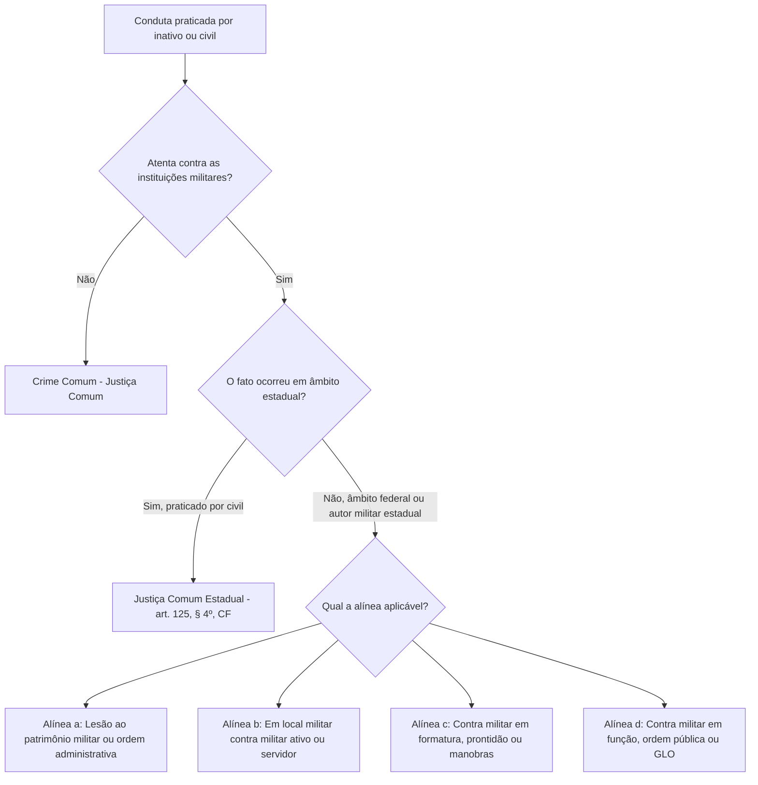

O estudo dos crimes militares ganha relevância quando o autor não integra as fileiras ativas. O artigo 9º, inciso III, do Código Penal Militar disciplina quando militares da reserva, reformados e civis respondem perante a jurisdição militar. É essencial compreender essa tutela penal. Também importa dominar a divisão de competência entre a Justiça Militar da União e a Estadual, bem como a atuação em operações de Garantia da Lei e da Ordem (GLO). Este capítulo analisa as alíneas do dispositivo, detalha a jurisprudência dos Tribunais Superiores e aborda as mudanças da Lei 14.688/2023.

> [!objetivos]
> - Identificar as categorias de sujeitos ativos contempladas no artigo 9º, inciso III, do CPM.
> - Compreender a distinção constitucional de competência entre a Justiça Militar da União e a Justiça Militar Estadual quanto a réus civis.
> - Distinguir as correntes doutrinárias e jurisprudenciais acerca da ofensa contra as instituições militares.
> - Analisar as alíneas do inciso III e a competência penal militar em missões de Garantia da Lei e da Ordem.

## Os sujeitos ativos do artigo 9º, inciso III

O artigo 9º, inciso III, do Código Penal Militar estabelece a tipicidade indireta para os autores que não ostentam a condição de militares da ativa:

> [!lei] CPM, art. 9º, III
> Consideram-se crimes militares, em tempo de paz:
> III - os crimes praticados por militar da reserva, ou reformado, ou por civil, contra as instituições militares, considerando-se como tais não só os compreendidos no inciso I, como os do inciso II, nos seguintes casos:

O dispositivo delimita taxativamente três classes de autores:
1. **Militar da reserva remunerada**: aquele que completou o tempo de serviço ou foi transferido para a reserva da corporação, permanecendo sujeito à eventual mobilização ou convocação.
2. **Militar reformado**: aquele dispensado definitivamente da prestação de serviços militares em razão de idade-limite ou invalidez definitiva.
3. **Civil**: qualquer indivíduo que não integre as Forças Armadas nem as Polícias e Corpos de Bombeiros Militares dos Estados.

A tabela abaixo sintetiza a situação jurídica de cada categoria de autor e a sua repercussão perante as Justiças Militares da União e dos Estados.

| Categoria do agente | Enquadramento legal | Justiça Militar da União (CF, art. 124) | Justiça Militar Estadual (CF, art. 125, § 4º) |
| --- | --- | --- | --- |
| Militar da reserva remunerada | Artigo 9º, inciso III | Julga nas hipóteses das alíneas do inciso III | Julga nas hipóteses das alíneas do inciso III |
| Militar reformado | Artigo 9º, inciso III | Julga nas hipóteses das alíneas do inciso III | Julga nas hipóteses das alíneas do inciso III |
| Civil | Artigo 9º, inciso III | Julga quando a conduta lesa as Forças Armadas | Não possui competência para julgar civil |
| Reserva não remunerada | Equiparado a civil | Julga quando atenta contra bens das Forças Armadas | Incompetência absoluta (julgado na Justiça Comum) |
| Inativo prestando tarefa certa | Equiparado à ativa (art. 12) | Julga sob o prisma dos incisos I e II do art. 9º | Julga sob o prisma dos incisos I e II do art. 9º |

Duas ressalvas estruturais exigem atenção máxima:
- **Reserva não remunerada**: o cidadão que concluiu o período de serviço militar obrigatório ou de formação básica sem remuneração contínua do erário integra a chamada reserva não remunerada. Para todos os efeitos do Direito Penal Militar, o integrante da reserva não remunerada é considerado **civil**, não respondendo como militar inativo.
- **Inativo empregado na administração militar**: consoante o artigo 12 do CPM, o militar da reserva ou reformado que presta tarefa por tempo certo ou desempenha função administrativa sob designação legal oficial equipara-se ao militar da ativa para a aplicação da lei penal militar. Em tal conjuntura, sua conduta deixa de ser disciplinada pelo inciso III e passa a ser regida pelos incisos I e II do artigo 9º.

### A vedação constitucional de julgamento de civil na Justiça Militar Estadual

A competência sobre o réu civil possui matriz puramente constitucional. O artigo 124 da Constituição Federal atribui à Justiça Militar da União competência para processar e julgar os crimes militares definidos em lei. A norma não fixa qualquer restrição quanto à pessoa do autor. Por essa razão, perante a Justiça Militar federal, o civil que praticar conduta descrita nas alíneas do inciso III será processado e julgado pelos Conselhos e Juízes Federais da Justiça Militar.

Em contrapartida, o artigo 125, § 4º, da Constituição dispõe taxativamente que compete à Justiça Militar Estadual processar e julgar os **militares dos Estados** nos crimes militares definidos em lei. A Constituição não concedeu competência à Justiça Militar dos Estados para julgar civis em tempo de paz. Portanto, a Justiça Militar Estadual é absolutamente incompetente para processar civis.

> [!atencao] Incompetência da Justiça Militar Estadual para julgar civis
> Um civil jamais poderá ser processado ou julgado pela Justiça Militar Estadual, ainda que cometa delito no interior de um quartel da Polícia Militar ou do Corpo de Bombeiros Militar de Pernambuco contra um oficial comandante. Tal fato configura crime comum, cuja competência pertence à Justiça Comum Estadual (Vara Criminal comum). Já perante a Justiça Militar da União, o civil pode figurar no banco dos réus se o fato violar bem tutelado das Forças Armadas.

> [!pegadinha] Pegadinha clássica sobre autor civil
> Assertivas que narram um civil subtraindo patrimônio de um quartel da Polícia Militar estadual pretendem induzir o candidato a marcar competência da Justiça Militar Estadual. Lembre-se: em âmbito estadual, civil responde perante a Justiça Comum. A competência da Justiça Militar Estadual limita-se estritamente aos policiais e bombeiros militares estaduais (da ativa ou inativos).

## A ofensa contra as instituições militares: correntes doutrinárias

O caput do artigo 9º, inciso III, exige que o crime seja praticado contra as instituições militares. Esses delitos abrangem as matérias do inciso I e do inciso II do CPM, desde que preenchidas as condições de suas alíneas. Trata-se de hipótese expressa de tipicidade indireta.

Diante da expressão "contra as instituições militares", surgiu controvérsia sobre a necessidade de intenção deliberada de atingir a corporação. A jurisprudência dos Tribunais Superiores dividiu-se em duas correntes:

A tabela comparativa a seguir evidencia o contraste entre as orientações jurisprudenciais sobre a exigência do elemento subjetivo na ofensa institucional.

| Corrente | Principais defensores | Pressuposto exigido | Consequência prática |
| --- | --- | --- | --- |
| 1ª Corrente (Subjetiva) | Supremo Tribunal Federal e doutrina de Cícero Coimbra Neves | Exige intenção deliberada (*animus*) de ofender, frustrar ou desmoralizar a Força Militar | Sem o dolo específico de afrontar a instituição militar, a conduta desloca-se para a Justiça Comum |
| 2ª Corrente (Objetiva) | Superior Tribunal Militar (STM) e Ministério Público Militar | A ofensa é presumida a partir do enquadramento formal nas hipóteses das alíneas do art. 9º, III | Basta a prática da conduta em local militar ou contra tropa para configurar o crime militar |

O Supremo Tribunal Federal, em reiterados julgados de suas Turmas, sedimentou a tese de que a locução "contra as instituições militares" constitui elemento subjetivo especial do tipo. Para a Corte Suprema, a simples condição de militar da vítima não basta para configurar crime militar quando o autor é civil ou inativo. É indispensável demonstrar a intenção de atingir, enfraquecer ou desmoralizar a instituição armada ou a função exercida. Sem esse dolo específico, o fato é crime comum.

Em sentido contrário, o Superior Tribunal Militar adota a teoria da ofensa objetiva presumida. Para o tribunal militar, o legislador já presumiu a ofensa institucional ao descrever as alíneas do inciso III. Desse modo, se o civil ou inativo atenta contra o patrimônio administrado ou invade local militar, o crime militar estará configurado formalmente. Não se exige a demonstração de dolo específico.

> [!jurisprudencia] STF e STM, Divergência sobre ofensa institucional
> Enquanto o STF entende que a lesão culposa provocada por motorista civil em viatura militar em via pública constitui crime comum de trânsito pela ausência de dolo de menoscabar a Força, o STM reconhece a competência da Justiça Militar da União, reputando que a danificação culposa de viatura militar lesa o patrimônio e a operacionalidade das Forças Armadas. Nas provas, atente para o texto do enunciado: se for cobrada a literalidade da lei ou julgados do STM, adota-se a corrente objetiva; se mencionada jurisprudência do STF, prestigia-se a tese subjetiva do dolo específico.

## Artigo 9º, inciso III, alínea a: patrimônio e ordem administrativa

A primeira hipótese do inciso III do artigo 9º protege a integridade do patrimônio militar e a ordem administrativa militar:

> [!lei] CPM, art. 9º, III, "a"
> a) contra o patrimônio sob a administração militar, ou contra a ordem administrativa militar;

Esta alínea guarda simetria com o artigo 9º, II, "e", diferindo apenas quanto ao autor da conduta. Aqui, o sujeito ativo é militar inativo ou cidadão civil.

A proteção patrimonial abrange bens públicos das Forças Armadas e qualquer bem de particular sob custódia militar oficial. Se um civil subtrai ferramentas ou insumos de uma oficina do Exército Brasileiro, comete furto qualificado como crime militar com base na alínea a.

A tutela da **ordem administrativa militar** compreende a preservação do prestígio, segurança e regularidade do serviço militar. A abrangência deste preceito revela-se ampla. Ela atrai a competência da Justiça Militar da União inclusive para delitos cometidos por civil contra outro civil dentro de estabelecimento militar federal.

> [!exemplo] Conduta ilícita de civil contra civil no Colégio Militar
> Suponha que um prestador de serviços terceirizado civil, desempenhando atividades no interior de um Colégio Militar administrado pelo Exército Brasileiro, cometa conduta ilícita contra a dignidade sexual de alunas civis menores de idade (tipificada no art. 216-A do CP e art. 232 do ECA). A integridade pessoal das vítimas é tutelada pela legislação penal geral. Todavia, como o fato ocorreu no ambiente interno de uma organização militar de ensino federal, atentando contra o civismo, a disciplina e a credibilidade institucional das Forças Armadas, o Superior Tribunal Militar firmou entendimento unânime de que se configura crime militar por lesão à ordem administrativa militar (art. 9º, III, "a", do CPM), fixando a competência da Justiça Militar da União.

Ademais, caso a vítima desse mesmo episódio fosse um policial militar estadual nas dependências do quartel federal, prevaleceria a competência da Justiça Militar da União. A Justiça Militar Estadual não detém jurisdição para julgar agressores civis nem tutelar patrimônio pertencente à União.

## Artigo 9º, inciso III, alínea b: lugar sob administração militar

A alínea b contempla a conduta cometida em ambiente militar contra sujeitos passivos determinados:

> [!lei] CPM, art. 9º, III, "b"
> b) em lugar sujeito à administração militar, contra militar da ativa ou contra servidor público das instituições militares ou da Justiça Militar, no exercício de função inerente ao seu cargo;

A redação da alínea b foi modernizada pela Lei nº 14.688/2023. O texto anterior continha referências ao assemelhado e a ministérios militares extintos. A nova redação incluiu expressamente no polo passivo os militares da ativa e os servidores das instituições militares ou da Justiça Militar no exercício funcional.

O critério de configuração é espacial (**ratione loci**), cumulado com a qualidade da vítima. Para o Superior Tribunal Militar, quanto ao militar ofendido, basta que seja da ativa, mesmo fora de serviço. Em relação ao servidor civil, contudo, a lei exige que a conduta ocorra durante o exercício funcional do cargo.

A jurisprudência do STM confirmou a amplitude dessa alínea em investigações penais militares:

> [!jurisprudencia] STM: crimes militares por extensão praticados por civis
> O STM consolidou que o art. 9º, III, alíneas "a" e "b", do CPM admite a tipificação de crimes militares por extensão praticados por civis (decorrentes da Lei 13.491/2017). O tribunal confirmou a competência da Justiça Militar da União sobre os fatos investigados e autorizou o prosseguimento do inquérito policial militar.

### A polêmica dos servidores da Justiça Militar fora de área militar

O Superior Tribunal de Justiça e a doutrina debatem a segunda parte da alínea b, concernente aos servidores da Justiça Militar.

O texto legal exige literalmente que a conduta ocorra "em lugar sujeito à administração militar". O STJ, todavia, no julgamento do Conflito de Competência nº 88.600/RJ, adotou interpretação extensiva. O tribunal decidiu que a tentativa de corrupção praticada por civil contra oficial de justiça da Justiça Militar fora de área militar atrai a competência da Justiça Militar da União. Para o STJ, a proteção ao órgão judicial independe do espaço físico.

Em sentido contrário, doutrinadores como Célio Lobão e Cícero Coimbra Neves sustentam a necessidade do espaço militar. Argumentam que o servidor civil da Justiça Militar não integra as Forças Armadas. Portanto, fora do quartel, a ofensa a funcionário judiciário civil constitui crime comum contra a administração da Justiça, sujeito à competência da Justiça Federal comum (CF, art. 109, IV).

> [!pegadinha] Servidor da Justiça Militar fora do quartel
> Para provas que explorem a jurisprudência do STJ, a agressão ou corrupção de civil contra servidor da Justiça Militar no exercício da função atrai a Justiça Militar da União, mesmo fora do quartel. Já pela literalidade do CPM e pela doutrina majoritária, exige-se que o fato ocorra em lugar sujeito à administração militar.

## Artigo 9º, inciso III, alíneas c e d: prontidão, serviço e operações de GLO

As alíneas c e d tratam de situações em que a tropa se encontra em prontidão ou atuando na segurança pública:

> [!lei] CPM, art. 9º, III, "c" e "d"
> c) contra militar em formatura, ou durante o período de prontidão, vigilância, observação, exploração, exercício, acampamento, acantonamento ou manobras;
> d) ainda que fora do lugar sujeito à administração militar, contra militar em função de natureza militar, ou no desempenho de serviço de vigilância, garantia e preservação da ordem pública, administrativa ou judiciária, quando legalmente requisitado para aquêle fim, ou em obediência a determinação legal superior.

A **alínea c** adota critérios temporal e material (*ratione temporis* e *ratione materiae*). Se um civil agride militares formados ou acampados em instrução tática, comete crime militar. A concentração das tropas em manobras justifica essa proteção penal especial.

A **alínea d** consagra o critério puramente material (*ratione materiae*). O fato pode ocorrer em qualquer ambiente, inclusive em vias públicas urbanas. Exige-se apenas que o militar esteja em função militar ou em serviço de garantia da ordem sob determinação superior.

### A atuação militar em operações de Garantia da Lei e da Ordem (GLO)

O ponto central da alínea d reside no emprego das Forças Armadas em missões de GLO.

O artigo 142 da Constituição estabelece que as Forças Armadas são instituições nacionais permanentes. São organizadas com base na hierarquia e na disciplina. Destinam-se à defesa da Pátria e à garantia dos poderes constitucionais. Sob convocação de qualquer destes poderes, podem atuar na garantia da lei e da ordem.

Durante muito tempo, discutiu-se se o civil que atentasse contra militares em GLO responderia por crime militar ou comum:
- **Posição antiga do STF**: no passado (HC 112.936/RJ), a Corte considerou o patrulhamento em GLO atividade de segurança pública comum, afastando a jurisdição militar.
- **Posição atual e pacificada do STM e do STF**: a jurisprudência superou essa divergência. No RHC 124.755/RJ e em decisões colegiadas posteriores, o STF assentou que os militares em GLO desempenham função de natureza militar (CF, art. 142). Logo, o atentado de civil contra a patrulha configura crime militar (art. 9º, III, "d", do CPM), processado perante a Justiça Militar da União.

> [!jurisprudencia] STM: homicídio tentado contra militar em GLO
> Em caso de disparos efetuados por civis contra patrulha do Exército em missão de GLO, o STM tipificou a conduta como crime militar por extensão (CP, art. 121, § 2º, VII, c/c art. 9º, III, "d", do CPM). O tribunal fixou a competência da Justiça Militar da União.

A tabela esquemática a seguir reúne os pressupostos operacionais das quatro alíneas do artigo 9º, inciso III:

| Alínea | Condição do sujeito ativo | Sujeito passivo ou objeto | Ambiente de ocorrência | Critério reitor |
| --- | --- | --- | --- | --- |
| a | Militar inativo ou civil | Patrimônio administrado ou ordem administrativa militar | Qualquer lugar (inclusive imóvel militar federal) | *Ratione materiae* |
| b | Militar inativo ou civil | Militar da ativa ou servidor da instituição/Justiça Militar | Em lugar sujeito à administração militar | *Ratione loci* |
| c | Militar inativo ou civil | Militar em formatura, prontidão, exercício ou manobras | Área de instrução ou acantonamento | *Ratione temporis* / *materiae* |
| d | Militar inativo ou civil | Militar em função militar, serviço de ordem pública ou GLO | Qualquer lugar (inclusive via pública) | *Ratione materiae* |

## Critério geral de configuração do crime militar

Ao longo da análise dogmática dos incisos do artigo 9º, depreende-se que cada alínea emprega critérios operacionais distintos para delimitar a incidência da lei penal:
- O critério **ratione personae** norteia a alínea a do inciso II (militar da ativa contra militar da ativa);
- O critério **ratione loci** orienta as alíneas b dos incisos II e III (local sujeito à administração militar);
- O critério **ratione temporis** rege a alínea d do inciso II e a alínea c do inciso III (período de manobras, exercícios ou prontidão);
- O critério **ratione materiae** fundamenta as alíneas c e e do inciso II e as alíneas a e d do inciso III (efetivo serviço, ordem militar e segurança pública).

Apesar dessas regras setoriais, se a questão de concurso indagar qual é o critério geral de configuração do crime militar no Brasil, a resposta é o critério **ratione legis**.

O Brasil não adotou o critério ratione personae geral nem o ratione loci universal. Adotou-se o princípio da estrita legalidade: considera-se crime militar apenas o que a legislação federal formal define expressamente como delito militar.

> [!bizu] Critério geral versus critério específico
> Não caia na armadilha da banca examinadora:
> - Perguntou o critério geral de configuração do crime militar no Brasil? Marque **ratione legis**.
> - Perguntou o critério da alínea "a" do inciso II (militar da ativa contra da ativa)? Marque **ratione personae**.
> - Perguntou o critério da alínea "b" (lugar sob administração militar)? Marque **ratione loci**.
> - Perguntou o critério do tempo de manobras? Marque **ratione temporis**.

## Mapa do capítulo

O esquema visual abaixo organiza as diretrizes de enquadramento do artigo 9º, inciso III, do Código Penal Militar:

### Para fixar
- Os sujeitos ativos do artigo 9º, inciso III, do CPM são o militar da reserva remunerada, o militar reformado e o cidadão civil.
- A Justiça Militar Estadual não possui competência para processar e julgar civis em tempo de paz (CF, art. 125, § 4º); condutas de civis contra instituições estaduais constituem crimes comuns.
- A Justiça Militar da União detém competência constitucional plena para julgar civis que cometam crimes militares contra as Forças Armadas (CF, art. 124).
- O integrante da reserva não remunerada é tratado juridicamente como civil para todos os fins do Direito Penal Militar.
- O militar inativo que presta tarefa por tempo certo na administração militar equipara-se ao militar da ativa (art. 12 do CPM), submetendo-se aos incisos I e II do artigo 9º.
- O STF exige dolo específico de afrontar a instituição militar no artigo 9º, inciso III; o STM adota a teoria da ofensa objetiva presumida a partir da adequação típica às alíneas.
- Na alínea a, o cometimento de crime de civil contra civil no interior de estabelecimento militar federal (como Colégio Militar) atrai a competência da Justiça Militar da União pela lesão à ordem administrativa militar.
- A Lei nº 14.688/2023 atualizou a alínea b, substituindo a menção a ministérios militares por servidores das Forças Armadas ou da Justiça Militar no desempenho de suas atribuições funcionais.
- A atuação das Forças Armadas nas operações de preservação da ordem pública e GLO constitui função de natureza militar (art. 142 da CF), submetendo agressões de civis contra a tropa à jurisdição da Justiça Militar da União (alínea d).
- O critério reitor e universal para a configuração do crime militar adotado no ordenamento brasileiro é o critério *ratione legis*.
