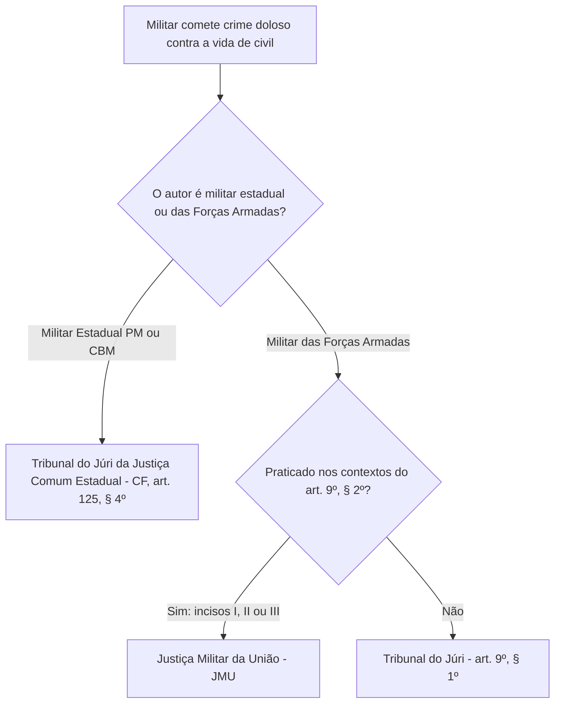

A definição de competência para julgar militares que cometem crimes dolosos contra a vida de civis é tema frequente em concursos. A divisão entre o Tribunal do Júri e a Justiça Militar decorre de importantes reformas legislativas. Destacam-se a Lei 9.299/1996, a Lei 13.491/2017 e a Lei 14.688/2023. Este capítulo examina os parágrafos do artigo 9º do Código Penal Militar. Analisamos a regra geral do Tribunal do Júri, as hipóteses específicas das Forças Armadas perante a Justiça Militar da União e os efeitos do veto presidencial ao § 3º.

> [!objetivos]
> - Compreender a regra de competência do Tribunal do Júri para crimes dolosos contra a vida de civil prevista no artigo 9º, § 1º, do CPM.
> - Analisar os contextos operacionais do artigo 9º, § 2º, que atraem a competência da Justiça Militar da União para as Forças Armadas.
> - Diferenciar a situação jurídica dos militares estaduais (policiais e bombeiros) daquela atribuída aos integrantes das Forças Armadas.
> - Explicar os reflexos dogmáticos do veto ao § 3º do artigo 9º nos crimes sexuais e de violência doméstica militar.

## O artigo 9º, § 1º: o Tribunal do Júri e suas controvérsias

A redação do § 1º do artigo 9º do Código Penal Militar consagra a regra geral de competência do Tribunal do Júri:

> [!lei] CPM, art. 9º, § 1º
> § 1º Os crimes de que trata este artigo, quando dolosos contra a vida e cometidos por militares contra civil, serão da competência do Tribunal do Júri.

A Lei nº 9.299/1996 havia inserido originariamente um parágrafo único no artigo 9º do CPM, remetendo esses delitos à Justiça Comum. Mais tarde, a Lei nº 13.491/2017 conferiu a redação do § 1º, prevendo expressamente a competência do Tribunal do Júri. A Lei nº 14.688/2023, por sua vez, deu nova redação ao § 2º. O § 1º permaneceu com o texto vigente desde a Lei de 2017. O dispositivo que sofreu veto presidencial na reforma de 2023 foi o § 3º.

No plano constitucional, cabe destacar uma distinção basilar entre a jurisdição militar estadual e a federal:
- **Militares Estaduais (PM e CBM)**: o artigo 125, § 4º, da Carta da República disciplina a Justiça Militar Estadual e contém ressalva categórica: "competindo ao tribunal do júri quando a vítima for civil". Dessa forma, para policiais e bombeiros militares estaduais, a competência do Júri possui assento constitucional expresso e inafastável.
- **Militares das Forças Armadas (Marinha, Exército e Aeronáutica)**: o artigo 124 da Constituição Federal, ao regular a Justiça Militar da União, não inseriu qualquer ressalva retirando da esfera militar federal o julgamento dos crimes dolosos contra a vida de civis.

Diante desse silêncio constitucional, juristas renomados como Cícero Robson Coimbra Neves e ministros do Superior Tribunal Militar debatem a constitucionalidade do § 1º quando aplicado indistintamente aos militares federais. Sustentam que a Constituição outorgou à Justiça Militar da União o julgamento de todos os crimes militares definidos em lei, sem ressalva para o Júri. O STM acolheu essa tese incidentalmente em decisões isoladas durante operações de Garantia da Lei e da Ordem (GLO).

> [!atencao] Postura em provas objetivas versus provas discursivas
> Em provas objetivas, o candidato deve pautar sua resposta pela **estrita literalidade da lei**: a regra geral enunciada no art. 9º, § 1º, submete os crimes dolosos contra a vida de civil ao Tribunal do Júri. A discussão sobre inconstitucionalidade material perante a Justiça Militar da União é matéria reservada para provas discursivas e certames jurídicos da magistratura ou do Ministério Público Militar.

## O artigo 9º, § 2º: competência da Justiça Militar da União

Para mitigar a rigidez do § 1º e assegurar respaldo jurídico às tropas federais empregadas em missões complexas de segurança e soberania, o legislador instituiu o § 2º do artigo 9º:

> [!lei] CPM, art. 9º, § 2º
> § 2º Os crimes militares de que trata este artigo, incluídos os previstos na legislação penal, nos termos do inciso II do caput deste artigo, quando dolosos contra a vida e cometidos por militares das Forças Armadas contra civil, serão da competência da Justiça Militar da União, se praticados no contexto:
> I – do cumprimento de atribuições que lhes forem estabelecidas pelo Presidente da República ou pelo Ministro de Estado da Defesa;
> II – de ação que envolva a segurança de instituição militar ou de missão militar, mesmo que não beligerante; ou
> III – de atividade de natureza militar, de operação de paz, de garantia da lei e da ordem ou de atribuição subsidiária, realizadas em conformidade com o disposto no art. 142 da Constituição Federal e diplomas legais específicos.

O dispositivo acima reproduz a redação conferida pela Lei nº 14.688/2023, que chancelou a inclusão explícita dos crimes previstos na legislação extravagante (crimes militares por extensão).

A incidência do § 2º reclama a conjugação de três condicionantes:
1. Que o agente autor seja **militar das Forças Armadas** (Marinha, Exército ou Aeronáutica);
2. Que a conduta constitua crime doloso contra a vida de **civil**;
3. Que a atuação militar ocorra no contexto de uma das situações descritas nos incisos I, II ou III.

A tabela comparativa a seguir detalha as hipóteses do § 2º do artigo 9º do CPM:

| Inciso | Contexto operacional | Exemplos práticos | Legislação de referência |
| --- | --- | --- | --- |
| I | Atribuições fixadas pelo Presidente da República ou Ministro da Defesa | Emprego emergencial do Exército em obras de infraestrutura ou apoio a calamidades | Atos normativos e decretos do Poder Executivo Federal |
| II | Segurança de instituição militar ou missão militar (inclusive não beligerante) | Sentinela militar que efetua disparos para repelir invasão armada ao quartel | Regulamentos de serviço interno e segurança das Forças Armadas |
| III | Atividade militar, operação de paz, GLO ou atribuições subsidiárias | Tiro de destruição contra aeronave hostil, patrulhamento de fronteira ou eleições | Lei 7.565/1986 (CBA), LC 97/1999, DL 1.002/1969 e Lei 4.737/1965 |

O inciso I confere ampla margem à autoridade federal. Atrai a competência da Justiça Militar da União sempre que os militares federais atuarem no cumprimento de diretrizes do Presidente da República ou do Ministro da Defesa.

O inciso II resguarda a autodefesa das instituições militares federais. Quando a sentinela que guarnece a entrada de quartel do Exército é alvejada por criminosos civis e revida os disparos para defender a instalação militar, ceifando a vida de um invasor, o homicídio doloso submete-se à Justiça Militar da União, e não ao Júri comum.

O inciso III contempla o espectro mais abrangente de atuação:
- **Código Brasileiro de Aeronáutica (Lei nº 7.565/1986)**: autoriza medidas de coerção no espaço aéreo, culminando no tiro de destruição contra aeronaves suspeitas ou hostis (art. 303). Antes restrita a este artigo específico, a nova redação alcança qualquer intervenção no âmbito da aviação sob o CBA;
- **Lei Complementar nº 97/1999**: disciplina o preparo e emprego das Forças Armadas, inclusive no patrulhamento da faixa de fronteira, no combate ao narcotráfico e aos crimes ambientais em cooperação subsidiária;
- **Código de Processo Penal Militar (DL nº 1.002/1969)**: operações de cumprimento de mandados e custódia militar;
- **Código Eleitoral (Lei nº 4.737/1965)**: requisição de tropas federais pela Justiça Eleitoral para garantir a lisura e a segurança do pleito democrático.

> [!pegadinha] Pegadinha das alternativas exclusivas
> As bancas organizadoras costumam formular assertivas afirmando que a competência da Justiça Militar da União ocorre "somente" na hipótese de segurança da instituição militar (inciso II). Trata-se de erro: as hipóteses dos incisos I, II e III são **alternativas**. Basta a presença de qualquer um desses três contextos para atrair a jurisdição da Justiça Militar da União.

### A restrição subjetiva: Forças Armadas versus Polícias e Bombeiros Militares

A advertência primordial deste capítulo recai sobre o âmbito subjetivo de aplicação do § 2º: ele beneficia **exclusivamente os militares das Forças Armadas**.

Os policiais militares e bombeiros militares estaduais jamais se submetem à disciplina do artigo 9º, § 2º, do CPM. Mesmo em serviço operacional ou uniformizado, se o militar estadual cometer crime doloso contra a vida de civil (homicídio, feminicídio ou infanticídio), a competência será obrigatoriamente do **Tribunal do Júri da Justiça Comum Estadual** (CF, art. 125, § 4º).

A tabela abaixo confronta o regramento de competência aplicável a cada carreira militar:

| Corporação do autor | Vítima civil em crime doloso contra a vida | Jurisdição competente | Fundamento normativo |
| --- | --- | --- | --- |
| Policial Militar Estadual | Vítima civil | Tribunal do Júri (Justiça Comum Estadual) | CF, art. 125, § 4º e CPM, art. 9º, § 1º |
| Bombeiro Militar Estadual | Vítima civil | Tribunal do Júri (Justiça Comum Estadual) | CF, art. 125, § 4º e CPM, art. 9º, § 1º |
| Militar das Forças Armadas | Vítima civil (fora dos contextos do § 2º) | Tribunal do Júri | CPM, art. 9º, § 1º |
| Militar das Forças Armadas | Vítima civil (nos contextos do § 2º, incisos I a III) | Justiça Militar da União (JMU) | CPM, art. 9º, § 2º |
| Militar Estadual ou Federal | Vítima militar da ativa | Justiça Militar (Estadual ou da União) | CPM, art. 9º, II, "a" |

> [!atencao] Vítima militar da ativa não vai ao Júri
> A competência do Tribunal do Júri delineada no artigo 9º, § 1º, do CPM e no artigo 125, § 4º, da CF incide **apenas quando a vítima for civil**. Caso um policial militar ou bombeiro militar cometa homicídio doloso contra outro militar da ativa (ainda que de folga), o julgamento competirá privativamente à Justiça Militar (Estadual ou da União), perante o Conselho de Justiça, inexistindo deslocamento para o Tribunal do Júri!

## O veto ao § 3º: crimes sexuais e violência doméstica militar

Durante a tramitação legislativa do projeto da Lei nº 14.688/2023, o Congresso Nacional aprovou a inserção de um § 3º no artigo 9º do CPM. A proposta pretendia retirar da esfera militar os crimes sexuais e de violência doméstica ou familiar contra a mulher praticados fora de lugar sob administração militar.

O objetivo parlamentar era direcionar os delitos cometidos no lar ou fora dos quartéis aos juizados civis especializados da Lei Maria da Penha (Lei nº 11.340/2006).

O Poder Executivo Federal, todavia, **vetou integralmente o § 3º**. As razões de veto apontaram que a redação aprovada produziria efeito indesejado: poderia dar a entender que a violência doméstica em área militar ficaria restrita à jurisdição castrense, enfraquecendo a proteção integral da mulher. Com o veto, a matéria segue disciplinada pela jurisprudência, em coerência com as duas correntes analisadas no Capítulo 1:
- **Para o STF e o STJ**: quando o entrevero entre militares ocorre no ambiente doméstico familiar ou em lazer fora do quartel, sem nexo funcional militar, a competência é da **Justiça Comum** (Juizado de Violência Doméstica / Lei Maria da Penha);
- **Para o STM (e pela literalidade do art. 9º, II, 'a', do CPM)**: sendo ambos militares da ativa, o delito é militar (*ratione personae*); contudo, se a agressão for cometida **no interior de lugar sob administração militar**, a competência da Justiça Militar é pacífica perante todos os tribunais.

O Superior Tribunal Militar enfrentou caso paradigmático envolvendo violência física praticada por oficial superior contra sua companheira, praça e subordinada hierárquica, dentro de veículo estacionado em quartel:

> [!jurisprudencia] STM: violência doméstica entre militares dentro de unidade militar
> Agressão física cometida por militar da ativa contra companheira, também militar da ativa e subordinada funcional, no estacionamento interno de unidade militar. O STM fixou a competência da Justiça Militar da União (art. 9º, II, "a", do CPM). O agressor foi condenado em concurso de crimes pelo delito militar de violência contra inferior (art. 175 do CPM) e pela lesão qualificada de violência doméstica (art. 129, § 9º, do Código Penal comum, por força do parágrafo único do art. 175). O tribunal rechaçou a incidência da insignificância e a aplicação de infração disciplinar de lesão levíssima (art. 209, § 6º), proclamando a expressa vedação ao hibridismo normativo.

> [!bizu] Síntese sobre violência doméstica entre militares
> Mantenha a coerência jurisprudencial com o art. 9º, II, "a":
> - Violência doméstica entre militares fora do quartel e no lar: para o STF e o STJ, a competência é da Justiça Comum (Lei Maria da Penha); para o STM e pela literalidade do CPM, atrai a Justiça Militar (*ratione personae*). Em provas objetivas, fique atento ao comando da questão.
> - Violência doméstica entre militares dentro de unidade sob administração militar: prevalece com tranquilidade a Justiça Militar, vedando-se a mistura de regras benéficas (*vedação ao hibridismo normativo*).

## Mapa do capítulo

O fluxograma abaixo orienta a definição da competência jurisdicional frente a crimes dolosos contra a vida de civil cometidos por agentes militares:

### Para fixar
- A regra geral do artigo 9º, § 1º, do CPM atribui a competência para processar crimes dolosos contra a vida de civil cometidos por militares ao Tribunal do Júri.
- Os policiais e bombeiros militares estaduais que praticam homicídio doloso contra civil são julgados obrigatoriamente pelo Tribunal do Júri Estadual (CF, art. 125, § 4º).
- O artigo 9º, § 2º, do CPM aplica-se com exclusividade aos militares das Forças Armadas (Marinha, Exército e Aeronáutica), não socorrendo os militares dos Estados.
- A Justiça Militar da União julga militar das Forças Armadas que mata civil dolosamente quando a conduta decorre de ordens do Presidente ou Ministro da Defesa (inciso I).
- A autodefesa de instalações e missões militares contra civis submete o homicídio doloso à Justiça Militar da União (inciso II).
- As operações de Garantia da Lei e da Ordem (GLO) e atuações sob o Código Brasileiro de Aeronáutica e Código Eleitoral atraem a competência da JMU (inciso III).
- Os três incisos do § 2º são hipóteses alternativas, bastando o amoldamento a uma delas para firmar a competência da Justiça Militar da União.
- Se a vítima do homicídio for militar da ativa, o crime é sempre da competência da Justiça Militar, inexistindo julgamento pelo Tribunal do Júri.
- A proposta de inclusão do § 3º no artigo 9º (crimes sexuais e violência doméstica fora do quartel) foi vetada pelo Presidente da República na Lei 14.688/2023.
- Violência física praticada por militar contra sua companheira militar nas dependências de unidade militar configura crime militar de competência da Justiça Militar.
