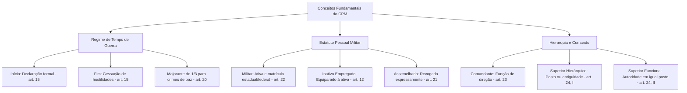

A compreensão sistemática do Direito Penal Militar pressupõe o domínio das regras excepcionais vigentes em tempo de guerra e dos conceitos dogmáticos fundamentais distribuídos entre os artigos 10 e 28 do Código Penal Militar. Esse bloco normativo estabelece os parâmetros de tipicidade em conflitos armados, define a condição jurídica de militar e superior hierárquico, disciplina a eficácia espacial frente a forças estrangeiras e delimita institutos nucleares da vida militar. A Lei 14.688/2023 promoveu profunda modernização nesse segmento, revogando figuras arcaicas e alinhando os tipos penais militares à ordem constitucional. Este capítulo finaliza o volume examinando cada uma dessas definições legais e seus desdobramentos práticos nas provas.

> [!objetivos]
> - Reconhecer as hipóteses de crimes militares em tempo de guerra e a causa de aumento de pena do artigo 20 do CPM.
> - Compreender os marcos inicial e final do tempo de guerra e a sujeição dos militares estrangeiros e aliados.
> - Aplicar os conceitos de militar, comandante, superior, presença do inimigo e servidores da Justiça Militar.
> - Identificar as reformas trazidas pela Lei 14.688/2023, com destaque para a revogação do assemelhado e os crimes hediondos militares.

## Crimes militares em tempo de guerra

O artigo 10 do Código Penal Militar consagra a tipicidade indireta aplicável durante períodos de beligerância formal:

> [!lei] CPM, art. 10
> Consideram-se crimes militares, em tempo de guerra:
> I - os especialmente previstos neste Código para o tempo de guerra;
> II - os crimes militares previstos para o tempo de paz;
> III - os crimes previstos neste Código, embora também o sejam com igual definição na lei penal comum ou especial, quando praticados, qualquer que seja o agente:
> a) em território nacional, ou estrangeiro, militarmente ocupado;
> b) em qualquer lugar, se comprometem ou podem comprometer a preparação, a eficiência ou as operações militares ou, de qualquer outra forma, atentam contra a segurança externa do País ou podem expô-la a perigo;
> IV - os crimes definidos na lei penal comum ou especial, embora não previstos neste Código, quando praticados em zona de efetivas operações militares ou em território estrangeiro, militarmente ocupado.

Em tempo de guerra, a abrangência da lei penal militar torna-se quase universal:
- Inciso I: alcança os delitos especificamente concebidos para o estado bélico, tipificados a partir do artigo 355 do CPM (traição, cobardia e rendição indevida);
- Inciso II: abrange a totalidade dos crimes militares definidos para o tempo de paz (arts. 136 a 354);
- Inciso III: atrai condutas de dupla previsão em território ocupado ou que ameacem as operações e a segurança do País, qualquer que seja o autor;
- Inciso IV: estabelece que qualquer crime da legislação penal comum ou especial praticado em zona de operações militares ou em solo ocupado converte-se em crime militar.

A tabela abaixo contrasta o regime de tempo de paz com o de tempo de guerra no CPM:

| Aspecto | Tempo de paz (art. 9º) | Tempo de guerra (art. 10) | Base legal |
| --- | --- | --- | --- |
| Tipicidade indireta | Rol fechado das alíneas dos incisos I a III | Amplitude expansiva dos incisos I a IV | Arts. 9º e 10 |
| Crimes da lei comum | Somente sob certas alíneas do art. 9º, II e III | Qualquer crime em zona de operações ou solo ocupado | Art. 10, IV |
| Sanção penal | Penas ordinárias dos tipos penais | Penas de paz aumentadas de 1/3 (regra geral) | Artigo 20 |
| Pena de morte | Proibida categoricamente (CF, art. 5º, XLVII, "a") | Admitida em casos expressos (CF, art. 5º, XLVII, "a") | Arts. 55 e 355 |

### Marcos de início e término e majorante penal de guerra

O artigo 15 do CPM define a demarcação cronológica do tempo de guerra:

> [!lei] CPM, art. 15
> O tempo de guerra, para os efeitos da aplicação da lei penal militar, começa com a declaração ou o reconhecimento do estado de guerra, ou com o decreto de mobilização se nêle estiver compreendido aquêle reconhecimento; e termina quando ordenada a cessação das hostilidades.

O estado bélico instaura-se formalmente por ato do Presidente da República autorizado ou referendado pelo Congresso Nacional (CF, art. 84, XIX e XX). Seu encerramento aperfeiçoa-se no instante em que a autoridade competente ordena formalmente a cessação das hostilidades.

No plano das penalidades, o artigo 20 estipula uma causa de aumento geral:

> [!lei] CPM, art. 20
> Aos crimes praticados em tempo de guerra, salvo disposição especial, aplicam-se as penas cominadas para o tempo de paz, com o aumento de um têrço.

Essa majorante de um terço incide sobre as infrações penais previstas para o tempo de paz cometidas durante o estado bélico. Não incide, contudo, sobre os crimes tipificados privativamente a partir do artigo 355 do CPM, os quais já contam com apenamentos específicos e agravados.

> [!pegadinha] Aplicação da majorante de guerra
> A exasperação de um terço do artigo 20 restringe-se aos crimes de tempo de paz cometidos durante a beligerância. É vedado aplicar esse aumento sobre os tipos privativos de guerra da Parte Especial, sob pena de incorrer em *bis in idem*.

## Sujeição de militares estrangeiros e normas especiais

Os artigos 11 a 19 regulam a submissão de forças aliadas e preceitos correlatos:

- **Militares estrangeiros (art. 11)**: a Lei nº 14.688/2023 assentou que militares estrangeiros em comissão ou estágio em instituições militares brasileiras submetem-se à lei penal militar nacional, respeitados tratados e convenções internacionais. A regra incide no âmbito das Forças Armadas federais, inexistindo persecução penal militar estadual.
- **Defeito no ato de incorporação ou matrícula (art. 14)**: irregularidades no ingresso formal nas fileiras (como impedimento pessoal não declarado) não afastam a incidência da lei penal militar, salvo se o defeito era conhecido ou formalmente arguido antes da prática da conduta criminosa.
- **Crimes contra país aliado (art. 18)**: atos cometidos contra nação engajada em guerra contra inimigo comum do Brasil submetem-se ao CPM se cometidos por brasileiro ou em território nacional ou ocupado.
- **Infrações disciplinares e contravenções (art. 19)**: transgressões regulamentares possuem natureza estritamente administrativa. No Direito Penal Militar inexistem contravenções penais e não se comina pena de multa.

## Equiparação ao serviço ativo e prerrogativas da inatividade

Os artigos 12 e 13 disciplinam a situação jurídica dos militares inativos:

O militar da reserva remunerada ou reformado prestando serviços aos órgãos militares (a exemplo do prestador de tarefa por tempo certo) é legalmente considerado em situação de atividade para a incidência das sanções penais militares (art. 12), respondendo sob os critérios dos incisos I e II do artigo 9º.

Por sua vez, o preceito do artigo 13 estatui que os integrantes da inatividade mantêm os predicamentos, deveres e prerrogativas inerentes ao respectivo grau hierárquico sempre que figurarem como sujeitos de infração militar.

> [!exemplo] Tutela da precedência hierárquica do inativo
> Se um soldado bombeiro da ativa agride fisicamente um tenente da reserva remunerada em ambiente militar, responderá pelo crime militar de violência contra superior (art. 157 do CPM), porquanto o militar inativo preserva a sua precedência hierárquica por força do artigo 13.

## Conceitos penais militares fundamentais

A aplicação das normas penais militares depende das definições dogmáticas fixadas nos artigos 21 a 28.

### Revogação do assemelhado e novo conceito de militar

A antiga figura do assemelhado (art. 21) foi **expressamente revogada pela Lei nº 14.688/2023**, retirando do ordenamento a categoria de funcionários civis submetidos à disciplina militar.

Paralelamente, o artigo 22 teve sua redação ampliada pela Lei nº 14.688/2023:

> [!lei] CPM, art. 22
> É militar, para o efeito da aplicação deste Código, qualquer pessoa que, em tempo de paz ou de guerra, seja incorporada a instituições militares ou nelas matriculada, para servir em posto ou em graduação ou em regime de sujeição à disciplina militar.

O dispositivo abrange expressamente os militares estaduais (policiais e bombeiros) e os membros das Forças Armadas. A qualidade de militar é elementar em tipos funcionais (como o motim, art. 149), comunicando-se aos coautores civis ou inativos em caso de concurso de pessoas com militares da ativa (art. 53 do CPM).

### Comandante e superior hierárquico

O artigo 23 equipara a **comandante** toda autoridade militar detentora de atribuição formal de direção, gestão ou chefia de organização militar ou fração de tropa.

O conceito de **superior** recebeu redação técnica no artigo 24 pela reforma de 2023:

> [!lei] CPM, art. 24
> Considera-se superior para fins de aplicação da lei penal militar:
> I – o militar que ocupa nível hierárquico, posto ou graduação superiores, conforme a antiguidade, nos termos da Lei nº 6.880, de 9 de dezembro de 1980 (Estatuto dos Militares), e de leis das unidades da Federação que regulam o regime jurídico de seus militares;
> II – o militar que, em virtude da função, exerce autoridade sobre outro de igual posto ou graduação.
> Parágrafo único. O militar sobre o qual se exerce autoridade nas condições descritas nos incisos I e II do caput deste artigo é considerado inferior hierárquico para fins de aplicação da lei penal militar.

A norma consagra duas modalidades de superioridade:
1. **Precedência hierárquica e temporal (inciso I)**: decorre da escala vertical de postos e graduações ou da antiguidade dentro do mesmo grau;
2. **Precedência funcional (inciso II)**: ocorre quando dois militares possuem o mesmo posto ou graduação, mas um exerce chefia funcional ou autoridade designada sobre o outro.

A tabela sintetiza as principais definições normativas consolidadas no Código Penal Militar:

| Instituto | Artigo | Conteúdo essencial | Inovação normativa |
| --- | --- | --- | --- |
| Militar | Art. 22 | Pessoa incorporada ou matriculada em corporação militar | Incluiu forças militares estaduais |
| Superior | Art. 24 | Superior na escala hierárquica, antiguidade ou função | Unificou precedência hierárquica e funcional |
| Comandante | Art. 23 | Toda autoridade com função de direção militar | Aplica-se a chefias e frações |
| Inimigo presente | Art. 25 | Zona de operações efetivas ou iminência de hostilidade | Delimitação espacial e tática |
| Servidor da Justiça | Art. 27 | Juízes, servidores públicos e auxiliares da Justiça Militar | Excluiu membros do Ministério Público |
| Assemelhado | Art. 21 | Categoria civil submetida à disciplina | Expressamente revogado |

### Definições complementares e crimes hediondos

- **Presença do inimigo (art. 25)**: fato praticado em zona de efetivas operações bélicas ou em situação de hostilidade iminente.
- **Nacional e estrangeiro (art. 26)**: apátridas e brasileiros que perderam a nacionalidade equiparam-se a estrangeiros.
- **Servidores da Justiça Militar (art. 27)**: contempla magistrados, servidores públicos e auxiliares. A exclusão dos membros do Ministério Público afasta a configuração de crime militar em ofensas direcionadas a promotores militares fora de contexto específico.
- **Concorrência de normas (art. 28)**: crimes contra a segurança externa e instituições militares definidos no CPM excluem os de mesma natureza de outras leis. Por força da Lei nº 7.710/1983 e do artigo 109, IV, da CF, crimes contra a segurança externa do País competem à Justiça Federal.

Por fim, a Lei nº 14.688/2023 inseriu o inciso VI no parágrafo único do artigo 1º da Lei nº 8.072/1990, instituindo os **crimes hediondos militares** por identidade típica com a lei comum: homicídio qualificado (art. 205, § 2º), estupro (art. 232), latrocínio (art. 242, § 3º), extorsão qualificada pela morte (art. 243, § 2º), extorsão mediante sequestro (art. 244), epidemia com morte (art. 292, § 1º) e envenenamento com morte (art. 293, § 2º).

## Mapa do capítulo

### Para fixar
- Em tempo de guerra, são crimes militares os previstos especialmente para o conflito, os de tempo de paz e qualquer crime comum cometido em zona de operações (art. 10).
- O tempo de guerra inicia-se com a declaração ou reconhecimento de guerra ou decreto de mobilização e encerra-se com a ordem de cessação das hostilidades (art. 15).
- Aos crimes de tempo de paz praticados durante a guerra aplica-se a majorante de um terço na pena cominada (art. 20).
- O militar inativo convocado ou exercendo encargo na administração militar equipara-se ao militar em atividade para fins penais (art. 12).
- Os militares inativos conservam as prerrogativas e deveres do posto ou graduação na persecução penal militar (art. 13).
- O vício formal no ato de incorporação ou matrícula não afasta a lei penal militar, salvo se arguido ou conhecido antes da infração (art. 14).
- A figura do assemelhado foi expressamente revogada pela Lei nº 14.688/2023.
- Militar é a pessoa incorporada ou matriculada em corporação militar estadual ou federal sob disciplina militar (art. 22).
- Superior hierárquico compreende tanto a precedência vertical de postos e graduações quanto a autoridade funcional sobre militar de igual grau (art. 24).
- A Lei nº 14.688/2023 inseriu os crimes hediondos militares na Lei 8.072/1990 para delitos do CPM com correspondência na legislação comum.
