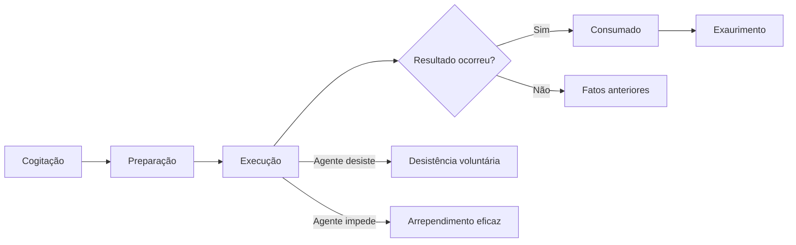

O Código Penal Militar tem um jeito próprio de enxergar o crime. Ele adota uma corrente teórica específica, define a
tentativa com uma pena que pode chegar à do crime consumado e traz uma excludente de ilicitude que não existe no
Código Penal comum. Por isso, estudar crime militar não é decorar o Código Penal trocando o nome dos artigos. Este
capítulo monta a estrutura do crime no CPM: o conceito, o fato típico, o nexo causal, os caminhos da tentativa e as
causas que afastam a ilicitude.

> [!objetivos]
> - Identificar a teoria do crime adotada pelo CPM e o lugar do dolo e da culpa.
> - Aplicar as regras de causalidade e distinguir os tipos de concausa.
> - Diferenciar tentativa, desistência voluntária e arrependimento eficaz.
> - Reconhecer o crime impossível e os crimes que não admitem tentativa.
> - Aplicar as excludentes de ilicitude do art. 42, inclusive a do comandante.

## O conceito de crime e a teoria adotada

O conceito analítico divide o crime em camadas, para permitir a análise separada de cada problema. A **teoria
tripartite** diz que crime é fato **típico**, **ilícito** e **culpável**. A **teoria bipartite** retira a
culpabilidade do conceito e a trata como pressuposto da pena: crime seria apenas fato típico e ilícito.

O CPM trabalha com a tripartite. A estrutura aparece na própria ordem do Código, que trata primeiro do fato
típico, depois da ilicitude e, em seguida, da culpabilidade.

A segunda escolha é sobre o lugar do dolo e da culpa. O **causalismo neoclássico** coloca dolo e culpa na
culpabilidade, e a conduta é analisada apenas como comportamento voluntário que causa resultado. O **finalismo**
de Welzel coloca dolo e culpa dentro da conduta, porque a conduta é dirigida a uma finalidade.

| Corrente | Onde ficam dolo e culpa | Consequência prática |
| --- | --- | --- |
| Causalismo neoclássico | Na culpabilidade | O dolo é analisado depois da tipicidade e da ilicitude |
| Finalismo | Na conduta, dentro do fato típico | A intenção integra o tipo desde o começo |

O **CPM adota o causalismo neoclássico**, e a prova disso é o art. 33, que define crime doloso e culposo dentro
do capítulo da culpabilidade. O Código Penal comum, por sua vez, seguiu o finalismo. Essa diferença é cobrada em
assertivas curtas: "o CPM filia-se ao causalismo" está correto.

O causalismo tem um risco conhecido: como o dolo fica fora do tipo, a tentativa e a participação podem ser
analisadas sem a intenção, o que favorece decisões de responsabilidade objetiva. Parte da doutrina, como Neves,
defende aplicar conceitos finalistas ao CPM quando isso não contrariar a letra da lei.

> [!atencao] Crime militar e tipicidade indireta
> O art. 9º do CPM define o que é crime militar em tempo de paz. A doutrina chama essa operação de **tipicidade
> indireta**: primeiro se verifica se o fato se encaixa no art. 9º, depois se procura o tipo específico. Um
> homicídio simples praticado por militar contra militar, em situação de serviço, é crime militar; o mesmo
> homicídio fora dessas hipóteses segue o Código Penal comum.

## Fato típico

Fato típico é a conduta humana que se encaixa na descrição legal. Seus elementos são **conduta**, **nexo
causal**, **resultado** e **tipicidade**.

### Conduta

Conduta é o comportamento humano voluntário dirigido a um fim. Ela pode ser comissiva, quando o agente age, ou
omissiva, quando deixa de fazer o que a norma exige.

A omissão aparece em duas formas. Na **omissão própria**, o próprio tipo descreve a conduta de não fazer, como a
omissão de lealdade militar. Na **omissão imprópria**, também chamada de crime comissivo por omissão, o tipo
descreve uma ação, mas responde pelo resultado quem tinha o dever de agir e não agiu.

> [!lei] CPM, art. 29, § 2º
> A omissão é relevante como causa quando o omitente devia e podia agir para evitar o resultado. O dever de agir
> incumbe a quem tenha por lei obrigação de cuidado, proteção ou vigilância; a quem, de outra forma, assumiu a
> responsabilidade de impedir o resultado; e a quem, com seu comportamento anterior, criou o risco de sua
> superveniência.

São três fontes do dever de agir: a **lei**, o **assumir** a responsabilidade e o **criar o risco** com
comportamento anterior. Além delas, a doutrina exige o **poder de agir** e a **evitabilidade do resultado**. Quem
não podia impedir o resultado não responde por ele.

> [!exemplo] O soldado que assiste
> Durante uma abordagem, um soldado vê o colega agredir o detento e não interfere, embora estivesse ao lado e
> pudesse impedir. Ele tinha dever legal de cuidado e poder de agir, então responde pela omissão imprópria. Se
> estivesse algemado a uma viatura, sem qualquer possibilidade de intervir, faltaria o poder de agir e a
> responsabilidade seria analisada por outro ângulo.

### Nexo causal

Quando o crime depende de resultado, só responde por ele quem lhe deu causa. A regra do art. 29 adota a
**equivalência dos antecedentes**: causa é a conduta que, retirada da história do fato, faria o resultado
desaparecer.

O critério tem um defeito evidente: se toda condição é causa, o fabricante da arma e o vendedor também seriam
causa do homicídio. Para limitar essa regressão, a doutrina criou a **imputação objetiva**, que exige a criação
de um risco proibido e a realização desse risco no resultado, e a **causalidade adequada**, que identifica como
causa o antecedente mais apto a produzir o resultado.

O Código também limita a equivalência quando aparece uma causa nova.

| Concausa | Exemplo | Efeito |
| --- | --- | --- |
| Dependente | Um amarra a vítima, outro atira | Todos respondem pelo resultado |
| Absolutamente independente | A vítima já estava envenenada e morre pelo veneno, não pelo tiro | Rompe o nexo; cada um responde pelo que causou |
| Relativamente independente superveniente que produz sozinha o resultado | A vítima baleada morre no acidente da ambulância | Exclui a imputação do resultado; o agente responde pelos atos anteriores |
| Relativamente independente superveniente que não produz sozinha o resultado | A vítima baleada morre de infecção hospitalar agravada pelo ferimento | Volta a regra geral; o agente responde pelo resultado |

> [!lei] CPM, art. 29, § 1º
> A superveniência de causa relativamente independente exclui a imputação quando, por si só, produziu o
> resultado. Os fatos anteriores imputam-se, entretanto, a quem os praticou.

O detalhe que decide a questão é o "por si só". Se a causa nova produz sozinha o resultado, o agente responde
apenas pelo que fez antes, em regra por tentativa. Se a causa nova apenas se soma ao ferimento, o resultado
continua imputado a quem feriu.

### Resultado e caminho do crime

Crime consumado é aquele em que se reúnem todos os elementos da definição legal (art. 30, I). O caminho percorrido
até ali é o *iter criminis*.

A cogitação não é punida. A preparação, em regra, também não, salvo quando o ato preparatório já é crime
autônomo, como portar arma de uso restrito sem autorização. A execução leva à tentativa ou à consumação. O
exaurimento vem depois e não altera a existência do crime, mas influencia a pena.

### Tentativa

Tentativa é o crime em que a execução tem início e o resultado não chega por fato independente da vontade do
autor (art. 30, II). A pena é a do crime consumado, diminuída de um a dois terços.

O CPM tem uma particularidade que o Código Penal comum não tem: em caso de **excepcional gravidade**, o juiz pode
aplicar a pena do crime consumado. É uma mistura de teoria objetiva, que manda reduzir, com teoria subjetiva, que
permite punir como se consumado fosse.

> [!atencao] Redução e distância da consumação
> Quanto mais perto da consumação, menor deve ser a redução, porque maior foi a lesão ao bem jurídico. Quanto mais
> longe, maior a redução. A excepcional gravidade não é sinônimo de resultado grave: exige fundamentação
> específica no caso concreto.

A doutrina classifica a tentativa em **cruenta**, quando a vítima é atingida, e **incruenta**, quando não é; e em
**perfeita**, quando o agente esgota os meios de que dispõe, e **imperfeita**, quando é interrompido antes de
esgotá-los.

### Desistência voluntária e arrependimento eficaz

Na **desistência voluntária**, o agente está no meio da execução, pode continuar, mas não quer. Ele responde
apenas pelos atos já praticados, e não pela tentativa do crime maior.

No **arrependimento eficaz**, o agente já esgotou os meios, mas impede o resultado. Também responde só pelos atos
praticados.

A diferença está no momento. Desistir é parar antes de terminar; arrepender-se é terminar e reverter.

> [!exemplo] Duas situações parecidas
> Um soldado quebra o vidro do carro para furtar o rádio e, ao ver o rádio velho, desiste e vai embora: desistência
> voluntária, responde pelo dano. Outro soldado dispara todos os tiros, atinge a vítima e, arrependido, a leva ao
> hospital a tempo: arrependimento eficaz, responde pela lesão, e não pela tentativa de homicídio.

> [!pegadinha] Arrependimento posterior não existe no CPM
> A Lei 14.688/2023 tentou incluir o arrependimento posterior no CPM, mas o dispositivo foi vetado. Portanto, a
> reparação do dano antes da denúncia, que no Código Penal comum reduz a pena, **não** tem previsão no CPM. A
> assertiva que a menciona como causa de diminuição no crime militar está errada.

### Crimes que não admitem tentativa

Alguns crimes não comportam fracionamento da execução. O mnemônico **PUCCHO** ajuda: **p**reterdolosos,
**u**nissubsistentes, **c**ulposos, **c**ontravenções, **h**abituais e **o**missivos próprios.

| Grupo | Por que não admite tentativa |
| --- | --- |
| Preterdoloso | O resultado mais grave é culposo, e não há tentativa de culpa |
| Unissubsistente | A execução se esgota em um único ato |
| Culposo | A vontade não se dirige ao resultado |
| Contravenção | O tipo não descreve resultado fracionável |
| Habitual | A consumação exige repetição de atos |
| Omissivo próprio | A inação se completa no instante em que o dever não é cumprido |

### Crime impossível

Quando, por **ineficácia absoluta do meio** ou **absoluta impropriedade do objeto**, é impossível consumar o
crime, nenhuma pena é aplicável (art. 32). São exemplos o disparo com arma de brinquedo e o tiro em cadáver.

Aqui a análise é de absoluta impossibilidade. Se a ineficácia fosse relativa, o caso seria de tentativa. A
diferença parece acadêmica, mas decide a questão.

> [!bizu] Meio e objeto
> Meio absolutamente ineficaz ou objeto absolutamente impróprio: crime impossível, sem pena. Se a ineficácia
> fosse apenas relativa, o caminho seria a tentativa.

### O que é imputação objetiva

A imputação objetiva é uma camada adicional de análise. Mesmo com nexo físico comprovado, o resultado só se
atribui ao agente quando ele criou um **risco proibido** e esse risco se realizou no resultado.

O exemplo clássico é o do sobrinho que convence o tio a viajar de avião na esperança de que o avião caia. Se o
avião cai, o sobrinho não responde pelo homicídio, porque viajar de avião não cria risco proibido relevante. O
nexo físico existe, mas falta a imputação objetiva.

No crime militar, o critério ajuda em situações de risco permitido, como o treinamento com munição real e a
execução de manobras previstas em norma. Se o risco era autorizado e foi gerado dentro dos limites, o resultado
não se imputa ao agente por esse caminho, ainda que reste a análise de eventual culpa.

A Súmula 145 do STF acrescenta uma hipótese: se a polícia monta o flagrante de modo a impossibilitar a
consumação, não há crime. O flagrante preparado, com a conduta do agente inteiramente controlada pela polícia, não
gera punição; já o flagrante esperado, em que a polícia apenas aguarda o crime que ocorreria de qualquer forma,
não afasta o crime.

### Tipicidade

Tipicidade **formal** é a subsunção do fato ao tipo. Tipicidade **material** é a lesão ou o perigo de lesão
relevante ao bem jurídico. Faltando qualquer delas, o fato é atípico.

A tipicidade material conversa com o princípio da ofensividade: só há crime quando a conduta atinge de modo
relevante o bem jurídico protegido. É por esse caminho que se discute a bagatela, e é também por ele que se
afastam condutas incapazes de lesionar, como o disparo que não expõe ninguém a perigo real em área de tiro
controlada. O tipo formal está preenchido, mas falta dano ou perigo relevante.

> [!pegadinha] Insignificância no crime militar
> O STM rejeita o princípio da insignificância na Justiça Militar, inclusive em crimes de entorpecentes em local
> sob administração militar, qualquer que seja a quantidade. O STF já admitiu a insignificância em crime militar
> de furto de valor ínfimo, exigindo mínima ofensividade, ausência de periculosidade, baixa reprovabilidade e
> lesão inexpressiva. Na prova objetiva, adote o não cabimento; na discursiva, apresente as duas posições e diga
> qual prevalece em cada tribunal.

## Ilicitude

Ilicitude é a contrariedade do fato típico ao ordenamento jurídico. Só se discute ilicitude onde já há tipicidade:
o fato típico se presume ilícito, até que o agente prove uma causa de exclusão.

> [!lei] CPM, art. 42
> Art. 42. **Não há crime** quando o agente pratica o fato:
> I - em estado de necessidade;
> II - em legítima defesa;
> III - em estrito cumprimento do dever legal;
> IV - em exercício regular de direito.

Repare que o Código é direto: presente a excludente, não há crime. As condições do estado de necessidade
justificante ficam no art. 43. Além das quatro excludentes comuns, o parágrafo único do art. 42 traz uma quinta,
exclusiva do CPM: a do comandante.

### Estado de necessidade

O CPM adota a teoria **dualista**: o estado de necessidade pode ser justificante, quando exclui a ilicitude, ou
exculpante, quando exclui apenas a culpabilidade. O justificante está no art. 43 e exige:

- perigo **certo e atual**, que o agente não provocou nem podia evitar de outro modo;
- salvamento de direito próprio ou alheio;
- mal causado **consideravelmente inferior** ao mal evitado;
- ausência do dever legal de enfrentar o perigo.

A última condição é a que mais cai. Bombeiro, policial e militar em serviço têm o dever de enfrentar certos
perigos, e por isso não podem invocar estado de necessidade para deixar de agir.

> [!pegadinha] Perigo iminente
> A doutrina majoritária admite o perigo iminente no estado de necessidade, mas a jurisprudência exige perigo
> atual. Na prova objetiva, siga a letra da lei: perigo certo e atual. Se o enunciado falar de perigo iminente,
> verifique se a alternativa está atribuindo a posição à doutrina.

### Legítima defesa

Legítima defesa é a reação a **agressão injusta, atual ou iminente**, contra direito próprio ou alheio, com uso
**moderado** dos meios disponíveis e necessários. A agressão futura e remota não autoriza defesa antecipada.

A distinção entre estado de necessidade e legítima defesa aparece em situações concretas.

> [!exemplo] O cão que ataca
> Se o cão se solta sozinho e ataca uma pessoa, matar o animal é estado de necessidade, porque não há agressão
> humana injusta. Se o dono instiga o cão contra alguém, o animal é arma e a agressão é humana e injusta, de modo
> que a reação configura legítima defesa.

### Estrito cumprimento do dever legal e exercício regular de direito

O estrito cumprimento do dever legal exige dever imposto por norma, que pode ser infralegal. O policial que
algema o preso nos moldes da Súmula Vinculante 11 e causa lesão leve age no cumprimento do dever.

O exercício regular de direito exige direito previsto em norma ampla. Costume não basta. O médico militar que, em
cirurgia de urgência, intervém para salvar a vida do paciente age no exercício regular de sua profissão.

Sobre o atirador de elite que dispara contra quem mantém refém, o Código Penal ganhou, pela Lei 13.964/2019,
regra que trata a conduta do agente de segurança pública como legítima defesa. A solução é aplicada por analogia
no âmbito militar.

### Excludente do comandante

O parágrafo único do art. 42 traz uma causa que não existe no Código Penal comum. O comandante de navio, de
aeronave ou de praça de guerra, diante de perigo iminente ou calamidade grave, pode forçar os subordinados, com
violência, a cumprir tarefas e manobras urgentes, para preservar a unidade, as vidas, ou impedir desânimo, terror,
desordem, rendição, revolta ou saque.

Não se trata de estado de necessidade. É uma excludente própria, com destinatário certo (o comandante) e
finalidade específica (a preservação da ordem e da tropa). A doutrina discute se é preciso compelir a tropa
inteira: Neves entende que basta compelir um ou mais, se o efeito moral alcançar o conjunto.

### Excesso nas excludentes

Quem age amparado por uma excludente precisa ficar dentro dos limites da necessidade. Se ultrapassa, o CPM
distingue três situações.

No **excesso culposo**, o agente excede por imprudência, negligência ou imperícia e responde pelo fato a título de
culpa, se o fato é punível culposamente (art. 45). No **excesso doloso**, o agente quer o excesso e responde por
isso, mas o juiz pode atenuar a pena (art. 46). E há o **excesso escusável**, que não é punível quando resulta de
surpresa ou perturbação de ânimo diante da situação (art. 45, parágrafo único).

> [!exemplo] Reação que passa do limite
> Um soldado é atacado com uma faca, consegue desarmar o agressor e, já sem perigo, continua a golpeá-lo. A
> primeira fase é legítima defesa; a segunda é excesso. Se a continuação decorreu de pânico compreensível diante
> da agressão, o excesso é escusável e não se pune. Se o soldado quis punir o agressor já dominado, o excesso é
> doloso.

### Elementos não constitutivos do crime

O art. 47 retira do tipo algumas qualidades pessoais quando o agente não as conhece. A qualidade de superior ou
de inferior hierárquico deixa de ser elemento do crime quando é desconhecida do agente. O mesmo vale para a
qualidade de oficial de dia, de serviço ou de quarto, de sentinela, vigia ou plantão, quando a ação é praticada em
repulsa a agressão.

A regra evita punir por crime mais grave quem não sabia estar diante de um superior ou de um sentinela. A
consequência é o deslocamento para o tipo correspondente ao que o agente podia conhecer.

### Causas supralegais

Existem excludentes fora do texto legal. A principal é o **consentimento do ofendido**, que só vale para bem
jurídico disponível e exige capacidade do ofendido, consentimento livre, expresso e anterior ao fato, além de
respeito à moral e aos bons costumes. Como o bem jurídico da vida não é disponível, o consentimento não exclui o
homicídio, mas pode ter outro efeito, como afastar a ilicitude em lesão desportiva dentro das regras.

## Mapa do capítulo

| Tema | Regra central | Pegadinha |
| --- | --- | --- |
| Teoria do crime | Tripartite, com causalismo neoclássico (art. 33) | Dizer que o CPM é finalista |
| Conduta | Comissiva ou omissiva, própria ou imprópria | Omissão sem poder de agir |
| Nexo causal | Equivalência dos antecedentes (art. 29) | Concausa que produz sozinha o resultado |
| Consumação | Todos os elementos do tipo (art. 30, I) | Confundir com exaurimento |
| Tentativa | Redução de um a dois terços, com pena integral na gravidade excepcional | Achar que a exceção é do CP comum |
| Desistência e arrependimento | Responde só pelos atos praticados | Trocar o momento de cada um |
| Crime impossível | Ineficácia absoluta do meio ou impropriedade absoluta do objeto | Tratar ineficácia relativa como impossibilidade |
| Ilicitude | Art. 42: quatro excludentes e a do comandante | Chamar a do comandante de estado de necessidade |
| Insignificância | STM não admite; STF admite em casos excepcionais | Aplicar sem distinguir o tribunal |

### Para fixar

- O CPM adota a teoria tripartite e o causalismo neoclássico, com dolo e culpa na culpabilidade (art. 33).
- A omissão imprópria exige dever de agir, poder de agir e evitabilidade do resultado (art. 29, § 2º).
- Causa é a conduta sem a qual o resultado não teria ocorrido, pela equivalência dos antecedentes.
- Concausa superveniente relativamente independente que produz sozinha o resultado exclui a imputação dele.
- Tentativa: pena reduzida de um a dois terços, permitida a pena do consumado em gravidade excepcional.
- Desistência voluntária ocorre no meio da execução; arrependimento eficaz, depois de esgotados os meios.
- Não há arrependimento posterior no CPM, porque o dispositivo foi vetado.
- Não admitem tentativa os preterdolosos, unissubsistentes, culposos, contravenções, habituais e omissivos
  próprios.
- Crime impossível: ineficácia absoluta do meio ou impropriedade absoluta do objeto (art. 32).
- O art. 42 afasta a ilicitude na legítima defesa, no estado de necessidade, no exercício regular de direito e
  no estrito cumprimento do dever legal, além da excludente do comandante no parágrafo único.
