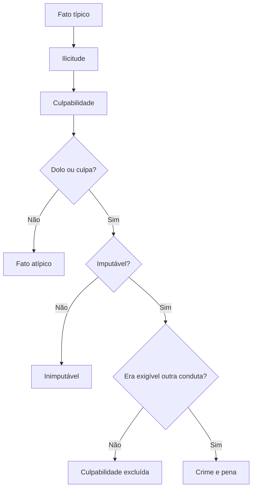

Culpabilidade é o juízo de reprovação que se faz sobre quem praticou fato típico e ilícito. Ela responde a uma
pergunta simples: era exigível que esse agente agisse de outro modo? No Código Penal Militar, a resposta passa por
dolo, culpa, imputabilidade e exigibilidade de conduta diversa, nessa ordem. E é justamente aí que o CPM mais se
afasta do Código Penal comum, porque coloca dolo e culpa dentro da culpabilidade, e não na conduta.

> [!objetivos]
> - Listar os elementos da culpabilidade no CPM e explicar por que eles ficam nessa camada.
> - Diferenciar erro de direito, erro de fato e erro acidental, com os efeitos de cada um.
> - Explicar as descriminantes putativas e a teoria adotada.
> - Reconhecer as causas que excluem a culpabilidade por inexigibilidade de conduta diversa.
> - Aplicar o limite do art. 40 aos crimes que violam o dever militar.

## Os elementos da culpabilidade

No CPM, a culpabilidade reúne **dolo ou culpa**, **imputabilidade** e **exigibilidade de conduta diversa**. Essa
ordem é consequência da filiação causalista neoclássica: primeiro se verifica o fato típico, depois a ilicitude,
depois a reprovação sobre o autor.

A prova cobra a diferença em assertivas curtas. Dizer que o dolo integra a conduta no CPM é errado; dizer que o
dolo integra a culpabilidade é correto. Dizer que a imputabilidade é pressuposto da culpabilidade também é
aceito, porque sem capacidade de compreender não há reprovação possível.

| Elemento | Pergunta que responde | Ausência gera |
| --- | --- | --- |
| Dolo ou culpa | O agente quis, assumiu o risco ou faltou ao cuidado? | Fato atípico, se não houver nem dolo nem culpa |
| Imputabilidade | O agente podia compreender o caráter ilícito? | Inimputabilidade |
| Exigibilidade de conduta diversa | Era possível exigir outro comportamento? | Exclusão da culpabilidade |

## Dolo e culpa

O art. 33 define o crime doloso e o culposo.

**Dolo** é a vontade de produzir o resultado ou a aceitação do risco de produzi-lo. Há **dolo direto**, quando o
resultado é querido, e **dolo eventual**, quando o agente não quer o resultado, mas assume o risco de que ele
ocorra.

**Culpa** é a falta de cautela, atenção ou diligência exigível nas circunstâncias. O agente não prevê o resultado
que podia prever, ou prevê e acredita, sem base, que ele não ocorrerá ou que poderá evitá-lo. A primeira hipótese
é de **culpa inconsciente**; a segunda, de **culpa consciente**.

> [!atencao] Culpa consciente e dolo eventual
> A fronteira é a aceitação do risco. Na culpa consciente, o agente confia de verdade que o resultado não virá; no
> dolo eventual, ele não se importa com a possibilidade. O exemplo militar: o motorista que ultrapassa em curva
> confiando que não vem carro (culpa consciente) e o que ultrapassa "custe o que custar", sabendo que pode bater
> (dolo eventual).

O CPM adota o ***dolus malus***: o dolo inclui a consciência da ilicitude. Isso é consequência da filiação
causalista. No finalismo, a consciência da ilicitude fica na culpabilidade, separada do dolo.

> [!lei] CPM, art. 33, parágrafo único
> Salvo os casos expressos em lei, ninguém pode ser punido por fato previsto como crime, senão quando o pratica
> dolosamente.

O dispositivo consagra a **excepcionalidade do crime culposo**. Em regra, todo crime é doloso; a forma culposa só
existe quando a lei a prevê expressamente. Daí a formulação usada nas provas: todo crime admite dolo, mas nem todo
crime admite culpa.

> [!pegadinha] "Todo crime admite a forma culposa"
> A assertiva é falsa. O crime culposo depende de previsão legal expressa. Homicídio e lesão corporal têm forma
> culposa; a deserção, por exemplo, não tem, porque o tipo exige a intenção de abandonar o serviço.

### Resultado agravador e preterdolo

O art. 34 impede a responsabilidade objetiva pelo resultado que agrava a pena. O agente só responde pelo
agravamento se o causou ao menos por culpa.

O caso mais comum é o **crime preterdoloso**: dolo na conduta e culpa no resultado mais grave. O militar que dá
uma "gravata" para conter um colega e causa a morte sem querer responde por lesão seguida de morte, com dolo na
lesão e culpa no resultado.

Há também o resultado que agrava por atingir **outro bem jurídico**. Na violência contra superior, a agressão pode
causar lesão corporal; o bem principal é a autoridade militar e o agravamento alcança a integridade física. Se
houve culpa no resultado agravador, as penas se somam quando as espécies são iguais.

> [!bizu] Preterdolo
> Dolo na frente, culpa no fim. Se não houver culpa no resultado mais grave, o agravamento não se aplica; se
> houver dolo também no resultado, há outro crime, e não preterdolo.

## Erro de direito

O Código Penal comum separa erro de tipo, que recai sobre elementos do fato, e erro de proibição, que recai sobre
a ilicitude. O CPM usa outros nomes: **erro de fato** (art. 36) e **erro de direito** (art. 35). A tabela
relaciona os dois sistemas.

| Código Penal | CPM | Efeito |
| --- | --- | --- |
| Erro de tipo | Erro de fato (art. 36) | Exclui o dolo; pode isentar de pena ou gerar culpa |
| Erro de proibição | Erro de direito (art. 35) | Atenua ou substitui a pena |

O erro de direito está no art. 35. Quando, por desconhecimento ou por interpretação equivocada da norma, o
agente acredita que o fato é permitido, e o engano é escusável, o juiz pode atenuar a pena ou trocá-la por outra
menos grave.

Três detalhes importam.

O primeiro é que o erro de direito **não isenta de pena**. Ele apenas reduz ou troca a pena. A diferença em
relação ao modelo do Código Penal é grande, porque lá o erro de proibição inevitável isenta de pena.

O segundo é a exceção: o benefício **não vale para crime que atenta contra o dever militar**. Nesses casos, o
agente responde como se conhecesse a lei.

O terceiro é o critério de escusabilidade. No erro de direito, o juízo é **profano**: avaliam-se as condições
pessoais e a capacidade do próprio agente, e não o homem médio.

> [!exemplo] Erro de direito na rotina da tropa
> Um soldado recebe orientação errada, dada por escrito em boletim interno, de que pode transportar determinado
> equipamento para casa no fim de semana. Ele acredita que a conduta é permitida. Se o erro é escusável, o juiz
> pode atenuar ou substituir a pena. Se o crime atenta contra o dever militar, a atenuante não incide.

> [!atencao] Posição doutrinária sobre o art. 35
> Neves sustenta que o art. 35 não foi recepcionado pela Constituição, porque permitiria punir quem não tinha
> sequer possibilidade de conhecer a ilicitude, o que equivale a responsabilidade objetiva. Ele propõe aplicar
> a regra do Código Penal sobre erro de proibição por analogia. Na prova objetiva, prevalece a letra do Código; a
> crítica doutrinária serve
> para a discursiva.

## Erro de fato

O art. 36 isenta de pena quem, por **erro plenamente escusável**, supõe que falta um dado de fato exigido pelo
tipo, ou supõe presente um contexto fáctico que daria amparo legal à conduta.

O critério aqui é diferente do erro de direito. No erro de fato, a escusabilidade é medida pelo **homem médio**:
pergunta-se se uma pessoa de prudência comum, nas mesmas circunstâncias, também se enganaria.

> [!lei] CPM, art. 36
> É isento de pena quem, ao praticar o crime, supõe, por erro plenamente escusável, a inexistência de
> circunstância de fato que o constitui ou a existência de situação de fato que tornaria a ação legítima.

O erro de fato se divide em duas grandes famílias.

### Erro essencial

O erro essencial recai sobre elemento do tipo. Se for **plenamente escusável**, isenta de pena. Se for **evitável**,
o agente responde por **culpa**, desde que o crime tenha forma culposa (art. 36, § 1º).

> [!exemplo] A seringa trocada
> Um médico prepara uma seringa com substância letal para um procedimento experimental e a deixa sobre a bancada.
> Uma enfermeira, acreditando ser soro, aplica no paciente, que morre. A enfermeira agiu em erro essencial sobre o
> conteúdo da seringa: se o erro era plenamente escusável, não é punida; se havia indícios que exigiam conferência,
> responde por homicídio culposo. O médico responde conforme sua própria conduta.

O § 2º do art. 36 trata do **erro provocado por terceiro**. Nesse caso, responde quem provocou o erro, a título de
dolo ou de culpa, conforme o caso. A regra resolve a hipótese do agente que é usado como instrumento por outro.

Vale registrar um ponto que a doutrina destaca: **não existe participação dolosa em crime culposo**. Se a
enfermeira soubesse do veneno e aplicasse mesmo assim, haveria dolo dela e concurso de pessoas com o médico. Se
apenas errou sem perceber, cada um responde por sua própria conduta culposa, sem vínculo de participação.

### Erro acidental

O erro acidental **não isenta de pena**. Ele recai sobre dados secundários, e não sobre a existência do crime. O
art. 37 disciplina três hipóteses.

| Hipótese | O que acontece | Efeito |
| --- | --- | --- |
| Erro sobre a pessoa | O agente confunde a vítima | Responde como se tivesse atingido a vítima pretendida |
| Erro na execução (*aberratio ictus*) | O agente erra a mira ou o meio | Também responde como se tivesse atingido a vítima pretendida |
| *Aberratio criminis* | O agente atinge bem jurídico diverso | Responde por culpa pelo bem atingido, se houver forma culposa |

No erro sobre a pessoa, o agente vê uma pessoa e pensa ser outra. Na execução, ele sabe quem quer atingir, mas
erra o golpe ou o disparo. O tratamento é o mesmo: consideram-se as qualidades da vítima **pretendida**, e não as
da vítima real.

> [!exemplo] O disparo que acerta o irmão
> Um cabo dispara contra quem acredita ser o colega que o humilhou, mas acerta o próprio irmão, que passava. Ele
> responde como se tivesse atingido o colega. Se o parentesco com o irmão agravaria a pena, essa qualidade não é
> considerada, porque a vítima pretendida era outra.

Na **aberratio criminis**, o resultado atinge bem jurídico diferente do planejado. Quem joga uma pedra para atingir
um desafeto e quebra a vidraça de uma viatura responde por dano culposo, se o dano tiver forma culposa. Se atingir
ao mesmo tempo a pessoa e a coisa, aplica-se a regra do concurso de crimes (art. 79).

> [!pegadinha] Erro acidental não isenta
> A banca escreve: "o erro quanto à pessoa exclui o dolo e isenta o agente de pena". É falso. O erro acidental
> mantém a punição, e o agente responde como se tivesse atingido quem pretendia. A isenção existe apenas no erro de
> fato essencial plenamente escusável.

## Descriminantes putativas

A descriminante putativa é a situação do agente que sabe que o fato é ilícito, mas supõe, por erro, estar
amparado por uma excludente de ilicitude. Ele acredita agir em legítima defesa, por exemplo, quando na verdade não
havia agressão.

O art. 36 trata do tema na parte final, ao mencionar a hipótese de o agente supor presente um contexto fáctico
que daria amparo legal à conduta. Se o erro é plenamente escusável, isenta de pena; se era evitável, o agente
responde por culpa, quando existir tipo culposo.

Como dolo e culpa estão na culpabilidade, o CPM se aproxima da **teoria extremada** das descriminantes putativas:
o erro sobre a excludente é tratado como erro de proibição, que exclui a culpabilidade.

> [!atencao] Teoria extremada na prática
> Na teoria limitada, o erro sobre os pressupostos de uma excludente é erro de tipo e exclui o dolo. Na extremada,
> é erro de proibição e exclui a culpabilidade. O CPM segue a extremada. Na prova objetiva, a resposta correta é
> "exclui a culpabilidade", e não "exclui o dolo".

## Exigibilidade de conduta diversa

Só se pune quem podia agir de outro modo. Quando as circunstâncias retiram essa possibilidade, a culpabilidade cai,
mesmo que o fato continue típico e ilícito. O CPM prevê três hipóteses.

O teste é concreto. Não se pergunta se uma pessoa ideal teria resistido, mas se o agente específico, naquela
situação, tinha alternativa razoável. Por isso a análise olha para o contexto: ameaça, hierarquia, risco
iminente, condições pessoais. A consequência é importante para a prova: a inexigibilidade não torna o fato
lícito, e por isso o terceiro que reage ao fato continua podendo invocar legítima defesa.

### Coação irresistível

O art. 38, a, declara não culpado quem comete o crime sob coação irresistível ou sob coação que suprima a
faculdade de agir segundo a própria vontade. Quem responde é o autor da coação (art. 38, § 1º).

A doutrina separa duas figuras. A **coação física** suprime a vontade e a própria conduta, e por isso exclui o
crime. A **coação moral** reduz a liberdade de decidir, mas não elimina a conduta, e por isso exclui a
culpabilidade. No CPM, o interesse prático está na coação moral.

> [!atencao] Limite no dever militar
> O art. 40 impede o militar de invocar coação irresistível nos crimes que violam o dever militar, salvo quando a
> coação é física ou material. A regra é dura e muito criticada pela doutrina, porque exige do militar um
> heroísmo que a lei não pode presumir. Em prova, porém, vale a letra: coação moral não exclui a culpabilidade
> nesses crimes.

Se era possível resistir à coação, o juiz pode atenuar a pena, considerando as condições pessoais do réu
(art. 41). Nesse caso, coator e coagido respondem, mas o coagido pode receber pena menor.

### Obediência hierárquica

O art. 38, b, exclui a culpabilidade de quem cumpre, com **obediência estrita**, ordem direta recebida do
superior e referente ao serviço. A ordem precisa vir do superior para o subordinado e tratar de assunto
funcional.

O § 2º, com a redação da Lei 14.688/2023, mantém a punição do subordinado quando a ordem tem por objeto **ato
manifestamente criminoso**, ou quando há excesso nos atos ou na forma de execução.

Aqui está o ponto mais cobrado. A ordem **manifestamente criminosa** é aquela em que o crime salta aos olhos: o
subordinado percebe e, mesmo assim, cumpre. Nesse caso, ele responde junto com quem ordenou. Vale a ideia das
"baionetas inteligentes": quem reconhece a ilicitude deve recusar a ordem.

A ordem **não manifestamente criminosa** é aquela em que o subordinado não tem condições de perceber a ilicitude
de imediato. O dever de obediência torna inexigível outra conduta, e a culpabilidade é excluída.

> [!exemplo] Ordem de revista
> Um tenente determina que o soldado revista, sem mandado, a casa de um civil, afirmando que há autorização
> verbal do juiz. O soldado não tem como conferir e cumpre a ordem. A ordem não é manifestamente criminosa para
> ele, e a culpabilidade pode ser excluída. Se o tenente dissesse "entre e pegue o que quiser, sem mandado, e
> depois resolvemos", o crime seria evidente, e o soldado responderia junto.

> [!pegadinha] A redação confusa do art. 41
> O art. 41 fala em atenuar a pena quando a ordem "não era manifestamente ilegal", o que contradiz a exclusão da
> culpabilidade. A doutrina lê o dispositivo às avessas: a atenuação aparece quando a ordem **era** manifestamente
> criminosa e o subordinado cumpriu sob circunstâncias que reduzem a reprovação. Na objetiva, siga a letra; na
> discursiva, explique a leitura doutrinária.

### Estado de necessidade exculpante

O Código Penal comum adota a teoria **unitária**, com o estado de necessidade apenas como excludente de ilicitude.
O CPM adota a teoria **diferenciadora**, com duas espécies.

A tabela compara as duas.

| Critério | Justificante (art. 42, I, e art. 43) | Exculpante (art. 39) |
| --- | --- | --- |
| Efeito | Exclui a ilicitude | Exclui a culpabilidade |
| Bem protegido | Direito próprio ou alheio | Direito próprio ou de pessoa ligada por parentesco ou afeição |
| Mal causado | Consideravelmente inferior ao evitado | Pode ser igual ou superior |
| Condição | Agente não obrigado a enfrentar o perigo | Não era razoavelmente exigível outra conduta |

O estado de necessidade exculpante do art. 39 exige perigo certo e atual, não provocado pelo agente e inevitável
de outro modo, e protege direito próprio ou de pessoa ligada por estreitas relações de parentesco ou afeição. O
sacrifício pode recair sobre direito alheio ainda que superior ao protegido, desde que não fosse razoavelmente
exigível outra conduta.

Quando o sacrifício do direito ameaçado podia ser razoavelmente exigido, o juiz pode atenuar a pena (art. 41).

## Imputabilidade

Imputabilidade é a capacidade de compreender o caráter ilícito do fato e de se determinar conforme essa
compreensão. Quem não tem essa capacidade é inimputável, e o tema é tratado com profundidade no capítulo sobre
imputabilidade penal e embriaguez deste volume.

Para a culpabilidade, o essencial é a ordem lógica: a imputabilidade é analisada antes da exigibilidade de
conduta diversa, porque sem capacidade de compreensão não existe reprovação possível. A imputabilidade é, por
isso, **pressuposto** da culpabilidade, e não seu sinônimo. Um militar que não conseguia entender o caráter
ilícito do fato não é culpável, ainda que o fato seja típico e ilícito.

### Ponte com o capítulo anterior

Três institutos estudados antes não pertencem a esta camada. A **desistência voluntária** e o **arrependimento
eficaz** afastam a tipicidade da tentativa, e o agente responde apenas pelos atos já praticados. O **crime
impossível** também impede a tipicidade, pela ineficácia absoluta do meio ou pela impropriedade absoluta do
objeto. Nenhum deles é causa de exclusão da culpabilidade, e trocar essas categorias é erro frequente em prova.

## Mapa do capítulo

| Tema | Regra central | Pegadinha |
| --- | --- | --- |
| Elementos | Dolo ou culpa, imputabilidade e exigibilidade | Colocar o dolo na conduta |
| Dolo | Direto e eventual | Confundir eventual com culpa consciente |
| Culpa | Consciente e inconsciente; exige previsão legal | Achar que todo crime tem forma culposa |
| Resultado agravador | Exige ao menos culpa (art. 34) | Responsabilizar objetivamente |
| Erro de direito | Atenua ou substitui a pena; não isenta | Dizer que isenta de pena |
| Erro de fato | Isenta se plenamente escusável (homem médio) | Aplicar o juízo profano |
| Erro acidental | Pune como se atingida a vítima pretendida | Dizer que isenta |
| Descriminante putativa | Teoria extremada: exclui a culpabilidade | Dizer que exclui o dolo |
| Coação moral | Exclui a culpabilidade, salvo dever militar | Invocar coação moral em crime contra o dever militar |
| Obediência | Ordem não manifestamente criminosa exclui | Achar que ordem ilegal sempre exclui |
| Estado de necessidade | Justificante e exculpante (teoria diferenciadora) | Tratar as duas como iguais |

### Para fixar

- No CPM, os elementos da culpabilidade são dolo ou culpa, imputabilidade e exigibilidade de conduta diversa.
- O crime culposo é exceção e depende de previsão legal expressa (art. 33, parágrafo único).
- O resultado que agrava a pena só se imputa se causado ao menos por culpa (art. 34).
- O erro de direito atenua ou substitui a pena, com juízo profano, e não vale em crime contra o dever militar.
- O erro de fato isenta de pena quando plenamente escusável, com juízo de homem médio; se evitável, gera culpa.
- Erro provocado por terceiro responsabiliza quem provocou, a título de dolo ou culpa.
- Erro sobre a pessoa e erro na execução punem como se atingida a vítima pretendida; na aberratio criminis,
  responde por culpa pelo bem atingido, e havendo os dois resultados, há concurso.
- Descriminante putativa segue a teoria extremada e exclui a culpabilidade.
- Coação moral irresistível e ordem não manifestamente criminosa excluem a culpabilidade; o art. 40 veda a coação
  moral nos crimes contra o dever militar.
- O estado de necessidade exculpante (art. 39) admite sacrificar bem igual ou superior, quando não era exigível
  outra conduta.
