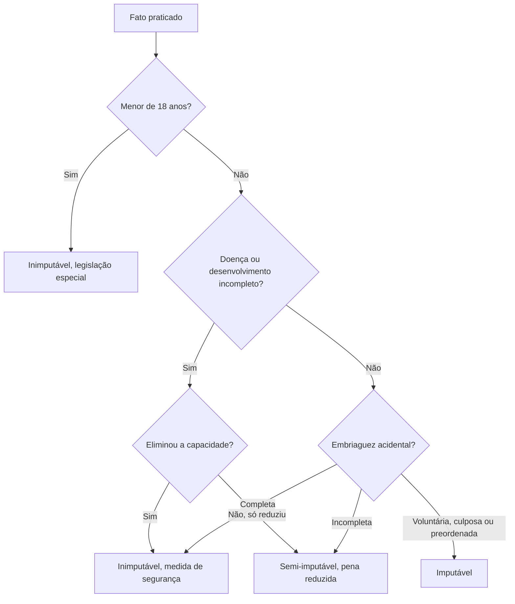

Nem todo mundo que pratica fato típico e ilícito responde com pena. Quem não tem capacidade de entender que o ato
é ilícito, ou de se comportar conforme esse entendimento, é inimputável e recebe medida de segurança. O tema
parece simples até a banca perguntar sobre embriaguez, sobre o momento em que a capacidade é avaliada ou sobre o
que mudou com a Lei 14.688/2023. Este capítulo organiza esses pontos.

> [!objetivos]
> - Explicar o critério biopsicológico e diferenciá-lo do critério biológico da menoridade.
> - Aplicar o art. 48 aos casos de doença mental e de semi-imputabilidade.
> - Classificar a embriaguez e indicar o efeito de cada espécie.
> - Reconhecer a situação do menor de 18 anos e o que foi revogado em 2023.
> - Identificar quando a perícia é necessária e quais quesitos ela responde.

## O que é imputabilidade

Imputabilidade é a capacidade de compreender o caráter ilícito do fato e de se determinar conforme essa
compreensão. Ela integra a culpabilidade, como pressuposto. Sem imputabilidade, não há reprovação possível.

O Código não define quem é imputável. Ele define quem **não** é. A técnica é comum: o legislador descreve a
exceção e deixa a regra implícita. Quem tem 18 anos ou mais, sem doença ou deficiência mental que afete a
capacidade, é presumidamente imputável.

A consequência prática da inimputabilidade é a substituição da pena por **medida de segurança**. O processo,
porém, não para: ele segue até as alegações finais, porque ainda pode haver absolvição por negativa de autoria ou
por atipicidade. A sentença que absolve o inimputável e aplica medida de segurança é chamada de **absolutória
imprópria**.

## Doença mental e semi-imputabilidade

O art. 48 adota o critério **biopsicológico**. Não basta a existência da doença: é preciso que, no momento da
conduta, ela tenha eliminado a capacidade de entender a ilicitude ou de agir conforme esse entendimento.

> [!lei] CPM, art. 48
> Não é imputável quem, no momento da ação ou da omissão, não possui a capacidade de entender o caráter ilícito do
> fato ou de determinar-se de acordo com esse entendimento, em virtude de doença mental, de desenvolvimento mental
> incompleto ou retardado.

Repare na expressão "no momento da ação ou da omissão". O que conta é o estado mental na hora da conduta. A
incapacidade civil, a interdição e o internamento anterior não decidem a questão penal. Um militar interditado
civilmente pode ser penalmente imputável se, no momento do fato, compreendia o que fazia.

O parágrafo único trata da **semi-imputabilidade**. Quando a doença ou o desenvolvimento incompleto **reduz
consideravelmente** a capacidade, sem eliminá-la, o agente continua imputável, mas a pena admite redução entre um
e dois terços. A faixa de redução foi fixada pela Lei 14.688/2023; antes, a lei dizia apenas que a pena podia ser
atenuada.

| Situação | Capacidade no momento do fato | Efeito |
| --- | --- | --- |
| Doença mental que elimina a capacidade | Nenhuma | Inimputável, com medida de segurança |
| Doença mental que reduz consideravelmente | Reduzida | Imputável, com pena reduzida de um a dois terços |
| Desenvolvimento mental incompleto ou retardado | Avaliada no caso | Inimputável ou semi-imputável |
| Incapacidade civil ou interdição | Não decide | Imputabilidade avaliada pela perícia |

> [!atencao] Perícia e quesitos
> A perícia do incidente de insanidade mental responde aos quesitos do art. 159 do Código de Processo Penal
> Militar: existe doença mental ou desenvolvimento incompleto ou retardado? O acusado estava nesse estado ao agir?
> Por causa disso, tinha capacidade de entender a ilicitude ou de se determinar? A doença reduziu muito essa
> capacidade, sem suprimi-la? As respostas encaixam o caso no caput, no parágrafo único ou na imputabilidade
> plena.

> [!exemplo] Doença real, capacidade preservada
> Um cabo com diagnóstico de transtorno de ansiedade grave agride um superior durante uma discussão. A perícia
> confirma a doença, mas conclui que, no momento da agressão, ele compreendia perfeitamente o caráter ilícito do
> ato e podia se controlar. Ele é imputável. A doença existe, mas não produziu o efeito psicológico exigido pelo
> art. 48.

## Embriaguez

A embriaguez só interessa ao Direito Penal quando afeta a capacidade de compreensão ou de determinação. O CPM
trata do tema no art. 49 e distingue as espécies com precisão.

A **embriaguez acidental** vem de caso fortuito ou de força maior, sem que o agente tenha querido se embriagar.
Ela pode ser completa ou incompleta.

Na **completa**, o agente era inteiramente incapaz de entender a ilicitude ou de se determinar. Ele é
inimputável, com medida de segurança.

Na **incompleta**, a capacidade ficou reduzida, mas não eliminada. O agente é imputável, com pena reduzida de um
a dois terços.

| Espécie | Efeito |
| --- | --- |
| Acidental completa | Inimputável |
| Acidental incompleta | Imputável, com pena reduzida de um a dois terços |
| Patológica (alcoolismo como doença) | Tratada como doença mental (art. 48) |
| Voluntária ou culposa | Não exclui nem reduz a imputabilidade |
| Preordenada | Imputável, com agravante (art. 70, II, c) |

A **embriaguez voluntária** é a que o agente provoca conscientemente. A **culposa** decorre de imprudência, como
beber em quantidade sem perceber o efeito. Nenhuma das duas exclui ou reduz a imputabilidade. A lei parte da ideia
de que quem bebe por vontade própria assume o risco do que fizer.

A **embriaguez preordenada** é a planejada para criar coragem. Além de não excluir a imputabilidade, é
circunstância agravante para militar ou civil.

A **embriaguez patológica**, quando o alcoolismo é tratado como doença, segue o regime do art. 48, com
inimputabilidade ou semi-imputabilidade conforme o efeito psicológico.

> [!pegadinha] Só a embriaguez involuntária isenta
> A banca escreve: "a embriaguez completa sempre exclui a imputabilidade". É falso. Só a embriaguez **acidental**
> completa isenta. A voluntária e a culposa mantêm a imputabilidade, e a preordenada ainda agrava.

> [!pegadinha] Agravante e sujeito
> A embriaguez preordenada agrava para militar e para civil. A embriaguez voluntária simples, fora de serviço,
> agrava apenas quando o agente é militar. Trocar o destinatário da agravante é erro comum.

### Embriaguez em serviço

Em serviço, embriagar-se ou apresentar-se embriagado é crime militar autônomo. A conduta só admite forma dolosa e
pode entrar em concurso com o delito praticado nesse estado, como a violência contra superior.

Fora de serviço, o militar que se embriagou por vontade própria ou por descuido responde pelo crime que praticar,
com a agravante do art. 70, II, c, que só não incide quando a embriaguez vem de caso fortuito, engano ou força
maior. O civil só sofre essa agravante quando a embriaguez foi preordenada (art. 70, parágrafo único).

## Menores de 18 anos

O art. 50 fixa a inimputabilidade penal do menor de 18 anos, sujeito à legislação especial, com medidas
socioeducativas. O critério é puramente **biológico**: basta a idade, sem análise de desenvolvimento.

A Lei 14.688/2023 ajustou o sistema. Antes, havia a possibilidade de tratar como imputável o maior de 16 anos com
desenvolvimento suficiente, com pena reduzida. Essa regra foi eliminada, e o critério passou a ser rígido, em
harmonia com a Constituição.

Os arts. 51 e 52 também foram **revogados** pela Lei 14.688/2023. O art. 51 equiparava a maiores de 18 anos
militares, convocados e alunos de escolas militares com 17 anos; o art. 52 previa medidas educativas, curativas ou
disciplinares para menores inimputáveis. A assertiva que ainda os cita como vigentes está errada.

## Elementos não constitutivos do crime

O art. 47 trata de qualidades que deixam de integrar o tipo em duas hipóteses. A primeira é o desconhecimento da
qualidade de superior ou de inferior hierárquico. A segunda é a ação praticada em repulsa a agressão, caso em que
também deixam de integrar o tipo as funções de sentinela, de vigia, de plantão e de oficial de dia, de serviço
ou de quarto.

A consequência é o deslocamento da imputação para o tipo compatível com o que o agente conhecia. Quem não sabia
estar diante de um superior não responde por crime que pressupõe essa qualidade.

> [!bizu] Imputabilidade em três perguntas
> É menor de 18 anos? Inimputável. Tinha doença que eliminou a compreensão no momento do fato? Inimputável. A
> doença apenas reduziu muito a compreensão? Semi-imputável. Se a resposta for não para as três, é imputável.

## Mapa do capítulo

| Situação | Critério | Efeito |
| --- | --- | --- |
| Menor de 18 anos | Biológico | Inimputável, legislação especial |
| Doença mental que elimina a capacidade | Biopsicológico | Inimputável, medida de segurança |
| Doença que reduz consideravelmente | Biopsicológico | Pena reduzida de um a dois terços |
| Embriaguez acidental completa | Biopsicológico | Inimputável |
| Embriaguez acidental incompleta | Biopsicológico | Pena reduzida de um a dois terços |
| Embriaguez voluntária, culposa ou preordenada | Não afasta | Imputável |
| Incapacidade civil | Irrelevante | Imputabilidade decidida pela perícia |

### Para fixar

- Imputabilidade é pressuposto da culpabilidade e se mede no momento da conduta.
- O CPM adota critério biopsicológico para doença mental e critério biológico para a menoridade.
- Doença mental que elimina a capacidade gera inimputabilidade e medida de segurança (art. 48).
- Doença que reduz consideravelmente a capacidade gera pena reduzida de um a dois terços.
- A capacidade civil e a interdição não decidem a imputabilidade penal.
- A perícia do incidente de insanidade mental responde aos quesitos do art. 159 do CPPM.
- Só a embriaguez acidental completa isenta; a incompleta reduz a pena de um a dois terços (art. 49).
- Embriaguez voluntária e culposa não excluem a imputabilidade; a preordenada é agravante.
- Menor de 18 anos é inimputável, com critério biológico; os arts. 51 e 52 foram revogados em 2023.
- O art. 47 retira a qualidade de superior ou de inferior do tipo quando desconhecida ou em repulsa a agressão.
