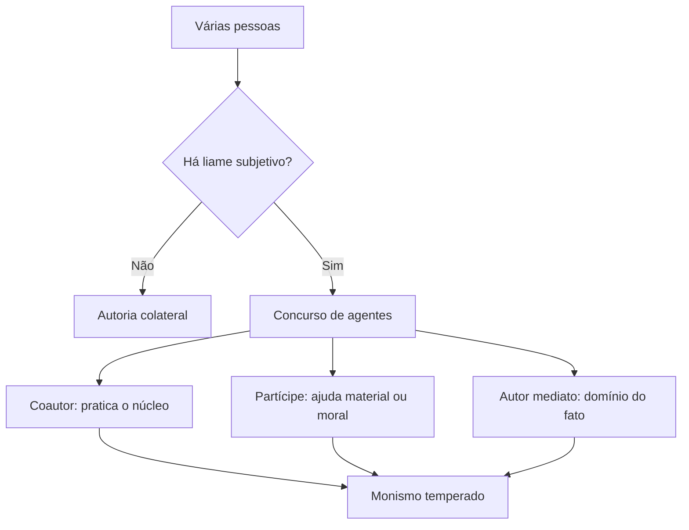

Quando duas ou mais pessoas concorrem para o mesmo crime, o Código precisa responder a três perguntas: quantos
crimes existem, quem responde por quê e como se comunicam as condições pessoais de cada um. O CPM segue o Código
Penal comum na base, mas tem regras próprias para os crimes de autoria coletiva necessária, os chamados
"cabeças". Este capítulo fecha o volume com esse tema.

> [!objetivos]
> - Listar os requisitos do concurso de pessoas e reconhecer a autoria colateral.
> - Explicar a teoria monista temperada adotada pelo CPM.
> - Diferenciar autor, coautor e partícipe, inclusive na autoria mediata.
> - Aplicar a comunicação das circunstâncias pessoais e das elementares.
> - Identificar as agravantes do art. 53 e a figura do cabeça.

## Requisitos do concurso

O concurso de agentes exige cinco requisitos, todos cumulativos:

- **pluralidade** de agentes e de condutas;
- **relevância causal** de cada conduta para o resultado;
- **identidade** de infração, com todos respondendo pelo mesmo crime;
- **existência de fato punível**;
- **liame subjetivo**, isto é, vínculo psicológico entre os agentes.

A falta do liame subjetivo produz a **autoria colateral**. Dois militares atiram na mesma pessoa sem saber um da
presença do outro. Não há concurso: cada um responde pelo que causou. Se o tiro de um foi o que matou, ele responde
por homicídio consumado, e o outro, por tentativa.

> [!pegadinha] Coautoria sem acordo
> A coautoria exige vínculo psicológico, ainda que não haja acordo prévio formal. Basta que um saiba da conduta do
> outro e queira o resultado comum. Se cada um age sem saber do outro, não há coautoria, e a solução é a autoria
> colateral.

## Teorias sobre o concurso

Três teorias explicam quantos crimes existem quando várias pessoas participam.

| Teoria | Ideia |
| --- | --- |
| Pluralista | Cada participante comete crime próprio: dez agentes, dez crimes |
| Dualista | Um crime para os autores e outro para os partícipes |
| Monista | Um só crime, ainda que haja vários agentes |

O CPM adota a **teoria monista**, de forma **temperada**. A regra está no art. 53: quem de qualquer modo contribui
para o crime sofre as penas previstas para ele, seja coautor ou partícipe. É uma única infração para todos, mas a
culpabilidade de cada um é analisada separadamente.

O tempero aparece justamente aí. Se um participante é inimputável por doença mental, só ele recebe o tratamento
correspondente, e os demais respondem normalmente. O crime é um; a resposta penal é individual.

> [!lei] CPM, art. 53
> Quem, de qualquer modo, concorre para o crime incide nas penas a este cominadas.

## Autor, coautor e partícipe

O conceito adotado é o **objetivo-formal**, mitigado pela teoria do **domínio do fato**.

Pelo critério objetivo-formal, **autor** é quem pratica o núcleo do tipo, o verbo principal da descrição legal.
**Partícipe** é quem presta ajuda material, como fornecer a arma, ou ajuda moral, como induzir ou instigar.

O critério objetivo-formal não resolve a **autoria mediata**, em que alguém usa outra pessoa como instrumento. Para
isso serve o domínio do fato: autor é quem controla a execução, ainda que não pratique o núcleo do tipo. Quem
determina que um inimputável pratique o crime tem o domínio do fato e responde como autor.

> [!exemplo] O instrumento humano
> Um sargento convence um soldado com doença mental grave, sem capacidade de compreensão, a furtar munição do
> paiol. O soldado é inimputável e não responde; o sargento responde como autor mediato do furto, porque controlou
> a execução por meio de outra pessoa.

## Comunicação de circunstâncias

A regra é clara: as circunstâncias de caráter **pessoal não se comunicam**, salvo quando forem **elementares** do
crime.

Circunstância pessoal é a condição que diz respeito apenas a um dos agentes, como reincidência, parentesco ou
motivo pessoal. Ela não se estende aos demais.

Elementar é o dado que integra o tipo. A condição de militar, nos crimes propriamente militares, é elementar. Por
isso, em regra, ela se comunica ao concorrente civil, que responde em concurso com militar. É o caso do motim, que
pressupõe a qualidade de militar da ativa.

| Circunstância | Comunica? | Exemplo |
| --- | --- | --- |
| Condição de militar, em crime propriamente militar | Sim, porque é elementar | Civil que participa de motim |
| Reincidência | Não | Só agrava a pena do reincidente |
| Parentesco com a vítima | Não | Só agrava quem é parente |
| Motivo pessoal | Não | Só alcança quem tem o motivo |

> [!atencao] Elementar x circunstância
> A pergunta decisiva é se o dado integra o tipo. Se integrar, comunica-se a quem tinha conhecimento dele. Se for
> apenas circunstância, fica restrito ao agente que a possui. Nos crimes propriamente militares, a condição de
> militar é elementar, e é isso que permite ao civil responder pelo crime militar em concurso.

## Agravantes e atenuante

O art. 53 agrava a pena de quatro grupos de participantes:

- quem organiza ou promove a cooperação, ou dirige a atividade dos outros;
- quem obriga alguém, por coação, a executar materialmente o crime;
- quem instiga ou determina o crime a pessoa sob sua autoridade ou não punível por condição pessoal;
- quem executa o crime ou participa dele por paga ou promessa de recompensa.

São agravantes genéricas, aplicadas na segunda fase da dosimetria. Se a circunstância já qualifica o crime, como a
paga no homicídio, não se aplica também a agravante, para evitar dupla punição pelo mesmo fato.

A pena é **atenuada** para quem teve participação de **somenos importância**, isto é, ajuda quase insignificante,
mas útil. A participação **inócua**, que em nada contribuiu, **não é punível**.

> [!bizu] Somenos x inócua
> Somenos importância ajuda pouco, mas ajuda: a pena diminui. Participação inócua não ajuda em nada: não há pena.
> Emprestar a corda usada no furto é somenos; levar a corda que ninguém usou é inócuo.

## Cabeças

Nos crimes de **autoria coletiva necessária**, que só existem com várias pessoas, o CPM cria a figura do
**cabeça**. São cabeças quem lidera a ação ou quem a provoca, instiga ou excita.

Há uma regra própria e muito cobrada: se participam inferiores e oficiais, os **oficiais são cabeças**, e também os
inferiores que exercem função de oficial.

O exemplo típico é o motim organizado por um sargento, com participação mínima de um tenente e vários soldados.
Tanto o sargento como o tenente são cabeças. Também é cabeça a praça que, na função de fiscal de dia, exerce papel
de oficial, sem precisar ter instigado ninguém.

> [!pegadinha] Cabeça não é sinônimo de autor
> A figura do cabeça só existe nos crimes de autoria coletiva necessária. Em crime comum, o líder é coautor ou
> partícipe, e a liderança é agravante do art. 53. Aplicar a regra do cabeça fora desses crimes é erro.

## Punibilidade da participação

Quem ajusta, determina, instiga ou auxilia só é punido se o crime ao menos for tentado, salvo previsão legal em
contrário (art. 54). É a **acessoria limitada**: o partícipe responde se o fato principal é típico e ilícito e
chegou, no mínimo, à tentativa.

A regra tem consequências práticas. Se o autor desiste de forma voluntária antes de iniciar a execução, o
partícipe que apenas instigou não responde por nada, porque não houve fato punível. Se o autor inicia a execução e
não consegue consumar, ambos respondem pela tentativa. E se o crime é impossível por ineficácia absoluta do meio,
ninguém responde, porque falta fato punível.

A acessoria é limitada, e não extremada, porque não se exige a culpabilidade do autor principal. Se o executor é
inimputável, o mandante continua respondendo como autor mediato, ainda que o instrumento humano não seja
culpável.

## Mapa do capítulo

| Tema | Regra | Pegadinha |
| --- | --- | --- |
| Requisitos | Pluralidade, relevância, identidade, fato punível, liame | Esquecer o liame |
| Teoria | Monista temperada | Dizer que é pluralista |
| Autor | Objetivo-formal, com domínio do fato | Ignorar a autoria mediata |
| Circunstâncias | Pessoais não se comunicam, salvo elementares | Achar que reincidência se comunica |
| Agravantes | Organizador, coator, instigador de subordinado, paga | Aplicar com qualificadora |
| Somenos | Atenua a pena | Confundir com participação inócua |
| Cabeças | Autoria coletiva necessária; oficiais são cabeças | Usar a figura em crime comum |
| Art. 54 | Só pune se o crime foi ao menos tentado | Punir participação sem fato punível |

### Para fixar

- Sem liame subjetivo não há concurso: a hipótese é de autoria colateral.
- O CPM adota a teoria monista temperada (art. 53): um crime, com culpabilidade individual.
- Autor é quem pratica o núcleo do tipo; a autoria mediata se explica pelo domínio do fato.
- Circunstâncias pessoais não se comunicam, salvo quando elementares, como a condição de militar.
- Agravam a pena o organizador, o coator, quem instiga subordinado ou pessoa não punível e quem age por paga.
- Participação de somenos importância atenua a pena; participação inócua não é punida.
- Cabeças são os que lideram, instigam ou excitam, nos crimes de autoria coletiva necessária.
- Em concurso entre oficiais e inferiores, os oficiais são cabeças, e também os inferiores em função de oficial.
- Pelo art. 54, a participação só se pune se o crime foi ao menos tentado.
