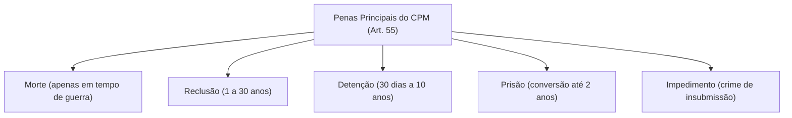
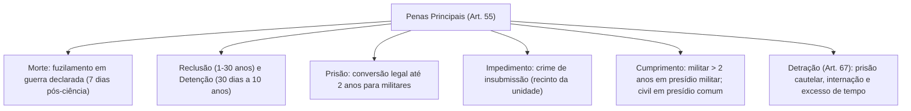

O Código Penal Militar (Decreto-Lei nº 1.001/1969) estabelece um sistema próprio de sanções penais voltado à proteção dos princípios estruturantes das corporações militares: a hierarquia e a disciplina. Ao contrário da legislação penal comum, que adota penas privativas de liberdade, restritivas de direitos e multa, a codificação penal militar estrutura suas sanções em duas categorias distintas: penas principais e penas acessórias. As penas principais são aquelas expressamente fixadas no preceito secundário de cada tipo penal incriminador militar.

> [!objetivos]
> - Identificar as espécies de penas principais do art. 55 do CPM após a Lei nº 14.688/2023.
> - Compreender a aplicação excepcional da pena de morte no ordenamento e sua execução por fuzilamento.
> - Analisar os limites temporais e regimes prisionais das penas de reclusão e detenção.
> - Distinguir as regras de conversão da pena de prisão para oficiais e praças e o impedimento na insubmissão.
> - Dominar os critérios de detração penal e a superveniência de alienação mental.

## O rol das penas principais e as alterações da Lei 14.688/2023

O catálogo de penas principais no direito penal militar encontra-se consolidado no art. 55 do Código Penal Militar. Esse rol é taxativo e foi profundamente alterado com a sanção da Lei nº 14.688/2023, que adequou normas materiais do direito repressivo militar aos princípios da Constituição Federal de 1988.

> [!lei] CPM, art. 55
> **Art. 55.** As penas principais são:
> a) morte;
> b) reclusão;
> c) detenção;
> d) prisão;
> e) impedimento;

Antes da modernização de 2023, o art. 55 trazia nas alíneas *f* e *g* as sanções de suspensão do exercício do posto, graduação, cargo ou função e de reforma. Com a revogação promovida pela Lei nº 14.688/2023, essas duas espécies deixaram de integrar o rol das penas principais. Revogaram-se também os antigos artigos 64 e 65, que regulavam sua aplicação, bem como o art. 60, que tratava do "assemelhado", figura extinta na legislação contemporânea.

> [!pegadinha] Inexistência de Pena de Multa e de Penas Alternativas
> O CPM **não prevê pena de multa** como modalidade de pena principal na Parte Geral. Questões de concurso frequentemente inserem a multa entre as penas principais para confundir o candidato. Da mesma forma, as penas restritivas de direitos da Lei nº 9.714/1998 não foram incorporadas ao CPM, mantendo o direito penal militar seu foco nas penas privativas de liberdade.

A tabela seguinte evidencia as espécies sancionatórias do art. 55 e sua situação atual:

| Espécie de Pena Principal | Previsão no CPM | Vigência Atual | Função Prática |
|---|---|---|---|
| Morte | Art. 55, alínea a | Vigor pleno | Restrita a crimes em guerra declarada |
| Reclusão | Art. 55, alínea b | Vigor pleno | Privativa de liberdade de 1 a 30 anos |
| Detenção | Art. 55, alínea c | Vigor pleno | Privativa de liberdade de 30 dias a 10 anos |
| Prisão | Art. 55, alínea d | Vigor pleno | Pena de conversão para condenações até 2 anos |
| Impedimento | Art. 55, alínea e | Vigor pleno | Específica da insubmissão (art. 183) |
| Suspensão Funcional | Art. 55, alínea f | Revogada | Excluída pela Lei nº 14.688/2023 |
| Reforma | Art. 55, alínea g | Revogada | Excluída pela Lei nº 14.688/2023 |

## A pena de morte no ordenamento militar

A Constituição de 1988 veda expressamente a pena de morte no art. 5º, inciso XLVII, alínea *a*, admitindo uma única exceção: casos de guerra externa formalmente declarada pelo Presidente da República, nos termos do art. 84, inciso XIX. O CPM, alinhado à Carta Magna, restringe a pena capital aos crimes praticados em tempo de guerra, tais como deserção em presença do inimigo, traição ou favorecimento do adversário militar.

> [!lei] CPM, arts. 56 e 57
> **Art. 56.** A pena de morte é executada por fuzilamento.
> **Art. 57.** A sentença definitiva de condenação à morte é comunicada, logo que passe em julgado, ao Presidente da República, e não pode ser executada senão depois de sete dias após a comunicação.
> **Parágrafo único.** Se a pena é imposta em zona de operações de guerra, pode ser imediatamente executada, quando o exigir o interesse da ordem e da disciplina militares.

A única modalidade permitida de execução é o fuzilamento militar. Em regra, observa-se o prazo de 7 dias contados da ciência do Presidente da República. Em zona de operações de guerra, a ordem militar admite execução imediata pelo comandante.

## Penas de reclusão e detenção: limites temporais e regimes

As penas clássicas privativas de liberdade no CPM apresentam marcos temporais mínimos e máximos próprios, estabelecidos de forma cogente pelo art. 58 do estatuto repressivo:

> [!lei] CPM, art. 58
> **Art. 58.** O mínimo da pena de reclusão é de um ano, e o máximo de trinta anos; o mínimo da pena de detenção é de trinta dias, e o máximo de dez anos.

Como o CPM não disciplinou minuciosamente os regimes de cumprimento e a progressão prisional, aplica-se a legislação penal comum (Código Penal e Lei de Execução Penal), subsidiariamente autorizada pelo art. 3º, alínea *a*, do Código de Processo Penal Militar. 

Os regimes penitenciários organizam-se pelos parâmetros a seguir:
1. **Regime Fechado**: cumprimento em penitenciária de segurança máxima ou média. Destina-se às penas de reclusão superiores a 8 anos. A pena de detenção não comporta regime inicial fechado.
2. **Regime Semiaberto**: cumprimento em colônia agrícola ou industrial. Aplica-se ao réu primário cuja sanção privativa de liberdade seja fixada em patamar superior a 4 anos e não exceda 8 anos.
3. **Regime Aberto**: cumprimento em casa de albergado ou estabelecimento congênere. Cabível ao réu primário condenado a pena igual ou inferior a 4 anos.

A escolha do regime pelo magistrado da Justiça Militar depende das circunstâncias judiciais e da gravidade concreta do fato ilícito. O condenado reincidente pode iniciar o cumprimento em regime semiaberto quando sua pena for igual ou inferior a 4 anos e suas circunstâncias judiciais forem favoráveis, conforme orientação da Súmula 269 do Superior Tribunal de Justiça.

## A pena substitutiva de prisão e sua execução

A pena de prisão consiste em modalidade especial de privação de liberdade voltada exclusivamente ao réu militar. Sua disciplina resulta de conversão legal obrigatória quando preenchidos os requisitos do art. 59 do CPM:

> [!lei] CPM, art. 59
> **Art. 59.** A pena de reclusão ou de detenção até 2 (dois) anos, aplicada a militar, é convertida em pena de prisão e cumprida, quando não cabível a suspensão condicional:
> I - pelo oficial, em recinto de estabelecimento militar;
> II - pela praça, em estabelecimento penal militar, onde ficará separada de presos que estejam cumprindo pena disciplinar ou pena privativa de liberdade por tempo superior a dois anos.
> **Parágrafo único.** Para efeito de separação, no cumprimento da pena de prisão, atender-se-á, também, à condição das praças especiais e à das graduadas, ou não; e, dentre as graduadas, à das que tenham graduação especial.

Essa conversão automática opera como uma garantia funcional do militar sentenciado a sanção privativa de liberdade de curta duração (até 2 anos), desde que não faça jus ao sursis militar. O local de cumprimento respeita os círculos hierárquicos: o oficial fica recolhido em recinto próprio de unidade militar, enquanto a praça cumpre pena em presídio militar, segregada dos presos disciplinares e dos condenados a penas mais longas. Mantém-se ainda a separação entre praças especiais (cadetes e aspirantes) e praças graduadas.

## Pena de impedimento e locais de cumprimento

A pena de impedimento, arrolada na alínea *e* do art. 55 do CPM, possui destinação exclusiva: aplica-se unicamente ao crime de insubmissão (art. 183 do CPM), delito praticado pelo convocado que não se apresenta no quartel para incorporação ao serviço militar obrigatório.

> [!lei] CPM, art. 63
> **Art. 63.** A pena de impedimento sujeita o condenado a permanecer no recinto da unidade, sem prejuízo da instrução militar.

O impedimento não submete o convocado sentenciado ao encarceramento em celas comuns. O condenado permanece restrito aos limites físicos da organização militar, desenvolvendo integralmente a rotina de instrução, marcha e exercícios com os demais recrutas.

Quanto ao local de cumprimento das penas privativas de liberdade superiores a 2 anos, os arts. 61 e 62 estabelecem distinções fundamentais entre militares e civis:
- **Militar com pena superior a 2 anos (art. 61)**: cumpre em penitenciária militar ou, na sua falta, em estabelecimento prisional comum sob a lei comum.
- **Civil na Justiça Militar (art. 62)**: cumpre a pena privativa de liberdade em presídio civil comum. Em tempo de guerra, pode ser recolhido a presídio militar por decisão judicial fundamentada.

## Superveniência de alienação mental e regras de detração

Se após a condenação definitiva sobrevier alienação mental ao sentenciado, o cumprimento converte-se em medida curativa de custódia médica:

> [!lei] CPM, art. 66
> **Art. 66.** O condenado a que sobrevenha doença mental deve ser recolhido a manicômio judiciário ou, na falta dêste, a outro estabelecimento adequado, onde lhe seja assegurada custódia e tratamento.

> [!lei] CPM, art. 67
> **Art. 67.** Computam-se na pena privativa de liberdade o tempo de prisão provisória, no Brasil ou no estrangeiro, e o de internação em hospital ou manicômio, bem como o excesso de tempo, reconhecido em decisão judicial irrecorrível, no cumprimento da pena, por outro crime, desde que a decisão seja posterior ao crime de que se trata.

O art. 67 disciplina a detração no direito penal militar, assegurando o abatimento da prisão cautelar prévia, da internação médica e do excesso temporal reconhecido em decisão irrecorrível por crime anterior. Essa decisão deve ser cronologicamente posterior ao delito atual para evitar créditos prévios perante o Judiciário.

## Mapa do capítulo

### Para fixar

1. **Rol taxativo do art. 55**: atualmente contempla cinco penas principais: morte, reclusão, detenção, prisão e impedimento. A Lei nº 14.688/2023 revogou a suspensão funcional e a reforma.
2. **Inexistência de multa**: o CPM não prevê pena de multa como sanção principal genérica na Parte Geral, nem admite penas alternativas restritivas de direitos da legislação penal comum.
3. **Pena de morte**: admissível exclusivamente em tempo de guerra declarada, cumprida por fuzilamento após decorridos sete dias da comunicação ao Presidente da República (salvo imediata em zona de combate).
4. **Pena de prisão**: decorre da conversão obrigatória de reclusão ou detenção aplicada a militar até o limite de dois anos, desde que incabível a suspensão condicional da pena.
5. **Pena de impedimento**: privativa do crime de insubmissão militar (art. 183), mantendo o apenado dentro da unidade militar sem afastar sua instrução ordinária de soldado.
6. **Regras de recolhimento**: sentenças superiores a dois anos para militares são executadas em presídios militares; civis cumprem sanção em presídios comuns com benefícios da lei comum.
7. **Detração penal militar**: desconta prisão cautelar sofrida no país ou exterior, período de internação em manicômio e excesso temporal de condenação prévia com trânsito em julgado posterior.
