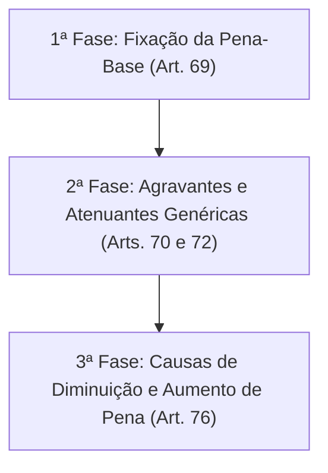
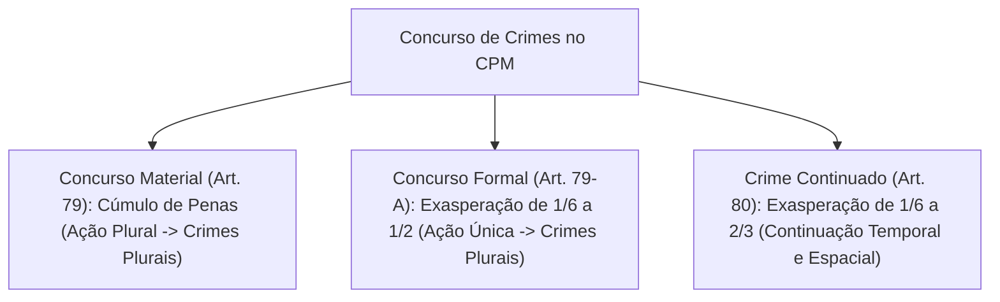
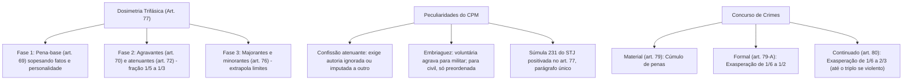

A individualização da pena constitui garantia fundamental insculpida no art. 5º, inciso XLVI, da Constituição Federal de 1988, orientando o magistrado na dosagem justa e proporcional da sanção penal em face do fato praticado e da personalidade do condenado. No âmbito do Direito Penal Militar, o processo de dosimetria da pena privativa de liberdade obedece a regras particulares expressas na Parte Geral do Código Penal Militar, as quais conjugam a avaliação do desvalor da conduta delitiva com a preservação imperiosa da hierarquia e da disciplina nas corporações militares.

> [!objetivos]
> - Compreender a positivação expressa do sistema trifásico de dosimetria pelo art. 77 do CPM após a Lei nº 14.688/2023.
> - Dominar a análise das circunstâncias judiciais objetivas e subjetivas na fixação da pena-base (art. 69 do CPM).
> - Diferenciar o rol das agravantes (art. 70) e atenuantes genéricas (art. 72), destacando as peculiaridades militares da confissão e da embriaguez.
> - Analisar a incidência de majorantes e minorantes na terceira fase e a aplicação da Súmula 231 do STJ.
> - Examinar as regras de concurso de crimes (material no art. 79, formal no art. 79-A e continuado no art. 80) e a revogação da pena indeterminada.

## O sistema trifásico de dosimetria no art. 77 do CPM

Historicamente, o Código Penal Militar de 1969 não continha disposição expressa estabelecendo a ordem cronológica das fases da dosimetria penal, o que compelia a doutrina militar e a jurisprudência do Superior Tribunal Militar (STM) e do Supremo Tribunal Federal (STF) a aplicar supletivamente o método trifásico criado por Nelson Hungria e positivado no art. 68 do Código Penal comum.

Essa lacuna histórica foi definitivamente sanada pela Lei nº 14.688/2023, que conferiu nova redação ao art. 77 do CPM, alinhando de maneira expressa o rito dosimétrico militar à técnica trifásica:

> [!lei] CPM, art. 77
> **Art. 77.** A pena-base será fixada de acordo com o critério definido no art. 69 deste Código e, em seguida, serão consideradas as circunstâncias atenuantes e agravantes e, por último, as causas de diminuição e de aumento de pena.
> **Parágrafo único.** Salvo na aplicação das causas de diminuição e de aumento, a pena não poderá ser fixada aquém do mínimo nem acima do máximo previsto em abstrato para o crime.

O parágrafo único do art. 77 consolidou expressamente no texto legal a orientação jurisprudencial da Súmula 231 do STJ: nem as circunstâncias judiciais da primeira fase nem as atenuantes genéricas da segunda fase possuem o condão de conduzir a reprimenda abaixo do limite mínimo cominado em abstrato pelo legislador, assim como as agravantes não podem superar a baliza máxima abstrata. Apenas na terceira fase do cálculo dosimétrico, diante de causas especiais de aumento (majorantes) ou de diminuição (minorantes), é autorizado ao julgador ultrapassar os limites ordinários do tipo penal.

## Primeira fase da dosimetria: a fixação da pena-base

Na primeira fase da dosimetria, o magistrado fixa a pena-base partindo do intervalo abstrato cominado no preceito secundário do tipo penal incriminador. Para tanto, o julgador deve avaliar individualmente as circunstâncias judiciais previstas no art. 69 do Código Penal Militar:

> [!lei] CPM, art. 69
> **Art. 69.** Para fixação da pena privativa de liberdade, o juiz aprecia a gravidade do crime praticado e a personalidade do réu, devendo ter em conta a intensidade do dolo ou grau da culpa, a maior ou menor extensão do dano ou perigo de dano, os meios empregados, o modo de execução, os motivos determinantes, as circunstâncias de tempo e lugar, os antecedentes do réu e sua atitude de insensibilidade, indiferença ou arrependimento após o crime.

Diferentemente do Código Penal comum (art. 59 do CP), que utiliza o termo genérico "culpabilidade" para sintetizar o grau de reprovabilidade social da conduta, o estatuto militar desdobra essa análise de forma analítica e psicológica, exigindo expressa ponderação da intensidade do dolo (direto de primeiro grau, de segundo grau ou eventual) ou do grau da culpa (culpa grave, média ou leve no crime culposo).

As circunstâncias judiciais do art. 69 dividem-se em dois grandes grupos:
1. **Circunstâncias objetivas (inerentes ao fato criminoso)**: proporção do dano ou perigo proporcionado à Administração Militar ou a terceiros; meios empregados na execução (instrumentos eficazes, dissimulados); modo de execução; e circunstâncias de tempo e lugar (delito praticado durante a noite, em local ermo ou em área de operações militares).
2. **Circunstâncias subjetivas (inerentes à pessoa do agente)**: intensidade do dolo ou grau da culpa; motivos determinantes do crime (motivação individual, desavença ou ambição); antecedentes criminais do sentenciado; e a postura emocional e moral demonstrada pelo agente após a prática do delito (insensibilidade, frieza, indiferença ostensiva ou pronto arrependimento).

> [!atencao] Distinção entre Circunstâncias Judiciais e Qualificadoras
> As circunstâncias judiciais do art. 69 atuam exclusivamente dentro das margens mínima e máxima da pena fixada pelo legislador. Não se confundem com as qualificadoras ou causas de privilégio, que constituem preceitos secundários autônomos com novos limites mínimos e máximos abstratos. Exemplificando: na corrupção passiva simples (art. 308, caput), a pena é de reclusão de 2 a 12 anos; já na forma privilegiada do art. 308, § 2º, a moldura abstrata desloca-se para detenção de 3 meses a 1 ano.

## Segunda fase da dosimetria: circunstâncias agravantes genéricas

Após estipular a pena-base, o juiz passa à apreciação das circunstâncias legais genéricas que agravam e atenuam a sanção. O art. 70 do CPM enumera as circunstâncias agravantes taxativas:

> [!esquema] Circunstâncias Agravantes Genéricas (CPM, art. 70)
> O Código Penal Militar elenca hipóteses legais taxativas que exasperam a sanção na segunda etapa dosimétrica:
> - Reincidência legal do condenado.
> - Motivações torpes, fúteis ou cometimento voltado a assegurar a impunidade ou proveito de outra infração.
> - Prática com traição, emboscada, dissimulação, veneno, asfixia, tortura ou emprego de fogo.
> - Ofensas cometidas contra familiares próximos (ascendente, descendente, irmão ou cônjuge).
> - Delitos perpetrados com abuso funcional de autoridade ou contra vulneráveis (criança, idoso, gestante ou pessoa com deficiência).
> - Infrações cometidas por militar em escala de serviço, com arma da corporação ou em território estrangeiro.

A redação da alínea *h* foi modernizada pela Lei nº 14.688/2023, substituindo a antiga expressão "velho" por "pessoa maior de 60 (sessenta) anos" e incluindo expressamente a proteção à mulher grávida e à pessoa com deficiência física ou mental.

### A disciplina da reincidência militar e o período depurador

A reincidência (art. 70, inciso I) é circunstância agravante de preponderância capital na individualização da sanção. O art. 71 do CPM conceitua o instituto:

> [!esquema] Reincidência no CPM (art. 71)
> Configura-se a reincidência castrense quando o indivíduo pratica nova infração após o trânsito em julgado de sentença condenatória anterior, proferida em território nacional ou no exterior.
> O estatuto militar adota expressamente o sistema da temporariedade (período depurador): a condenação pretérita perde a força de gerar reincidência se decorridos mais de cinco anos entre a data da extinção da pena anterior e a nova conduta.

O sistema militar acolheu o sistema da temporariedade da reincidência, adotando o período depurador quinquenal idêntico ao Direito Penal comum. Transcorridos mais de 5 anos entre o integral cumprimento (ou extinção por qualquer causa) da reprimenda anterior e a prática do novo delito, cessa a reincidência, voltando o condenado à condição técnica de primário, remanescendo unicamente maus antecedentes.

> [!pegadinha] Vedação ao Bis in Idem e Multirreincidência
> Conforme assentado na Súmula 241 do STJ, a mesma condenação criminal pretérita não pode ser valorada simultaneamente como maus antecedentes na primeira fase (pena-base) e como agravante de reincidência na segunda fase, sob pena de intolerável duplicidade punitiva (*bis in idem*). Todavia, ostentando o agente múltiplas condenações definitivas anteriores, é plenamente legítimo utilizar uma delas para elevar a pena-base e outra para configurar a reincidência.

### Particularidades militares: embriaguez e circunstâncias privativas

O parágrafo único do art. 70 estabelece uma distinção essencial entre o réu militar e o réu civil perante a Justiça Militar:

> [!lei] CPM, art. 70, parágrafo único
> **Parágrafo único.** As circunstâncias das letras *c*, salvo no caso de embriaguez preordenada, *l*, *m* e *o*, só agravam o crime quando praticado por militar.

Essa regra comporta as seguintes deduções lógicas de relevância para provas:
1. **Embriaguez voluntária comum (alínea c)**: agrava a pena se o agente for militar. Se o autor for civil, a embriaguez voluntária simples não agrava a pena, incidindo a exasperação apenas quando se tratar de embriaguez preordenada (comprovado que o civil bebeu deliberadamente com a finalidade prévia de adquirir coragem para cometer a infração penal).
2. **Estar de serviço (alínea l)**: incide exclusivamente sobre o militar, tendo em vista o dever funcional de prontidão inerente à vida militar.
3. **Emprego de arma ou instrumento de serviço (alínea m)**: aplicável somente ao agente militar que se valeu do armamento disponibilizado pelo Estado para a execução criminosa.
4. **Cometimento em país estrangeiro (alínea o)**: agrava a reprimenda unicamente quando cometido por militar brasileiro em missão, destacamento ou comissão oficial no exterior.

| Circunstância Agravante | Réu Militar | Réu Civil | Fundamento Legal |
|---|---|---|---|
| Embriaguez voluntária simples | Agrava a pena | Não agrava | Art. 70, parágrafo único |
| Embriaguez preordenada | Agrava a pena | Agrava a pena | Art. 70, II, c e parágrafo único |
| Estar em escala de serviço | Agrava a pena | Inaplicável | Art. 70, II, l e parágrafo único |
| Emprego de arma de serviço | Agrava a pena | Inaplicável | Art. 70, II, m e parágrafo único |
| Prática em país estrangeiro | Agrava a pena | Inaplicável | Art. 70, II, o e parágrafo único |

## Segunda fase da dosimetria: circunstâncias atenuantes genéricas

O art. 72 do CPM disciplina as hipóteses legais que impõem a mitigação da pena na segunda fase:

> [!esquema] Circunstâncias Atenuantes Genéricas (CPM, art. 72)
> O estatuto militar consolida fatores de abrandamento da sanção aplicáveis na segunda fase do cálculo da pena:
> - Idade do agente: contar com menos de vinte e um anos na data do fato ou mais de setenta anos na data da sentença.
> - Histórico funcional meritório registrado nos assentamentos militares do réu.
> - Conduta motivada por relevante valor social ou sentimento moral justificado.
> - Reparação espontânea e eficaz dos danos logo após a conduta ou atuação sob violenta emoção provocada por ato injusto.
> - Confissão voluntária perante a autoridade sobre delito de autoria desconhecida ou imputada a terceiro.

A aplicação das atenuantes militares encerra peculiaridades dogmáticas que exigem atenção redobrada:

### A singularidade da confissão espontânea no Direito Militar

No Código Penal comum (CP, art. 65, III, *d*), a confissão espontânea da autoria do crime perante a autoridade judiciária ou policial constitui atenuante genérica objetiva, bastando que a manifestação do réu seja utilizada para a formação do convencimento do julgador (Súmula 545 do STJ).

No Código Penal Militar, contudo, a incidência da atenuante da confissão é qualificada por um requisito restritivo estrito: a confissão deve ocorrer perante a autoridade militar ou judiciária quando a autoria do delito era **ignorada ou estava imputada a outrem**. Se a autoria já era pública, notória ou sobejamente conhecida pela tropa ou encarregado do inquérito (por exemplo, quando o militar comete o fato na presença de testemunhas da guarda), a confissão espontânea não autoriza a diminuição da pena na segunda fase. Trata-se de entendimento reiterado na jurisprudência do Superior Tribunal Militar.

### A atenuante da provocação injusta versus privilégio

Na alínea *c* do inciso III do art. 72, a atenuante genérica exige que o sentenciado tenha agido sob o influxo de violenta emoção desencadeada por comportamento ilícito ou injusto do ofendido. Essa circunstância difere substancialmente do homicídio privilegiado militar (art. 205, § 1º, do CPM):
- Para a atenuante genérica da segunda fase, basta a simples **influência** emocional decorrente de ato injusto.
- Para o privilégio (que incide na terceira fase como causa especial de diminuição), a lei exige o efetivo **domínio** de violenta emoção, logo em seguida a **injusta provocação** da vítima.

### Inexistência de atenuante inominada no CPM

Enquanto o art. 66 do Código Penal comum autoriza o magistrado a atenuar a pena em razão de qualquer circunstância relevante anterior ou posterior ao crime, ainda que não expressamente prevista em lei (atenuante inominada), o Código Penal Militar não contempla dispositivo semelhante. O rol das atenuantes do art. 72 é taxativo, sendo inadmissível a criação de causas inominadas de benevolência dosimétrica na Justiça Militar.

### Quantum de aumento e diminuição na segunda fase

Quando o legislador militar prevê a agravação ou a atenuação genérica sem quantificar expressamente a fração correspondente, o art. 73 do CPM fornece a baliza matemática imperativa:

> [!lei] CPM, art. 73
> **Art. 73.** Quando a lei determina a agravação ou atenuação da pena sem mencionar o quantum, deve o juiz fixá-lo entre um quinto e um terço, guardados os limites da pena cominada ao crime.

A fração legal militar (entre 1/5 e 1/3) afasta a prática usual do processo penal comum, que adota convencionalmente a fração jurisprudencial de 1/6 (um sexto) para cada atenuante ou agravante. No âmbito militar, a oscilação situa-se obrigatoriamente entre um quinto (fração mínima) e um terço (fração máxima).

> [!bizu] Cálculo Prático da Fração do Art. 73 do CPM
> Suponha uma pena-base de 5 anos de reclusão. Havendo uma circunstância agravante isolada (por exemplo, delito praticado em serviço), o acréscimo dosimétrico na segunda fase não será de 1/6, mas oscilará entre 1 ano (1/5 de 5 anos) e 1 ano e 8 meses (1/3 de 5 anos), a critério motivado do julgador, sem ultrapassar o teto cominado em abstrato.

## Terceira fase da dosimetria: majorantes e minorantes

Na terceira e derradeira etapa do cálculo dosimétrico, o juiz faz incidir as causas especiais de aumento (majorantes) e de diminuição de pena (minorantes). As causas especiais encontram-se predominantemente distribuídas na Parte Especial do CPM (como o aumento pela condição de oficial comandante em crimes contra a autoridade ou a diminuição na apropriação indébita com restituição imediata), bem como na Parte Geral (a exemplo da tentativa no art. 30, parágrafo único, que reduz a pena de um a dois terços).

> [!lei] CPM, art. 76
> **Art. 76.** Quando a lei prevê causas especiais de aumento ou diminuição da pena, não fica o juiz adstrito aos limites da pena cominada ao crime, senão apenas aos da espécie de pena aplicável (art. 58).
> **Parágrafo único.** No concurso dessas causas especiais, pode o juiz limitar-se a um só aumento ou a uma só diminuição, prevalecendo, todavia, a causa que mais aumente ou diminua.

As causas especiais autorizam expressamente a exasperação da pena acima do limite máximo cominado ao tipo penal básico, bem como a fixação da pena em patamar aquém do mínimo abstrato, desde que respeitados os limites absolutos da espécie da pena previstos no art. 58 do CPM (mínimo de 1 ano para reclusão e 30 dias para detenção; máximo de 30 anos para reclusão e 10 anos para detenção).

Havendo pluralidade concorrente de majorantes ou de minorantes da Parte Especial, o parágrafo único do art. 76 confere discricionariedade ao julgador para aplicar um único aumento ou uma única diminuição, devendo prevalecer a causa que promova a maior oscilação na pena.

## Concurso de crimes e a reforma da Lei 14.688/2023

A individualização da resposta punitiva alcança sua maior complexidade quando o agente militar perpetra múltiplos delitos. A Lei nº 14.688/2023 alterou radicalmente a disciplina do concurso de crimes no CPM, harmonizando as regras militares com as soluções consolidadas no Código Penal comum.

### Concurso material de crimes (art. 79)

O concurso material (ou real) configura-se quando o agente, mediante duas ou mais condutas autônomas (ações ou omissões), pratica dois ou mais crimes militares, idênticos ou não.

> [!lei] CPM, art. 79
> **Art. 79.** Quando o agente, mediante mais de uma ação ou omissão, pratica dois ou mais crimes, idênticos ou não, aplicam-se-lhe cumulativamente as penas privativas de liberdade em que haja incorrido.
> **Parágrafo único.** No caso de aplicação cumulativa de penas de reclusão e de detenção, executa-se primeiro aquela.

O sistema adotado é o do cúmulo material: todas as reprimendas individuais são somadas aritmeticamente. Havendo simultaneamente penas de reclusão e de detenção, a reclusão é executada prioritariamente por ostentar natureza mais gravosa.

### Concurso formal de crimes (art. 79-A)

A reforma promovida pela Lei nº 14.688/2023 introduziu formalmente o art. 79-A no Código Penal Militar, superando o antigo sistema de unificação que inexistia nos moldes comuns:

> [!lei] CPM, art. 79-A
> **Art. 79-A.** Quando o agente, mediante uma só ação ou omissão, pratica dois ou mais crimes, idênticos ou não, aplica-se-lhe a mais grave das penas cabíveis ou, se iguais, somente uma delas, mas aumentada, em qualquer caso, de 1/6 (um sexto) até metade.

No concurso formal próprio, utiliza-se o critério da exasperação. Contudo, se a conduta decorre de desígnios autônomos com dolo em cada delito (concurso formal impróprio), as penas são somadas cumulativamente pelo art. 79-A, § 1º. Em nenhuma hipótese o cúmulo ou aumento poderá exceder o total que resultaria do concurso material (regra do cúmulo material benéfico do § 2º).

Distingue-se entre:
1. **Concurso formal próprio (caput)**: uma única conduta enseja dois ou mais delitos sem desígnios autônomos. Aplica-se o sistema da exasperação: incide a pena mais grave exasperada de 1/6 até metade.
2. **Concurso formal impróprio (§ 1º)**: embora haja conduta única, os crimes derivam de desígnios autônomos (vontade consciente de produzir ambos os resultados lesivos). Nesse cenário, aplicam-se cumulativamente as sanções pela regra do concurso material.
3. **Cúmulo material benéfico (§ 2º)**: a pena unificada pela exasperação jamais poderá resultar em quantitativo superior àquele que decorreria da simples soma material de todas as infrações.

### Crime continuado no âmbito militar (art. 80)

O crime continuado (ou continuidade delitiva) constitui ficção jurídica concebida para atenuar o rigor do cúmulo material. A Lei nº 14.688/2023 reescreveu inteiramente o art. 80 do CPM:

> [!esquema] Crime Continuado (CPM, art. 80)
> A continuidade delitiva caracteriza-se pela prática de duas ou mais infrações de mesma natureza mediante homogeneidade de condições temporais, espaciais e operacionais de execução:
> - Aplica-se a reprimenda de apenas um dos delitos (se idênticos) ou a mais severa, acrescida da fração legal exasperadora de um sexto a dois terços.
> - O parágrafo único admite a exasperação até o triplo diante de crimes dolosos violentos cometidos contra vítimas diversas.

A redação atual aboliu a restrição histórica que vedava a continuidade delitiva em crimes contra bens personalíssimos com vítimas diversas. Atualmente, os crimes dolosos perpetrados com violência ou grave ameaça contra vítimas distintas admitem a aplicação da continuidade qualificada (parágrafo único), autorizando o aumento da reprimenda até o triplo, desde que favoráveis os vetores judiciais de culpabilidade e antecedentes.

## A revogação da pena indeterminada do art. 78

A Lei nº 14.688/2023 revogou expressamente o art. 78 do Código Penal Militar, que previa a imposição de pena por tempo indeterminado para o chamado "criminoso habitual" ou "criminoso por tendência".

Esse dispositivo, remanescente da criminologia positivista e de teorias correcionais do século XIX, colidia frontalmente com o princípio republicano da legalidade estrita, com a individualização da pena e com a vedação constitucional de penas perpétuas ou de duração imprevisível (art. 5º, XLVII, *b*, da CF/88). Com sua revogação formal, todas as sanções privativas de liberdade no Direito Penal Militar possuem termo final previamente determinado na sentença condenatória, inexistindo sanção carcerária militar por tempo indeterminado.

A tabela sinóptica abaixo sintetiza as principais diretrizes de cada fase dosimétrica e do concurso de crimes:

| Etapa Dosimétrica / Instituto | Base Normativa | Regra de Aplicação | Limites de Operação |
|---|---|---|---|
| Primeira Fase (Pena-Base) | Art. 69 do CPM | Valoração das circunstâncias judiciais objetivas e subjetivas | Veda ultrapassar o mínimo ou máximo abstrato |
| Segunda Fase (Agravantes) | Art. 70 do CPM | Acréscimo por circunstâncias legais taxativas | Fração de 1/5 a 1/3 (art. 73), sem superar o teto |
| Segunda Fase (Atenuantes) | Art. 72 do CPM | Mitigação obrigatória pelas circunstâncias legais | Fração de 1/5 a 1/3, vedada redução aquém do piso |
| Terceira Fase (Majorantes/Minorantes) | Art. 76 do CPM | Causas especiais da Parte Geral ou Especial | Autoriza ultrapassar os limites abstratos do tipo |
| Concurso Material | Art. 79 do CPM | Soma aritmética de todas as penas privativas | Executa-se primeiro a pena de reclusão |
| Concurso Formal Próprio | Art. 79-A do CPM | Ação única; pena mais grave aumentada de 1/6 até metade | Sujeito à trava do cúmulo material benéfico |
| Crime Continuado Comum | Art. 80 do CPM | Condutas homogêneas; aumento de 1/6 a 2/3 | Exige mesma espécie e vínculo espacial/temporal |

## Mapa do capítulo

### Para fixar

1. **Positivação do sistema trifásico**: a Lei nº 14.688/2023 introduziu expressamente no art. 77 o rito das três fases (pena-base, atenuantes/agravantes e causas de aumento/diminuição).
2. **Vedação de extrapolação ordinária**: o parágrafo único do art. 77 positivou a Súmula 231 do STJ, vedando pena aquém do mínimo ou além do máximo na primeira e segunda fases.
3. **Pena-base e circunstâncias judiciais**: o art. 69 analisa o dolo e a culpa de forma analítica (intensidade do dolo e grau da culpa), ao lado do dano, meios, motivos e antecedentes.
4. **Agravantes militares exclusivas**: as circunstâncias de serviço, uso de armamento funcional e prática no exterior (art. 70, parágrafo único) aplicam-se somente a militares.
5. **Embriaguez como agravante**: para o militar, qualquer embriaguez não fortuita agrava; para o civil perante a Justiça Militar, apenas a embriaguez preordenada exaspera a reprimenda.
6. **Confissão restrita no CPM**: a atenuante do art. 72, III, *d*, exige que a autoria do fato fosse ignorada ou estivesse falsamente atribuída a outrem.
7. **Fração da segunda fase**: a exasperação ou atenuação genérica oscila obrigatoriamente entre um quinto e um terço (art. 73), afastando a fração jurisprudencial comum de um sexto.
8. **Concurso de crimes modernizado**: o CPM acolhe o concurso material no art. 79 (cúmulo), o concurso formal no art. 79-A (exasperação de 1/6 a 1/2) e o crime continuado no art. 80 (exasperação de 1/6 a 2/3).
9. **Extinção da pena indeterminada**: a revogação do art. 78 aboliu as sanções por tempo indeterminado impostas ao chamado criminoso habitual ou por tendência.
