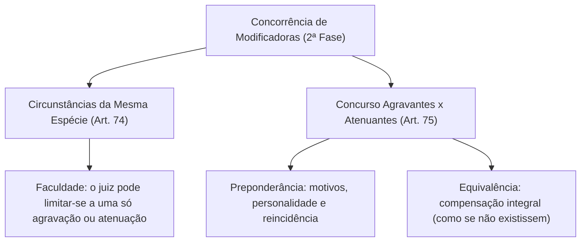
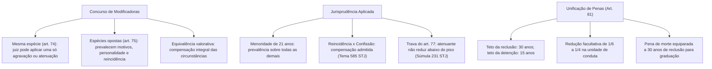

A segunda fase da dosimetria penal militar ganha contornos de refinada técnica jurídica quando concorrem no mesmo caso concreto múltiplas circunstâncias modificadoras da pena. O magistrado militar frequentemente depara-se com réus que ostentam agravantes simultâneas ou com cenários nos quais uma agravante legal coexiste com uma atenuante de idêntica relevância. A disciplina normativa dos arts. 74 e 75 do Código Penal Militar estabelece os vetores cogentes para harmonizar essas forças contrapostas no cálculo da sanção.

> [!objetivos]
> - Compreender a aplicação facultativa de agravação ou atenuação única na concorrência homogênea (art. 74 do CPM).
> - Analisar os critérios de preponderância e compensação no concurso de agravantes e atenuantes (art. 75 do CPM).
> - Examinar a jurisprudência do Superior Tribunal Militar e do Superior Tribunal de Justiça sobre compensação entre reincidência e confissão.
> - Conhecer as regras de unificação das penas privativas de liberdade e os limites temporais do art. 81 do CPM.

## Concorrência de circunstâncias da mesma espécie: o art. 74 do CPM

Na segunda fase da dosimetria, pode ocorrer a presença de duas ou mais circunstâncias agravantes (por exemplo, delito perpetrado em serviço e com o emprego de arma funcional) ou a concorrência simultânea de duas ou mais atenuantes (como a menoridade de 21 anos associada a comportamento meritório anterior). Para esse cenário de modificadoras homogêneas, o legislador militar conferiu faculdade discricionária expressa ao julgador:

> [!lei] CPM, art. 74
> **Art. 74.** Quando ocorre mais de uma agravante ou mais de uma atenuante, o juiz poderá limitar-se a uma só agravação ou a uma só atenuação.

O art. 74 autoriza o magistrado da Justiça Militar a não somar aritmeticamente sucessivas frações de agravação ou de diminuição, podendo eleger a circunstância mais expressiva no caso concreto para promover um único acréscimo ou uma única minoração, que observará a faixa legal entre 1/5 e 1/3 (art. 73 do CPM).

Essa faculdade visa assegurar a razoabilidade da reprimenda, impedindo exasperações desmedidas que desvirtuariam os fins preventivos da sanção penal militar. Contudo, caso o juiz decida valorar mais de uma modificadora, deverá fundamentar detalhadamente a necessidade do acréscimo progressivo, respeitando sempre o teto abstrato do preceito secundário.

## O concurso de agravantes e atenuantes e as circunstâncias preponderantes

O conflito mais tormentoso da dosimetria reside no concurso heterogêneo, verificado quando o réu apresenta simultaneamente ao menos uma circunstância agravante e ao menos uma circunstância atenuante. O art. 75 do Código Penal Militar resolve esse embate mediante o critério qualitativo da preponderância:

> [!lei] CPM, art. 75
> **Art. 75.** No concurso de agravantes e atenuantes, a pena deve aproximar-se do limite indicado pelas circunstâncias preponderantes, entendendo-se como tais as que resultam dos motivos determinantes do crime, da personalidade do agente, e da reincidência. Se há equivalência entre umas e outras, é como se não tivessem ocorrido.

O legislador militar estabeleceu expressamente quais circunstâncias possuem peso superior no balanceamento judicial. São preponderantes:
1. **Os motivos determinantes do crime**: a exemplo do relevante valor moral ou social (atenuante) confrontado com o motivo fútil ou torpe (agravante).
2. **A personalidade do agente**: englobando a idade do réu (menor de 21 anos na data do fato ou maior de 70 anos na sentença) e seu histórico de conduta moral e militar.
3. **A reincidência**: fator que denota reiteração criminosa e desprezo deliberado pela ordem jurídica.

Quando as circunstâncias concorrentes ostentam idêntica gravidade e relevância jurídica (equivalência valorativa), opera-se a compensação integral entre elas. A lei militar é categórica: "é como se não tivessem ocorrido", mantendo-se a reprimenda no patamar previamente estabelecido na primeira fase (pena-base).

| Categoria | Circunstâncias Classificadas | Efeito Prático no Concurso |
|---|---|---|
| Preponderantes Subjetivas | Menoridade (menor de 21 anos), maioridade (maior de 70 anos) e reincidência | Atraem a dosimetria para o seu sentido (elevação ou redução) |
| Preponderantes Teleológicas | Motivo de relevante valor social/moral e motivo fútil/torpe | Sobrepõem-se a circunstâncias meramente objetivas ou de ocasião |
| Circunstâncias Acessórias | Delito em calamidade, em país estrangeiro ou com arma de serviço | Cedem diante das circunstâncias preponderantes |

## Jurisprudência dos Tribunais Superiores sobre o concurso

A aplicação do art. 75 do CPM dialoga diretamente com as súmulas e precedentes vinculantes dos Tribunais Superiores (STM, STF e STJ), delineando soluções pacificadas para controvérsias clássicas:

> [!atencao] Súmula e Precedentes: Prevalência da Menoridade Relativa
> O entendimento pacificado tanto no âmbito do Superior Tribunal de Justiça quanto no Superior Tribunal Militar consagra que a atenuante da menoridade de 21 anos à época do fato (art. 72, I, do CPM) ostenta preponderância absoluta sobre qualquer agravante, inclusive sobre a reincidência. A personalidade em formação do jovem justifica a mitigação punitiva prioritária.

### A compensação entre reincidência e confissão espontânea

Uma das controvérsias mais recorrentes em concursos envolve o confronto direto entre a agravante da reincidência (art. 70, I) e a atenuante da confissão espontânea (art. 72, III, *d*):
- **Orientação do STJ (Tema Repetitivo 585)**: no processo penal comum, pacificou-se a tese de que a reincidência e a confissão espontânea são igualmente preponderantes (uma ligada à reiteração delitiva e a outra à personalidade do réu), operando-se a compensação integral entre ambas na segunda fase, salvo hipótese de multirreincidência específica.
- **Particularidade na Justiça Militar (Jurisprudência do STM)**: no Direito Penal Militar, a confissão espontânea só é reconhecida como atenuante válida quando a autoria do crime era desconhecida ou estava falsamente imputada a terceiro. Presente esse requisito restritivo estrito, a confissão adquire elevadíssimo valor processual, admitindo a compensação com a reincidência simples. Todavia, em casos de reincidência militar específica (delitos militares idênticos contra a autoridade ou hierarquia), o Superior Tribunal Militar confere primazia à reincidência militar para salvaguardar a estabilidade da tropa.

> [!pegadinha] Súmula 231 do STJ e o Parágrafo Único do Art. 77 do CPM
> A incidência de atenuantes preponderantes jamais poderá conduzir a pena aquém do limite mínimo abstratamente cominado ao delito militar. Se a pena-base foi fixada no patamar mínimo legal em razão de circunstâncias judiciais favoráveis, o reconhecimento posterior de atenuantes (como a confissão ou menoridade) não autoriza a redução da pena abaixo desse piso. Trata-se da regra consolidada na Súmula 231 do STJ, hoje positivada no parágrafo único do art. 77 do CPM.

## Unificação das penas e limites temporais do art. 81

Ao consolidar a dosimetria decorrente do concurso de crimes, o Código Penal Militar impõe tetos rígidos para a unificação das penas privativas de liberdade no art. 81:

> [!lei] CPM, art. 81
> **Art. 81.** A pena unificada não pode ultrapassar de trinta anos, se é de reclusão, ou de quinze anos, se é de detenção.
> **§ 1º** A pena unificada pode ser diminuída de um sexto a um quarto, no caso de unidade de ação ou omissão, ou de crime continuado.
> **§ 2°** Quando cominada a pena de morte como grau máximo e a de reclusão como grau mínimo, aquela corresponde, para o efeito de graduação, à de reclusão por trinta anos.
> **§ 3°** Nos crimes punidos com a pena de morte, esta corresponde à de reclusão por trinta anos, para cálculo da pena aplicável à tentativa, salvo disposição especial.

O teto máximo de cumprimento unificado no CPM é de 30 anos para as penas de reclusão e de 15 anos para as penas de detenção. 

O § 1º do art. 81 traz uma regra de benevolência dosimétrica tipicamente militar: no concurso formal (unidade de ação) ou no crime continuado, além da aplicação da exasperação, a pena resultante unificada pode ser facultativamente diminuída de 1/6 a 1/4 pelo órgão julgador, sopesando a culpabilidade e o impacto da conduta.

Para efeito de dosimetria da tentativa (art. 30, parágrafo único) ou graduação legal nos delitos sancionados com pena capital em tempo de guerra, a pena de morte é equiparada matematicamente à reclusão por 30 anos, servindo esse número como base objetiva de cálculo para os percentuais de redução.

## Limites das majorantes do art. 76 e a revogação do art. 78 do CPM

A individualização da resposta punitiva na terceira fase do cálculo dosimétrico articula-se com as causas especiais de aumento e diminuição disciplinadas no art. 76 do Código Penal Militar. O juiz não se encontra adstrito aos limites abstratos do crime, ficando restrito aos limites absolutos da respectiva espécie prisional (art. 58 do CPM). 

Concorrendo duas ou mais causas especiais, o julgador pode aplicar uma única causa, desde que prevaleça aquela que mais aumenta ou mais diminui a reprimenda.

Em perspectiva histórica, o antigo art. 78 do CPM previa pena indeterminada para o criminoso habitual ou com desvio por tendência. A habitualidade era presumida na reincidência dolosa ou na prática sucessiva de quatro infrações demonstrando inclinação delitiva. Já a tendência aplicava-se a delitos com extraordinária torpeza. A Lei nº 14.688/2023 revogou expressamente o art. 78 e o art. 82.

No concurso de crimes do art. 79 do CPM, praticadas infrações mediante pluralidade de condutas, opera-se o cúmulo material das penas, quer sejam elas iguais ou distintas. No crime continuado (art. 80), exige-se estreita homogeneidade de tempo, lugar e execução, exigindo os tribunais intervalo ou lapso não superior a 30 dias para caracterizar a continuidade entre ações delituosas sucessivas.

## Autonomia das penas não privativas de liberdade no art. 83

O art. 83 do Código Penal Militar resguarda a eficácia e a imperatividade das sanções penais militares que não implicam o encarceramento do sentenciado:

> [!lei] CPM, art. 83
> **Art. 83.** As penas não privativas de liberdade são aplicadas distinta e integralmente, ainda que previstas para um só dos crimes concorrentes.

A regra encerra relevante princípio sancionatório no âmbito militar: enquanto as penas privativas de liberdade sofrem os influxos dos sistemas de unificação, cúmulo material do art. 79 ou exasperação do concurso formal e continuado, as sanções não privativas de liberdade permanecem imunes a esses mecanismos de absorção. 

Penas acessórias de natureza funcional, tais como a perda do posto e da patente, a demissão ou a exclusão das Forças Armadas e a inabilitação para o exercício de função pública, incidem de forma integral, autônoma e cumulativa sobre a situação jurídica do militar condenado. Mesmo que tais consequências punitivas estejam cominadas apenas para um dos delitos concorrentes, a sua imposição judicial é obrigatória e inafastável, assegurando a higidez e a moralidade da Administração Militar.

## Mapa do capítulo

### Para fixar

1. **Pluralidade homogênea do art. 74**: o magistrado possui faculdade legal de limitar-se a uma única agravação ou atenuação quando concorrem várias da mesma espécie.
2. **Critério da preponderância do art. 75**: no concurso entre agravantes e atenuantes, prevalecem as que resultam dos motivos determinantes, da personalidade do autor e da reincidência.
3. **Compensação integral**: havendo equilíbrio de forças morais entre circunstâncias concorrentes opostas, opera-se a anulação mútua, permanecendo a pena-base inalterada.
4. **Primazia da menoridade**: a menoridade relativa (menor de 21 anos na data do crime) prevalece dogmaticamente sobre qualquer circunstância desfavorável.
5. **Reincidência versus confissão**: no STJ (Tema 585), compensam-se integralmente; no STM, a confissão exige que a autoria fosse ignorada ou atribuída a outro para ter eficácia atenuante plena.
6. **Limites da unificação (art. 81)**: o cúmulo executório militar não pode superar 30 anos para a reclusão e 15 anos para a detenção.
7. **Equiparação da pena de morte**: para fins de tentativa e graduação dosimétrica, a pena de morte corresponde a trinta anos de reclusão.
8. **Independência do art. 83**: penas não privativas de liberdade executam-se integralmente sem qualquer redução decorrente de concurso delitivo.
