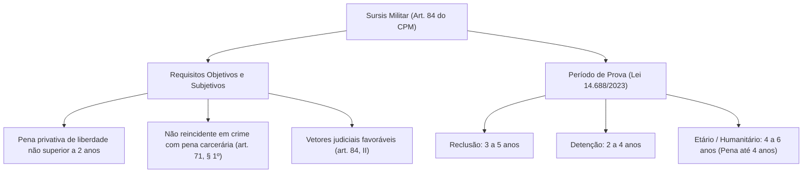
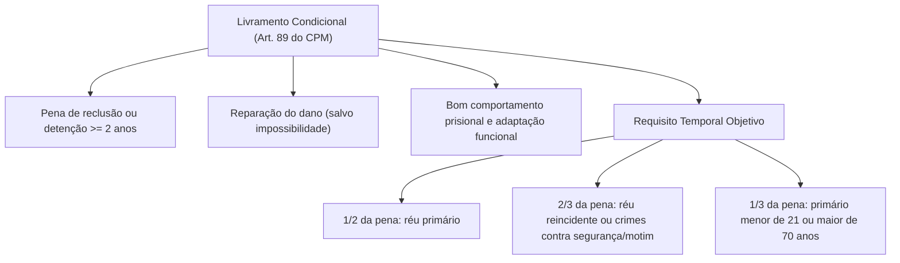
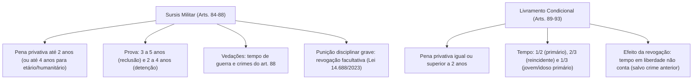

A execução da pena privativa de liberdade no Direito Penal Militar combina o rigor necessário à manutenção da autoridade e da disciplina com institutos desencarcerizadores orientados pela política criminal contemporânea. Entre os mecanismos que evitam o encarceramento inicial ou antecipam a restituição da liberdade do condenado militar, destacam-se a suspensão condicional da pena (*sursis* militar) e o livramento condicional. Ambos foram substancialmente remodelados pela Lei nº 14.688/2023 para atender aos princípios constitucionais da dignidade da pessoa humana e da proporcionalidade.

> [!objetivos]
> - Compreender os requisitos objetivos e subjetivos do sursis militar no art. 84 do CPM após a Lei nº 14.688/2023.
> - Diferenciar os períodos de prova aplicáveis à reclusão e à detenção e as hipóteses do sursis etário e humanitário.
> - Analisar as causas de revogação obrigatória e facultativa da suspensão condicional (art. 86).
> - Examinar as vedações legais do art. 88 e as modulações jurisprudenciais do Superior Tribunal Militar.
> - Dominar os pressupostos temporais e subjetivos do livramento condicional militar e os efeitos jurídicos de sua revogação (arts. 89 e 93).

## A suspensão condicional da pena no CPM: o sursis militar

A suspensão condicional da pena constitui medida de despenalização consistente na suspensão da execução da reprimenda privativa de liberdade imposta na sentença condenatória irrecorrível, submetendo o apenado a período de prova e ao cumprimento de condições judiciais prévias. Decorrido o período probatório sem causa superveniente de revogação, opera-se a extinção definitiva da punibilidade (art. 87 do CPM).

### Requisitos objetivos e o período de prova pós-Lei 14.688/2023

O art. 84 do CPM fixa os requisitos indispensáveis para a concessão do benefício pelo Conselho de Justiça ou juiz federal da Justiça Militar:

> [!esquema] Requisitos do Sursis Militar (CPM, art. 84)
> **Condições básicas:** Sanção de prisão não excedente a 2 anos admite sobrestamento pelo prazo de 3 a 5 anos se for reclusão, ou de 2 a 4 anos se for detenção, desde que atendidos os requisitos de primariedade e favorabilidade subjetiva. A suspensão não atinge pena acessória nem medida de segurança não detentiva.

Uma das inovações mais expressivas da reforma de 2023 foi o desdobramento do período de prova conforme a gravidade da espécie prisional cominada. Antes da Lei nº 14.688/2023, o prazo de prova oscilava entre 2 e 6 anos para qualquer modalidade de sanção. Atualmente, a prova dura de 3 a 5 anos se a condenação for de reclusão, e de 2 a 4 anos se for de detenção. A reforma de 2023 extirpou a arcaica presunção subjetiva de que o condenado não tornaria a delinquir, prestigiando a análise concreta da culpabilidade.

> [!pegadinha] Comparação entre CPM e Código Penal Comum no Sursis
> Enquanto o Código Penal comum (art. 77 do CP) fixa o período de prova ordinário indistintamente entre 2 e 4 anos para reclusão e detenção, o Código Penal Militar diferencia expressamente os prazos probatórios conforme a espécie da sanção: na reclusão, o período de prova é de 3 a 5 anos; na detenção, o intervalo é de 2 a 4 anos.

### O sursis etário e humanitário no Código Penal Militar

A reforma militar introduziu no § 2º do art. 84 modalidades especiais de suspensão condicional da pena voltadas a condenados idosos ou enfermos:

> [!lei] CPM, art. 84, § 2º
> **§ 2º** A execução da pena privativa de liberdade não superior a 4 (quatro) anos poderá ser suspensa por 4 (quatro) a 6 (seis) anos, desde que o condenado seja maior de 70 (setenta) anos de idade ou existam razões de saúde que justifiquem a suspensão.

Nessas modalidades especiais (sursis etário e humanitário), o teto da pena privativa de liberdade passível de suspensão é duplicado, alcançando condenações de até 4 anos de prisão. Em contrapartida, o período de prova judicial é estendido para a faixa de 4 a 6 anos, viabilizando o acompanhamento das condições impostas sem o encarceramento de pessoas vulneráveis.

| Modalidade de Sursis | Limite Máximo da Pena | Período de Prova Judicial | Requisito Subjetivo Específico |
|---|---|---|---|
| Ordinário em Reclusão | Até 2 anos | De 3 a 5 anos | Primariedade carcerária e circunstâncias favoráveis |
| Ordinário em Detenção | Até 2 anos | De 2 a 4 anos | Primariedade carcerária e circunstâncias favoráveis |
| Sursis Etário | Até 4 anos | De 4 a 6 anos | Idade superior a 70 anos na data da condenação |
| Sursis Humanitário | Até 4 anos | De 4 a 6 anos | Razões graves de saúde comprovadas por laudo médico oficial |

O réu não pode ter sofrido anterior condenação irrecorrível a pena de prisão. Eventual causa minorante reconhecida na terceira fase da dosimetria penal que reduza a pena definitiva a patamar igual ou inferior a dois anos viabiliza a concessão do benefício. O objetivo do instituto reside no reequilíbrio social e na recuperação do militar sem os efeitos deletérios do ambiente carcerário.

## Condições e hipóteses de revogação do sursis

Nos termos do art. 85 do CPM, a sentença condenatória fixa expressamente as restrições e compromissos do sentenciado, tais como a proibição de frequentar determinados lugares, o comparecimento periódico perante o juízo militar e a vedação de ausentar-se da localidade sem autorização.

O art. 86 do CPM estabelece as causas de revogação obrigatória e facultativa do benefício:

> [!esquema] Revogação Obrigatória do Sursis (CPM, art. 86)
> **Art. 86.** A suspensão é revogada se o apenado:
> I - for condenado por crime doloso por decisão irrecorrível;
> II - não efetuar, sem justo motivo, a reparação do dano.
> **§ 1º** Pode ser revogada se descumprir obrigações da sentença ou, sendo militar, sofrer punição disciplinar grave.
> **§ 2º** Sendo facultativa a revogação, o juiz pode prorrogar a prova até o teto.

A reforma da Lei nº 14.688/2023 alterou substancialmente a disciplina da revogação:
1. **Revogação obrigatória**: restringe-se agora à condenação irrecorrível por crime doloso (comum ou militar) e à ausência injustificada de reparação do dano causado à vítima ou ao erário. Suprimiu-se a revogação compulsória por contravenções penais.
2. **Revogação facultativa**: o descumprimento das condições fixadas na sentença e a punição disciplinar grave imposta ao militar constituem causas facultativas de revogação (§ 1º). Antes de 2023, a punição disciplinar grave operava como causa de revogação obrigatória. Atualmente, o magistrado pode optar pela prorrogação do período de prova até o teto máximo legal em vez de cassar o benefício (§ 2º).

## Vedações legais do art. 88 e entendimentos jurisprudenciais do STM

O art. 88 do CPM veicula um extenso catálogo de crimes militares que, por razões de preservação da hierarquia, segurança e disciplina bélica, são insuscetíveis da suspensão condicional da pena:

> [!esquema] Vedações ao Sursis Militar (CPM, art. 88)
> **Art. 88.** A suspensão condicional não se aplica em tempo de guerra, nem por crimes contra segurança nacional, aliciação, desrespeito ou violência contra superior ou de serviço, insubordinação, deserção e outros tipos legais expressos.

A proibição legal atinge infrações militares gravosas, como o desacato a superior (art. 160), a desobediência qualificada (art. 161), o pederastia ou ato libidinoso em local militar (art. 235) e o tráfico de entorpecentes em área militar (art. 291).

> [!atencao] Modulação Jurisprudencial pelo Superior Tribunal Militar
> Não obstante a vedação literal do art. 88, II, *a*, em relação ao crime de deserção (art. 187 do CPM), a jurisprudência dominante do STM consolidou entendimento no sentido de que, se o sentenciado foi licenciado, desincorporado ou perdeu a condição de militar da ativa, passando à condição de civil antes do julgamento final, é admissível a concessão do sursis militar por política criminal desencarcerizadora. Além disso, o STM assentou que a vedação do sursis da pena não impede o agraciamento do apenado por decretos de indulto natalino.

## O livramento condicional no Direito Penal Militar

O livramento condicional constitui a última etapa executória da individualização da sanção privativa de liberdade, permitindo ao sentenciado que já cumpriu parcela significativa de sua reprimenda em regime fechado ou semiaberto antecipar sua reintegração social sob condições judiciais fiscalizadas.

### Requisitos temporais e subjetivos do art. 89

Para a concessão do livramento condicional pelo juiz da execução penal militar, o condenado deve atender aos pressupostos estabelecidos no art. 89 do CPM:

> [!esquema] Livramento Condicional (CPM, art. 89)
> **Condições básicas:** O sentenciado submetido a reprimenda carcerária a partir de dois anos de duração obtém a desinternação antecipada se resgatou metade da sanção (se primário) ou dois terços (caso reincidente), satisfez os prejuízos causados e manteve conduta prisional exemplar. O marco cai para um terço se o réu primário tiver menos de 21 ou mais de 70 anos.

O estatuto militar adota frações temporais distintas daquelas consagradas na legislação penal comum (art. 83 do Código Penal). Enquanto o Código Penal comum exige o cumprimento de mais de 1/3 para primários com bons antecedentes e mais de 1/2 para reincidentes dolosos, o Código Penal Militar estabelece patamares mais severos: exige metade (1/2) para réus primários e dois terços (2/3) para reincidentes. 

Por outro lado, o CPM contempla uma causa especial de redução temporal no § 2º do art. 89: sendo o condenado primário e ostentando idade menor de 21 anos na data da conduta ou maior de 70 anos na sentença, o tempo de cumprimento exigido é mitigado para apenas um terço (1/3) da reprimenda total unificada. 

Em sede procedimental, o Superior Tribunal Militar firmou entendimento de que a competência para deferir livramento condicional e progressão carcerária pertence com exclusividade ao juiz da execução, não cabendo o ajuizamento de habeas corpus (writ constitucional) substitutivo perante tribunal de segunda instância sob pena de indevida supressão de grau jurisdicional. A concessão do livramento condicional é vedada de forma categórica aos condenados por crimes militares praticados em tempo de guerra.

### Hipóteses e efeitos da revogação do livramento condicional

O art. 93 do CPM disciplina os casos de cassação do livramento condicional:

> [!esquema] Revogação do Livramento Condicional (CPM, art. 93)
> **Art. 93.** Revoga-se obrigatoriamente o livramento se o liberado for condenado irrecorrivelmente a pena de prisão por delito cometido durante o benefício ou anterior. O juiz pode revogá-lo facultativamente se houver descumprimento de obrigação, condenação contravencional ou punição disciplinar grave.

A revogação do livramento condicional acarreta consequências jurídicas gravosas:
- O benefício revogado jamais poderá ser concedido novamente em relação à mesma condenação originária.
- O período em que o liberado permaneceu em liberdade sob prova **não é computado** como tempo de cumprimento da pena (não gera detração ou remição), devendo o apenado cumprir integralmente o saldo remanescente em regime fechado. 
- A única exceção a essa perda temporal ocorre na revogação motivada por condenação referente a infração penal praticada **anteriormente** ao início do livramento condicional, hipótese em que o período de prova transcorrido é aproveitado e descontado da pena global unificada.

## Mapa do capítulo

### Para fixar

1. **Cabimento do sursis**: destina-se a penas privativas de liberdade não superiores a dois anos, vedada a concessão para réus com condenação anterior irrecorrível a pena de prisão (respeitado o período depurador de cinco anos).
2. **Prazos do sursis pós-2023**: período de prova de três a cinco anos na reclusão e de dois a quatro anos na detenção. O sursis etário e humanitário admite pena até quatro anos com prova de quatro a seis anos.
3. **Revogação do sursis**: obrigatória em nova condenação irrecorrível por crime doloso ou falta injustificada de reparação do dano; facultativa no descumprimento de obrigações ou punição disciplinar grave do militar.
4. **Vedações do art. 88**: incabível em tempo de guerra e nos delitos de segurança, deserção, insubordinação, violência contra superior ou sentinela. O STM admite sursis na deserção de réu licenciado que voltou a ser civil.
5. **Cabimento do livramento**: incidente sobre penas de reclusão ou detenção iguais ou superiores a dois anos, vedada a concessão em crimes de guerra.
6. **Frações do livramento**: exige cumprimento de metade da pena para primários, dois terços para reincidentes e um terço para réus primários menores de 21 anos ou maiores de 70 anos.
7. **Efeitos da revogação do livramento**: o período de prova não é descontado como pena cumprida, salvo quando a revogação decorrer de infração penal anterior à concessão do benefício.
