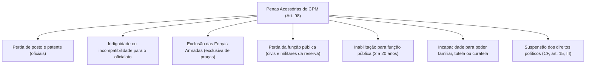
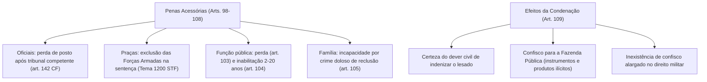

A condenação criminal transitada em julgado na Justiça Militar acarreta consequências sancionatórias que ultrapassam a imposição da pena principal privativa de liberdade. O ordenamento jurídico militar estruturou duas categorias adicionais de repercussões punitivas e civis: as penas acessórias e os efeitos da condenação. Enquanto as penas acessórias ostentam natureza jurídica penal e extrapenal com incidência direta sobre a carreira militar e o exercício de prerrogativas de cidadania, os efeitos da condenação consagram a obrigação civil de reparação dos prejuízos causados e o confisco de bens de origem ilícita.

> [!objetivos]
> - Identificar as espécies de penas acessórias do art. 98 do CPM e as modificações da Lei nº 14.688/2023.
> - Compreender o rito constitucional de perda de posto e patente de oficiais (art. 142, § 3º, da CF e art. 99 do CPM).
> - Analisar a exclusão das Forças Armadas aplicada a praças e a tese de Repercussão Geral do Tema 1200 do STF.
> - Distinguir os requisitos e prazos da perda e inabilitação para o exercício de função pública (arts. 103 e 104).
> - Examinar os efeitos da condenação previstos no art. 109 do CPM e a disciplina do confisco patrimonial.

## O rol das penas acessórias no art. 98 do CPM

O art. 98 do Código Penal Militar veicula o catálogo taxativo das penas acessórias que podem cumular-se à pena principal. A Lei nº 14.688/2023 atualizou a nomenclatura e a abrangência de suas disposições, ajustando-as ao vocabulário constitucional e protetivo moderno:

> [!esquema] Penas Acessórias no CPM (art. 98)
> **Art. 98.** São penas acessórias: perda de posto e patente; indignidade para o oficialato; incompatibilidade com o oficialato; exclusão das forças armadas; perda da função pública; inabilitação para função pública; incapacidade para o poder familiar, tutela ou curatela no melhor interesse do menor; e suspensão dos direitos políticos.

A redação do inciso VII substituiu a denominação arcaica "suspensão do pátrio poder" por inaptidão para o poder familiar, guarda tutelar ou curatela, vinculando sua decretação ao princípio do melhor interesse da criança ou do curatelado. No inciso V, manteve-se a perda da função pública ainda que eletiva, assegurando que o condenado militar não se escude em mandato parlamentar para elidir a sanção decorrente de quebra do dever ético.

## A perda de posto e patente e o controle constitucional

A perda de posto e patente é a pena acessória mais grave aplicável aos oficiais das Forças Armadas e das corporações militares estaduais (Polícia Militar e Corpo de Bombeiros Militar). A redação originária do art. 99 do CPM induzia à falsa interpretação de que a cassação do oficialato decorria de forma mecânica e imediata da sentença condenatória superior a 2 anos.

A Lei nº 14.688/2023 harmonizou expressamente o dispositivo com o texto da Constituição Federal de 1988:

> [!lei] CPM, art. 99
> **Art. 99.** A perda de posto e patente resulta da condenação a pena privativa de liberdade por tempo superior a 2 (dois) anos, por crimes comuns e militares, e importa a perda das condecorações, desde que submetido o oficial ao julgamento previsto no inciso VI do § 3º do art. 142 da Constituição Federal.

A perda do oficialato jamais se opera de modo automático pelo juiz ou Conselho de Justiça de primeira instância. O art. 142, § 3º, incisos VI e VII, da Constituição da República erigiu garantia fundamental de caráter corporativo:

> [!atencao] Competência Constitucional para Julgamento de Oficiais
> O oficial militar condenado na Justiça comum ou na Justiça Militar a pena privativa de liberdade superior a 2 anos somente perderá o posto e a patente se for declarado indigno do oficialato ou com ele incompatível por decisão de tribunal militar de caráter permanente:
> - Para oficiais das Forças Armadas (Exército, Marinha e Aeronáutica): competência privativa do **Superior Tribunal Militar (STM)**.
> - Para oficiais da Polícia Militar e do Corpo de Bombeiros Militar de Pernambuco: competência privativa do **Tribunal de Justiça Militar estadual** ou, inexistindo este no estado, do **Tribunal de Justiça do Estado de Pernambuco (TJPE)**, por força do art. 42, § 1º, c/c art. 125, § 4º, da Constituição Federal.
> Essa perda depende de representação autônoma proposta pelo Ministério Público perante o respectivo tribunal permanente.

A tabela a seguir sistematiza as regras constitucionais e processuais aplicáveis à perda de posto:

| Corporação Militar | Autoridade Competente | Procedimento Exigido | Requisito Objetivo |
|---|---|---|---|
| Forças Armadas | Superior Tribunal Militar (STM) | Processo ético por representação do MPM | Pena privativa de liberdade superior a 2 anos |
| Polícia Militar Estadual | Tribunal de Justiça Militar ou TJ Estadual | Representação do Procurador-Geral de Justiça | Pena privativa de liberdade superior a 2 anos |
| Bombeiro Militar Estadual | Tribunal de Justiça Militar ou TJ Estadual | Representação do Procurador-Geral de Justiça | Pena privativa de liberdade superior a 2 anos |

## Declaração de indignidade e incompatibilidade com o oficialato

Os arts. 100 e 101 do CPM enumeram delitos específicos cuja prática acarreta a sujeição do oficial à declaração de indignidade ou de incompatibilidade funcional:

> [!lei] CPM, art. 100
> **Art. 100.** Fica sujeito à declaração de indignidade para o oficialato o militar condenado, qualquer que seja a pena, nos crimes de traição, espionagem ou cobardia, ou em qualquer dos definidos nos arts. 161, 235, 240, 242 a 245, 251, 252, 303, 304, 311 e 312.

O rol do art. 100 contempla condutas atentatórias à honra e à moralidade militar, abrangendo crimes de desrespeito grave (art. 161), atos libidinosos em recinto militar (art. 235), infrações patrimoniais como furto, roubo, extorsão e estelionato (arts. 240, 242 a 251), peculato e apropriação indevida (arts. 303 e 304) e falsidade documental (arts. 311 e 312).

Consoante assentado pela doutrina majoritária e pela jurisprudência do Superior Tribunal Militar, essas hipóteses legais não dispensam o processo constitucional autônomo perante o tribunal de segunda instância. Elas operam como balizadores da representação acusatória ministerial, devendo a Corte Militar avaliar as circunstâncias concretas para decidir se a dignidade do posto restou irremediavelmente comprometida.

## Exclusão das Forças Armadas e o Tema 1200 do STF

Diferentemente da perda do posto, restrita aos oficiais, a pena acessória de exclusão das Forças Armadas incide com exclusividade sobre as praças militares:

> [!lei] CPM, art. 102
> **Art. 102.** A condenação da praça a pena privativa de liberdade, por tempo superior a dois anos, importa sua exclusão das forças armadas.

Historicamente, controvertia-se na doutrina e nos tribunais sobre a aplicação do art. 102 às praças das Polícias Militares e Corpos de Bombeiros Militares, sustentando-se que o art. 125, § 4º, da Constituição Federal exigiria processo específico perante o Tribunal de Justiça estadual também para as praças.

Essa controvérsia jurídica foi definitivamente pacificada pelo Supremo Tribunal Federal no julgamento do **Tema 1200 da Repercussão Geral** (Recurso Extraordinário com Agravo nº 1.320.744/DF), oportunidade em que a Suprema Corte fixou as seguintes teses de observância obrigatória:

> [!bizu] Teses Vinculantes do Tema 1200 do STF
> 1. A perda da graduação da praça militar pode ser decretada pelo juiz competente na própria sentença condenatória criminal, como efeito secundário da condenação, quer em crime militar (art. 102 do CPM), quer em crime comum (art. 92, I, *b*, do CP comum).
> 2. A competência atribuída ao Tribunal de Justiça Militar estadual ou ao Tribunal de Justiça do Estado pelo art. 125, § 4º, da Constituição de 1988 refere-se a processo autônomo instaurado por representação do Ministério Público, o qual não afasta nem anula a possibilidade de decretação incidental da perda de graduação pelo juiz na própria sentença condenatória penal transitada em julgado.

A decisão do STF fortaleceu a resposta punitiva estatal, admitindo que o magistrado militar condene a praça e determine concomitantemente sua exclusão da corporação militar estadual ou federal, desde que a reprimenda imposta supere dois anos de privação da liberdade.

## Perda e inabilitação para o exercício de função pública

Os arts. 103 e 104 do CPM disciplinam a cassação de funções públicas e a interdição temporária de novas admissões no serviço público:

> [!lei] CPM, arts. 103 e 104
> **Art. 103.** Incorre na perda da função pública o civil:
> I - condenado a pena privativa de liberdade por crime cometido com abuso de poder ou violação de dever inerente à função pública;
> II - condenado, por outro crime, a pena privativa de liberdade por mais de dois anos.
> **Parágrafo único.** O disposto no artigo aplica-se ao militar da reserva, ou reformado, se estiver no exercício de função pública de qualquer natureza.
> **Art. 104.** Incorre na inabilitação para o exercício de função pública, pelo prazo de dois até vinte anos, o condenado a reclusão por mais de quatro anos, em virtude de crime praticado com abuso de poder ou violação do dever militar ou inerente à função pública.
> **Parágrafo único.** O prazo da inabilitação começa ao termo da execução da pena privativa de liberdade ou da medida de segurança, ou da data em que se extingue a referida pena.

A perda da função pública do art. 103 dirige-se primordialmente ao réu civil processado perante a Justiça Militar da União ou ao militar em inatividade (reserva ou reforma) investido em cargo público civil. Exige-se que o crime envolva abuso funcional ou que a pena por delito comum exceda dois anos.

Já a inabilitação para o exercício de função pública (art. 104) apresenta contornos substancialmente mais rigorosos:
- **Espécie e quantidade da pena**: condenação à pena de **reclusão por mais de quatro anos**. Sanções de detenção não comportam essa inabilitação.
- **Elemento normativo do tipo**: prática do delito com manifesto abuso de poder ou quebra frontal do dever militar ou público.
- **Extensão temporal**: vigora pelo período de **2 a 20 anos**.
- **Termo inicial de contagem (art. 104, parágrafo único)**: o prazo da inabilitação não se inicia na data da publicação da sentença condenatória, mas somente após o integral cumprimento da pena carcerária (ou da medida de segurança substitutiva) ou de sua extinção legal. Consoante o art. 108 do CPM, caso o apenado seja beneficiado por sursis militar ou livramento condicional sem revogação, o período de prova é computado no cumprimento.

## Incapacidade familiar e suspensão dos direitos políticos

A Lei nº 14.688/2023 alterou radicalmente a disciplina da antiga suspensão do pátrio poder no art. 105 do CPM:

> [!lei] CPM, art. 105
> **Art. 105.** O condenado por cometimento de crime doloso sujeito a pena de reclusão praticado contra outrem igualmente titular do mesmo poder familiar ou contra filho, tutelado ou curatelado poderá, justificadamente e em atendimento ao melhor interesse do menor ou do curatelado, ter decretada a incapacidade para o exercício do poder familiar, da tutela ou da curatela, enquanto durar a execução da pena ou da medida de segurança.
> **Parágrafo único.** Durante o processo para apuração dos crimes descritos no caput deste artigo, poderá o juízo decretar a incapacidade provisória para o exercício do poder familiar, da tutela ou da curatela.

A redação revogada previa a suspensão automática em qualquer condenação carcerária superior a dois anos. Atualmente, a imposição da incapacidade subordina-se a rigorosos requisitos cumulativos:
1. Prática de crime **doloso** punido com pena de **reclusão** (afasta delitos culposos e condenações a detenção).
2. Delito dirigido expressamente contra cônjuge/companheiro titular do mesmo poder ou contra os próprios descendentes, tutelados ou curatelados (como lesão corporal grave, estupro de vulnerável ou tentativa de homicídio familiar).
3. Demonstração fundamentada na sentença de que o afastamento atende imperiosamente ao melhor interesse do incapaz.

Quanto à suspensão dos direitos políticos (art. 106 do CPM), trata-se de consequência cogente fundada no art. 15, inciso III, da Constituição Federal. O apenado perde transitoriamente as capacidades eleitorais ativa (votar) e passiva (ser votado) durante todo o cumprimento da sanção carcerária e, havendo cumulação com inabilitação para função pública (art. 104), a suspensão perdurará até o esgotamento do prazo interditório decenal ou vigesimal.

## Exigência de declaração expressa na sentença (art. 107)

O art. 107 do Código Penal Militar consagra o princípio da legalidade estrita quanto à necessidade de motivação expressa para a imposição das penas acessórias:

> [!lei] CPM, art. 107
> **Art. 107.** Salvo os casos dos arts. 99, 103, nº II, e 106, a imposição da pena acessória deve constar expressamente da sentença.

A regra geral impõe que o magistrado fundamente e declare a imposição da pena acessória no corpo decisório da sentença condenatória. As únicas exceções taxativas que dispensam menção expressa no dispositivo da sentença são:
- A perda de posto e patente (art. 99), cuja decretação depende de processo ético autônomo perante o tribunal competente.
- A perda da função pública pelo civil condenado a mais de dois anos (art. 103, inciso II), por operar como consequência legal cogente da condenação.
- A suspensão dos direitos políticos (art. 106), que decorre de mandamento constitucional autoaplicável do art. 15, III, da Carta da República.

## Os efeitos da condenação no art. 109 do CPM

Diversamente das penas acessórias, que encerram natureza estritamente penal sancionatória, os efeitos da condenação previstos no art. 109 veiculam repercussões de natureza eminentemente civil e patrimonial:

> [!lei] CPM, art. 109
> **Art. 109.** São efeitos da condenação:
> I - tornar certa a obrigação de reparar o dano resultante do crime;
> II - a perda em favor da Fazenda Pública, ressalvado o direito do lesado ou de terceiro de boa-fé:
> a) dos instrumentos do crime, desde que consistam em coisas cujo fabrico, alienação, uso, porte ou detenção constitua fato ilícito;
> b) do produto do crime ou de qualquer bem ou valor que constitua proveito auferido pelo agente com a sua prática.

A reforma da Lei nº 14.688/2023 alterou a expressão "Fazenda Nacional" para "Fazenda Pública", viabilizando a destinação dos bens apreendidos e confiscados aos cofres do respectivo estado-membro quando se tratar de julgamento pela Justiça Militar estadual de oficiais e praças da Polícia Militar e do Corpo de Bombeiros Militar.

O confisco penal militar ostenta dupla finalidade preventiva: desestimular a prática de novas infrações e obstar o enriquecimento ilícito do agente corrupto.

> [!pegadinha] Inexistência de Confisco Alargado no CPM
> O Código Penal Militar **não adotou o confisco alargado** de bens introduzido no art. 91-A do Código Penal comum pela Lei nº 13.964/2019 (Pacote Anticrime). A decretação de perdimento no foro militar restringe-se aos instrumentos de fabricação, porte ou uso ilícitos e ao produto ou proveito diretamente decorrente do fato criminoso apurado, vedando-se presunções genéricas sobre patrimônio incompatível.

A tabela comparativa a seguir sintetiza as espécies de penas acessórias e os efeitos da condenação:

| Sanção / Efeito Legal | Sujeito Passivo Alvo | Requisito Objetivo Primordial | Competência para Decretação |
|---|---|---|---|
| Perda de Posto e Patente | Oficial militar | Condenação prisional superior a 2 anos | Tribunal militar competente (STM, TJM ou TJ estadual) |
| Exclusão das Forças Armadas | Praça militar | Condenação prisional superior a 2 anos | Juiz na sentença (Tema 1200 STF) ou Tribunal em processo próprio |
| Perda da Função Pública | Civil ou militar inativo | Abuso de poder ou pena superior a 2 anos | Juiz na sentença penal militar |
| Inabilitação para Função | Qualquer condenado | Reclusão superior a 4 anos com quebra de dever | Juiz na sentença (vigora de 2 a 20 anos pós-pena) |
| Incapacidade Familiar | Condenado familiar | Reclusão dolosa contra cônjuge ou dependente | Juiz motivadamente no melhor interesse do incapaz |
| Reparação Civil do Dano | Condenado geral | Trânsito em julgado de sentença penal | Título executivo judicial civil na vara cível comum |
| Confisco para a Fazenda | Bens e valores ilícitos | Instrumento ilícito ou produto econômico | Juiz militar na sentença penal condenatória |

## Mapa do capítulo

### Para fixar

1. **Catálogo do art. 98**: elenca taxativamente as penas acessórias militares, incluindo perda de posto, exclusão das praças, perda da função, inabilitação de 2 a 20 anos e incapacidade familiar.
2. **Perda de posto e patente (art. 99)**: reservada aos oficiais com pena superior a dois anos, dependendo exclusivamente de representação do Ministério Público perante o STM ou Tribunal de Justiça estadual.
3. **Tema 1200 do STF**: fixou que a perda da graduação da praça militar pode ser decretada na própria sentença pelo juiz singular militar, não afastando a via autônoma perante o Tribunal.
4. **Inabilitação funcional (art. 104)**: exige condenação à reclusão superior a quatro anos com quebra do dever militar, operando por dois a vinte anos contados do término da pena carcerária.
5. **Incapacidade familiar pós-2023**: exige crime doloso apenado com reclusão praticado contra filho, tutelado ou companheiro titular do mesmo poder familiar, motivada no melhor interesse do menor.
6. **Declaração expressa (art. 107)**: em regra a pena acessória exige expressa motivação, ressalvadas a perda de posto, perda da função do civil com mais de dois anos e direitos políticos.
7. **Efeitos civis do art. 109**: consagram a certeza do dever de reparar os danos causados e a perda em favor da Fazenda Pública dos instrumentos e proventos do crime, sem prever confisco alargado.
