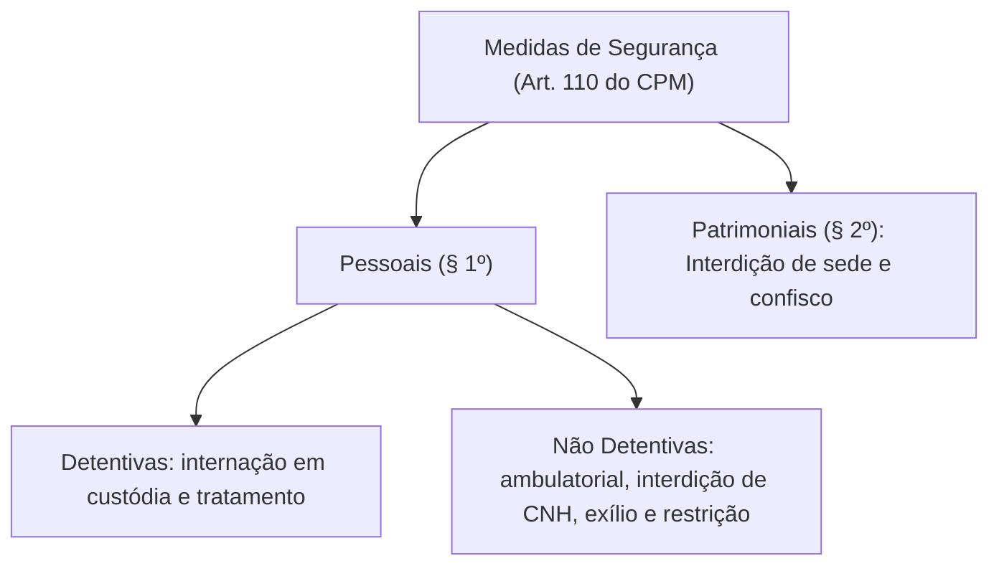
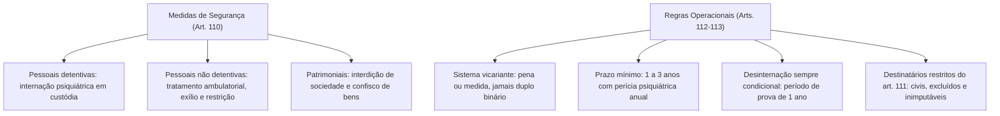

As medidas de segurança constituem providências judiciais de natureza preventiva e terapêutica. Elas se fundamentam na constatação da periculosidade social do agente que praticou um fato típico e antijurídico. Ao passo que as penas privativas de liberdade fundam-se na culpabilidade, as medidas de segurança visam à cura e ao tratamento médico de agentes inimputáveis ou semi-imputáveis portadores de anomalia mental.

> [!objetivos]
> - Compreender a classificação das medidas de segurança no art. 110 do CPM após a Lei nº 14.688/2023.
> - Analisar a distinção dogmática entre o sistema vicariante e o sistema do duplo binário na Justiça Militar.
> - Dominar as regras de execução da internação e do tratamento ambulatorial (arts. 112 e 113).
> - Identificar o rol de pessoas sujeitas à medida de segurança segundo o art. 111 do CPM.

## Espécies de medidas de segurança no art. 110 do CPM

O art. 110 do Código Penal Militar foi reestruturado pela Lei nº 14.688/2023, modernizando a terminologia e incorporando formalmente modalidades não detentivas alinhadas à reforma psiquiátrica:

> [!lei] CPM, art. 110
> **Art. 110.** As medidas de segurança são pessoais ou patrimoniais.

As medidas pessoais subdividem-se em detentivas (internação em estabelecimento psiquiátrico de custódia e tratamento) e não detentivas (tratamento ambulatorial e cassações de habilitação funcional). As de caráter patrimonial compreendem a interdição de sede e o confisco de instrumentos ilegais.

A reforma legislativa promoveu alterações relevantes. Substituiu a menção ao arcaico manicômio judiciário pelo estabelecimento de custódia e tratamento psiquiátrico. Incluiu formalmente o tratamento ambulatorial entre as medidas não detentivas. Também trocou o termo cassação por interdição de licença para direção.

| Categoria Legal | Espécies Previstas | Finalidade Principal |
|---|---|---|
| Pessoal Detentiva | Internação em estabelecimento de custódia e tratamento | Tratamento psiquiátrico com privação de liberdade |
| Pessoal Não Detentiva | Tratamento ambulatorial, exílio local e proibição de lugares | Acompanhamento médico ou restrição locativa |
| Patrimonial | Interdição de sede ou sociedade e confisco de bens | Supressão de instrumentos utilizados em crimes institucionais |

## O sistema vicariante no Direito Penal Militar

Na teoria geral do Direito Penal, existem dois grandes modelos sancionatórios para agentes com perturbação mental:
1. **Sistema do duplo binário**: o agente cumpre sucessivamente pena privativa de liberdade e medida de segurança.
2. **Sistema vicariante (unitário)**: o juiz aplica apenas uma espécie de sanção. O imputável recebe pena. O inimputável recebe medida de segurança. No caso do semi-imputável (art. 48, parágrafo único, do CPM), a pena pode ser substituída por medida curativa (art. 113).

> [!atencao] Prevalência do Sistema Vicariante na Justiça Militar
> A doutrina amplamente majoritária e a jurisprudência consolidada do Superior Tribunal Militar (STM) consagram que o CPM adota o **sistema vicariante**. É vedado cumular pena e medida de segurança em relação ao mesmo fato. A imposição da medida decorre ordinariamente de sentença absolutória imprópria (art. 48 do CPM).

## Regime da internação e tratamento ambulatorial

A internação e o tratamento ambulatorial destinam-se aos indivíduos cuja periculosidade decorre de enfermidade mental comprovada por laudo pericial:

> [!esquema] Internação de Inimputável (CPM, art. 112)
> **Art. 112.** O juiz pode determinar a internação ou tratamento ambulatorial ao inimputável, por prazo mínimo de 1 a 3 anos. A perícia médica é realizada ao término do prazo e repete-se de ano em ano. A desinternação é sempre condicional pelo prazo de um ano.

O procedimento rege-se pelos seguintes parâmetros fundamentais:
- **Prazo mínimo**: o magistrado fixa na sentença absolutória imprópria um período inicial de **1 a 3 anos**.
- **Perícia médica de verificação de periculosidade**: é realizada ao término do prazo mínimo. Deve ser repetida anualmente ou a qualquer momento por ordem judicial.
- **Desinternação condicional**: cessada a periculosidade, a liberação é sempre condicional. O indivíduo permanece em período de prova durante um ano. Se praticar fato indicativo de persistência do quadro nesse período, a internação é restabelecida.
- **Limite máximo temporal**: a medida de segurança não pode ser perpétua. Para o inimputável, o limite é a pena máxima cominada em abstrato ao delito militar. Para o semi-imputável (art. 113), o teto é a pena fixada na sentença.

## Pessoas sujeitas às medidas de segurança no art. 111

O art. 111 do CPM define expressamente os destinatários das medidas de segurança no foro militar:

> [!esquema] Destinatários das Medidas de Segurança (CPM, art. 111)
> **Art. 111.** As medidas de segurança aplicam-se a civis, a militares nos casos de inimputabilidade (art. 48) e a militares condenados a pena superior a dois anos que perderam o posto ou foram excluídos da tropa.

A imposição de medida de segurança ao militar em serviço ativo subordina-se a condições estritas. Ou o militar praticou a conduta em estado de inimputabilidade ou semi-imputabilidade (art. 48), ou foi sentenciado a pena carcerária superior a dois anos com exclusão ou perda do posto. Evita-se que um militar permaneça no serviço ativo sob medida curativa incompatível com a hierarquia militar. A Lei nº 14.688/2023 expurgou expressamente a figura dos assemelhados dos incisos do art. 111, atualizando a redação para a realidade funcional contemporânea.

## As medidas pessoais não detentivas em espécie

O art. 110, § 1º, inciso II, do CPM prevê quatro modalidades de medidas pessoais não detentivas. Cada uma delas possui características próprias:

1. **Tratamento ambulatorial**: introduzido formalmente pela Lei nº 14.688/2023. Aplica-se ao inimputável ou semi-imputável quando a perturbação mental não exigir o confinamento hospitalar. O indivíduo comparece periodicamente a consultas e sessões terapêuticas sob fiscalização médica.
2. **Interdição de licença para direção de veículos motorizados**: veda temporariamente a condução de veículos automotores. A doutrina assinala que essa previsão restou em grande parte derrogada pelo Código de Trânsito Brasileiro (CTB), diploma especial que disciplina as sanções e medidas administrativas relativas à habilitação de trânsito.
3. **Exílio local**: impõe a proibição de o sentenciado residir ou permanecer, pelo prazo mínimo de um ano, no município ou comarca onde praticou a infração. Parte expressiva da doutrina sustenta a inconstitucionalidade do exílio local por ofensa ao direito fundamental de locomoção (art. 5º, XV, da CF/88), embora tribunais admitam sua vigência em virtude de seu caráter preventivo e temporário.
4. **Proibição de frequentar determinados lugares**: visa impedir o acesso do agente a recintos que facilitem o estímulo criminoso, tais como bares, casas de jogos ou estabelecimentos sob controle militar.

## Extinção da periculosidade e controle em sede de writ

A medida de segurança não pode subsistir quando demonstrada a cura clínica do paciente ou a completa ausência de risco à sociedade. Caso o laudo pericial oficial ateste a higidez psíquica do agente, impõe-se a pronta desinternação condicional pelo juiz da execução.

O Superior Tribunal Militar assentou que eventual indulto presidencial que verse sobre penas corporais não se estende de modo automático às medidas de segurança. A cessação da medida curativa subordina-se de modo inafastável à realização da perícia médica legal. Por conseguinte, tem sido reiteradamente rechaçado em sede de habeas corpus (writ constitucional) qualquer pleito defensivo de liberação sumária desprovido de suporte pericial nos autos executórios. A via estreita da ação mandamental não comporta dilação probatória psiquiátrica complexa. Compete exclusivamente ao juiz da execução penal militar avaliar a persistência ou cessação da periculosidade após regular contraditório entre defesa e Ministério Público Militar.

## Mapa do capítulo

### Para fixar

1. **Natureza e finalidade**: as medidas de segurança fundam-se na periculosidade social do agente com anomalia mental, possuindo finalidade essencialmente preventiva e terapêutica.
2. **Espécies do art. 110**: dividem-se em pessoais (detentivas e não detentivas) e patrimoniais. A Lei nº 14.688/2023 inseriu o tratamento ambulatorial.
3. **Adoção do sistema vicariante**: a jurisprudência consolidada do STM consagra a aplicação alternativa e exclusiva de pena ou de medida de segurança, vedando a cumulação do duplo binário.
4. **Prazos da internação**: duração indeterminada vinculada à persistência da periculosidade, com prazo mínimo obrigatório fixado entre um e três anos.
5. **Perícia médica**: realizada ao final do prazo mínimo e repetida anualmente para atestar a higidez mental e a eventual cessação da periculosidade.
6. **Desinternação condicional**: a liberação do paciente submete-se a período de prova de um ano, restabelecendo-se a internação se houver fato indicador de regressão psiquiátrica.
7. **Pessoas sujeitas (art. 111)**: aplicáveis a civis, a militares inimputáveis pelo art. 48 e a condenados a mais de dois anos que perderam o posto ou sofreram exclusão militar.
