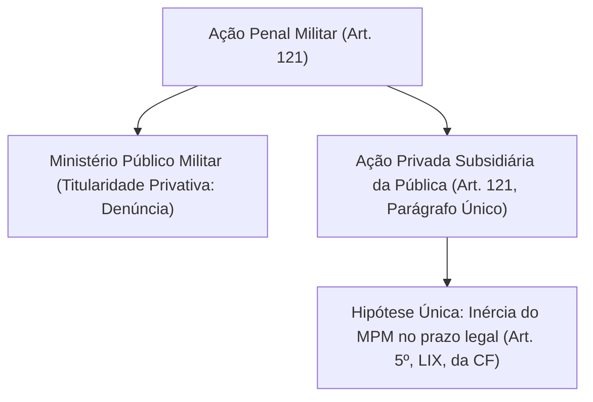
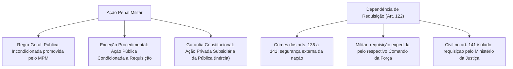

A ação penal militar consubstancia o direito público subjetivo de invocar a tutela jurisdicional do Estado-Juiz para a aplicação do direito repressivo ao autor de um crime militar. Em virtude do manifesto interesse público na preservação da hierarquia, da disciplina e da segurança nacional, o ordenamento jurídico militar estruturou a persecução penal sobre a regra imperativa da oficialidade e da obrigatoriedade, atribuindo a condução privativa da acusação penal ao Ministério Público.

> [!objetivos]
> - Compreender a titularidade da ação penal militar e a disciplina do art. 121 do CPM após a Lei nº 14.688/2023.
> - Analisar o cabimento e as características da ação penal privada subsidiária da pública no foro militar.
> - Diferenciar a ação penal pública incondicionada da ação pública condicionada a requisição.
> - Identificar as hipóteses taxativas de requisição do art. 122 do CPM e as autoridades legitimadas a expedir o ato.

## Titularidade da ação penal e a ação privada subsidiária

O art. 121 do Código Penal Militar foi reformulado pela Lei nº 14.688/2023 para conformar sua redação ao modelo acusatório consagrado no art. 129, inciso I, da Constituição Federal de 1988:

> [!lei] CPM, art. 121
> **Art. 121.** A ação penal é promovida pelo Ministério Público, na forma da lei.
> **Parágrafo único.** Será admitida ação privada, se a ação pública não for intentada no prazo legal.

No desenho institucional da Justiça Militar da União e das Justiças Militares estaduais, a titularidade originária para iniciar o processo criminal pertence com exclusividade ao Ministério Público (Ministério Público Militar na esfera federal e Ministério Público do Estado nas corporações estaduais). A peça inaugural acusatória é a denúncia, formulada sempre que presentes os elementos constitutivos de justa causa (prova da materialidade delitiva e indícios suficientes de autoria).

O parágrafo único do art. 121 introduziu expressamente na codificação militar a garantia constitucional da ação penal privada subsidiária da pública (art. 5º, inciso LIX, da CF/88). Trata-se de modalidade subsidiária e excepcionalíssima: a vítima ou seu representante legal somente adquire legitimidade extraordinária para ajuizar queixa-crime subsidiária quando o órgão do Ministério Público Militar permanecer inerte, deixando transcorrer integralmente o prazo legal sem oferecer denúncia, sem requisitar diligências e sem promover o arquivamento formal do inquérito policial militar.

## Modalidades de ação penal militar e a regra da incondicionada

O Direito Processual Penal Militar classifica a persecução em duas modalidades distintas quanto às condições de procedibilidade:

| Espécie de Ação Penal | Regra ou Exceção | Condição de Procedibilidade | Titular da Ação |
|---|---|---|---|
| Pública Incondicionada | Regra geral absoluta no CPM | Nenhuma; atua pelo princípio da obrigatoriedade | Ministério Público Militar |
| Pública Condicionada a Requisição | Exceção restrita e taxativa | Requisição expressa da autoridade competente (art. 122) | Ministério Público Militar |

A ação penal militar pública incondicionada constitui a regra geral absoluta no âmbito das corporações militares. A quase totalidade dos delitos descritos na Parte Especial do CPM (como homicídio, lesão corporal, peculato, furto, deserção e insubordinação) dispensa qualquer manifestação de vontade da vítima ou de seus superiores hierárquicos.

Ao contrário do Código Penal comum, que admite com frequência a ação penal pública condicionada à representação do ofendido (por exemplo, na ameaça e nas lesões corporais leves da Lei nº 9.099/1995), o Código Penal Militar não contempla a figura da representação do ofendido como condição de procedibilidade, resguardando o interesse público indisponível na punição da quebra disciplinar.

## Ação condicionada à requisição no art. 122 do CPM

A única exceção admitida pelo ordenamento castrense à atuação de ofício do Ministério Público Militar é a ação penal pública condicionada à requisição militar, disciplinada no art. 122 do CPM:

> [!lei] CPM, art. 122
> **Art. 122.** Nos crimes previstos nos arts. 136 a 141 deste Código, a ação penal, quando o agente for militar, depende da requisição do Comando da Força a que aquele estiver subordinado, observado que, no caso do art. 141, quando o agente for civil e não houver coautor militar, a requisição será do Ministério da Justiça.

A exigência legal de requisição restringe-se aos crimes contra a segurança externa do país, tipificados no Capítulo I do Título I da Parte Especial do Código:
- Art. 136: prática de atos hostis contra país estrangeiro.
- Art. 137: provocação militar contra potência estrangeira.
- Art. 138: usurpação de competência jurisdicional internacional.
- Art. 139: violação arbitrária do território ou espaço de Estado estrangeiro.
- Art. 140: conluio ou entendimento com governos estrangeiros sobre neutralidade ou guerra.
- Art. 141: entendimento com governo estrangeiro visando gerar atrito ou desentendimento com o Brasil.

A autoridade competente para expedir o ato requisitório varia segundo a condição funcional do agente:
1. **Agente militar (arts. 136 a 141)**: a ação penal depende de requisição do respectivo **Comando da Força** (Comando da Marinha, Comando do Exército ou Comando da Aeronáutica) a que o militar estiver subordinado. A reforma de 2023 suprimiu a arcaica referência a "Ministério Militar".
2. **Agente civil no art. 141 sem concurso de militar**: a requisição compete com exclusividade ao **Ministro da Justiça**, por se tratar de civil desprovido de subordinação hierárquica às Forças Armadas.

> [!pegadinha] Terminologia Técnica: Requisição versus Representação
> Nas provas, é comum a substituição capciosa do termo legal. A legislação militar exige **requisição** (que constitui ato político-administrativo de natureza vinculante), e não "representação" da vítima nem "autorização" presidencial. Sem a juntada formal da requisição nos autos, o Ministério Público Militar carece de legitimidade processual para oferecer a denúncia nos crimes dos arts. 136 a 141.

## Mapa do capítulo

### Para fixar

1. **Titularidade privativa**: a ação penal pública militar é promovida privativamente pelo Ministério Público Militar, mediante denúncia (art. 121 do CPM e art. 129, I, da CF/88).
2. **Ação privada subsidiária**: admitida exclusivamente se o Ministério Público Militar não intentar a ação pública no prazo legal (art. 121, parágrafo único, do CPM e art. 5º, LIX, da CF).
3. **Incondicionada como regra geral**: a quase totalidade dos delitos militares é processada sem dependência de representação ou condição prévia.
4. **Inexistência de representação**: o direito penal militar não acolhe a ação pública condicionada à representação do ofendido.
5. **Hipóteses de requisição (art. 122)**: incide unicamente nos crimes contra a segurança externa do país (arts. 136 a 141 do CPM).
6. **Autoridades requisitantes**: cabe ao Comando da Força Armada do réu militar ou ao Ministério da Justiça quando o réu for civil no art. 141 sem coautor militar.
7. **Natureza da requisição**: configura verdadeira condição objetiva de procedibilidade, sem a qual a denúncia não pode ser validamente ofertada.
