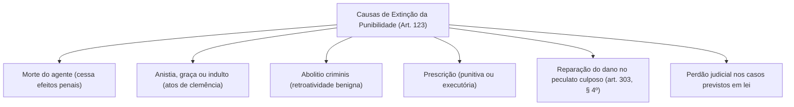
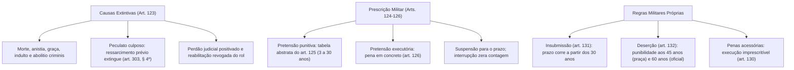

A extinção da punibilidade compreende os fatos jurídicos, causas legais e atos de clemência que fazem perecer o poder sancionatório do Estado. Ela impede a persecução criminal ou obsta a execução da pena previamente imposta. No Direito Penal Militar, o tema é disciplinado no Título VIII da Parte Geral. O diploma sofreu expressivas modificações pela Lei nº 14.688/2023 para compatibilizar prazos e institutos com a ordem constitucional.

> [!objetivos]
> - Identificar as causas extintivas da punibilidade do art. 123 do CPM após a reforma da Lei nº 14.688/2023.
> - Compreender a dinâmica da prescrição da pretensão punitiva e os prazos escalonados do art. 125 do CPM.
> - Analisar as causas de suspensão e interrupção da prescrição e suas particularidades processuais militares.
> - Dominar os prazos diferenciados de prescrição na insubmissão (art. 131) e na deserção militar (art. 132).
> - Examinar os pressupostos temporais e procedimentais da reabilitação criminal militar (art. 134).

## O rol de causas extintivas da punibilidade no art. 123 do CPM

O art. 123 do Código Penal Militar estabelece as hipóteses legais que acarretam a extinção da punibilidade militar. Esse dispositivo foi substancialmente reformulado pela Lei nº 14.688/2023:

> [!lei] CPM, art. 123
> **Art. 123.** Extingue-se a punibilidade:
> I - pela morte do agente;
> II - pela anistia, graça ou indulto;
> III - pela retroatividade de lei que não mais considera o fato como criminoso;
> IV - pela prescrição;
> V - (revogado);
> VI - pelo ressarcimento do dano, no peculato culposo (art. 303, § 4º);
> VII - pelo perdão judicial, nos casos previstos em lei.

A reforma promovida pela Lei nº 14.688/2023 introduziu alterações capitais no rol legal:
1. **Inclusão da graça**: formalizou a graça (clemência executiva individual) ao lado da anistia e do indulto no inciso II.
2. **Inclusão do perdão judicial**: positivou o perdão judicial como causa geral no inciso VII, preenchendo antiga lacuna da codificação militar.
3. **Revogação da reabilitação como causa extintiva**: o inciso V foi expressamente revogado. A doutrina clássica já advertia que a reabilitação não extingue a punibilidade (posto que pressupõe a pena já extinta ou cumprida há pelo menos cinco anos), funcionando apenas como instrumento de reinserção social e sigilo cadastral de antecedentes.

> [!atencao] Natureza do Rol do Art. 123: Taxativo ou Exemplificativo?
> A doutrina especializada diverge quanto à taxatividade do rol: parcela dos juristas sustenta natureza exemplificativa, citando hipóteses dispersas como o cumprimento do sursis (art. 87). Contudo, a jurisprudência dominante do Superior Tribunal Militar (STM) orienta-se pela taxatividade estrita em matéria punitiva, rechaçando a criação pretoriana de novas causas extintivas não expressas na lei (a exemplo da perda superveniente da condição de militar durante a instrução criminal).

O parágrafo único do art. 123 consagra a autonomia dos crimes conexos: a extinção da punibilidade de delito que seja pressuposto, elemento constitutivo ou agravante de outro não se estende a este último. No mesmo sentido, nos crimes conexos, a extinção da punibilidade de uma das infrações não afasta a exasperação da pena resultante da conexão quanto aos delitos remanescentes.

## Atos de clemência estatal e reparação no peculato culposo

As figuras da anistia, graça e indulto representam institutos de clemência da soberania estatal, distinguindo-se por sua origem institucional e amplitude subjetiva:
- **Anistia (art. 123, II)**: ato privativo do Congresso Nacional, veiculado por lei ordinária federal (art. 48, VIII, da CF/88). Apaga todos os efeitos penais principais e secundários do crime, voltando-se a fatos políticos ou delitos coletivos.
- **Indulto (art. 123, II)**: ato de competência privativa do Presidente da República (art. 84, XII, da CF/88), formalizado por decreto presidencial coletivo no fim do ano. Extingue a pretensão executória da sanção carcerária, mantendo hígidos os efeitos civis indenizatórios e as anotações para fins de reincidência.
- **Graça (art. 123, II)**: clemência individual concedida pelo Chefe do Poder Executivo mediante requerimento fundamentado do sentenciado militar, do Ministério Público ou do Conselho Penitenciário.

No tocante ao inciso VI do art. 123, a reparação do dano no peculato culposo consagra regra de evidente incentivo restaurativo:

> [!lei] CPM, art. 303, § 4º
> **Art. 303, § 4º.** No caso do peculato culposo, a reparação do dano, se precede à sentença irrecorrível, extingue a punibilidade; se lhe é posterior, reduz de metade a pena imposta.

Se o militar responsável culposamente pelo extravio, dano ou apropriação indevida de bens públicos sob sua custódia ressarcir integralmente o prejuízo patrimonial perante a Administração Militar antes do trânsito em julgado da sentença condenatória, opera-se a extinção cabal da punibilidade. Caso a reparação ocorra após a definitividade do julgado, a consequência jurídica restringe-se à mitigação da pena carcerária pela metade.

## Prescrição penal militar: espécies e a tabela do art. 125

A prescrição consubstancia a perda do direito estatal de punir ou de executar a sanção penal em face do decurso do tempo fixado em lei. O art. 124 do CPM, na redação conferida pela Lei nº 14.688/2023, consagrou expressamente a divisão bipartida entre prescrição da pretensão punitiva (antes do trânsito em julgado) e prescrição da pretensão executória (após a definitividade da condenação).

O art. 125 do Código Penal Militar estabelece a tabela geral de prazos da prescrição da pretensão punitiva calculada sobre a pena máxima abstrata cominada ao crime militar:

> [!esquema] Prazos da Prescrição Punitiva (CPM, art. 125)
> **Art. 125.** A prescrição da pretensão punitiva regula-se pela pena máxima cominada: trinta anos (pena de morte); vinte anos (pena superior a 12 anos); dezesseis anos (pena superior a 8 até 12); doze anos (pena superior a 4 até 8); oito anos (pena superior a 2 até 4); quatro anos (pena de 1 a 2 anos); e três anos (pena inferior a 1 ano).

A reforma de 2023 alterou o inciso VII: elevou o prazo prescricional mínimo militar de 2 para 3 anos quando a pena abstrata for inferior a um ano, harmonizando o CPM com a sistemática adotada no art. 109, VI, do Código Penal comum pela Lei nº 12.234/2010.

| Limite Máximo da Pena Privativa em Abstrato | Prazo Prescricional Aplicável | Dispositivo do CPM |
|---|---|---|
| Pena de morte (delitos em tempo de guerra) | 30 anos | Art. 125, inciso I |
| Pena privativa superior a 12 anos de reclusão | 20 anos | Art. 125, inciso II |
| Pena superior a 8 anos e não excedente a 12 anos | 16 anos | Art. 125, inciso III |
| Pena superior a 4 anos e não excedente a 8 anos | 12 anos | Art. 125, inciso IV |
| Pena superior a 2 anos e não excedente a 4 anos | 8 anos | Art. 125, inciso V |
| Pena de 1 ano até 2 anos de detenção/reclusão | 4 anos | Art. 125, inciso VI |
| Pena privativa inferior a 1 ano de prisão | 3 anos | Art. 125, inciso VII (Lei 14.688/2023) |

## Termos iniciais da pretensão punitiva no art. 125, § 2º

A fluência do prazo prescricional subordina-se ao momento de consumação ou cessação da conduta ilícita, conforme disciplina o § 2º do art. 125 do CPM:

> [!lei] CPM, art. 125, § 2º
> **Art. 125, § 2º.** A prescrição da ação penal começa a correr:
> a) do dia em que o crime se consumou;
> b) no caso de tentativa, do dia em que cessou a atividade criminosa;
> c) nos crimes permanentes, do dia em que cessou a permanência;
> d) nos crimes de falsidade, da data em que o fato se tornou conhecido.

Destacam-se duas regras particulares de elevada incidência prática em concursos:
- **Crimes permanentes (alínea c)**: a exemplo do sequestro ou do porte ilegal de armamento não autorizado, o prazo prescricional não corre enquanto subsistir a conduta antijurídica, iniciando-se somente no exato instante em que cessa a permanência delitiva.
- **Crimes de falsidade (alínea d)**: nos delitos de falsificação de documento ou falsidade ideológica (arts. 311 e 312 do CPM), o termo inicial não se vincula à data material da confecção do documento adulterado, mas sim ao momento histórico em que a falsidade tornou-se formalmente conhecida pela autoridade militar competente.

## Prescrição pela pena em concreto: modalidades retroativa e intercorrente

Quando há sentença condenatória com trânsito em julgado para a acusação (ou quando esta interpõe recurso sem pleitear a elevação da pena cominada), a prescrição deixa de ser aferida pelo teto abstrato e passa a regular-se pela **pena concretamente fixada pelo juiz** na condenação (art. 125, § 1º, do CPM):

1. **Prescrição retroativa**: projeta-se para o passado, analisando os intervalos transcorridos entre os marcos processuais anteriores à publicação da sentença ou acórdão condenatório recorrível (por exemplo, entre a data do fato e a instauração do processo, ou entre a instauração e a publicação da condenação). Na jurisprudência do Superior Tribunal Militar e do STF, para crimes praticados sob a égide da Lei nº 12.234/2010, não se admite a prescrição retroativa em período anterior à denúncia ou instauração do processo.
2. **Prescrição intercorrente (ou superveniente)**: analisa os lapsos temporais projetados para o futuro, verificados entre a data da publicação da sentença condenatória recorrível e o trânsito em julgado definitivo para a defesa. Aplica-se na Justiça Militar por integração analógica in bonam partem com o art. 110, § 1º, do Código Penal comum.

> [!pegadinha] Súmula 146 do STF e a Pena Fixada na Sentença
> O Supremo Tribunal Federal consolidou na Súmula 146 o entendimento de que a prescrição da pretensão punitiva regula-se pela pena concretizada na sentença quando não há recurso da acusação. Nas provas, deve-se atentar que a apelação exclusiva da defesa viabiliza a imediata declaração de extinção da punibilidade pelo tribunal se o prazo da tabela do art. 125, dimensionado pela pena imposta, tiver escoado entre os marcos interruptivos.

## Causas de suspensão e de interrupção da prescrição

A contagem do lapso prescricional não transcorre de maneira linear e contínua, sujeitando-se a eventos jurídicos que paralisam provisoriamente sua contagem (suspensão) ou reiniciam integralmente o cômputo temporal do zero (interrupção).

### Causas de suspensão da prescrição (art. 125, § 4º)

A suspensão acarreta o congelamento do prazo prescricional, que volta a correr pelo saldo remanescente quando cessada a causa impeditiva:
- Questão prejudicial não resolvida em outro processo de cuja definição dependa a existência material do crime militar (inciso I).
- Cumprimento de pena pelo militar ou civil no exterior (inciso II).
- Pendência de embargos de declaração ou recursos extraordinários perante o Supremo Tribunal Federal quando declarados inadmissíveis pela instância competente (inciso III, acrescentado pela Lei nº 14.688/2023 para combater recursos meramente protelatórios).

### Causas de interrupção da prescrição (art. 125, § 5º)

A interrupção faz com que todo o prazo prescricional anterior seja descartado, iniciando-se nova contagem a partir da data do evento interruptivo:

> [!lei] CPM, art. 125, § 5º
> **Art. 125, § 5º.** O curso da prescrição da ação penal interrompe-se:
> I - pela instauração do processo;
> II - pela sentença condenatória ou acórdão condenatório recorríveis;
> III - pelo início ou continuação da execução provisória ou definitiva da pena;
> IV - pela reincidência.
> **§ 6º** A interrupção da prescrição produz efeito relativamente a todos os autores do crime; e nos crimes conexos, que sejam objeto do mesmo processo, a interrupção relativa a qualquer dêles estende-se aos demais.

A Lei nº 14.688/2023 inseriu expressamente o **acórdão condenatório recorrível**, o início da execução provisória e a reincidência no rol do § 5º, alinhando a legislação repressiva militar com os precedentes firmados pelo Supremo Tribunal Federal no julgamento do Habeas Corpus nº 176.473/RR (acórdão confirmatório da condenação como marco interruptivo autônomo).

## A prescrição da pretensão executória no art. 126 do CPM

Após a definitividade da condenação carcerária transitada em julgado para ambas as partes, tem início a fluência da prescrição da pretensão executória, que atinge o direito de o Estado encarcerar o apenado:

> [!esquema] Prescrição Executória (CPM, art. 126)
> **Art. 126.** A prescrição da execução regula-se pela pena fixada na sentença, nos prazos do art. 125. Corre do trânsito em julgado para a acusação ou da interrupção executória. Na evasão, calcula-se sobre o restante da pena. Interrompe-se pelo início do cumprimento ou pela reincidência.

Diferentemente da pretensão punitiva, o termo inicial da pretensão executória é a data do trânsito em julgado para a acusação e defesa ou o dia da fuga do sentenciado. Havendo evasão carcerária ou revogação de livramento, a base de cálculo temporal da prescrição não será a pena total originária, mas unicamente o saldo remanescente da pena ainda não cumprido.

## Regras especiais e prazos diferenciados: deserção e insubmissão

O Código Penal Militar consagra peculiaridades exclusivas que não encontram paralelo na legislação penal comum, refletindo a especialidade das corporações militares:

### Redução do prazo prescricional pela metade (art. 129)

> [!lei] CPM, art. 129
> **Art. 129.** São reduzidos de metade os prazos da prescrição, quando o criminoso era, ao tempo do crime, menor de vinte e um anos ou maior de setenta.

A redução pela metade dos prazos da tabela do art. 125 subordina-se à idade biológica do militar na data do fato criminoso (menor de 21 anos) ou na data da sentença condenatória (maior de 70 anos). A jurisprudência do Superior Tribunal Militar aplica com rigor essa regra de clemência legal aos jovens recrutas e soldados que praticam infrações no início da carreira militar.

### Imprescritibilidade das penas acessórias (art. 130)

O art. 130 do CPM estabelece categoricamente que as **penas acessórias são imprescritíveis na sua execução**. Uma vez declarada a perda de posto e patente de um oficial pelo tribunal militar ou decretada a inabilitação para o exercício de função pública, tais efeitos extrapenais não sucumbem ao decurso do tempo, devendo ser executados a qualquer época.

### A prescrição no crime de insubmissão (art. 131)

O crime de insubmissão (art. 183 do CPM) possui regramento prescricional anômalo ditado pelo art. 131:

> [!lei] CPM, art. 131
> **Art. 131.** A prescrição começa a correr, no crime de insubmissão, do dia em que o insubmisso atinge a idade de trinta anos.

Enquanto o cidadão convocado não atingir 30 anos completos de idade, o prazo prescricional da insubmissão sequer começa a fluir. Esse dispositivo visa coibir a fuga deliberada do jovem em idade de alistamento obrigatório, assegurando que o dever cívico militar permaneça exigível até os limites da maturidade militar.

### A prescrição no crime de deserção (art. 132)

O delito de deserção (art. 187 do CPM), que consiste na ausência voluntária e injustificada do militar da unidade por mais de oito dias, traz a regra restritiva mais marcante de todo o Direito Penal Militar:

> [!lei] CPM, art. 132
> **Art. 132.** No crime de deserção, embora decorrido o prazo da prescrição, esta só extingue a punibilidade quando o desertor atinge a idade de quarenta e cinco anos, e, se oficial, a de sessenta.

No crime militar de deserção, o simples decurso do prazo prescricional abstrato ordinário (por exemplo, quatro anos pela tabela do art. 125) não é suficiente para exonerar o militar foragido. A consumação da extinção da punibilidade exige o atingimento cumulativo da idade limite biológica:
- **Praça desertora**: a punibilidade só se extingue quando atingir **45 anos de idade**.
- **Oficial desertor**: a punibilidade só se extingue quando atingir **60 anos de idade**.

A tabela seguinte sistematiza as peculiaridades prescricionais no estatuto repressivo militar:

| Instituto / Crime Militar | Regra Específica de Prescrição | Dispositivo Legal |
|---|---|---|
| Menor de 21 ou Maior de 70 Anos | Redução do prazo prescricional pela metade | Art. 129 do CPM |
| Penas Acessórias | Execução imprescritível a qualquer tempo | Art. 130 do CPM |
| Crime de Insubmissão | Prazo só começa a correr aos 30 anos de idade | Art. 131 do CPM |
| Crime de Deserção (Praça) | Punibilidade só extingue aos 45 anos de idade | Art. 132 do CPM |
| Crime de Deserção (Oficial) | Punibilidade só extingue aos 60 anos de idade | Art. 132 do CPM |
| Declaração de Prescrição | Matéria de ordem pública; declaração de ofício | Art. 133 do CPM |

## Reabilitação criminal militar no art. 134 do CPM

Embora a Lei nº 14.688/2023 tenha revogado a reabilitação como causa de extinção da punibilidade do art. 123, o instituto permanece plenamente disciplinado nos arts. 134 e seguintes do CPM, servindo à restauração da dignidade jurídica e ao cancelamento dos registros criminais do condenado militar.

> [!esquema] Reabilitação Criminal Militar (CPM, art. 134)
> **Art. 134.** A reabilitação alcança quaisquer penas definitivas após cinco anos da extinção da pena. Exige domicílio no país, bom comportamento constante e reparação do dano. Novo pedido só cabe após dois anos se negado. Revoga-se por condenação criminal definitiva a pena privativa de liberdade.

O prazo quinquenal de interstício (5 anos contados da extinção da pena) é condição cogente para a propositura do pedido perante o juízo militar. Deferida a reabilitação, o apenado recupera a higidez de sua folha de antecedentes perante a sociedade civil, subsistindo os dados exclusivamente para consulta sigilosa requisitada pelo Ministério Público ou por magistrado em novo procedimento penal militar.

## Mapa do capítulo

### Para fixar

1. **Rol modernizado do art. 123**: compreende morte do agente, anistia, graça, indulto, *abolitio criminis*, prescrição, ressarcimento no peculato culposo e perdão judicial.
2. **Peculato culposo**: a reparação do prejuízo antes da sentença irrecorrível extingue a punibilidade militar; se posterior, reduz a pena pela metade.
3. **Prazos da pretensão punitiva (art. 125)**: oscilam de três anos (para penas inferiores a um ano, conforme a Lei nº 14.688/2023) até trinta anos (pena capital em guerra).
4. **Interrupção da prescrição**: são causas interruptivas a instauração do processo, a sentença ou acórdão condenatório recorrível, o início da execução e a reincidência.
5. **Redução pela metade (art. 129)**: aplica-se aos autores menores de 21 anos na data do crime ou maiores de 70 anos na sentença penal militar.
6. **Deserção e insubmissão**: na insubmissão, a prescrição inicia-se somente aos trinta anos de idade; na deserção, a punibilidade extingue-se apenas aos 45 anos para praças e aos 60 anos para oficiais.
7. **Imprescritibilidade acessória**: as penas acessórias militares do art. 98 são imprescritíveis na fase de execução judicial.
8. **Reabilitação (art. 134)**: requer interstício de cinco anos com domicílio no país, bom comportamento e reparação do dano, com prazo de renovação bienal em caso de indeferimento.
