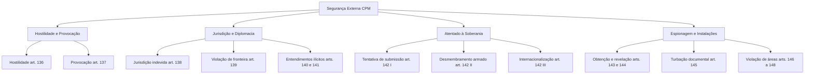

O Título I da Parte Especial do Código Penal Militar inaugura a tutela penal dos bens jurídicos vitais das Forças Armadas. Ele tipifica condutas que colocam em risco a soberania, as fronteiras e a paz do Brasil frente a governos estrangeiros.

Nas provas, a banca cobra a literalidade dos tipos, as penas e as qualificadoras pelo resultado. Embora a doutrina aponte que esses crimes afetam essencialmente a União e as Forças Armadas, os artigos 136 a 148 constam expressamente dos programas de concurso.

> [!objetivos]
> - Diferenciar os crimes de hostilidade, provocação e entendimentos com governos estrangeiros.
> - Distinguir ato de jurisdição indevida e violação de território estrangeiro.
> - Identificar as hipóteses de atentado contra a soberania territorial nacional.
> - Reconhecer as espécies de espionagem militar e as hipóteses com previsão culposa.

## Hostilidade e provocação contra nações estrangeiras

A estabilidade internacional exige resguardar a paz diplomática. O Código Penal Militar pune o militar que arrisca envolver o País em conflito internacional armado. A tutela penal pune o perigo concreto de guerra e agrava a pena caso ocorram danos diplomáticos reais.

O crime de hostilidade pune atos agressivos de militar contra representações ou bens estrangeiros, gerando risco de confronto bélico. Trata-se de crime formal e de perigo comum.

> [!lei] CPM, art. 136
> Praticar o militar ato de hostilidade contra país estrangeiro, expondo o Brasil a perigo de guerra: Pena - reclusão, de oito a quinze anos.
> § 1º Se resulta ruptura de relações diplomáticas, represália ou retorsão: Pena - reclusão, de dez a vinte e quatro anos.
> § 2º Se resulta guerra: Pena - reclusão, de doze a trinta anos.

A lei não fixa rol taxativo de atos hostis. São exemplos o ataque desautorizado a destacamento de fronteira ou a agressão física a embaixador estrangeiro. Para consumar o tipo básico, basta o perigo comprovado de guerra, sem necessidade de combate real. Se houver rompimento de laços, represália, retorsão ou guerra, aplicam-se as qualificadoras dos parágrafos 1º e 2º.

> [!exemplo]
> Em patrulha fluvial de fronteira, o Primeiro-Tenente Marcos, sem autorização, ordena disparos contra posto aduaneiro de país vizinho. O fato gera crise internacional imediata e deslocamento de tropas estrangeiras. Marcos comete o crime do art. 136 em sua forma básica. Se o incidente levar ao rompimento formal de relações diplomáticas, incidirá a qualificadora do § 1º.

Em sentido inverso, a provocação a país estrangeiro ocorre quando o militar estimula diretamente um governo externo a declarar guerra ou mover hostilidades contra o Brasil, ou a intervir em questão ligada à soberania nacional (CPM, art. 137). Nesse delito, a iniciativa da crise parte do militar brasileiro, que instiga a autoridade alienígena a romper a harmonia ou intervir na soberania nacional. A pena é de reclusão de doze a trinta anos.

## Jurisdição indevida e entendimentos diplomáticos ilícitos

A soberania territorial veda atos coercitivos de um país em solo de outro sem autorização bilateral. No âmbito militar, isso gera dois tipos contrapostos: a usurpação de jurisdição estrangeira no Brasil e a intrusão em solo vizinho para fins jurisdicionais.

O delito previsto no artigo 138 do Código Penal Militar sanciona a realização irregular de providências judiciais ordenadas por cortes de outras nações dentro do território brasileiro, bem como qualquer conduta que facilite essa diligência estrangeira desautorizada, cominando pena de reclusão de cinco a quinze anos. Ocorre, por exemplo, quando o militar cumpre mandado expedido por magistrado estrangeiro sem a necessária homologação pelas vias legais.

Já a violação de território estrangeiro (CPM, art. 139) visa a impedir excessos das tropas brasileiras além das fronteiras. Ocorre quando o militar transpõe a linha divisória internacional sem autorização do país vizinho com o objetivo de executar diligência determinada pela Justiça do Brasil, sujeitando-se à pena de reclusão de dois a seis anos.

O artigo 139 é crime de perigo abstrato. Consuma-se no exato momento da entrada não autorizada em solo estrangeiro impulsionada pelo fim especial, sendo irrelevante se o mandado foi cumprido.

A condução da política externa cabe privativamente ao Presidente da República (CF, art. 84). O militar que negocia com governos forasteiros incorre nos crimes dos artigos 140 e 141:

1. **Entendimento para neutralidade ou guerra (art. 140)**: pune ajustar ou tentar ajustar termos com nação estrangeira sobre envolvimento em conflito armado. Pena de reclusão de seis a doze anos.
2. **Entendimento para gerar conflito (art. 141)**: abrange ajuste com governos ou entidades privadas externas para gerar divergência internacional. Pena de quatro a oito anos, qualificada por ruptura de relações (seis a dezoito anos) ou guerra (dez a vinte e quatro anos).

A tabela a seguir resume as distinções entre os crimes diplomáticos:

| Delito Militar | Conduta Núcleo | Sujeito Passivo Externo | Resultados Qualificadores |
| --- | --- | --- | --- |
| Hostilidade (art. 136) | Praticar ato de agressão física ou política | Estado estrangeiro | Ruptura de relações, represália, retorsão ou guerra |
| Provocação (art. 137) | Incitar governo externo a atacar o Brasil | Estado estrangeiro | Sem qualificadoras expressas |
| Entendimento (art. 140) | Ajustar compromisso de guerra ou neutralidade | Estado estrangeiro | Sem qualificadoras expressas |
| Entendimento (art. 141) | Ajustar intriga para gerar conflito bilateral | Estado ou entidade estrangeira | Ruptura de relações diplomáticas ou guerra |

> [!pegadinha]
> Cuidado com as qualificadoras dos artigos 136 e 141. No art. 136, § 1º, figuram ruptura de relações, represália e retorsão. Já no art. 141, § 1º, a qualificadora intermediária prevê unicamente a ruptura de relações diplomáticas, sem contemplar retorsão ou represália.

## Tentativa contra a soberania nacional

O Código Penal Militar resguarda a integridade territorial por meio do artigo 142. Classifica-se como crime de atentado ou empreendimento, no qual o legislador pune o começo da execução com a mesma pena da consumação integral.

> [!lei] CPM, art. 142
> Tentar:
> I - submeter o território nacional, ou parte dêle, à soberania de país estrangeiro;
> II - desmembrar, por meio de movimento armado ou tumultos planejados, o território nacional, desde que o fato atente contra a segurança externa do Brasil ou a sua soberania;
> III - internacionalizar, por qualquer meio, região ou parte do território nacional:
> Pena - reclusão, de quinze a trinta anos, para os cabeças; de dez a vinte anos, para os demais agentes.

O tipo contempla três condutas alternativas: sujeitar parte do território ao domínio estrangeiro (inciso I); destacar província ou região mediante levante armado organizado (inciso II); ou transferir fração do território à administração de comitê ou consórcio internacional (inciso III).

A dosimetria penal diferencia os cabeças (líderes, CPM, art. 53, §§ 4º e 5º), sancionados com quinze a trinta anos de reclusão, dos executores e partícipes secundários, sujeitos a dez a vinte anos.

## Espionagem e proteção de segredos militares

A tutela da segurança militar exige proteção absoluta sobre documentos reservados, códigos e planos de defesa. Os artigos 143 a 148 disciplinam a matéria:

O crime de consecução de dados para espionagem (art. 143) pune quem obtém documento ou dado sigiloso para fins de espionagem militar (reclusão de quatro a doze anos). A pena sobe para dez a vinte anos (§ 1º) se comprometer a eficiência bélica, se houver entrega de documento a estrangeiro, manutenção de serviço de espionagem ou uso indevido de canais de comunicação.

> [!atencao] Modalidade culposa na espionagem
> O Código Penal Militar prevê modalidade culposa nos crimes de espionagem dos artigos 143 (§ 2º), 144 (§ 3º) e 145 (§ 2º). A negligência na custódia de dados confidenciais que viabilize o vazamento sujeita o infrator a pena de detenção.

O artigo 144 pune a revelação de segredo militar (três a oito anos), agravada se visar à espionagem (seis a doze anos) ou se abalar a capacidade bélica (dez a vinte anos). O artigo 145 incrimina a turbação documental (suprimir, deturpar ou alterar papéis reservados).

Por fim, o Código disciplina a violação de instalações sensíveis:
- Invasão de área militar com intuito de espionagem (art. 146): exige dolo específico de repassar informes ao exterior, com pena de três a oito anos (ou até três anos ao agente portando máquina fotográfica, conforme parágrafo único).
- Confecção não autorizada de plantas ou imagens de quartéis e arsenais (art. 147): apenada com reclusão de até quatro anos, sob condição expressa de subsidiariedade.
- Voo não autorizado sobre zona proibida (art. 148): sanciona o tráfego aéreo sobre perímetro vedado, com pena de reclusão de até três anos.

## Mapa do capítulo

A tabela a seguir compila os núcleos e peculiaridades dos crimes contra a segurança externa:

| Delito Militar | Dispositivo | Conduta Central | Sanção Principal | Ponto de Destaque na Prova |
| --- | --- | --- | --- | --- |
| Hostilidade | Art. 136 | Praticar ato hostil expondo o País a guerra | 8 a 15 anos | Qualifica com retorsão, represália, ruptura ou guerra |
| Provocação | Art. 137 | Provocar nação estrangeira a atacar o Brasil | 12 a 30 anos | Crime comissivo com elevada pena mínima |
| Jurisdição indevida | Art. 138 | Praticar ato judicial de país forasteiro | 5 a 15 anos | Exige ausência de homologação formal |
| Violação de fronteira | Art. 139 | Entrar em país vizinho para ato judicial | 2 a 6 anos | Consuma-se na transposição da linha divisória |
| Entendimento bélico | Art. 140 | Negociar guerra ou neutralidade | 6 a 12 anos | Atenta contra atribuição privativa presidencial |
| Entendimento lesivo | Art. 141 | Negociar intriga com entidade externa | 4 a 8 anos | Qualifica com ruptura de relações ou guerra |
| Atentado soberano | Art. 142 | Submeter, desmembrar ou internacionalizar | 15 a 30 anos (cabeças) | Pune a tentativa como crime consumado |
| Espionagem de dados | Arts. 143 a 145 | Obter, revelar ou turbar papéis sigilosos | Penas variáveis | Admitem modalidade culposa expressa |
| Violação de área | Arts. 146 a 148 | Entrar, desenhar ou sobrevoar área militar | Até 8 anos | Art. 147 possui natureza expressamente subsidiária |

### Para fixar

- O crime de hostilidade (art. 136) consuma-se com o perigo concreto de guerra, qualificando-se se resulta ruptura diplomática, retorsão, represália ou conflito armado.
- A provocação a país estrangeiro (art. 137) possui pena autônoma de doze a trinta anos de reclusão.
- A violação de território estrangeiro para ato judicial (art. 139) é crime formal e de perigo abstrato.
- O entendimento para neutralidade ou guerra (art. 140) tutela a competência do Presidente da República.
- A tentativa contra a soberania (art. 142) pune a tentativa com pena plena, apenando os cabeças com quinze a trinta anos de reclusão.
- Os delitos de espionagem dos artigos 143, 144 e 145 admitem punição na forma culposa.
- A penetração em local militar para espionagem (art. 146) exige finalidade específica de prestar dados a governo estrangeiro.
- O levantamento de plantas ou imagens de instalações militares (art. 147) possui cláusula expressa de subsidiariedade.
