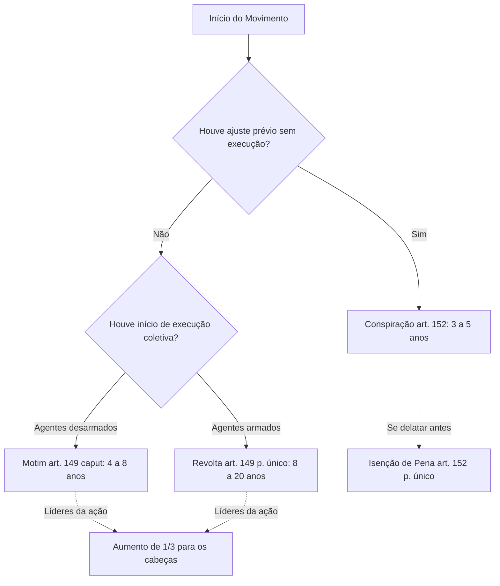
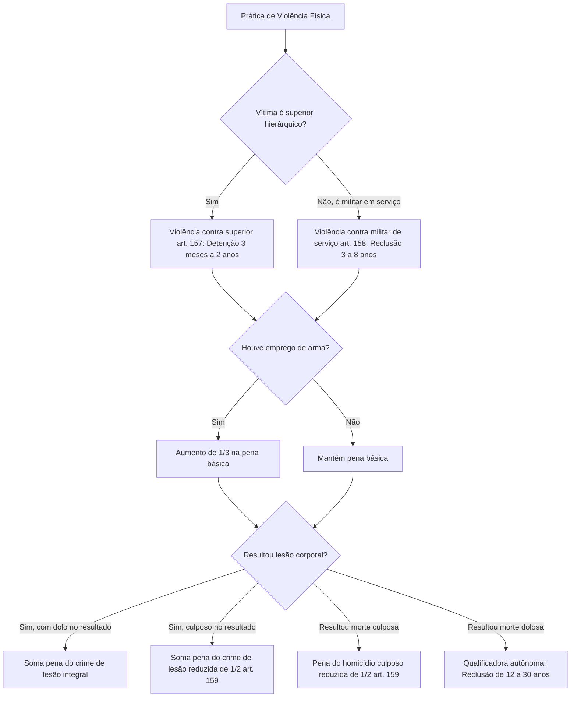

A autoridade e a disciplina militar constituem as bases institucionais das Forças Armadas e das corporações militares estaduais, como a Polícia Militar e o Corpo de Bombeiros Militar de Pernambuco. Por essa razão, os crimes que atingem o princípio da subordinação hierárquica e a integridade física dos comandantes e sentinelas recebem tratamento penal rigoroso.

Neste capítulo, estudamos as condutas mais emblemáticas do Título II da Parte Especial do Código Penal Militar: os crimes de motim e revolta, a conspiração, a aliciação e o incitamento militar, a apologia delitiva e as modalidades de violência contra superior e contra militar de serviço. Compreenderemos a tipicidade de cada figura, as causas de aumento, as formas qualificadas e as inovações introduzidas pela Lei 14.688/2023.

> [!objetivos]
> - Diferenciar juridicamente motim e revolta com base no critério legal do armamento.
> - Compreender os limites entre a conspiração preparatória e o início de execução do motim.
> - Identificar as características dos crimes de aliciação, incitamento e apologia de crime militar.
> - Analisar as formas fundamentais, qualificadas e majoradas da violência contra superior e contra militar de serviço.
> - Aplicar a regra de cumulação de penas com o resultado e a redução do artigo 159.

## Motim e revolta: o núcleo da insubordinação coletiva

O motim e a revolta representam a ruptura ostensiva da ordem militar praticada por tropa ou grupo organizado de militares. O artigo 149 do Código Penal Militar define o motim por meio de quatro incisos estruturantes, exigindo sempre concurso necessário de militares.

> [!lei] CPM, art. 149
> Reunirem-se militares:
> I - agindo contra a ordem recebida de superior, ou negando-se a cumpri-la;
> II - recusando obediência a superior, quando estejam agindo sem ordem ou praticando violência;
> III - assentindo em recusa conjunta de obediência, ou em resistência ou violência, em comum, contra superior;
> IV - ocupando quartel, fortaleza, arsenal, fábrica ou estabelecimento militar, ou dependência de qualquer dêles, hangar, aeródromo ou aeronave, navio ou viatura militar, ou utilizando-se de qualquer daqueles locais ou meios de transporte, para ação militar, ou prática de violência, em desobediência a ordem superior ou em detrimento da ordem ou da disciplina militar:
> Pena - reclusão, de quatro a oito anos, com aumento de um têrço para os cabeças.
> Parágrafo único. Se os agentes estavam armados: Pena - reclusão, de oito a vinte anos, com aumento de um têrço para os cabeças.

A configuração do motim requer a reunião de pelo menos dois militares da ativa. A redação original do Código mencionava assemelhados, expressão expressamente revogada pela reforma da Lei 14.688/2023. O sujeito ativo, portanto, é o militar em serviço ativo. O militar inativo e o civil não praticam motim na qualidade de autores materiais principais perante a Justiça Militar estadual, tendo em vista os limites da competência penal estabelecidos no artigo 125, parágrafo 4º, da Constituição Federal.

Examinemos detidamente cada uma das quatro condutas previstas nos incisos do artigo 149:

1. **Agir contra ordem ou negar-se a cumpri-la (inciso I)**: pune a oposição direta, expressa ou tácita, a determinação emanada de autoridade hierárquica. O grupo de militares atua positivamente em sentido contrário ou simplesmente cruza os braços recusando o comando.
2. **Recusar obediência em situação de desordem ou violência (inciso II)**: incrimina os militares que, já envolvidos em conduta desautorizada ou agressões, recusam ordem superior expressa de cessar imediatamente a ação e retomar o comportamento disciplinar regular.
3. **Assentimento em recusa coletiva ou violência (inciso III)**: pune a concordância explícita ou tácita com a desobediência conjunta. A doutrina amplamente majoritária enquadra nesse inciso os movimentos de greve ou paralisação coletiva de policiais e bombeiros militares, conduta que encontra vedação expressa no artigo 142, parágrafo 3º, inciso IV, da Constituição Federal.
4. **Ocupação indevida de instalações ou meios de transporte (inciso IV)**: pune a tomada física de quartéis, companhias, viaturas, navios ou aeronaves militares para realizar ações de força ou em detrimento da ordem militar. A consumação dispensa ordem direta descumprida: basta que a ocupação ocorra em prejuízo manifesto da disciplina.

A distinção jurídica entre motim e revolta baseia-se exclusivamente na circunstância objetiva de os agentes estarem armados. Se os militares que se amotinam não portam armamento, o fato configura motim, punido com reclusão de quatro a oito anos. Se os militares estão armados, a infração transmuda-se em revolta, com pena substancialmente mais rigorosa de reclusão de oito a vinte anos.

> [!atencao] Armamento na revolta
> Para a configuração de revolta, não é necessário que os militares façam disparos ou usem efetivamente as armas. Basta o porte de armamento próprio (como pistolas da corporação e fuzis) ou impróprio. Havendo pelo menos dois militares armados no grupo amotinado, a qualificadora comunica-se a todos os integrantes que tenham conhecimento dessa condição.

Tanto no motim quanto na revolta, a lei impõe causa especial de aumento de pena de um terço para os cabeças. Conforme o artigo 53, parágrafos 4º e 5º, do Código Penal Militar, consideram-se cabeças os militares que dirigem, incitam ou coordenam a ação delituosa coletiva; inexistindo líderes ostensivos, são reputados cabeças os militares de posto ou graduação mais elevada ou, em igualdade, os mais idosos.

> [!exemplo]
> Três soldados de um batalhão militar, insatisfeitos com a escala de serviço de plantão, fecham o portão da unidade e recusam a ordem do capitão fiscal de dia para abrir o acesso e iniciar o patrulhamento. Dois deles portam pistolas no coldre. Embora não tenham sacado as armas, a presença de armamento qualifica o crime: todos respondem por revolta (art. 149, parágrafo único), com aumento de um terço para o soldado que articulou a tomada do portão, na condição de cabeça.

A tabela a seguir compara as principais diferenças entre motim e revolta:

| Critério Jurídico | Motim (CPM, art. 149, caput) | Revolta (CPM, art. 149, parágrafo único) |
| --- | --- | --- |
| Presença de Armamento | Agentes desarmados | Pelo menos dois agentes portando armas |
| Uso Efetivo da Arma | Não ocorre | Desnecessário; basta o porte ou disponibilidade |
| Pena Cominada | Reclusão de quatro a oito anos | Reclusão de oito a vinte anos |
| Majoração para os Cabeças | Aumento obrigatório de um terço | Aumento obrigatório de um terço |
| Sujeito Ativo | Concurso de pelo menos dois militares da ativa | Concurso de pelo menos dois militares da ativa |

## Grupo armado para violência, omissão de lealdade e conspiração

Além do motim e da revolta, o Código Penal Militar pune outras condutas coletivas e atos preparatórios que ameaçam a disciplina e a lealdade militar.

A infração penal descrita no artigo 150 do Código Penal Militar sanciona a conduta de dois ou mais militares que, reunidos com armamento ou material bélico pertencente à corporação militar, praticam atos violentos contra pessoas ou bens públicos e particulares. A pena é de reclusão de quatro a oito anos. Trata-se de crime material, que só se consuma com a prática efetiva da violência física contra pessoas ou coisas.

O artigo 151 disciplina a omissão de lealdade militar. Pune com reclusão de três a cinco anos o militar que, sabendo com antecedência da preparação de motim ou revolta, não avisa tempestivamente seu superior hierárquico, ou aquele que, presenciando o ato criminoso, não utiliza todos os meios ao seu alcance para impedi-lo. Diferentemente do motim, a omissão de lealdade é crime unissubjetivo, podendo ser praticado por um único militar omisso.

Já o artigo 152 pune a conspiração militar, caracterizada pelo ajuste ou acordo prévio entre dois ou mais militares para praticar o crime de motim ou revolta. A pena é de reclusão de três a cinco anos. O Código excepciona aqui o princípio geral que não pune os atos meramente preparatórios, punindo a conspiração como crime autônomo.

> [!pegadinha]
> Não confunda motim com conspiração. A conspiração (art. 152) consuma-se no momento do pacto ou planejamento conjunto, antes de qualquer início de execução física da insubordinação. Se o grupo passa à execução do ato de desobediência ou ocupação, a conspiração fica absorvida pelo motim ou pela revolta. Ademais, a conspiração conta com causa especial de isenção de pena (art. 152, parágrafo único) para quem denuncia o ajuste antes da execução, enquanto ainda for possível evitar suas consequências.

O artigo 153 estabelece importante regra de cumulação: as penas cominadas para os artigos 149 e 150 são aplicadas sem prejuízo das penas correspondentes aos atos de violência física eventualmente praticados contra superiores ou terceiros (cúmulo material obrigatório).

## Aliciação, incitamento e apologia de crime militar

O Código Penal Militar antecipa a tutela preventiva da disciplina incriminando a instigação, o aliciamento e a exaltação pública de delitos militares.

O crime de aliciação para motim ou revolta (art. 154) pune quem atrai, convida ou seduz militar a aderir aos crimes previstos no capítulo do motim. A pena é de reclusão de dois a quatro anos. O sujeito ativo pode ser qualquer pessoa (militar ou civil). A consumação opera-se quando o militar aliciado aceita a proposta de insubordinação; se o militar convidado rejeita incontinenti o convite, resta caracterizada a tentativa punível.

O delito de incitamento (art. 155) incrimina incitar militar à desobediência, à indisciplina ou à prática de crime militar. A sanção é de reclusão de dois a quatro anos. O parágrafo único pune com a mesma pena quem introduz, afixa ou distribui em lugar militar matéria impressa, manuscrita, copiada ou eletrônica que contenha incitamento. O crime exige dolo específico e consuma-se com a percepção do estímulo delitivo pelo destinatário.

> [!bizu]
> Guarde a distinção dos verbos:
> - **Aliciar (art. 154)**: atrair ou recrutar militar para motim ou revolta específica.
> - **Incitar (art. 155)**: estimular genérica ou diretamente à indisciplina, desobediência ou crime militar.
> - **Fazer apologia (art. 156)**: elogiar fato criminoso militar já consumado ou seu autor, obrigatoriamente dentro de lugar sujeito à administração militar.

O artigo 156 tipifica a apologia de fato criminoso militar ou de seu autor, apenando com detenção de seis meses a um ano a manifestação de louvor ou engrandecimento a delito militar. O elemento espacial é elementar indispensável do tipo: a exaltação deve ocorrer em lugar sob administração militar. Se a manifestação ocorrer em ambiente civil ou em rede social desvinculada de dependência militar, a conduta poderá tipificar crime na legislação penal comum, mas não crime militar.

A tabela a seguir sistematiza as diferenças entre os delitos de provocação da indisciplina:

| Infração Penal | Artigo e Pena | Conduta Típica | Elemento Subjetivo e Local |
| --- | --- | --- | --- |
| Aliciação | Art. 154 (2 a 4 anos) | Aliciar militar para motim ou revolta | Dolo de aliciar; local indiferente |
| Incitamento | Art. 155 (2 a 4 anos) | Incitar à desobediência ou crime militar | Dolo direto; parágrafo único exige local militar para papéis |
| Apologia | Art. 156 (6 meses a 1 ano) | Elogiar crime militar ou seu executor | Dolo direto; exige lugar sob administração militar |

## Violência contra superior

O crime de violência contra superior (art. 157) protege a autoridade da hierarquia e a intangibilidade física dos militares de maior posto ou graduação. Exige relação direta de superioridade hierárquica ou funcional (art. 24) entre vítima e agressor.

> [!lei] CPM, art. 157
> Praticar violência contra superior:
> Pena - detenção, de três meses a dois anos.
> § 1º Se o superior é comandante da unidade a que pertence o agente, ou oficial general: Pena - reclusão, de três a nove anos.
> § 2º Se a violência é praticada com arma, a pena é aumentada de um terço.
> § 3º Se da violência resulta lesão corporal, aplica-se, além da pena da violência, a do crime contra a pessoa.
> § 4º Se da violência resulta morte: Pena - reclusão, de doze a trinta anos.
> § 5º A pena é aumentada da sexta parte, se o crime ocorre em serviço.

Para a configuração do tipo fundamental, exige-se emprego efetivo de força física contra a pessoa do superior (vias de fato, empurrão, socos). A violência moral, ameaça verbal ou dano aos pertences materiais do superior não preenchem a elementar do artigo 157, podendo configurar desacato (art. 298) ou dano (art. 259). O agente deve saber inequivocamente que a vítima ostenta a qualidade de superior; a ignorância invencível dessa condição afasta o dolo (erro sobre elementar).

O artigo 157 estrutura-se em várias formas qualificadas e causas de aumento:

- **Superior comandante ou oficial-general (§ 1º)**: forma qualificada com pena severa de reclusão de três a nove anos. Aplica-se quando a vítima comanda a unidade ou batalhão a que pertence o agressor, ou quando ostenta posto de oficial-general (general, brigadeiro ou almirante).
- **Emprego de arma (§ 2º)**: causa de aumento de um terço. A arma pode ser própria (pistola, fuzil) ou imprópria (faca comum, barra de ferro), exigindo-se que tenha sido concretamente empregada na violência, não bastando o mero porte ostensivo no coldre.
- **Resultado lesão corporal (§ 3º)**: manda aplicar, além da pena da violência, a pena correspondente à lesão corporal (CPM, art. 209). Trata-se de hipótese expressa de cúmulo de sanções.
- **Resultado morte (§ 4º)**: qualifica o crime quando da violência resulta óbito, estabelecendo limites punitivos idênticos aos do homicídio qualificado (reclusão de doze a trinta anos).
- **Crime em serviço (§ 5º)**: causa especial de aumento de um sexto quando a conduta ocorre durante o serviço do agressor, da vítima ou de ambos. O conceito de serviço abrange o desempenho formal de atividades de rotina ou operacionais da corporação.

## Violência contra militar de serviço e a regra do artigo 159

O artigo 158 tutela a segurança de militares investidos em funções especiais de vigilância, guarda e comando imediato de unidades. Enquanto a violência contra superior protege a pessoa do chefe, a violência contra militar de serviço protege a função operacional de segurança da tropa.

> [!lei] CPM, art. 158
> Praticar violência contra oficial de dia, de serviço, ou de quarto, ou contra sentinela, vigia ou plantão:
> Pena - reclusão, de três a oito anos.
> § 1º Se a violência é praticada com arma, a pena é aumentada de um terço.
> § 2º Se da violência resulta lesão corporal, aplica-se, além da pena da violência, a do crime contra a pessoa.
> § 3º Se da violência resulta morte: Pena - reclusão, de doze a trinta anos.

O sujeito ativo da violência contra militar de serviço pode ser tanto militar (superior, igual ou inferior) quanto civil perante a Justiça Militar da União. A norma elenca as funções protegidas:
- **Oficial de dia**: oficial (ou praça designada) que gerencia a unidade militar fora do expediente, atuando como delegado direto do comandante.
- **Oficial de serviço**: oficial incumbido de tarefas setoriais específicas (oficial de operações, oficial de tiro, comandante de pelotão de plantão).
- **Oficial de quarto**: militar designado para a supervisão dos turnos ou quartos de quarto de hora e vigília da unidade militar.
- **Sentinela**: militar armado ou desarmado que guarnece posto fixo ou itinerante de vigilância de entrada e instalações.
- **Vigia e plantão**: praças escaladas para a proteção e controle de segurança interna das subunidades e alojamentos.

> [!exemplo]
> Durante a madrugada, um soldado embriagado retorna ao quartel e, ao ter seu ingresso barrado pelo soldado sentinela do portão das armas por desobediência às normas de identificação, desfere socos e coronhadas no sentinela, causando-lhe escoriações corporais. O agressor responde pelo crime de violência contra militar de serviço (art. 158), qualificado pelo uso de arma (§ 1º) e somado à pena das lesões corporais (§ 2º).

Uma regra fundamental para as provas de concurso relaciona-se à gradação subjetiva do resultado mais grave previsto no artigo 159 do Código Penal Militar:

> [!lei] CPM, art. 159
> Quando da violência resulta morte ou lesão corporal e as circunstâncias evidenciam que o agente não quis o resultado nem assumiu o risco de produzi-lo, a pena do crime contra a pessoa é diminuída de metade.

O artigo 159 cuida da hipótese preterdolosa. Quando o militar desfere empurrão ou golpe físico pretendendo apenas agredir (dolo de violência), mas a vítima cai, bate a cabeça e sofre lesão grave ou falece por negligência ou imperícia do agressor (culpa no resultado), o agente responde pela violência contra superior ou de serviço, e a pena autônoma do homicídio culposo ou lesão corporal culposa é obrigatoriamente diminuída de metade.

> [!pegadinha]
> Fique muito atento à sistemática do artigo 159: ele não afasta a responsabilidade pelo resultado danoso culposo. Em vez disso, reduz pela metade a pena cominada ao crime autônomo contra a pessoa que for somada à pena do crime de violência. Se o resultado morte decorrer de dolo direto ou eventual, incide a forma qualificada plena (reclusão de doze a trinta anos), afastando a redução do artigo 159.

## Mapa do capítulo

A tabela abaixo sintetiza os principais crimes contra a autoridade e disciplina militar examinados neste capítulo, seus requisitos de concurso, penas básicas e pontos de maior cobrança em concursos públicos:

| Crime Militar | Dispositivo | Sujeito Ativo | Pena Básica | Peculiaridade Essencial |
| --- | --- | --- | --- | --- |
| Motim | Art. 149, caput | Concurso de dois ou mais militares | Reclusão de 4 a 8 anos | Desarmados; aumento de 1/3 para os cabeças |
| Revolta | Art. 149, parágrafo único | Concurso de militares armados | Reclusão de 8 a 20 anos | Ao menos dois armados; aumento de 1/3 para cabeças |
| Organização de grupo armado | Art. 150 | Concurso de dois ou mais militares | Reclusão de 4 a 8 anos | Exige emprego de material bélico militar e violência real |
| Omissão de lealdade | Art. 151 | Unissubjetivo (um militar da ativa) | Reclusão de 3 a 5 anos | Omitir comunicação tempestiva ou não tentar impedir |
| Conspiração | Art. 152 | Concurso de dois ou mais militares | Reclusão de 3 a 5 anos | Ajuste prévio; isenção de pena por denúncia antecipada |
| Aliciação para motim | Art. 154 | Qualquer pessoa (militar ou civil) | Reclusão de 2 a 4 anos | Consuma-se com a concordância do militar aliciado |
| Incitamento | Art. 155 | Qualquer pessoa | Reclusão de 2 a 4 anos | Estimula à indisciplina; parágrafo único pune panfletagem |
| Apologia | Art. 156 | Qualquer pessoa | Detenção de 6 meses a 1 ano | Exige que o elogio ocorra em lugar sob administração militar |
| Violência contra superior | Art. 157 | Militar subordinado | Detenção de 3 meses a 2 anos | Qualifica se comandante ou general (3 a 9 anos); morte 12 a 30 |
| Violência contra sentinela | Art. 158 | Militar ou civil | Reclusão de 3 a 8 anos | Protege oficial de dia, serviço, quarto, sentinela e vigia |
| Redução por ausência de dolo | Art. 159 | Autor da violência militar | Redução legal de metade | Diminui pela metade a pena do crime culposo contra a pessoa |

### Para fixar

- O motim (art. 149) exige o concurso necessário de pelo menos dois militares da ativa agindo sem armas.
- A revolta (art. 149, parágrafo único) caracteriza-se pela presença de armas no grupo amotinado; a existência de dois agentes armados já estende a qualificadora aos demais cientes.
- No motim e na revolta, a pena é obrigatoriamente aumentada de um terço para os cabeças do movimento.
- A greve de militares é vedada pelo artigo 142 da Constituição Federal e enquadra-se formalmente no crime de motim do artigo 149, inciso III.
- A conspiração (art. 152) pune o ajuste prévio para o motim; há isenção de pena se o agente denunciar o plano antes do início da execução física.
- A omissão de lealdade (art. 151) é crime de concurso facultativo, bastando a inércia injustificada de um único militar que soube do plano ou presenciou a insubordinação.
- A apologia (art. 156) só configura crime militar se praticada expressamente em lugar sujeito à administração militar.
- A violência contra superior (art. 157) é qualificada com pena de reclusão de três a nove anos se a vítima comanda a unidade do agressor ou é oficial-general.
- A violência contra militar de serviço (art. 158) tem pena básica de reclusão de três a oito anos e tutela sentinelas, vigias, plantões e oficiais de serviço.
- Na violência qualificada pelo resultado culposo de lesão ou morte, a pena do crime contra a pessoa é reduzida de metade pelo artigo 159.
