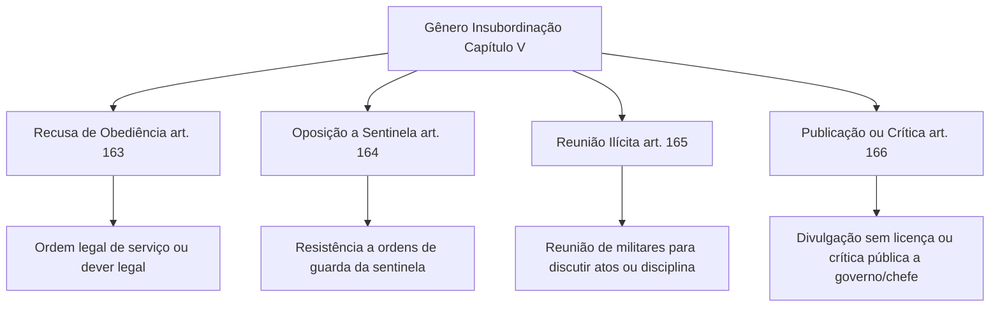

A disciplina e a hierarquia sustentam as corporações militares e exigem respeito incondicional aos superiores, aos símbolos nacionais e às ordens de serviço. No cotidiano da Polícia Militar e do Corpo de Bombeiros Militar de Pernambuco, a urbanidade e a obediência asseguram a eficácia das missões operacionais. Neste capítulo, estudamos o desrespeito a superior, a símbolo nacional ou à farda (arts. 160 a 162) e as quatro espécies de insubordinação militar (arts. 163 a 166).

> [!objetivos]
> - Identificar as elementares do crime de desrespeito a superior e a presença de testemunha militar.
> - Distinguir o ultraje a símbolo nacional do despojamento desprezível de peças e condecorações.
> - Compreender a insubordinação como gênero composto por quatro figuras típicas autônomas.
> - Analisar os requisitos legais da recusa de obediência e os limites da ordem legal de serviço.
> - Diferenciar a oposição a ordem de sentinela, a reunião ilícita e a publicação ou crítica indevida.

## Desrespeito a superior: consideração hierárquica e subsidiariedade

O crime de desrespeito a superior tutela a consideração funcional devida àqueles de maior patente ou no exercício de função de comando (art. 24).

> [!lei] CPM, art. 160
> Desrespeitar superior diante de outro militar:
> Pena - detenção, de três meses a um ano, se o fato não constitui crime mais grave.
> Parágrafo único. Se o superior é o comandante da unidade a que pertence o agente, oficial-general, ou oficial de dia, de serviço ou de quarto, a pena é aumentada de metade.

O tipo exige conduta que menoscabe a autoridade moral do superior por palavras, gestos ou deboche. Para a tipicidade, é indispensável a presença de pelo menos outro militar. Se o ato ocorre a sós ou diante unicamente de civis, não há crime militar, restando infração disciplinar. O terceiro militar que presencia não precisa ter posto igual, mas deve perceber a ofensa.

O delito é expressamente subsidiário. Se a conduta caracterizar desacato a superior (art. 298) ou violência física (art. 157), o desrespeito é absorvido. O parágrafo único aumenta a pena de metade se a vítima é comandante da unidade, oficial-general ou oficial de dia, serviço ou quarto.

> [!exemplo]
> Durante a preleção matinal, o soldado Lucas, ao receber uma orientação corriqueira do capitão de dia, vira as costas balançando a cabeça em sinal de desprezo e profere gracejos desairosos perante a guarda formada. Presentes diversos outros policiais da unidade, Lucas comete o crime de desrespeito a superior (art. 160), com pena aumentada de metade pelo parágrafo único, em razão de a vítima ser o oficial de dia.

## Desrespeito a símbolo nacional e despojamento desprezível

O culto ao patriotismo e o apreço aos emblemas oficiais integram o núcleo da conduta militar. O Código Penal Militar tipifica duas infrações que protegem a dignidade dos símbolos cívicos e das condecorações institucionais:

O crime de desrespeito a símbolo nacional pune a prática de atos que se traduzam em ultraje a símbolos oficiais da Federação.

> [!lei] CPM, art. 161
> Praticar o militar diante da tropa, ou em lugar sujeito à administração militar, ato que se traduza em ultraje a símbolo nacional:
> Pena - detenção, de um a dois anos.

A definição dos símbolos nacionais decorre do artigo 13, parágrafo 1º, da Constituição Federal e da Lei 5.700/1971: a Bandeira Nacional, o Hino Nacional, as Armas Nacionais e o Selo Nacional. Constitui ultraje rasgar, queimar, pisotear, profanar a Bandeira ou executar paródias ofensivas durante a execução solene do Hino.

> [!pegadinha]
> O artigo 161 abrange exclusivamente os quatro símbolos oficiais da República Federativa do Brasil. Não se aplica o tipo penal militar aos símbolos estaduais ou municipais, como a bandeira ou hino do Estado de Pernambuco. No Direito Penal, é vedada a analogia desfavorável ao réu para criar infrações ou ampliar o alcance incriminador de tipos penais fechados.

O crime do artigo 161 exige que o ato seja praticado diante da tropa (reunião formal de dois ou mais militares sob comando de outro) ou dentro de lugar sujeito à administração militar.

Já o artigo 162 cuida do despojamento desprezível, sancionando o militar que se desfaz ostensivamente de suas insígnias ou fardamento por sentimento de desprezo:

> [!lei] CPM, art. 162
> Despojar-se de uniforme, condecoração militar, insígnia ou distintivo, por menosprezo ou vilipêndio:
> Pena - detenção, de seis meses a um ano.
> Parágrafo único. A pena é aumentada da metade, se o fato é praticado diante da tropa, ou em público.

A conduta consiste em arrancar do próprio corpo a farda, jogá-la ao solo, pisoteá-la ou desfazer-se de medalhas militares por desprezo ou menoscabo. O crime é de mão própria: o agente deve despojar-se de suas próprias peças. Se um militar arranca a insígnia ou condecoração de outro colega, comete delito de injúria real ou desacato, mas não o despojamento do artigo 162.

A tabela a seguir sistematiza as diferenças entre as figuras de ultraje cívico:

| Delito Militar | Objeto Material | Elemento Subjetivo Especial | Causa de Aumento de Pena |
| --- | --- | --- | --- |
| Desrespeito a símbolo (art. 161) | Bandeira, Hino, Armas e Selo Nacional | Vontade de ultrajar e ofender o símbolo | Não possui causa de aumento específica |
| Despojamento desprezível (art. 162) | Uniforme, condecoração, insígnia ou distintivo próprio | Ânimo especial de menosprezo ou vilipêndio | Aumento de metade diante da tropa ou em público |

## Insubordinação: gênero e espécies

Na linguagem cotidiana, é frequente o uso da palavra insubordinação como sinônimo puro de desobediência a ordem superior. No Direito Penal Militar, entretanto, a insubordinação não é um crime isolado, mas o gênero conceitual que intitula o Capítulo V do Título II da Parte Especial. Sob essa rubrica, o legislador reuniu quatro espécies delitivas autônomas que tutelam a integridade dos vínculos hierárquicos e a autoridade funcional contra atos individuais ou organizados de contestação.

A correta identificação dessas quatro espécies é indispensável nas provas de concurso público, pois as bancas examinadoras costumam explorar a confusão entre o descumprimento individual de ordem de serviço, a desobediência genérica e a resistência às determinações de sentinelas. O Código Penal Militar divide o gênero insubordinação nas seguintes infrações:
1. Recusa de obediência (art. 163);
2. Oposição a ordem de sentinela (art. 164);
3. Reunião ilícita (art. 165);
4. Publicação ou crítica indevida (art. 166).

Cada uma dessas condutas atinge a disciplina militar por vias distintas, desde a inércia omissiva diante de comando direto até a manifestação pública censória veiculada pela imprensa ou redes sociais.

## Recusa de obediência

A recusa de obediência (art. 163) é o tipo penal mais comum de insubordinação individual e protege a imperatividade dos comandos militares funcionais.

> [!lei] CPM, art. 163
> Recusar obedecer a ordem do superior sobre assunto ou matéria de serviço, ou relativamente a dever imposto em lei, regulamento ou instrução:
> Pena - detenção, de um a dois anos, se o fato não constitui crime mais grave.

O núcleo consiste em recusar cumprimento a ordem direta de superior hierárquico ou funcional. A conduta pode ser omissiva (o subordinado permanece inerte e não executa a tarefa determinada) ou comissiva (o militar executa ato oposto ao determinado).

O Código Penal Militar não acolhe o princípio da obediência cega. O dever de cumprimento alcança exclusivamente a ordem legal. Se o superior emite determinação manifestamente criminosa ou manifestamente ilegal (como torturar um suspeito detido ou fraudar boletim de ocorrência), o subordinado tem o dever jurídico de não cumpri-la, sem que incorra no artigo 163. A ordem precisa atender aos requisitos essenciais do ato administrativo: competência da autoridade emissora, forma adequada e finalidade pública.

Além disso, a ordem deve versar sobre assunto ou matéria de serviço militar. Se o superior determina a prática de ato legal de natureza estritamente privada ou alheia ao serviço da corporação (como lavar o automóvel particular do comandante), a recusa não é criminosa. Se a ordem legal não se refere a matéria de serviço, mas possui respaldo funcional genérico, a eventual recusa pode configurar o delito comum de desobediência (CPM, art. 301), mas não a recusa de obediência militar do artigo 163.

Trata-se de crime de mão própria e unissubjetivo. Se houver recusa coletiva concertada de dois ou mais militares, a conduta atinge maior gravidade e transmuda-se no crime de motim (art. 149, I).

## Oposição a ordem de sentinela e reunião ilícita

A figura delitiva prevista no artigo 164 do Código Penal Militar sanciona a conduta de quem resiste passivamente ou contraria determinações comunicadas pelo militar em posto de sentinela, estabelecendo pena de detenção de seis meses a um ano sob cláusula de subsidiariedade expressa.

> [!atencao] Natureza da ordem da sentinela
> A sentinela não cria a ordem militar; ela é a executora e transmissora de determinação geral originada do comando da unidade militar ou do oficial de dia. Por isso, a ordem tem natureza impessoal e vinculada ao serviço de segurança da instalação. Qualquer pessoa pode figurar no polo ativo, inclusive civil ou militar que ostente posto ou graduação superior à da sentinela.

O crime é subsidiário em relação à resistência (art. 177) e à violência contra militar de serviço (art. 158). Se o militar opõe-se verbalmente ou por desobediência simples, responde pelo artigo 164; se emprega força física ou violência contra a sentinela, responde pelo artigo 158.

O crime de reunião ilícita (art. 165) protege a higidez do princípio da hierarquia contra agrupamentos criados para questionar decisões de comando:

> [!lei] CPM, art. 165
> Promover a reunião de militares, ou nela tomar parte, para discussão de ato de superior ou assunto atinente à disciplina militar:
> Pena - detenção, de seis meses a um ano a quem promove a reunião; de dois a seis meses a quem dela participa, se o fato não constitui crime mais grave.

O tipo pune tanto quem promove (organiza, convoca e lidera) quanto quem toma parte (participa conscientemente dos debates). Exige-se agrupamento de pelo menos dois militares com a finalidade de discutir ato de autoridade superior ou normas disciplinares em tom de censura, contestação ou indisciplina. A dosimetria comina sanção mais severa ao promotor do conclave ilícito (detenção de seis meses a um ano) do que aos participantes aderentes (dois a seis meses).

## Publicação ou crítica indevida

O artigo 166 resguarda a discrição institucional e a vedação à manifestação político-partidária ou contestatória ostensiva no âmbito das corporações militares.

> [!lei] CPM, art. 166
> Publicar o militar ou assemelhado, sem licença, ato ou documento oficial, ou criticar publicamente ato de seu superior ou assunto atinente à disciplina militar, ou a qualquer resolução do Governo:
> Pena - detenção, de dois meses a um ano, se o fato não constitui crime mais grave.

O crime possui duas modalidades centrais:
1. Publicar documento oficial sem autorização da autoridade competente, seja por via escrita, impressa ou eletrônica.
2. Criticar publicamente decisão de superior, matéria ligada à disciplina militar ou deliberação do Governo Federal ou Estadual.

Por ocasião da reforma legislativa do Código Penal Militar promovida pela Lei 14.688/2023, o Congresso Nacional pretendeu retirar do tipo penal a incriminação das críticas direcionadas às resoluções do Governo. Todavia, a modificação foi expressamente vetada pela Presidência da República (Mensagem de Veto 486/2023). A razão do veto fundamentou-se na preservação do artigo 142 da Constituição Federal, destacando que as Forças Armadas e as corporações militares são subordinadas à autoridade suprema do Poder Executivo, sendo incompatível com a disciplina militar a crítica pública a decisões de governo.

Dessa forma, na vigência atual, criticar publicamente resoluções do Governo ou ordens de superiores hierárquicos continua configurando o crime militar do artigo 166 do Código Penal Militar.

A tabela comparativa a seguir sintetiza os tipos de insubordinação estudados:

| Crime de Insubordinação | Dispositivo | Sujeito Ativo | Conduta Principal | Sanção Penal Básica |
| --- | --- | --- | --- | --- |
| Recusa de obediência | Art. 163 | Militar subordinado | Recusar ordem legal de serviço | Detenção de 1 a 2 anos |
| Oposição a sentinela | Art. 164 | Militar (mesmo superior) ou civil | Opor-se a ordens da guarda | Detenção de 6 meses a 1 ano |
| Reunião ilícita | Art. 165 | Militares reunidos | Promover ou integrar debate censório | Promotor: 6m a 1a; Membro: 2m a 6m |
| Publicação ou crítica | Art. 166 | Militar em atividade | Publicar ato oficial ou criticar governo | Detenção de 2 meses a 1 ano |

## Mapa do capítulo

O quadro a seguir resume a estrutura geral das infrações de desrespeito e insubordinação disciplinar:

| Tipo Penal Militar | Artigo | Bem Jurídico Tutelado | Condição Específica de Aplicação | Ponto Crucial de Prova |
| --- | --- | --- | --- | --- |
| Desrespeito a superior | Art. 160 | Autoridade funcional | Presença obrigatória de outro militar | Subsidiário ao desacato; aumenta metade contra oficial de dia |
| Ultraje a símbolo | Art. 161 | Patriotismo cívico | Diante da tropa ou em lugar militar | Restringe-se aos quatro símbolos nacionais da Federação |
| Despojamento desprezível | Art. 162 | Dignidade do uniforme | Menosprezo ou vilipêndio a peças próprias | Crime de mão própria; aumenta metade em público ou tropa |
| Recusa de obediência | Art. 163 | Cumprimento de ordens | Ordem legal sobre matéria de serviço | Inexiste obediência cega; mão própria individual |
| Oposição à sentinela | Art. 164 | Segurança de instalações | Oposição à ordem transmitida pela guarda | Subsidiário à resistência e à violência contra militar de serviço |
| Reunião ilícita | Art. 165 | Disciplina coletiva | Discussão de atos de superior ou normas | Pena diferenciada entre promotor e mero participante |
| Crítica indevida | Art. 166 | Neutralidade e lealdade | Manifestação pública sem licença oficial | Veto presidencial manteve crime para crítica a atos de governo |

### Para fixar

- O crime de desrespeito a superior (art. 160) só se consuma se praticado na presença de pelo menos outro militar.
- O desrespeito a superior possui pena aumentada de metade se a vítima é o comandante da unidade do agente, oficial-general ou oficial de dia, de serviço ou de quarto.
- O ultraje a símbolo nacional (art. 161) abrange unicamente os símbolos da República (Bandeira, Hino, Armas e Selo Nacionais), não alcançando símbolos estaduais ou municipais.
- O despojamento desprezível (art. 162) exige ânimo especial de vilipêndio e só pode ser praticado em relação ao fardamento, insígnia ou medalha do próprio autor.
- A insubordinação é gênero no Código Penal Militar que compreende quatro espécies: recusa de obediência, oposição a ordem de sentinela, reunião ilícita e crítica indevida.
- Na recusa de obediência (art. 163), o militar não é obrigado a cumprir ordem manifestamente ilegal.
- O crime de oposição a ordem de sentinela (art. 164) pode ser cometido por qualquer pessoa, inclusive por superior hierárquico da sentinela.
- Na reunião ilícita (art. 165), a pena cominada ao promotor (seis meses a um ano) é superior à do mero participante (dois a seis meses).
- O crime de publicação ou crítica indevida (art. 166) permanece plenamente em vigor quanto à crítica a atos e resoluções do Governo, em razão do veto à Lei 14.688/2023.
