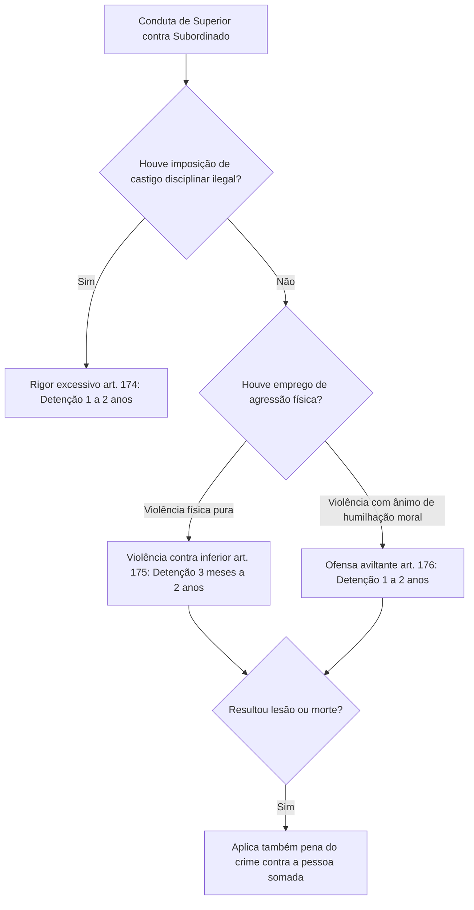

O regular funcionamento das instituições militares depende do respeito estrito aos limites funcionais de comando e da observância dos procedimentos legais na custódia de pessoas privadas de liberdade. Quando um agente público extrapola suas prerrogativas de comando, comete excessos disciplinares ou permite a quebra da segurança de instalações prisionais, a integridade da administração militar resta vulnerada.

Neste capítulo, estudamos três blocos normativos de alta relevância: a usurpação e os abusos de autoridade militar (arts. 167 a 176), o crime de resistência à execução de ato legal com as inovações da Lei 14.688/2023 (art. 177) e os delitos atinentes à custódia e evasão de presos e internados (arts. 178 a 182). Analisaremos detalhadamente a jurisprudência sumulada do Superior Tribunal de Justiça sobre fuga de presos e as hipóteses de cumulação de penas.

> [!objetivos]
> - Diferenciar a assunção de comando sem ordem da conservação indevida de comando militar.
> - Compreender os limites típicos do rigor excessivo e da violência contra inferior.
> - Analisar a estrutura do crime de resistência, suas qualificadoras e a cumulação de penas com atos de violência.
> - Distinguir as figuras de fuga, evasão, arrebatamento e amotinamento de presos.
> - Aplicar a jurisprudência da Súmula 75 do Superior Tribunal de Justiça no concurso de competências.

## Usurpação e desvios de comando operacional

O exercício do comando militar apoia-se em delegação legal formal. O Código Penal Militar protege a cadeia hierárquica contra intervenções ilegítimas nos artigos 167 a 170.

O crime de assunção de comando sem ordem (art. 167) pune o militar que assume comando de unidade ou direção de estabelecimento militar sem ter recebido designação oficial ou autorização formal de escalão superior. A pena é de reclusão de dois a quatro anos, sob condição subsidiária expressa ("se o fato não constitui crime mais grave"). Para a consumação do tipo, não basta o agente ingressar nas dependências do gabinete de comando: exige-se a prática concreta de atos de gestão, determinação de ordens a subordinados ou deliberações administrativas privativas do comandante. A lei ressalva expressamente que não há crime se a assunção ocorrer motivada por grave emergência imprevista (como a morte repentina do comandante em combate ou desastre).

Distinto é o crime de conservação ilegal de comando (art. 168), sancionado com detenção de um a três anos. Aqui, o agente assumiu o comando de forma inteiramente legítima e legal, mas recusa-se a transferi-lo ou deixá-lo após haver recebido ordem regular da autoridade competente determinando sua substituição ou destituição. Enquanto o artigo 167 pune a investidura arbitrária e sem título, o artigo 168 incrimina a recusa desobediente em desocupar a função exercida.

Nos artigos 169 e 170, a lei militar pune manobras táticas não autorizadas:

- **Operação militar sem ordem superior (art. 169)**: pune o comandante que determina movimento de tropa ou ação militar sem ter ordem ou autorização superior. A pena básica é de reclusão de três a cinco anos. O crime consuma-se no instante em que a ordem é transmitida, mesmo que a tropa se recuse a marchar. A pena é qualificada (reclusão de quatro a oito anos) se a operação ocorre em território estrangeiro ou se dirige contra força armada alienígena.
- **Ordem arbitrária de invasão (art. 170)**: pune o comandante de tropa, navio, aeronave ou blindado militar que ordena entrada ou sobrevoo não autorizado em águas ou território de outro país. Com a reforma operada pela Lei 14.688/2023, a sanção foi fixada em detenção de um a dois anos, afastando a antiga previsão de reforma ou perda de posto. Exige-se dolo direto; eventual erro involuntário de navegação afasta o delito.

A tabela a seguir contrasta as características das infrações ligadas ao comando militar:

| Delito Militar | Dispositivo | Conduta Central | Sanção Principal | Requisito ou Excludente |
| --- | --- | --- | --- | --- |
| Assunção sem ordem | Art. 167 | Assumir comando sem autorização | Reclusão de 2 a 4 anos | Afastado se praticado em grave emergência |
| Conservação ilegal | Art. 168 | Reter comando após ordem de saída | Detenção de 1 a 3 anos | Pressupõe investidura originária lícita |
| Operação sem ordem | Art. 169 | Ordenar deslocamento tático sem plano | Reclusão de 3 a 5 anos | Qualifica se em solo externo (4 a 8 anos) |
| Ordem de invasão | Art. 170 | Ordenar ingresso ilegal em território externo | Detenção de 1 a 2 anos | Redação reformada pela Lei 14.688/2023 |

## Uniformes, requisições militares e abusos disciplinares

A preservação da identidade visual das forças e a moderação no exercício do poder hierárquico constituem garantias fundamentais da legalidade.

Os artigos 171 e 172 tratam do uso indevido de fardamentos e insígnias. O artigo 171 comina detenção de seis meses a um ano ao militar que utiliza em público uniforme, distintivo ou insígnia de posto ou graduação superior à que realmente possui. Já o artigo 172 pune qualquer pessoa (militar ou civil) que usa indevidamente fardamento ou símbolo militar a que não tem direito, com detenção de até seis meses. Assim, se um sargento ostenta dragonas de capitão, responde pelo crime específico do artigo 171; se um tenente utiliza insígnias de sargento ou se um civil veste a farda militar na rua, incide no tipo geral do artigo 172.

O artigo 173 disciplina o abuso de requisição militar, cominando detenção de um a dois anos ao militar em serviço ativo que excede os poderes autorizados ou deixa de cumprir as formalidades legais da requisição administrativa. A requisição de bens privados é ato de intervenção na propriedade amparado pelo artigo 5º, inciso XXV, da Constituição Federal, exigindo perigo público iminente e formalização solene por escrito, sob pena de responsabilização penal militar.

No âmbito disciplinar, o Código Penal Militar pune os excessos punitivos e a violência corporal praticados por superiores contra subordinados:

> [!lei] CPM, art. 174
> Exceder a faculdade de punir o subordinado, fazendo-o com rigor não permitido, ou ofendendo-o por palavra, ato ou escrito:
> Pena - detenção, de um a dois anos, se o fato não constitui crime mais grave.

O crime de rigor excessivo (art. 174) é infração própria de militar investido de poder sancionatório regulamentar. O excesso manifesta-se pela imposição de sanções disciplinares não previstas em regulamento, pela aplicação de punição física degradante (como privação prolongada de água ou descanso em treinamento), ou pelo emprego de agressões verbais vexatórias durante a execução da sanção. O delito possui natureza subsidiária, cedendo espaço a crimes autônomos mais graves caso ocorram lesões corporais ou homicídio.

> [!exemplo]
> Um capitão comandante de companhia, ao verificar o atraso injustificado de um soldado ao serviço de ronda matinal, determina que o militar permaneça em posição de sentido sob sol forte por dez horas consecutivas sem ingerir líquidos, além de ofendê-lo publicamente com termos depreciativos perante a tropa. Não havendo lesão corporal resultante, o oficial responde pelo crime militar de rigor excessivo (art. 174).

O artigo 175 tipifica a violência contra inferior, punindo o militar que emprega força física contra subordinado hierárquico ou funcional (detenção de três meses a dois anos). Trata-se de agressão física (socos, empurrões, tapas). O parágrafo único estabelece que, se da violência resulta lesão corporal ou morte, somam-se as penas do crime contra a pessoa (CPM, art. 209 ou homicídio), aplicando-se a redução de metade do artigo 159 se o resultado gravoso foi meramente culposo.

A única excludente legal expressa para essa conduta repousa no artigo 42, parágrafo único, do Código Penal Militar: não há crime quando o comandante de embarcação, aeronave ou praça de guerra, sob perigo iminente ou grave calamidade, compele subordinados por meios violentos a executar manobras urgentes indispensáveis para salvar vidas ou evitar a destruição da unidade.

Por sua vez, o artigo 176 tipifica a ofensa aviltante a inferior, punida com detenção de um a dois anos. Cuida-se da violência que, pela sua própria natureza ou pelo meio utilizado, possui como objetivo primário humilhar moralmente o subordinado perante terceiros (como desferir bofetadas com luvas, puxões de orelha infantis ou agressões vexatórias). Se não for comprovado o propósito de ultraje moral, a conduta desclassifica-se para a violência simples do artigo 175.

## Resistência: a tutela do cumprimento do dever legal

O crime de resistência militar tutela a integridade das decisões legais da Administração Militar e protege os agentes públicos encarregados de dar cumprimento a mandados e providências regulamentares.

> [!lei] CPM, art. 177
> Opor-se à execução de ato legal, mediante ameaça ou violência ao executor, ou a quem esteja prestando auxílio:
> Pena - detenção, de seis meses a dois anos.
> § 1º Se o ato não se executa em razão da resistência: Pena - reclusão de dois a quatro anos.
> § 1º-A. Se da resistência resulta morte: Pena – reclusão, de 6 (seis) a 20 (vinte) anos.
> § 2º As penas previstas no caput e no § 1º deste artigo são aplicáveis sem prejuízo das correspondentes à violência.

O crime de resistência exige a oposição física ou moral direcionada a impedir ato que seja plenamente legal. Se a ordem da autoridade for flagrantemente arbitrária, nula ou destituída de competência legal, a oposição do cidadão ou do subordinado não tipifica o crime de resistência, operando o princípio da legalidade.

A oposição deve ocorrer mediante violência real contra a pessoa do executor ou de quem o auxilia, ou mediante grave ameaça verbalizada. A violência física contra coisas (como desferir chutes na viatura militar ou atirar pedras contra a parede do alojamento) não preenche a conduta típica da resistência, podendo configurar crime de dano (art. 259).

O sujeito ativo pode ser militar ou civil. No caso do civil que resiste a policiais militares estaduais, a jurisprudência fixa a competência da Justiça Comum estadual, tipificando o crime comum do artigo 329 do Código Penal.

O artigo 177 apresenta duas formas qualificadas de suma importância para provas:
1. **Frustração do ato legal (§ 1º)**: se, em virtude da resistência violenta ou ameaçadora oposta pelo agente, a autoridade pública não consegue dar cumprimento ao ato legal que determinara, a pena eleva-se substancialmente para reclusão de dois a quatro anos.
2. **Resultado morte (§ 1º-A)**: inovação de grande relevo inserida pela Lei 14.688/2023, estabelecendo pena de reclusão de seis a vinte anos se da conduta de resistência resultar o falecimento do executor ou de terceiro que o auxiliava.

Além disso, o parágrafo 2º comina a regra do cúmulo material obrigatório: as penas da resistência básica ou qualificada aplicam-se sem prejuízo das penas relativas à violência física efetivamente perpetrada (como as lesões corporais causadas no policial que executava a diligência).

> [!exemplo]
> Durante patrulhamento em Recife, uma guarnição da Polícia Militar aborda um militar que transporta munições desautorizadas em veículo. Ao ser cientificado de sua prisão em flagrante por porte ilegal, o militar reage com violência desferindo socos e coronhadas nos componentes da viatura policial. Em virtude do tumulto e das agressões, o militar consegue evadir-se do local, impedindo a consumação da prisão. O agente responde pelo crime de resistência qualificada pela não execução do ato (art. 177, § 1º), em cúmulo material com as sanções de lesão corporal (CPM, art. 209).

## Crimes contra a custódia de presos e internados

A preservação da segurança de presos e a manutenção da ordem carcerária militar são protegidas pelos artigos 178 a 182 do Código Penal Militar.

### Fuga de preso ou internado (arts. 178 e 179)

O artigo 178 incrimina a ação de terceiro que auxilia pessoa sob custódia legal a escapar:

> [!lei] CPM, art. 178
> Promover ou facilitar a fuga de pessoa legalmente presa ou submetida a medida de segurança detentiva:
> Pena - detenção, de seis meses a dois anos.
> § 1º Se o crime é praticado a mão armada, ou por mais de uma pessoa, ou mediante arrombamento: Pena - reclusão, de dois a seis anos.
> § 2º As penas deste artigo são aplicáveis sem prejuízo das correspondentes à violência.
> § 3º Se o crime é praticado por pessoa sob cuja guarda, custódia ou condução está o preso ou internado: Pena - reclusão, até quatro anos.

O tipo pune tanto quem promove (planeja e deflagra a fuga) quanto quem facilita (colabora pontualmente para o sucesso da evasão). As qualificadoras incidem se o crime for executado com uso de arma própria ou imprópria, mediante concurso de duas ou mais pessoas, por arrombamento físico das instalações, ou pelo agente público que ostentava o dever legal específico de vigilância e custódia do preso (§ 3º).

> [!jurisprudencia] STJ, Súmula 75
> O julgamento de policial militar acusado de promover ou facilitar a fuga de detento em presídio comum pertence à Justiça Comum Estadual, e não à Justiça Militar.

A fixação da competência nos crimes de facilitação de fuga depende do local da custódia. O entendimento consagrado na Súmula 75 do Superior Tribunal de Justiça estabelece que, se o policial militar facilita a fuga de detento recolhido em presídio ou penitenciária pública comum, a competência é da Justiça Comum Estadual. Para que o fato configure crime militar perante a Justiça Militar estadual, é indispensável que o estabelecimento seja militar (presídio militar de corporação) ou que o preso esteja sob escolta estritamente militar no momento da fuga.

O artigo 179 cuida da fuga culposa: pune com detenção de três meses a um ano quem deixa fugir, por culpa in vigilando, pessoa legalmente presa confiada à sua guarda.

> [!atencao] Limites da modalidade culposa
> O crime de fuga culposa (art. 179) possui aplicação restrita: alcança exclusivamente o militar guardião da pessoa legalmente presa. A conduta é atípica na via culposa se a pessoa que escapa estava submetida a medida de segurança (internado). Ademais, a doutrina pacífica reconhece que o civil não pode cometer a modalidade culposa na Justiça Militar da União, dada a ausência de dolo de ofensa às instituições militares.

### Evasão de preso e arrebatamento (arts. 180 e 181)

O crime de evasão de preso ou internado (art. 180) pune o próprio custodiado que se evade ou tenta evadir-se de dependência militar utilizando violência contra a pessoa.

> [!lei] CPM, art. 180
> Evadir-se, ou tentar evadir-se o preso ou internado, usando de violência contra a pessoa:
> Pena - detenção, de um a dois anos, além da correspondente à violência.
> § 1º Se a evasão ou a tentativa ocorre mediante arrombamento da prisão militar: Pena - detenção, de seis meses a um ano.
> § 2º Se ao fato sucede deserção, aplicam-se cumulativamente as penas correspondentes.

> [!pegadinha]
> O artigo 180 do Código Penal Militar equipara expressamente a tentativa à consumação integral da evasão. O núcleo incriminador é o emprego da violência física para tentar fugir. Se o preso simplesmente foge aproveitando-se de um descuido do guarda ou pulando uma janela aberta sem empregar violência física contra ninguém nem arrombar a estrutura, a conduta é penalmente atípica no CPM, configurando apenas infração disciplinar carcerária. Havendo arrombamento de grade ou portal, incide a modalidade do § 1º.

Se o preso militar que se evade permanece foragido por mais de oito dias consecutivos, consuma-se o delito autônomo de deserção (art. 187), aplicando-se as sanções de ambos os crimes de forma cumulativa (§ 2º).

O artigo 181 disciplina o arrebatamento de preso ou internado, apenado com reclusão de até quatro anos somada à pena da violência. Ocorre quando terceiros atacam a guarda militar com emprego de força física para tomar o preso com o fim especial de maltratá-lo ou linchá-lo. O sujeito ativo pode ser qualquer pessoa (militar ou civil).

### Amotinamento de presos (art. 182)

O amotinamento de presos (art. 182) tipifica a insurreição coletiva e a perturbação violenta da disciplina dentro de presídio militar ou hospital de custódia militar.

Trata-se de crime de concurso necessário: exige a reunião concertada de pelo menos dois presos ou internados amotinados. A pena é de reclusão de até três anos para os cabeças e detenção de um a dois anos para os demais participantes. O parágrafo único estabelece responsabilização autônoma para quem participa do motim mesmo sem estar preso (invasores externos) e para o oficial que, estando presente na unidade militar, não emprega com presteza todos os recursos operacionais ao seu dispor para reprimir o amotinamento carcerário.

A tabela comparativa a seguir consolida os crimes ligados à custódia de presos no CPM:

| Delito Militar | Dispositivo | Sujeito Ativo | Requisito Principal | Sanção Penal Básica |
| --- | --- | --- | --- | --- |
| Fuga dolosa | Art. 178 | Terceiro que auxilia | Promover ou facilitar a fuga de preso/internado | Detenção de 6 meses a 2 anos |
| Fuga culposa | Art. 179 | Guarda militar | Negligência na custódia de preso legal | Detenção de 3 meses a 1 ano |
| Evasão violenta | Art. 180 | O próprio preso | Violência contra pessoa ou arrombamento | Detenção de 1 a 2 anos |
| Arrebatamento | Art. 181 | Terceiro agressor | Tomar o preso com o fim de maltratá-lo | Reclusão de até 4 anos |
| Amotinamento | Art. 182 | Grupo de presos | Mínimo dois presos amotinados em presídio militar | Cabeças: até 3 anos; Demais: 1 a 2 anos |

## Mapa do capítulo

O quadro abaixo sintetiza os principais eixos normativos estudados relativos aos desvios de poder, crimes de resistência e violações de custódia prisional:

| Tipo Penal Militar | Artigo | Conduta Núcleo | Regime Punitivo | Ponto Crucial de Prova |
| --- | --- | --- | --- | --- |
| Assunção de comando | Art. 167 | Assumir comando sem credencial formal | Reclusão de 2 a 4 anos | Afastado na hipótese de grave emergência |
| Conservação ilegal | Art. 168 | Reter função após ordem legítima de saída | Detenção de 1 a 3 anos | Pressupõe investidura originária regular |
| Rigor excessivo | Art. 174 | Exceder faculdade regulamentar de punir | Detenção de 1 a 2 anos | Subsidiário a lesão corporal ou homicídio |
| Violência contra inferior | Art. 175 | Agredir fisicamente subordinado militar | Detenção de 3 meses a 2 anos | Aplica excludente de emergência do art. 42 p. único |
| Ofensa aviltante | Art. 176 | Violência com ânimo de humilhação moral | Detenção de 1 a 2 anos | Exige elemento subjetivo especial de aviltar |
| Resistência | Art. 177 | Opor-se com violência à execução de ato legal | Detenção de 6 meses a 2 anos | Qualifica com morte (6 a 20 anos, Lei 14.688/2023) |
| Fuga facilitada | Art. 178 | Auxiliar fuga de preso sob custódia militar | Detenção de 6 meses a 2 anos | Súmula 75 do STJ: presídio comum é Justiça Comum |
| Fuga culposa | Art. 179 | Deixar preso fugir por negligência funcional | Detenção de 3 meses a 1 ano | Só atinge preso; não pune fuga de internado |
| Evasão de preso | Art. 180 | Evadir-se com violência física à pessoa | Detenção de 1 a 2 anos | Tentativa equiparada; atípico se fuga sem violência |
| Arrebatamento | Art. 181 | Retirar preso à força para maltratar | Reclusão até 4 anos | Cumula pena da violência física empregada |
| Amotinamento prisional | Art. 182 | Quebrar disciplina de recinto prisional | Reclusão até 3 anos (cabeças) | Concurso necessário; pune oficial omisso presente |

### Para fixar

- A assunção de comando sem ordem (art. 167) é afastada penalmente se o ato foi praticado em decorrência de grave emergência imprevista.
- O crime de conservação ilegal de comando (art. 168) pressupõe que o militar assumiu a função legitimamente e recusa-se a transferi-la após ordem de substituição.
- O rigor excessivo (art. 174) é crime subsidiário e pune o militar com faculdade de punir que impõe sanções desumanas ou ofensas verbais.
- A violência contra inferior (art. 175) exige agressão física direta; a excludente do artigo 42, parágrafo único, afasta o crime em perigo iminente de unidade militar.
- A ofensa aviltante a inferior (art. 176) distingue-se da violência comum pelo dolo específico de ultrajar moralmente a honra do subordinado.
- Na resistência militar (art. 177), a Lei 14.688/2023 criou a qualificadora de morte (§ 1º-A, 6 a 20 anos), exigindo-se ameaça ou violência à pessoa, sendo atípica a violência contra coisas.
- A Súmula 75 do STJ firma que a facilitação de fuga praticada por policial militar em estabelecimento penal comum é da competência da Justiça Comum Estadual.
- A fuga culposa (art. 179) é exclusiva para pessoas presas, não incriminando a fuga negligente de internados em medida de segurança.
- A evasão de preso (art. 180) exige violência contra a pessoa ou arrombamento; a fuga sem violência é penalmente atípica no Código Penal Militar.
- O amotinamento de presos (art. 182) requer concurso necessário de ao menos dois custodiados e pune o oficial presente que não age para debelá-lo.
