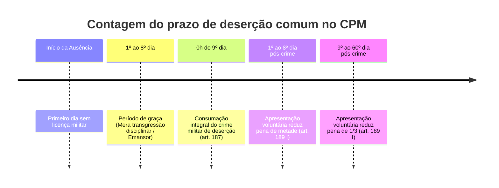
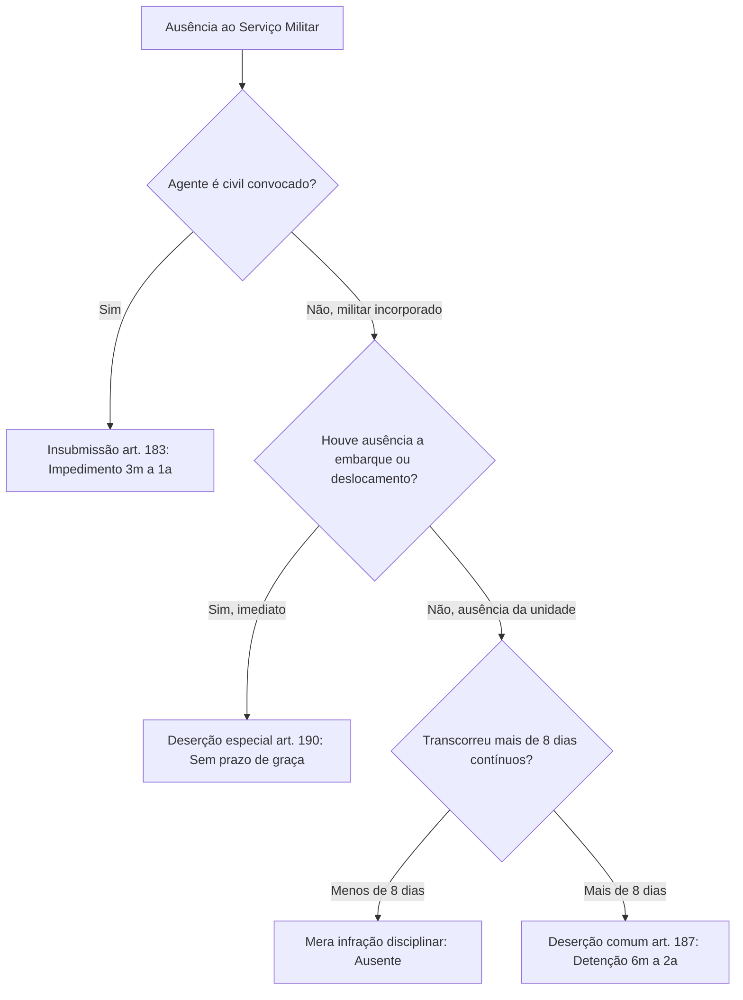

O serviço militar e o dever militar formam o alicerce operacional e cívico da defesa nacional e da preservação da segurança pública. Enquanto nas corporações militares estaduais, como a Polícia Militar e o Corpo de Bombeiros Militar de Pernambuco, o ingresso é voluntário mediante concurso público, as Forças Armadas assentam-se historicamente na convocação obrigatória estabelecida pela Constituição Federal.

Neste capítulo, estudamos as infrações penais militares que tutelam o dever de fidelidade do militar às fileiras corporativas. O Título III da Parte Especial divide-se em dois grandes eixos: os crimes relacionados ao alistamento e à convocação inicial, com foco na insubmissão (arts. 183 a 186), e o regime jurídico integral da deserção militar (arts. 187 a 194). Examinaremos a contagem do período de graça, as hipóteses assimiladas, as causas especiais de diminuição de pena e as modalidades autônomas de deserção especial e concerto.

> [!objetivos]
> - Diferenciar a infração administrativa do refratário do crime militar de insubmissão.
> - Compreender a dinâmica temporal do período de graça e o momento exato da consumação da deserção.
> - Identificar as quatro hipóteses de casos assimilados à deserção do artigo 188.
> - Analisar as causas especiais de diminuição e aumento de pena da deserção no artigo 189.
> - Distinguir a deserção especial, a deserção por evasão e o concerto para deserção.

## Insubmissão e crimes relativos à convocação inicial

A obrigatoriedade do serviço militar inicial decorre do artigo 143 da Constituição Federal. Para assegurar o comparecimento dos cidadãos convocados à seleção e incorporação nas Forças Armadas (Exército, Marinha e Aeronáutica), o Código Penal Militar instituiu o delito de insubmissão.

> [!lei] CPM, art. 183
> Deixar de apresentar-se o convocado à incorporação, dentro do prazo que lhe foi marcado, ou, apresentando-se, ausentar-se antes do ato oficial de incorporação:
> Pena - impedimento, de três meses a um ano.
> § 1º Na mesma pena incorre quem, dispensado temporàriamente da incorporação, deixa de se apresentar, decorrido o prazo de licenciamento.
> § 2º A pena é diminuída de um têrço:
> a) pela ignorância ou a errada compreensão dos atos da convocação militar, quando escusáveis;
> b) pela apresentação voluntária dentro do prazo de um ano, contado do último dia marcado para a apresentação.

O crime de insubmissão possui peculiaridades singulares que costumam surpreender os candidatos em provas de concurso. Em primeiro lugar, o sujeito ativo é exclusivamente o civil convocado que foi regularmente selecionado e designado para determinada unidade militar. O militar já incorporado não comete insubmissão. Trata-se de uma das raríssimas hipóteses de crime militar próprio de civil, existindo apenas na esfera federal perante a Justiça Militar da União, uma vez que o serviço militar inicial obrigatório não alcança as polícias e bombeiros militares estaduais.

Em segundo lugar, a espécie de pena privativa de liberdade cominada no preceito secundário é a pena de impedimento. Conforme o artigo 63 do Código Penal Militar, a pena de impedimento sujeita o condenado a permanecer no recinto da unidade militar, sem estar submetido a isolamento celular ou a trabalhos penitenciários forçados.

> [!atencao] Distinção entre refratário e insubmisso
> É fundamental distinguir as figuras do refratário e do insubmisso reguladas pela Lei do Serviço Militar (Lei 4.375/1964):
> - **Refratário**: é o jovem que deixa de se alistar no prazo regulamentar, falta à seleção geral ou não comparece à inspeção de saúde. Trata-se de mera infração administrativa disciplinar, sujeita a multas e restrições a certidões públicas, sem configurar crime militar.
> - **Insubmisso**: é o cidadão já alistado, inspecionado, considerado apto e expressamente designado para incorporação em data certa que não se apresenta no quartel ou foge antes do juramento à Bandeira. Apenas aqui ocorre o crime militar do artigo 183.

A prescrição da insubmissão segue regra temporal especialíssima prevista no artigo 132 do Código Penal Militar: a contagem do prazo extintivo de punibilidade inicia-se unicamente a partir da data em que o autor alcança seus 30 anos completos de idade. Até esse marco biológico, o delito não sofre os efeitos da prescrição comum. Ademais, o processamento judicial do insubmisso exige a sua prévia apresentação ou captura com submissão à nova inspeção de saúde que comprove sua higidez física para o serviço militar (condição de procedibilidade).

O Código disciplina ainda três infrações conexas à convocação:
1. **Criação ou simulação de incapacidade física (art. 184)**: pune o convocado que mutila a si mesmo, ingere substâncias nocivas ou finge enfermidade com o propósito de esquivar-se ao recrutamento (detenção de seis meses a dois anos).
2. **Substituição de convocado (art. 185)**: incrimina o convocado que envia terceiro para apresentar-se em seu lugar na inspeção médica, bem como sanciona o próprio substituto com a mesma pena de detenção de seis meses a dois anos.
3. **Favorecimento a convocado (art. 186)**: pune com detenção de três meses a um ano aquele que abriga, emprega ou auxilia na fuga de convocado foragido. O parágrafo único estabelece escusa absolutória (isenção de pena) quando o favorecedor for ascendente, descendente, cônjuge ou irmão do convocado.

## Deserção comum: conceito, período de graça e consumação

A deserção representa a infração mais severa contra o dever funcional do militar, violando diretamente a obrigação de permanência na unidade e a fidelidade ao serviço público.

> [!lei] CPM, art. 187
> Ausentar-se o militar, sem licença, da unidade em que serve, ou do lugar em que deve permanecer, por mais de oito dias:
> Pena - detenção, de seis meses a dois anos; se oficial, a pena é agravada.

O sujeito ativo da deserção é exclusivamente o militar em serviço ativo (das Forças Armadas, da Polícia Militar ou do Corpo de Bombeiros Militar). O civil e o militar inativo (da reserva ou reformado) não praticam deserção na condição de autores materiais principais.

A conduta típica consiste no afastamento não justificado do militar da sede da unidade onde serve, ou da localidade física onde fora formalmente escalado para cumprir serviço. O elemento normativo "sem licença" é essencial: havendo justificativa plausível (como afastamento médico comprovado ou força maior incontornável), afasta-se a tipicidade.

A consumação da deserção depende do decurso ininterrupto de prazo superior a oito dias de ausência ilegítima. Esse interregno inicial de oito dias é denominado pela doutrina e jurisprudência de período de graça.

A contagem desse prazo possui regramento técnico objetivo: inicia-se à zero hora do dia subsequente àquele em que se constatou oficialmente a falta injustificada do militar ao serviço. Durante os oito primeiros dias de ausência, o agente não comete crime militar; ele é considerado tecnicamente um ausente ou emansor, sujeito exclusivamente a sanções de natureza disciplinar administrativa. O crime militar de deserção só se consuma à zero hora do nono dia de ausência contínua.

> [!pegadinha]
> Fique atento à natureza jurídica do Termo de Deserção lavrado pela autoridade militar. Segundo jurisprudência firme e sumulada do Superior Tribunal Militar, o Termo de Deserção possui natureza meramente declaratória e formalizadora da ocorrência. O crime consuma-se de pleno direito com o término do oitavo dia de ausência. Se o militar retornar voluntariamente à unidade no décimo dia, o crime já estará consumado, sendo totalmente indiferente se o comandante da corporação já lavrou ou ainda não expediu o respectivo Termo de Deserção.

Ademais, a jurisprudência militar é categórica no sentido de que telefonemas, mensagens por aplicativos ou contatos feitos por parentes não têm o condão de interromper o curso do período de graça. A interrupção da ausência exige o comparecimento físico e formal do militar perante a sua unidade militar de lotação.

A deserção classifica-se como crime permanente. Isso implica que a conduta delitiva protrai-se no tempo durante todo o período em que o militar se mantiver foragido, possibilitando a sua captura e prisão em flagrante a qualquer dia e hora, sem necessidade de mandado judicial (CPPM, art. 452).

A tabela abaixo sintetiza a situação jurídica do militar ao longo da ausência injustificada:

| Momento Temporal | Enquadramento Jurídico | Condição do Militar | Medida Aplicável |
| --- | --- | --- | --- |
| 1º ao 8º dia de ausência | Ausência não autorizada (período de graça) | Ausente ou emansor | Infração disciplinar; recolhimento disciplinar |
| Zero hora do 9º dia | Consumação do crime de deserção (art. 187) | Desertor consumado | Crime permanente; prisão em flagrante delito |
| Até 8 dias pós-consumação | Hipótese de apresentação espontânea | Desertor com atenuante | Pena obrigatoriamente reduzida pela metade |
| 9 a 60 dias pós-consumação | Hipótese de apresentação voluntária | Desertor com atenuante | Pena obrigatoriamente reduzida de um terço |
| Mais de 60 dias pós-crime | Apresentação voluntária tardia ou captura | Desertor comum | Pena básica sem direito à atenuante do art. 189 |

## Casos assimilados à deserção e dosimetria especial

O artigo 188 do Código Penal Militar tipifica quatro situações em que o militar se afasta de maneira formalmente autorizada, mas deixa de regressar ao serviço no momento oportuno, ou utiliza meios fraudulentos para desligar-se da ativa:

> [!lei] CPM, art. 188
> Na mesma pena incorre o militar que:
> I - não se apresenta no lugar designado, dentro de oito dias, findo o prazo de trânsito ou férias;
> II - deixa de se apresentar a autoridade competente, dentro do prazo de oito dias, contados daquele em que termina ou é cassada a licença ou agregação ou em que é declarado o estado de sítio ou de guerra;
> III - tendo cumprido a pena, deixa de se apresentar, dentro do prazo de oito dias;
> IV - consegue exclusão do serviço ativo ou situação de inatividade, criando ou simulando incapacidade.

As condutas descritas nos incisos I a III consagram o que a doutrina de Célio Lobão denomina "deserção após afastamento autorizado". O militar gozava de permissão regulamentar para estar ausente (férias regulamentares, período de trânsito para nova sede, licença para interesse particular ou cumprimento de pena judicial privativa de liberdade). Ao término do benefício ou suspensão, a lei concede o mesmo prazo de graça de oito dias para que ele se reapresente. Transcorridos os oito dias sem apresentação, o crime equiparado à deserção está consumado.

Por outro lado, o inciso IV constitui uma figura penal materialmente autônoma de estelionato militar com escopo de deserção: pune o militar que forja enfermidade psiquiátrica ou provoca lesões no próprio corpo com a finalidade exclusiva de obter aposentadoria, reforma precoce ou exclusão indevida das fileiras da corporação.

Para a dosimetria penal da deserção comum e dos casos assimilados dos incisos I a III, o artigo 189 do Código Penal Militar instituiu atenuantes e agravantes especiais obrigatórias:

> [!lei] CPM, art. 189
> Art. 189. Nos crimes dos arts. 187 e 188, ns. I, II e III:
> I - se o agente se apresenta voluntàriamente dentro em oito dias após a consumação do crime, a pena é diminuída de metade; e de um têrço, se de mais de oito dias e até sessenta;
> II - se a deserção ocorre em unidade estacionada em fronteira ou país estrangeiro, a pena é agravada de um têrço.

A gradação premial da apresentação espontânea incentiva o militar a restabelecer a legalidade institucional:
- Apresentação em até oito dias contados da consumação (ou seja, entre o 9º e o 16º dia desde o início da falta inicial): redução obrigatória da pena de metade.
- Apresentação entre o 9º e o 60º dia após a consumação: diminuição obrigatória de um terço da pena cominada.
- Se o desertor não se apresenta e é capturado por forças policiais, não tem direito a essas reduções especiais, respondendo pela pena integral de detenção de seis meses a dois anos.

Em contrapartida, o inciso II estabelece uma causa especial de aumento de pena de um terço se o delito for cometido em unidade militar estacionada em fronteira ou em país estrangeiro, em face do maior risco à soberania territorial.

## Modalidades específicas: deserção especial, concerto e fuga

Além da modalidade genérica do artigo 187, o Código Penal Militar prevê espécies autônomas de deserção adaptadas a contingências operacionais urgentes.

### Deserção especial (art. 190)

A deserção especial ocorre quando o militar falta ao embarque programado ou ao deslocamento operacional da tropa:

> [!lei] CPM, art. 190
> Deixar o militar de apresentar-se no momento da partida do navio ou aeronave, de que é tripulante, ou do deslocamento da unidade ou força em que serve:
> Pena - detenção, até três meses, se após a partida ou deslocamento se apresentar, dentro de vinte e quatro horas...
> § 1º Se a apresentação se der dentro de prazo superior a vinte e quatro horas e não excedente a cinco dias: Pena - detenção, de dois a oito meses.
> § 2° Se superior a cinco dias e não excedente a oito dias: Pena - detenção, de três meses a um ano.
> § 2°-A. Se superior a oito dias: Pena - detenção, de seis meses a dois anos.
> § 3o A pena é aumentada de um terço, se se tratar de sargento, subtenente ou suboficial, e de metade, se oficial.

> [!pegadinha]
> Na deserção especial do artigo 190, não existe período de graça de oito dias. O crime consuma-se no instante exato da partida da embarcação, decolagem da aeronave ou partida da coluna de viaturas da tropa militar. O tempo que o agente demora para comparecer perante uma autoridade militar atua unicamente como critério escalonado de fixação da pena pelo legislador.

A tabela a seguir demonstra a progressão punitiva da deserção especial conforme o atraso na apresentação:

| Intervalo de Apresentação após a Partida | Sanção Penal Aplicável (CPM, art. 190) | Majoração Funcional (§ 3º) |
| --- | --- | --- |
| Apresentação em até 24 horas | Detenção de até três meses | Sargento/Subtenente: +1/3; Oficial: +metade |
| De 24 horas a cinco dias de atraso | Detenção de dois a oito meses | Sargento/Subtenente: +1/3; Oficial: +metade |
| De cinco a oito dias de atraso | Detenção de três meses a um ano | Sargento/Subtenente: +1/3; Oficial: +metade |
| Mais de oito dias de atraso | Detenção de seis meses a dois anos | Sargento/Subtenente: +1/3; Oficial: +metade |

### Concerto para deserção (art. 191)

O crime de concerto para deserção sanciona o pacto ou combinação prévia entre militares para desertarem coletivamente. Trata-se de crime plurissubjetivo (concurso necessário de pelo menos dois militares da ativa).

O legislador estabeleceu duas hipóteses de apenamento:
- **Concerto simples (inciso I)**: se os militares combinam a deserção, mas o plano é frustrado ou os agentes são detidos antes que o prazo de consumação se esgote, comina-se detenção de três meses a um ano.
- **Modalidade complexa consumada (inciso II)**: se a deserção chega a consumar-se efetivamente, os agentes sofrem pena de reclusão de dois a quatro anos, em cúmulo com a pena da própria deserção consumada.

### Deserção por evasão, favorecimento e omissão (arts. 192 a 194)

O artigo 192 tipifica a deserção por evasão ou fuga: pune com detenção de seis meses a dois anos o militar que escapa da custódia de escolta, foge de cela de detenção disciplinar ou evade-se após o cometimento de crime para não ser preso em flagrante, mantendo-se foragido por mais de oito dias consecutivos.

O artigo 193 pune o favorecimento a desertor, impondo detenção de quatro meses a um ano a qualquer pessoa que acolhe, dá esconderijo, oferece emprego ou facilita o transporte de militar foragido sabendo de sua condição criminosa. O parágrafo único assegura isenção de pena aos parentes próximos (ascendente, descendente, cônjuge ou irmão).

Por fim, o artigo 194 disciplina a omissão de oficial: pune com detenção de seis meses a um ano o oficial que, sabendo ou tendo o dever de saber que há desertor oculto entre seus comandados, deixa dolosamente de tomar as medidas cabíveis para efetuar a sua prisão e instauração do competente processo penal militar.

## Mapa do capítulo

A tabela a seguir compila os elementos estruturais, sujeitos e peculiaridades dos crimes contra o serviço militar estudados:

| Crime Militar | Artigo | Sujeito Ativo | Pena Básica | Ponto de Destaque na Prova |
| --- | --- | --- | --- | --- |
| Insubmissão | Art. 183 | Civil convocado | Impedimento de 3m a 1a | Prescrição conta dos 30 anos; sujeito ativo civil |
| Fraude em alistamento | Arts. 184 e 185 | Convocado e substituto | Detenção de 6m a 2a | Substituição pune tanto quem manda quanto quem vai |
| Favorecimento inicial | Art. 186 | Qualquer pessoa | Detenção de 3m a 1a | Isenção de pena para ascendente, descendente, cônjuge, irmão |
| Deserção comum | Art. 187 | Militar da ativa | Detenção de 6m a 2a | Consuma-se após 8 dias de ausência; crime permanente |
| Casos assimilados | Art. 188 | Militar em afastamento | Detenção de 6m a 2a | Trânsito, férias, licença, agregação ou simulação |
| Deserção atenuada | Art. 189 | Desertor confesso | Redução de 1/2 ou 1/3 | Apresentação em até 8 dias (1/2) ou até 60 dias (1/3) |
| Deserção especial | Art. 190 | Tripulante ou componente | Detenção escalonada | Inexiste período de graça; consumação instantânea |
| Concerto de deserção | Art. 191 | Concurso de militares | Detenção ou reclusão | Modalidade complexa reclusão 2 a 4 anos se consumada |
| Deserção por evasão | Art. 192 | Militar preso/foragido | Detenção de 6m a 2a | Fuga de custódia com ausência superior a oito dias |
| Favorecimento a desertor | Art. 193 | Qualquer pessoa | Detenção de 4m a 1a | Isenção expressa de pena para parentes imediatos |
| Omissão de oficial | Art. 194 | Oficial com tropa | Detenção de 6m a 1a | Não proceder formalmente contra desertor comandado |

### Para fixar

- O crime de insubmissão (art. 183) é próprio de civil convocado e apenado com impedimento de três meses a um ano.
- O prazo de prescrição da insubmissão só começa a fluir no dia em que o agente completa trinta anos de idade (CPM, art. 132).
- O refratário comete mera falta administrativa perante a Lei do Serviço Militar; apenas o convocado designado para incorporação comete insubmissão.
- A deserção comum (art. 187) consuma-se à zero hora do nono dia consecutivo de ausência desautorizada do militar.
- Os oito primeiros dias de afastamento do militar configuram o período de graça, constituindo apenas transgressão disciplinar de ausência.
- A lavratura do Termo de Deserção tem natureza meramente declaratória, não impedindo a consumação do crime pelo simples decurso do prazo legal.
- Telefonemas ou contatos informais não suspendem nem interrompem o prazo do período de graça da deserção.
- A apresentação voluntária em até oito dias da consumação reduz a pena de metade; entre oito e sessenta dias, reduz de um terço (art. 189).
- A deserção especial (art. 190) não possui período de graça, consumando-se no momento exato da partida da aeronave, embarcação ou tropa.
- Os crimes de favorecimento a convocado (art. 186) e favorecimento a desertor (art. 193) contêm escusa absolutória que isenta de pena ascendentes, descendentes, cônjuge e irmãos.
