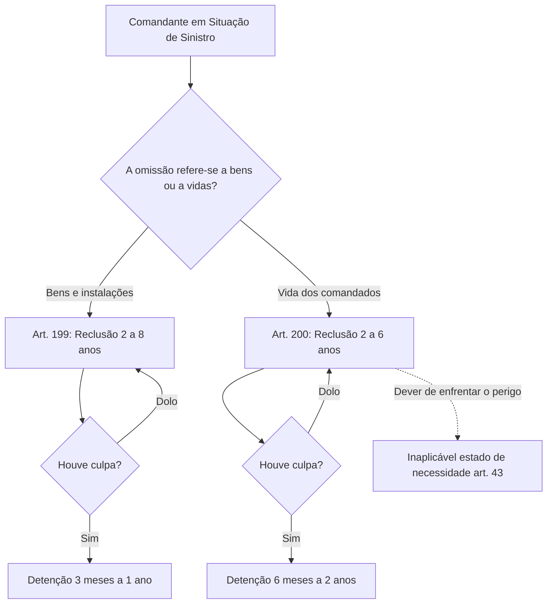
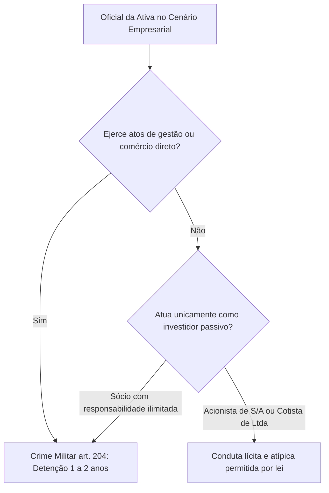

A prontidão constante e a dedicação integral ao serviço representam deveres inegociáveis para o policial militar e o bombeiro militar. Quando o militar assume um quarto de hora, uma escala de ronda ou o comando de uma guarnição em Pernambuco, a sociedade confia a sua integridade física e o patrimônio público à vigilância daquele operador. O abandono do posto ou o relaxamento dos sentidos durante o plantão rompem o sistema de segurança coletiva.

Neste capítulo de encerramento do volume, estudamos os delitos praticados durante a execução do serviço militar (CPM, arts. 195 a 204). Analisaremos a tipicidade estrita do abandono de posto, a jurisprudência dominante sobre perigo abstrato, o descumprimento de missão, as omissões dos comandantes em emergências, a embriaguez e o sono em serviço de vigilância, e a proibição legal do comércio por oficiais da ativa.

> [!objetivos]
> - Diferenciar juridicamente posto, lugar de serviço e serviço para a consumação do abandono.
> - Compreender a natureza de perigo abstrato do artigo 195 e a recusa do princípio da insignificância.
> - Analisar o descumprimento de missão, suas formas qualificadas e a modalidade culposa.
> - Identificar os deveres dos comandantes em situações de sinistro e os limites do estado de necessidade.
> - Distinguir as hipóteses puníveis de embriaguez e sono em serviço e as exceções ao comércio por oficial.

## Abandono de posto e descumprimento de missão

O crime de abandono de posto (art. 195) é um dos tipos penais de maior incidência prática nos tribunais militares e de mais frequente cobrança em concursos.

> [!lei] CPM, art. 195
> Abandonar, sem ordem superior, o posto ou lugar de serviço que lhe tenha sido designado, ou o serviço que lhe cumpria, antes de terminá-lo:
> Pena - detenção, de três meses a um ano.

O tipo tutela a segurança da instalação militar e a regular continuidade das atividades da tropa. A conduta divide-se em três modalidades alternativas:
1. **Abandonar o posto**: afastar-se do local exato, fixo ou móvel, demarcado na ordem de serviço para a execução da tarefa (como a guarita do quartel ou a cabine de guarda).
2. **Abandonar o lugar de serviço**: afastar-se de perímetro espacial mais amplo confiado ao militar (por exemplo, o oficial de dia que se retira dos limites físicos do quartel, ou a viatura policial que se desvia injustificadamente da área de patrulhamento designada).
3. **Abandonar o serviço**: largar a função ou a tarefa antes de sua conclusão regulamentar, quando o serviço não estiver adstrito a limite espacial estrito.

A consumação opera-se de forma instantânea: no exato momento em que o militar afasta-se fisicamente do local designado sem autorização prévia, o crime está consumado. A lei não exige tempo mínimo de afastamento (um quarto de hora ou várias horas caracterizam o delito).

> [!jurisprudencia] STM, Apelação 7000580-49.2022.7.00.0000
> O abandono de posto (CPM, art. 195) possui natureza de delito de mera conduta e de perigo abstrato. O tipo dispensa resultado lesivo concreto à administração militar. Por essa razão, não se aplicam os princípios da insignificância e da intervenção mínima.

O Superior Tribunal Militar reconhece a consumação por perigo abstrato. Por essa razão, o militar que abandona o posto para resolver interesses particulares comete o delito militar. É irrelevante que a unidade não sofra qualquer invasão durante sua ausência. Se o agente deixa o posto para comprar drogas e retorna ao quartel, responde por abandono de posto em concurso material com porte de entorpecente (CPM, art. 290).

> [!atencao] Pressuposto de assunção do serviço
> Para haver abandono de posto, o militar já deve ter assumido a escala. Quem se recusa a entrar de serviço comete recusa de obediência (art. 163), e não abandono. Por outro lado, se a ausência ultrapassar oito dias, a deserção (art. 187) absorve o abandono de posto.

> [!exemplo]
> O Soldado Bruno é escalado para a sentinela do paiol de munições de um batalhão entre 02h00 e 04h00. Às 02h40, cansado, decide abandonar o posto e deslocar-se a um posto de combustíveis situado a três quilômetros da unidade para comprar cigarros, retornando quarenta minutos depois. Embora nenhuma munição tenha sido subtraída durante sua ausência, Bruno consumou o delito de abandono de posto (art. 195) no momento em que transpôs os limites de seu perímetro de vigilância.

O artigo 196 disciplina o descumprimento de missão: pune com detenção de seis meses a dois anos o militar que deixa de desempenhar a missão operacional que lhe foi confiada, sob cláusula expressa de subsidiariedade penal ("se o fato não constitui crime mais grave"). Trata-se de crime omissivo próprio. A lei comina duas causas de aumento de pena:
- Se o agente é oficial, a pena aumenta de um terço (§ 1º).
- Se exercia função de comando da fração de tropa, a pena aumenta de metade (§ 2º).
- O parágrafo 3º prevê modalidade culposa (detenção de três meses a um ano) para a negligência no cumprimento da missão.

O artigo 197 tipifica a retenção indevida, sancionando com detenção de até seis meses o oficial que deixa de restituir, na passagem de função ou quando exigido por autoridade competente, objeto, plano tático, carta geográfica, cifra, código de criptografia ou documento sob sua custódia. O parágrafo único qualifica a conduta com detenção de três meses a um ano se o documento envolver segredo concernente à segurança nacional.

## Deveres do comandante e omissões em situações de emergência

Os artigos 198 a 201 impõem deveres de liderança severos aos oficiais e graduados investidos no comando de forças e unidades militares em ocasiões de perigo.

O artigo 198 pune a omissão de eficiência da força, sancionando com detenção de três meses a um ano o comandante que deixa de manter a tropa sob seu comando em condições adequadas de treinamento técnico e preparo material para o combate.

Nas situações de desastre, catástrofe ou confronto armado, o Código Penal Militar distingue a proteção de coisas da proteção de vidas humanas:

- **Omissão de providências para evitar danos (art. 199)**: pune o comandante de navio, aeronave, blindado ou instalação militar que, diante de grave perigo natural ou militar, não utiliza todos os recursos materiais disponíveis para evitar a destruição, avaria ou inutilização do patrimônio sob sua guarda. A pena é de reclusão de dois a oito anos na forma dolosa, e detenção de três meses a um ano na modalidade culposa (parágrafo único).
- **Omissão de providências para salvar comandados (art. 200)**: pune com reclusão de dois a seis anos o comandante que, em ocasião de incêndio, naufrágio, colisão ou perigo similar, não adota todas as providências viáveis para salvar a integridade física de sua tropa, ou não é o último a deixar o quartel, aeronave ou embarcação sinistrada. A modalidade culposa é apenada com detenção de seis meses a dois anos (parágrafo único).

O artigo 200 tutela diretamente a vida humana. O comandante tem o dever de enfrentar o perigo e evacuar seus subordinados. Ele não pode invocar o estado de necessidade geral (CPM, art. 43). Contudo, isso não impõe sacrifício suicida. O comandante deve agir com zelo, mas não é obrigado a perecer se o salvamento for inviável.

Por fim, o artigo 201 incrimina a omissão de socorro náutico ou aéreo (detenção de um a dois anos). Pune o comandante de outra força que deixa de socorrer embarcação ou aeronave em perigo, sem justa causa. A justa causa existe se o resgate sacrificar a própria tripulação.

A tabela a seguir contrasta os crimes omissivos de comandantes:

| Delito do Comandante | Artigo | Objeto Material Tutelado | Sanção Dolosa Básica | Previsão Culposa Expressa |
| --- | --- | --- | --- | --- |
| Omissão de eficiência | Art. 198 | Treinamento e preparo da força | Detenção de 3 meses a 1 ano | Não admite modalidade culposa |
| Omissão de dano a bens | Art. 199 | Bens, armas, navios e instalações | Reclusão de 2 a 8 anos | Detenção de 3 meses a 1 ano |
| Omissão de salvar pessoas | Art. 200 | Vida e integridade da tropa | Reclusão de 2 a 6 anos | Detenção de 6 meses a 2 anos |
| Omissão de socorro marítimo | Art. 201 | Embarcações externas e náufragos | Detenção de 1 a 2 anos | Não admite modalidade culposa |

## Embriaguez e sono em serviço de vigilância

O pleno domínio das faculdades mentais e motoras é requisito indispensável para o porte de arma de fogo e para a atuação operacional. O Código Penal Militar tipifica com rigor a embriaguez e o repouso não autorizado em serviço.

### Embriaguez em serviço (art. 202)

O artigo 202 tutela a regularidade do serviço contra os efeitos do álcool e de substâncias psicotrópicas:

> [!lei] CPM, art. 202
> Embriagar-se o militar, quando em serviço, ou apresentar-se embriagado para prestá-lo:
> Pena - detenção, de seis meses a dois anos.

O tipo contempla duas condutas comissivas:
1. Embriagar-se durante a execução do serviço militar para o qual está regularmente escalado.
2. Apresentar-se perante a corporação militar em estado visível de embriaguez para iniciar a jornada escalada.

O delito exige embriaguez voluntária, pelo consumo intencional de álcool ou drogas. A ingestão involuntária por caso fortuito ou força maior afasta a culpabilidade.

A prova da embriaguez faz-se por perícia médica clínica ou laboratorial. O perito avalia marcha, hálito, equilíbrio e fala. A substância é indiferente: o crime abrange álcool, entorpecentes ilícitos ou sedativos sem prescrição.

> [!pegadinha]
> Atenção à elementar da apresentação no artigo 202. Se o policial militar bebe em excesso na folga e veste a farda, mas adormece no trajeto e não chega ao quartel, não há o crime do artigo 202. Sem a apresentação efetiva do militar em serviço, a conduta é atípica na via penal, restando apenas infração disciplinar.

### Dormir em serviço (art. 203)

O artigo 203 protege o estado de alerta das sentinelas e encarregados da proteção ostensiva:

> [!lei] CPM, art. 203
> Dormir o militar, quando em serviço, como oficial de quarto ou de ronda, ou em situação equivalente, ou, não sendo oficial, em serviço de sentinela, vigia, plantão às máquinas, ao leme, de ronda ou em qualquer serviço de natureza semelhante:
> Pena - detenção, de três meses a um ano.

A conduta típica reside em adormecer, perdendo a vigilância sobre o ambiente. A duração do sono é indiferente para a consumação. Tanto o sono breve quanto o profundo caracterizam a infração.

> [!atencao] Exigência de serviço de vigilância
> O crime do artigo 203 restringe-se a atividades de vigilância ostensiva e segurança externa. Abrange sentinelas, vigias e plantões. Se um militar que cumpre escala em seção administrativa ou almoxarifado adormece na mesa durante o expediente, a conduta é atípica penalmente, ensejando apenas sanção disciplinar.

## Exercício indevido de comércio por oficial da ativa

A dedicação exclusiva dos oficiais das corporações militares busca assegurar a independência funcional e impedir conflitos de interesse entre os negócios privados e o poder de autoridade conferido pelo Estado.

> [!lei] CPM, art. 204
> Comerciar o oficial da ativa, ou tomar parte na administração ou gerência de sociedade comercial, ou dela ser sócio ou participar, exceto como acionista ou cotista em sociedade anônima, ou por cotas de responsabilidade limitada:
> Pena - detenção, de um a dois anos.

O sujeito ativo desse crime é exclusivamente o oficial em serviço ativo (das Forças Armadas, da Polícia Militar ou do Corpo de Bombeiros Militar). As praças e os oficiais da reserva remunerada ou reformados não cometem o delito do artigo 204.

O tipo proíbe três modalidades principais de inserção mercantil:
1. Comerciar individualmente de modo habitual com fito de lucro.
2. Participar da administração, gerência ou direção executiva de qualquer sociedade empresária.
3. Ser sócio com poderes de gerência ou sócio de responsabilidade ilimitada em sociedades em nome coletivo ou comandita simples.

> [!atencao] A exceção legal para o oficial investidor
> O Código Penal Militar e os estatutos militares consagram uma importante exceção: o oficial da ativa pode licitamente aplicar suas economias financeiras como acionista de sociedade anônima (S/A) ou como cotista de sociedade limitada (Ltda), desde que na condição exclusiva de investidor patrimonial ou cotista sem poderes de gerência ou administração. O que a lei penal veda de modo absoluto é o exercício de atos executivos de gestão, assinatura de contratos e representação comercial da empresa.

A tabela a seguir sintetiza as permissões e vedações ao oficial da ativa no ambiente negocial:

| Situação Empresarial do Oficial | Enquadramento Legal | Consequência Jurídica |
| --- | --- | --- |
| Comerciante individual autônomo habitual | Proibição absoluta pelo art. 204 | Crime militar (detenção de 1 a 2 anos) |
| Sócio administrador ou gerente de empresa | Proibição absoluta pelo art. 204 | Crime militar (detenção de 1 a 2 anos) |
| Titular de empresa individual com gestão | Proibição absoluta pelo art. 204 | Crime militar (detenção de 1 a 2 anos) |
| Acionista de Sociedade Anônima sem gestão | Exceção legal permitida pelo art. 204 | Conduta plenamente lícita e atípica |
| Cotista de Sociedade Limitada sem gestão | Exceção legal permitida pelo art. 204 | Conduta plenamente lícita e atípica |

## Mapa do capítulo

A tabela a seguir compila os principais tipos penais praticados em serviço e o exercício vedado de comércio:

| Crime Militar | Dispositivo | Sujeito Ativo | Natureza Penal | Ponto Crítico de Prova |
| --- | --- | --- | --- | --- |
| Abandono de posto | Art. 195 | Militar de serviço | Perigo abstrato e mera conduta | Inaplicável insignificância; instantâneo |
| Descumprimento de missão | Art. 196 | Militar da ativa | Omissivo e subsidiário | Admite modalidade culposa (§ 3º); +1/3 oficial |
| Retenção indevida | Art. 197 | Oficial da ativa | Omissivo próprio | Qualifica se segredo de segurança nacional |
| Omissão de eficiência | Art. 198 | Comandante de força | Omissivo próprio | Não exige prejuízo concreto imediato |
| Dano a bens militares | Art. 199 | Comandante militar | Comissivo por omissão | Protege coisas e instalações; doloso e culposo |
| Salvar comandados | Art. 200 | Comandante militar | Comissivo por omissão | Protege vidas; ininvocável estado de necessidade |
| Omissão de socorro marítimo | Art. 201 | Comandante externo | Omissivo próprio | Ressalva ausência de justa causa comprovada |
| Embriaguez em serviço | Art. 202 | Militar da ativa | Mera conduta | Exige apresentação de serviço; voluntária |
| Dormir em serviço | Art. 203 | Militar de vigilância | Mera conduta | Exclusivo de sentinela/vigia; atípico em burocracia |
| Exercício de comércio | Art. 204 | Oficial da ativa | Crime próprio de oficial | Permite ser cotista ou acionista sem gerência |

### Para fixar

- O crime de abandono de posto (art. 195) classifica-se como delito de mera conduta e perigo abstrato, não admitindo insignificância material.
- Para consumar o abandono de posto, é indispensável que o militar já tenha assumido regularmente a escala de serviço.
- O descumprimento de missão (art. 196) possui cláusula expressa de subsidiariedade e admite modalidade culposa (§ 3º).
- A retenção indevida de documentos e planos táticos (art. 197) é crime próprio e exclusivo de oficiais.
- No crime de omissão de providências para salvar comandados (art. 200), o comandante tem o dever de enfrentar o perigo (art. 43), mas não a obrigação de sacrifício suicida.
- A embriaguez em serviço (art. 202) exige a apresentação formal do militar ao quartel em estado etílico ou a ingestão alcoólica durante a escala.
- A embriaguez acidental decorrente de caso fortuito ou força maior afasta a culpabilidade penal no artigo 202.
- O crime de dormir em serviço (art. 203) exige que a atividade desempenhada seja especificamente ligada a tarefas de vigilância, guarda ou segurança.
- O sono durante o exercício de atribuições meramente administrativas ou burocráticas no quartel não caracteriza o crime do artigo 203.
- O oficial da ativa pode licitamente atuar como acionista ou cotista de sociedade empresária (art. 204), desde que não participe de atos de administração ou gerência.
