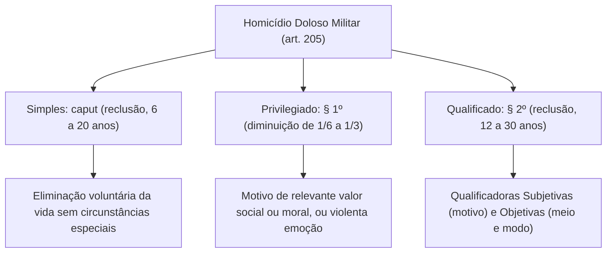
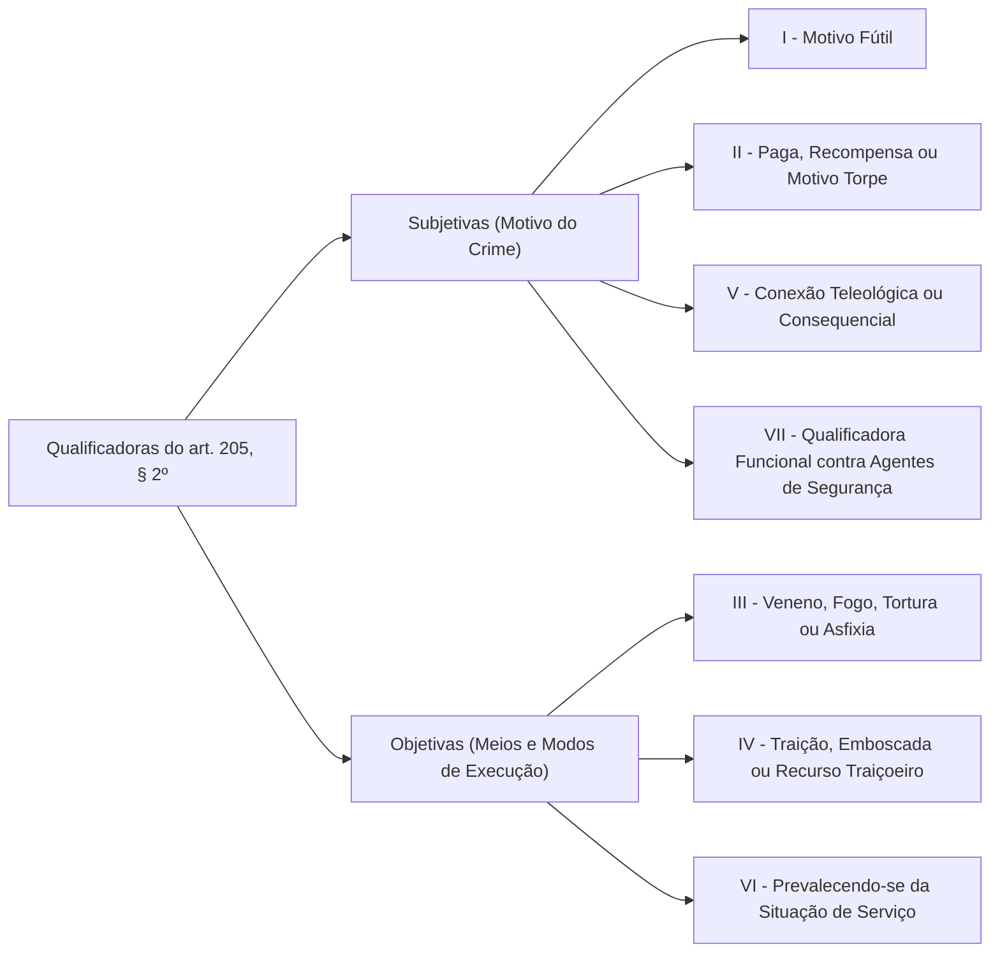
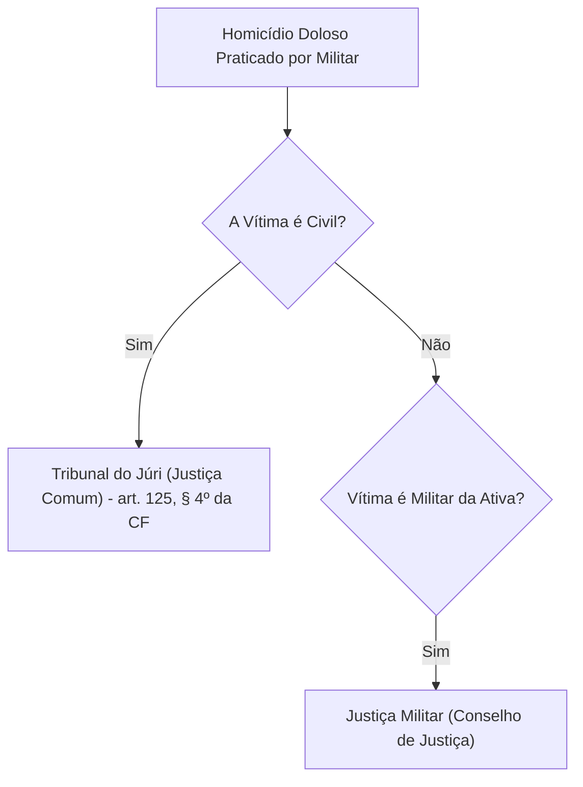
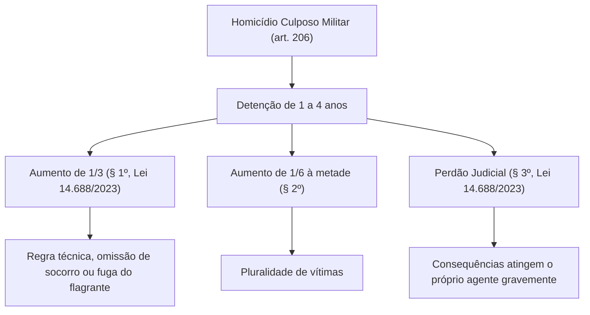
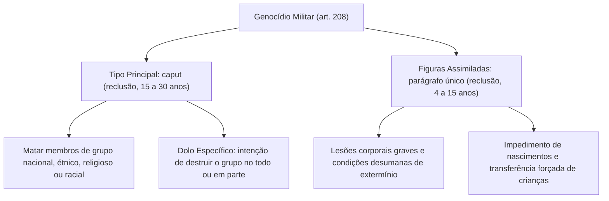

A tutela da pessoa humana constitui o núcleo valorativo central de qualquer ordenamento jurídico. No Direito Penal Militar, o Título IV da Parte Especial do Código Penal Militar (Decreto-Lei nº 1.001/1969) abre-se com o Capítulo I, dedicado aos crimes contra a vida: homicídio, instigação ao suicídio e genocídio.

Embora guardem correspondência com o Código Penal comum, os delitos militares contra a vida possuem notas distintivas. Suas peculiaridades manifestam-se nas qualificadoras próprias, nas regras de competência jurisdicional e nas recentes inovações da Lei nº 14.688/2023, que redefiniu penas e instituiu a hediondez militar.

> [!objetivos]
> - Analisar a estrutura do homicídio doloso militar simples, privilegiado e qualificado (art. 205).
> - Diferenciar a natureza objetiva e subjetiva das qualificadoras do homicídio militar.
> - Compreender a competência do Tribunal do Júri nos crimes dolosos contra a vida de civil.
> - Dominar o homicídio culposo militar (art. 206), suas causas de aumento e o perdão judicial.
> - Examinar os tipos penais de auxílio ao suicídio (art. 207) e de genocídio militar (art. 208).

## Homicídio doloso militar: artigo 205 do CPM

O crime de homicídio consiste na eliminação da vida extrauterina de uma pessoa praticada por outra. O Código Penal Militar tipifica a conduta em três graus de gravidade:

### Homicídio simples (art. 205, caput)

O preceito primário do tipo fundamental é direto: "matar alguém". A pena cominada é de reclusão de 6 a 20 anos. O sujeito ativo pode ser qualquer militar da ativa, da reserva ou civil (sob a jurisdição da Justiça Militar da União). O sujeito passivo é qualquer ser humano nascido com vida.

Não há no Código Penal Militar o homicídio praticado por grupo de extermínio como tipo qualificado autônomo, figurando apenas como causa especial de exasperação na lei comum.

### Homicídio privilegiado (art. 205, § 1º)

O § 1º do art. 205 prevê causa especial de diminuição de pena para hipóteses de menor culpabilidade:

> [!lei] Art. 205, § 1º, do Código Penal Militar
> Se o agente comete o crime impelido por motivo de relevante valor social ou moral, ou sob o domínio de violenta emoção, logo em seguida a injusta provocação da vítima, a pena pode ser diminuída de um sexto a um terço.

Embora o texto legal utilize a expressão "pode ser diminuída", a jurisprudência militar consolidou que a redução é **direito subjetivo do réu**:
- **Relevante valor social:** interesse que atende ao bem coletivo (exemplo: eliminar espião infiltrado em quartel durante conspiração armada);
- **Relevante valor moral:** interesse de cunho individual, porém nobre e altruísta perante a sensibilidade média;
- **Domínio de violenta emoção:** perturbação emocional intensa que afeta o autocontrole do agente. Exige reação imediata (*logo em seguida*) e que a provocação da vítima tenha sido injusta.

### Homicídio qualificado (art. 205, § 2º)

Se o crime for cometido sob circunstâncias de maior reprovabilidade, a pena eleva-se para reclusão de 12 a 30 anos.

A doutrina reparte as qualificadoras conforme sua natureza:

| Inciso do art. 205, § 2º | Circunstância Qualificadora | Natureza | Fundamento |
|---|---|---|---|
| **Inciso I** | Motivo fútil | **Subjetiva** | Desproporção entre o motivo e o resultado morte |
| **Inciso II** | Paga, promessa de recompensa ou motivo torpe | **Subjetiva** | Mesquinhez, cupidez ou vingança vil |
| **Inciso III** | Veneno, asfixia, tortura, fogo, explosivo ou meio insidioso | **Objetiva** | Meio cruel de execução ou risco de perigo comum |
| **Inciso IV** | Traição, emboscada, dissimulação ou recurso que dificulte a defesa | **Objetiva** | Modo traiçoeiro que surpreende a vítima |
| **Inciso V** | Para assegurar execução, ocultação ou impunidade de outro crime | **Subjetiva** | Conexão teleológica ou consequencial |
| **Inciso VI** | Prevalecendo-se da situação de serviço | **Objetiva** | Quebra do dever funcional militar |
| **Inciso VII** (Lei 14.688/2023) | Contra agentes dos arts. 142 e 144 da CF no exercício da função | **Subjetiva** | Qualificadora funcional em defesa da autoridade pública |

### Particularidades das qualificadoras militares

1. **Crime de mando e paga (inciso II):** no homicídio mercenário, o executor que aceita o pagamento responde como autor. O mandante que contrata a execução atua na condição de **partícipe por induzimento** (art. 53 do CPM), respondendo igualmente pelo homicídio qualificado;
2. **Prevalecer-se da situação de serviço (inciso VI):** qualificadora exclusiva do Direito Penal Militar. Exige que o militar cometa o homicídio aproveitando-se das facilidades, da autoridade ou do armamento conferidos pela escala de serviço ativo;
3. **Qualificadora funcional (inciso VII):** inserida pela Lei nº 14.688/2023. Pune o homicídio contra militares das Forças Armadas, integrantes da segurança pública (policiais e bombeiros militares), policiais penais e agentes da Força Nacional, no exercício da função ou em razão dela. Estende-se a cônjuge, companheiro ou parente até terceiro grau, desde que motivado pela atividade do familiar.

> [!pegadinha]
> **Homicídio qualificado-privilegiado no CPM:**
> É plenamente admissível a coexistência entre o privilégio (§ 1º) e qualificadoras (§ 2º), desde que as qualificadoras sejam de **natureza estritamente objetiva** (incisos III, IV ou VI).
> Não pode haver combinação de privilégio com qualificadora subjetiva (motivo fútil, torpe ou funcional), pois são incompatíveis.
> O homicídio qualificado-privilegiado **não é considerado crime hediondo**.

## Competência nos crimes dolosos contra a vida de civil

A Constituição de 1988 fixou a competência do júri para crimes dolosos contra a vida de civis:

> [!lei] Art. 125, § 4º, da Constituição Federal de 1988
> Compete à Justiça Militar estadual processar e julgar os militares dos Estados, nos crimes militares definidos em lei e as ações judiciais contra atos disciplinares militares, ressalvada a competência do júri quando a vítima for civil.

Em consonância com a Carta Magna, o art. 9º, § 1º, do CPM determina que os crimes dolosos contra a vida praticados por militar contra **vítima civil** são de competência da Justiça Comum (Tribunal do Júri).

A tabela consolida a distribuição de competência:

| Hipótese Fática | Sujeito Passivo (Vítima) | Juízo Competente |
|---|---|---|
| Militar estadual em serviço ou folga | **Vítima Civil** | **Tribunal do Júri (Justiça Estadual)** |
| Militar das Forças Armadas em serviço | **Vítima Civil** | **Tribunal do Júri (Justiça Federal)** (salvo art. 9º, § 2º) |
| Militar da ativa | **Militar da Ativa** | **Justiça Militar (Estadual ou da União)** |
| Civil | Militar da ativa federal | **Justiça Militar da União** (art. 9º, III) |
| Civil | Militar estadual | **Tribunal do Júri (Justiça Estadual)** |

## A hediondez militar sob a Lei nº 14.688/2023

A reforma penal militar promovida pela Lei nº 14.688/2023 pacificou controvérsias ao introduzir o inciso VI no parágrafo único do art. 1º da Lei nº 8.072/1990 (Lei dos Crimes Hediondos).

O legislador acolheu o critério da **identidade material típica**:
- São hediondos os crimes previstos no Código Penal Militar que apresentem correspondência conceitual com os delitos listados no art. 1º da Lei nº 8.072/1990;
- Sob essa ótica, qualificam-se como hediondos o homicídio qualificado (art. 205, § 2º), o estupro militar (art. 232), o latrocínio militar (art. 242, § 3º), a extorsão qualificada pela morte (art. 243, § 2º) e a epidemia com resultado morte (art. 292, § 1º);
- A hediondez acarreta inafiançabilidade, vedação a anistia e graça, e lapsos temporais mais rigorosos para progressão de regime.

## Homicídio culposo militar: artigo 206 do CPM

O homicídio culposo ocorre quando o militar dá causa involuntária à morte de outrem por imprudência, negligência ou imperícia na condução de veículos ou manuseio de armamentos. A pena é de detenção de 1 a 4 anos.

### Causas de aumento de pena (§§ 1º e 2º)

A Lei nº 14.688/2023 fixou causa de aumento de **um terço** (§ 1º) se o crime resultar de:
- Inobservância de regra técnica de profissão, arte ou ofício;
- Omissão de socorro imediato à vítima lesionada;
- Não procurar diminuir as consequências do ato lesivo;
- Fuga do local para evitar prisão em flagrante.

O § 2º estipula que, se da ação culposa resultar morte de mais de uma pessoa ou lesões corporais adicionais, a pena aumentará de **um sexto até a metade**.

### O perdão judicial no CPM (§ 3º)

A Lei nº 14.688/2023 incluiu o § 3º no art. 206 do Código Penal Militar:

> [!lei] Art. 206, § 3º, do Código Penal Militar (Lei nº 14.688/2023)
> O juiz pode deixar de aplicar a pena se as consequências da infração atingirem o próprio agente de forma tão grave que a sanção penal se torne desnecessária.

O **perdão judicial** aplica-se quando o militar sofre abalo físico incapacitante ou trauma moral profundo (como no disparo acidental que vitima o próprio filho ou colega próximo). A sentença extingue a punibilidade sem gerar reincidência.

## Instigação ou auxílio ao suicídio ou automutilação: artigo 207

O art. 207 do CPM incrimina a participação na autodestruição alheia:
- **Induzimento:** fazer nascer na vítima a ideia suicida antes inexistente;
- **Instigação:** reforçar ou estimular propósito suicida preexistente;
- **Auxílio material:** fornecer meios materiais para a execução do ato.

A pena é de reclusão de 2 a 6 anos se o suicídio se consumar. A sanção é duplicada (§ 1º) se o delito for cometido por motivo egoístico, ou se a vítima for menor de idade ou possuir capacidade de resistência diminuída.

A Lei nº 14.688/2023 introduziu o § 2º, punindo a provocação indireta ao suicídio: aplicar maus-tratos de forma desumana a militar subordinado, levando-o ao suicídio, punido com detenção de 1 a 4 anos. Se o suicídio apenas for tentado e resultar lesão grave, a pena diminui de um a dois terços (§ 3º).

## Genocídio militar: artigo 208 do CPM

O genocídio militar tutela a preservação de coletividades humanas identitárias:

### O dolo específico de destruição do grupo

O tipo fundamental do art. 208 comina reclusão de 15 a 30 anos para quem matar membros de grupo nacional, étnico, religioso ou racial com o fim de destruí-lo no todo ou em parte.

O elemento definidor é o **dolo específico** voltado ao extermínio grupal. Sem esse propósito coletivo, as mortes configuram homicídios qualificados individuais (art. 205, § 2º).

### Formas assimiladas de genocídio (parágrafo único)

Comina-se reclusão de 4 a 15 anos a quem, com a mesma finalidade de extermínio:
- Causa lesões graves à integridade física ou mental de membros do grupo (inciso I);
- Submete o grupo a condições de existência destinadas a provocar sua destruição física (inciso II);
- Força a dispersão violenta da comunidade (inciso III);
- Impõe medidas destinadas a impedir nascimentos no seio do grupo (inciso IV);
- Transfere forçadamente crianças do grupo para outra comunidade (inciso V).

> [!resolvido]
> **Caso prático simulado:**
> Durante serviço em quartel, um policial militar dispara seu fuzil pelas costas de seu comandante de pelotão por motivo fútil, matando-o instantaneamente.
>
> **Enquadramento técnico e competência:**
> 1. Trata-se de homicídio doloso consumado duplamente qualificado: motivo fútil (art. 205, § 2º, I), traição (art. 205, § 2º, IV) e prevalecendo-se da situação de serviço (art. 205, § 2º, VI);
> 2. O delito é crime hediondo militar por identidade com a Lei nº 8.072/1990;
> 3. Como a vítima era militar da ativa estadual em serviço, afasta-se a competência do Tribunal do Júri, cabendo o processo à **Justiça Militar Estadual** (Conselho Especial de Justiça).

## Mapa do capítulo

A tabela consolida os crimes contra a vida no Código Penal Militar:

| Tipo Penal Militar | Dispositivo do CPM | Pena Cominada | Nota Distintiva / Inovações da Lei 14.688/2023 |
|---|---|---|---|
| **Homicídio Simples** | Art. 205, caput | Reclusão, 6 a 20 anos | Eliminação dolosa da vida humana extrauterina |
| **Homicídio Privilegiado** | Art. 205, § 1º | Diminuição de 1/6 a 1/3 | Relevante valor social/moral ou violenta emoção |
| **Homicídio Qualificado** | Art. 205, § 2º | Reclusão, 12 a 30 anos | Motivo torpe/fútil, meios cruéis, serviço e funcional (VII) |
| **Homicídio Culposo** | Art. 206, caput | Detenção, 1 a 4 anos | Negligência, imprudência ou imperícia militar |
| **Majorante Culposa** | Art. 206, § 1º | Aumento de 1/3 | Inobservância técnica ou omissão de socorro |
| **Perdão Judicial** | Art. 206, § 3º | Extinção da punibilidade | Consequências atingem o agente de modo grave |
| **Instigação ao Suicídio** | Art. 207, caput | Reclusão, 2 a 6 anos | Induzimento, instigação ou auxílio material |
| **Genocídio (Morte)** | Art. 208, caput | Reclusão, 15 a 30 anos | Dolo específico de destruição de grupo identitário |
| **Genocídio Assimilado** | Art. 208, parágrafo único | Reclusão, 4 a 15 anos | Lesões graves, dispersão forçada ou esterilização |

### Para fixar

- O homicídio simples no CPM comina reclusão de 6 a 20 anos; o homicídio qualificado comina de 12 a 30 anos.
- O privilégio do art. 205, § 1º, reduz a pena de um sexto a um terço e constitui direito subjetivo do réu.
- Qualificadoras de meio e modo (III, IV e VI) são objetivas e podem coexistir com o privilégio (não sendo hediondo).
- Prevalecer-se de situação de serviço (VI) e qualificadora funcional (VII) são qualificadoras exclusivas ou renovadas pela Lei 14.688/2023.
- Homicídio doloso militar praticado contra civil compete ao Tribunal do Júri (art. 125, § 4º, CF/88 c/c art. 9º, § 1º, CPM).
- Homicídio qualificado militar é crime hediondo militar por identidade com a Lei 8.072/1990 (Lei 14.688/2023).
- O homicídio culposo comina detenção de 1 a 4 anos, com causa de aumento de 1/3 e possibilidade de perdão judicial (§ 3º).
- A instigação ao suicídio tem pena duplicada se cometida por motivo egoístico ou contra vítima de menor resistência.
- O genocídio pune a destruição de grupo nacional, étnico ou religioso, exigindo dolo específico para configuração típica.
