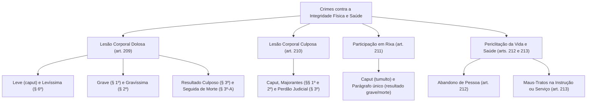

A proteção da pessoa no Código Penal Militar vai além da preservação da vida humana. O legislador penal especial resguarda com rigor a integridade corporal e a saúde física e mental dos indivíduos, sancionando condutas agressivas e comportamentos omissivos que submetem terceiros a perigo concreto. No contexto das corporações armadas, em que vigoram hierarquia, disciplina estrita e o porte funcional de armamento, tais limites delimitam com clareza o treinamento legítimo e o abuso punível.

> [!objetivos]
> - Diferenciar as modalidades leve, grave, gravíssima e seguida de morte da lesão corporal dolosa no CPM.
> - Compreender a regra da lesão qualificada pelo resultado culposo e o tratamento da lesão levíssima.
> - Dominar a lesão culposa, suas majorantes e a concessão do perdão judicial após a Lei nº 14.688/2023.
> - Analisar a estrutura típica da rixa militar e os reflexos penais da morte ou lesão grave de participante.
> - Identificar os crimes de periclitação da vida e da saúde: abandono de pessoa e maus-tratos funcionais.

## Fecho do genocídio e introdução à integridade corporal

Antes de ingressar no exame das lesões corporais, cabe rememorar as modalidades executórias complementares do genocídio previstas no art. 208, parágrafo único, do Código Penal Militar. Enquanto o caput pune o extermínio biológico direto, o tipo penal equiparado sanciona condutas comissivas direcionadas a inviabilizar a sobrevivência física ou identitária do grupo tutelado por meio de desestruturação sistemática:

1. **Dispersão forçada (inciso III):** deslocamento compulsório e violento que fragmenta a comunidade e rompe os laços de convivência da população protegida. A banca examinadora costuma confrontar a dispersão forçada com atos legítimos de evacuação tática em operações bélicas.
2. **Medidas impeditivas de nascimentos (inciso IV):** procedimentos coercitivos de contracepção, esterilização involuntária ou separação forçada de gêneros que impeçam a reprodução biológica dos integrantes do grupo.
3. **Transferência forçada de crianças (inciso V):** remoção compulsória de infantes para outra comunidade social, aniquilando a transmissão da língua, da cultura e dos valores identitários do grupo de origem.

Consumada a compreensão dessas formas especiais de violência coletiva, o Título IV do CPM abre o Capítulo III, voltado à tutela da integridade corporal individual e da saúde dos cidadãos e dos militares.

## Lesão corporal dolosa leve (art. 209, caput)

O crime consiste em causar ofensa anatômica ou perturbação à integridade física ou à saúde de outra pessoa.

> [!lei] Art. 209, caput e § 6º, do Código Penal Militar
> Ofender a integridade corporal ou a saúde de outrem:
> Pena - detenção, de três meses a um ano.
> [...]
> § 6º No caso de lesões levíssimas, o juiz pode considerar a infração como disciplinar.

O objeto jurídico é a integridade física e o equilíbrio psíquico-fisiológico do ser humano. A conduta admite ação física direta e omissão imprópria (descumprimento do dever de garantidor previsto no art. 29 do CPM). Pelo princípio da alteridade, ninguém responde por ofender o próprio corpo no art. 209; a autolesão para esquivar-se de dever militar configura delito autônomo (art. 184).

A lesão leve é subsidiária: abrange equimoses, hematomas e escoriações superficiais que não atinjam a gravidade dos parágrafos posteriores, exigindo laudo pericial.

O § 6º confere faculdade judicial exclusiva ao magistrado. O laudo descreve os vestígios mínimos; cabe ao julgador avaliar se a ofensa justifica sancionamento penal ou se a resposta regulamentar interna atende à disciplina e à justiça.

| Parâmetro | Lesão Leve (Art. 209, Caput) | Lesão Levíssima (Art. 209, § 6º) |
|---|---|---|
| **Efeito Físico** | Escoriações e hematomas superficiais | Vestígios ínfimos sem abalo funcional relevante |
| **Resposta Estatal** | Sanção penal: detenção de 3 meses a 1 ano | Faculdade judicial de converter em sanção disciplinar |
| **Avaliação** | Laudo técnico constata o dano corporal | Juízo de valor discricionário do juiz militar |

> [!bizu]
> Na lesão corporal grave (art. 209, § 1º), a lei prescreve "reclusão, até cinco anos", sem fixar o piso mínimo. Aplica-se a regra geral do art. 58 do CPM, que define o mínimo de um ano para as penas de reclusão. Portanto, os limites da lesão grave situam-se entre um e cinco anos.

## Lesões corporais graves e gravíssimas (art. 209, §§ 1º e 2º)

A Lei nº 14.688/2023 harmonizou as figuras qualificadas da lesão dolosa militar com o sistema penal comum, mantendo as particularidades da Justiça Militar.

### Lesão corporal grave (art. 209, § 1º)

Configura-se quando a conduta dolosa produz qualquer dos quatro resultados taxativos:
1. **Aceleração de parto:** antecipação traumática do parto com nascimento de concepto vivo.
2. **Perigo de vida:** probabilidade iminente e concreta de óbito decorrente das lesões, atestada tecnicamente em laudo pericial.
3. **Debilidade permanente:** enfraquecimento duradouro e sensível da capacidade funcional de membro, sentido ou função (órgãos pares conservam funcionamento parcial).
4. **Incapacidade para ocupações habituais por mais de 30 dias:** impedimento transitório de desempenhar atividades rotineiras, comprovado em exame pericial complementar após o trigésimo dia.

### Lesão corporal gravíssima (art. 209, § 2º)

Pune com reclusão de dois a oito anos a produção dolosa de resultados irreversíveis:
1. **Enfermidade incurável:** estado patológico para o qual não há cura científica consolidada no momento do delito.
2. **Perda ou inutilização:** destruição anatômica, amputação ou perda funcional integral de membro, sentido ou função corporal (como a perda total da visão por enucleação ocular bilateral).
3. **Incapacidade permanente para o trabalho:** invalidez definitiva para ocupações produtivas em geral, e não apenas para a atividade militar específica.
4. **Deformidade duradoura:** dano estético visível, marcante e irreparável por processos espontâneos da medicina.
5. **Aborto provocado por agressão:** expulsão e morte do feto no ventre materno em razão da agressão, sem que o agente tivesse dolo direto de abortamento.

| Hipótese | Enquadramento Legal | Sanção Privativa de Liberdade |
|---|---|---|
| **Aceleração de parto** | Art. 209, § 1º (Grave) | Reclusão, 1 a 5 anos (mínimo pelo art. 58) |
| **Incapacidade habitual > 30 dias** | Art. 209, § 1º (Grave) | Reclusão, 1 a 5 anos |
| **Debilidade de membro, sentido ou função** | Art. 209, § 1º (Grave) | Reclusão, 1 a 5 anos |
| **Perigo concreto de vida** | Art. 209, § 1º (Grave) | Reclusão, 1 a 5 anos |
| **Perda ou ablação funcional total** | Art. 209, § 2º (Gravíssima) | Reclusão, 2 a 8 anos |
| **Deformidade visível duradoura** | Art. 209, § 2º (Gravíssima) | Reclusão, 2 a 8 anos |
| **Enfermidade sem cura conhecida** | Art. 209, § 2º (Gravíssima) | Reclusão, 2 a 8 anos |
| **Incapacidade laboral definitiva** | Art. 209, § 2º (Gravíssima) | Reclusão, 2 a 8 anos |
| **Aborto consequente da violência** | Art. 209, § 2º (Gravíssima) | Reclusão, 2 a 8 anos |

## Figuras preterdolosas na lesão corporal (art. 209, §§ 3º e 3º-A)

O Código Penal Militar possui regras singulares para a lesão corporal qualificada pelo evento quando o agressor atua com dolo na agressão e culpa no resultado agravador.

### Lesão qualificada pelo resultado culposo (art. 209, § 3º)

O § 3º do art. 209 disciplina o crime preterdoloso: o autor tenciona ferir levemente o ofendido, mas, por manifesta imprudência ou imperícia na agressão física, produz involuntariamente uma das sequelas dos §§ 1º ou 2º. A pena cominada é de detenção de um a quatro anos, nitidamente mais branda do que a reclusão cominada para os desfechos dolosos.

> [!pegadinha]
> Fique atento: no CPM, se as consequências do § 1º ou do § 2º decorrerem de culpa, o agente não é punido com reclusão. Ele incide no art. 209, § 3º, cuja pena é de detenção de um a quatro anos. Não confunda essa modalidade preterdolosa com a lesão puramente culposa do art. 210, na qual a própria conduta inicial é desprovida de dolo.

### Lesão corporal seguida de morte (art. 209, § 3º-A)

Tipificada formalmente no art. 209, § 3º-A, pela Lei nº 14.688/2023, essa figura comina reclusão de quatro a doze anos. Requer dolo inicial direcionado apenas a ferir e culpa estrita no evento morte. Havendo provas de que o autor anuiu ao risco da morte ou desejou o resultado letal, o crime será de homicídio (art. 205), que absorve a ofensa corporal.

| Combinação Subjetiva | Dispositivo Típico | Sanção Cominada |
|---|---|---|
| **Dolo no ferimento e dolo no resultado grave** | Art. 209, § 1º | Reclusão, 1 a 5 anos |
| **Dolo no ferimento e dolo no resultado gravíssimo** | Art. 209, § 2º | Reclusão, 2 a 8 anos |
| **Dolo no ferimento e culpa no resultado agravador** | Art. 209, § 3º | Detenção, 1 a 4 anos |
| **Dolo no ferimento e culpa estrita na morte** | Art. 209, § 3º-A | Reclusão, 4 a 12 anos |
| **Dolo na morte decorrente da agressão física** | Art. 205 (Homicídio) | Reclusão, 6 a 20 anos (ou 12 a 30) |

## Minoração de pena e lesões recíprocas (art. 209, §§ 4º e 5º)

O estatuto repressivo militar contempla hipóteses em que a resposta punitiva estatal é atenuada em virtude de circunstâncias emocionais nobres ou diante da inviabilidade fática de definir qual dos litigantes iniciou a contenda física:

### Lesão corporal privilegiada (art. 209, § 4º)

A minoração autoriza a redução de um sexto a um terço se o militar atua impelido por nobre valor individual (moral) ou comunitário (social), ou sob intensa perturbação emocional logo após injusta provocação da vítima. Exigem-se três requisitos:
1. O domínio efetivo de forte estado de emoção que subjugue os freios inibitórios normais;
2. A contemporaneidade cronológica da resposta física, exigindo-se que a agressão ocorra de pronto, sem lapso temporal que permita o restabelecimento da calma ou o planejamento de vingança tardia;
3. A ausência de juridicidade ou fundamento na provocação perpetrada pelo ofendido.

### Lesões leves recíprocas (art. 209, § 5º)

Nos entreveros em que ambos os envolvidos produzem reciprocamente ofensas anatômicas corporais de natureza leve, sem que o conjunto probatório permita esclarecer com certeza quem iniciou os ataques físicos, o julgador pode diminuir a pena de um a dois terços. Essa mitigação mais expressiva aplica-se com rigor apenas nas hipóteses de lesões estritamente leves; caso qualquer dos contendores suporte sequela qualificada como grave ou gravíssima, fica terminantemente inviabilizada a incidência do benefício do § 5º. Havendo elementos seguros nos autos que apontem quem partiu para o primeiro ataque violento, o agressor inicial responde criminalmente e o contra-ataque comedido do ofendido configura legítima defesa.

## Lesão corporal culposa militar (art. 210)

A lesão corporal culposa decorre da quebra involuntária do dever de cuidado, punida com detenção de dois meses a um ano. Não há no CPM graduação da lesão culposa em razão da gravidade da lesão sofrida.

O tipo traz as seguintes especificidades introduzidas e ajustadas pela Lei nº 14.688/2023:
1. **Majorante de um terço (§ 1º):** aplicada se houver inobservância de regra técnica de profissão, omissão imediata de socorro à vítima, falta de empenho para diminuir as consequências ou fuga para evitar flagrante.
2. **Concurso formal (§ 2º):** exasperação de um sexto até metade se ação ou omissão culposa única atinge múltiplos indivíduos.
3. **Perdão judicial (§ 3º):** faculdade de o magistrado extinguir a punibilidade quando as repercussões materiais ou morais do fato atingem o próprio autor com gravidade extrema (exemplo: disparo involuntário que lesiona gravemente parente próximo do militar).

| Dispositivo Legal | Matéria Regulada no Art. 210 | Consequência Penal |
|---|---|---|
| **Art. 210, caput** | Lesão culposa sem diferenciação por grau de dano | Detenção, 2 meses a 1 ano |
| **Art. 210, § 1º** | Omissão de socorro, quebra técnica ou fuga de flagrante | Aumento obrigatório de 1/3 |
| **Art. 210, § 2º** | Múltiplas vítimas decorrentes de conduta culposa única | Aumento fracionário de 1/6 até a metade |
| **Art. 210, § 3º** | Sequela irreparável suportada pelo próprio militar | Perdão judicial extintivo da punibilidade |

## Participação em rixa (art. 211)

A rixa militar pune a participação em confronto físico tumultuário e desordenado entre três ou mais indivíduos com agressões mútuas:
- **Pena básica (caput):** detenção de até dois meses (mínimo de trinta dias pelo art. 58 do CPM).
- **Excludente típica:** intervir na contenda unicamente com o propósito de separar os litigantes e restabelecer a ordem pública.
- **Rixa qualificada (parágrafo único):** se sobrevier morte ou lesão corporal grave, aplica-se detenção de seis meses a dois anos a todos os contendores participantes. Caso seja apurado o autor individual do golpe letal ou grave, ele responderá pelo homicídio ou lesão em concurso formal ou material com a rixa.

> [!esquema]
> - Confronto coletivo básico (art. 211, caput): contenda física entre ao menos 3 pessoas -> Detenção de até dois meses.
> - Ação pacificadora de terceiro: intervir exclusivamente para conter o entrevero -> Conduta atípica.
> - Resultado qualificador comum: ocorrência de lesão grave ou morte no tumulto -> Detenção de 6 meses a 2 anos para todos os litigantes.
> - Autor de golpe letal identificado: responde pelo crime autônomo (homicídio ou lesão grave) cumulado com a rixa.

## Abandono de pessoa no Código Penal Militar (art. 212)

O Capítulo IV do Título IV contempla os crimes de periclitação da vida e da saúde, iniciando pelo desamparo de vulneráveis sob responsabilidade militar.

> [!lei] Art. 212 do Código Penal Militar (com redação da Lei nº 14.688/2023)
> Abandonar o militar pessoa que está sob seu cuidado, guarda, vigilância ou autoridade e, por qualquer motivo, incapaz de defender-se dos riscos resultantes do abandono:
> Pena - detenção, de seis meses a três anos.
> § 1º Se do abandono resulta lesão grave: Pena - reclusão, até cinco anos.
> § 2º Se resulta morte: Pena - reclusão, de quatro a doze anos.
> § 3º As penas cominadas neste artigo são aumentadas de 1/3 (um terço):
> I – se o abandono ocorre em lugar ermo;
> II – se o agente é ascendente ou descendente, cônjuge, irmão, tutor ou curador da vítima;
> III – se a vítima é maior de 60 (sessenta) anos, menor de 14 (quatorze) anos ou pessoa com deficiência.

O delito é próprio ("o militar"), consumando-se como crime de perigo concreto quando a pessoa dependente é desamparada em situação de desproteção. Os §§ 1º e 2º tipificam formas preterdolosas qualificadas por lesão grave e morte culposas.

## Maus-tratos em função ou ambiente militar (art. 213)

O art. 213 do CPM reprime abusos cometidos sob o pretexto de instruir, educar, tratar ou custodiar subordinados ou detidos.

O preceito criminal sanciona quem sujeita a risco concreto a integridade ou a sobrevivência de indivíduo colocado sob sua guarda institucional, seja no interior de recinto militar ou no cumprimento de atividade funcional, mediante privação de alimentação e cuidados indispensáveis, imposição de trabalho excessivo ou abuso nos meios correcionais ou disciplinares:
- **Pena básica (caput):** detenção de dois meses a um ano.
- **Qualificadoras preterdolosas:** reclusão de até quatro anos se sobrevier lesão grave (§ 1º) e reclusão de dois a dez anos se sobrevier morte (§ 2º).
- **Causa de aumento (§ 3º, Lei nº 14.688/2023):** majoração de um terço se a vítima for menor de 14 anos, maior de 60 anos ou pessoa com deficiência.

> [!exemplo]
> Em exercício prático no quartel, um instrutor militar submete pelotão de soldados a exercícios físicos extremos sob sol forte por dez horas consecutivas, privando-os inteiramente de hidratação e descanso para "testar a têmpera da tropa". Se um instruendo desmaia e morre por choque térmico decorrente do esgotamento biológico sem que houvesse intenção letal do instrutor, haverá maus-tratos qualificados pela morte (art. 213, § 2º), punidos com reclusão de dois a dez anos, e não homicídio doloso.

> [!atencao]
> A prática de castigos corporais severos ou o esgotamento biológico desmedido durante instruções militares não se confundem com exercício regular da disciplina. Sob a ordem constitucional vigente, tais excessos ostentam tipicidade penal pelo art. 213 do CPM, repelindo qualquer alegação de costume corporativo para justificar práticas degradantes.

| Requisito Tipológico | Abandono de Pessoa (Art. 212) | Maus-Tratos (Art. 213) |
|---|---|---|
| **Conduta Subjacente** | Desamparo e isolamento da pessoa indefesa | Abuso corretivo, excesso de esforço ou privação de cuidado |
| **Contexto Funcional** | Vínculo de custódia, cuidado, autoridade ou guarda | Local sujeito à administração militar ou exercício funcional |
| **Finalidade Subjetiva** | Não exige fim específico pedagógico ou corretivo | Fim estrito de instrução, educação, custódia ou tratamento |
| **Pena Básica** | Detenção, 6 meses a 3 anos | Detenção, 2 meses a 1 ano |
| **Qualificadora por Morte** | Reclusão, 4 a 12 anos (§ 2º) | Reclusão, 2 a 10 anos (§ 2º) |
| **Aumento de Pena (+1/3)** | Local ermo, parentesco, idade (<14 ou >60) ou deficiência | Vítima menor de 14 anos, maior de 60 ou com deficiência |

## Mapa do capítulo

A tabela consolida os crimes contra a integridade corporal e periclitação da saúde no CPM:

| Delito Militar | Fundamento Legal | Sanção Privativa de Liberdade | Elemento Dogmático Marcante |
|---|---|---|---|
| **Lesão Corporal Leve** | Art. 209, caput | Detenção, 3 meses a 1 ano | Ofensa residual à higidez corporal ou psíquica |
| **Lesão Levíssima** | Art. 209, § 6º | Faculdade de sanção disciplinar | Conversão judicial discricionária por dano ínfimo |
| **Lesão Corporal Grave** | Art. 209, § 1º | Reclusão, até 5 anos (mínimo de 1 ano) | Perigo de vida, debilidade ou incapacidade > 30 dias |
| **Lesão Gravíssima** | Art. 209, § 2º | Reclusão, 2 a 8 anos | Incurabilidade, perda funcional, deformidade ou aborto |
| **Preterdolosa Agravada** | Art. 209, § 3º | Detenção, 1 a 4 anos | Dolo no ato lesivo e culpa no resultado qualificador |
| **Preterdolosa Letal** | Art. 209, § 3º-A | Reclusão, 4 a 12 anos | Homicídio preterdoloso inserido pela Lei nº 14.688/2023 |
| **Lesão Recíproca Leve** | Art. 209, § 5º | Redução de 1/3 a 2/3 | Dúvida insuperável sobre início da contenda física |
| **Lesão Culposa** | Art. 210, caput | Detenção, 2 meses a 1 ano | Ausência de graduação legal segundo o dano sofrido |
| **Perdão Judicial Culposo** | Art. 210, § 3º | Extinção da punibilidade | Gravidade moral extrema das sequelas sobre o autor |
| **Participação em Rixa** | Art. 211, caput | Detenção, até 2 meses | Contenda física de no mínimo três participantes |
| **Rixa Qualificada** | Art. 211, parágrafo único | Detenção, 6 meses a 2 anos | Advento solidário de lesão corporal grave ou morte |
| **Abandono de Pessoa** | Art. 212, caput | Detenção, 6 meses a 3 anos | Desamparo voluntário de vulnerável sob dever funcional |
| **Maus-Tratos Militares** | Art. 213, caput | Detenção, 2 meses a 1 ano | Abuso em contexto de ensino, custódia ou treinamento |

### Para fixar

- A lesão leve comina detenção de três meses a um ano; a lesão levíssima pode ser desclassificada para infração disciplinar pelo magistrado militar.
- A lesão grave (art. 209, § 1º) tem pena de reclusão de um a cinco anos (mínimo balizado pelo art. 58 do CPM); a lesão gravíssima (art. 209, § 2º) comina reclusão de dois a oito anos.
- A produção culposa de resultado grave ou gravíssimo por quem agiu com dolo de lesão corporal acarreta pena de detenção de um a quatro anos (art. 209, § 3º).
- A lesão corporal seguida de morte (art. 209, § 3º-A) comina reclusão de quatro a doze anos e exige ausência de intenção ou assunção do risco de matar.
- Na lesão culposa (art. 210), não há graduação legal da ofensa corporal; o tipo comporta majorante de um terço por inobservância técnica ou fuga e faculta perdão judicial no § 3º.
- A rixa exige ao menos três pessoas em confronto generalizado mútuo; a ocorrência de morte ou lesão grave exaspera a sanção para todos os rixosos pelo resultado comum.
- O abandono de pessoa (art. 212) reprime o desamparo de vulnerável sob custódia, e os maus-tratos (art. 213) sancionam o abuso dos meios disciplinares ou sobrecarga física na instrução.
